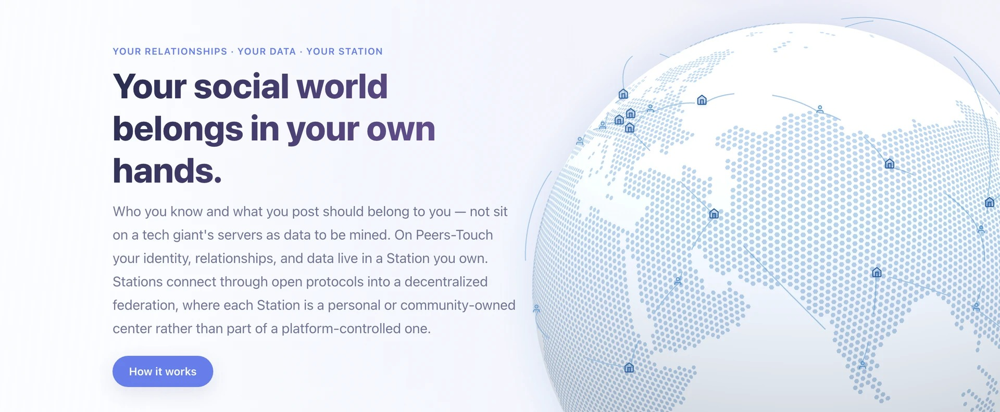
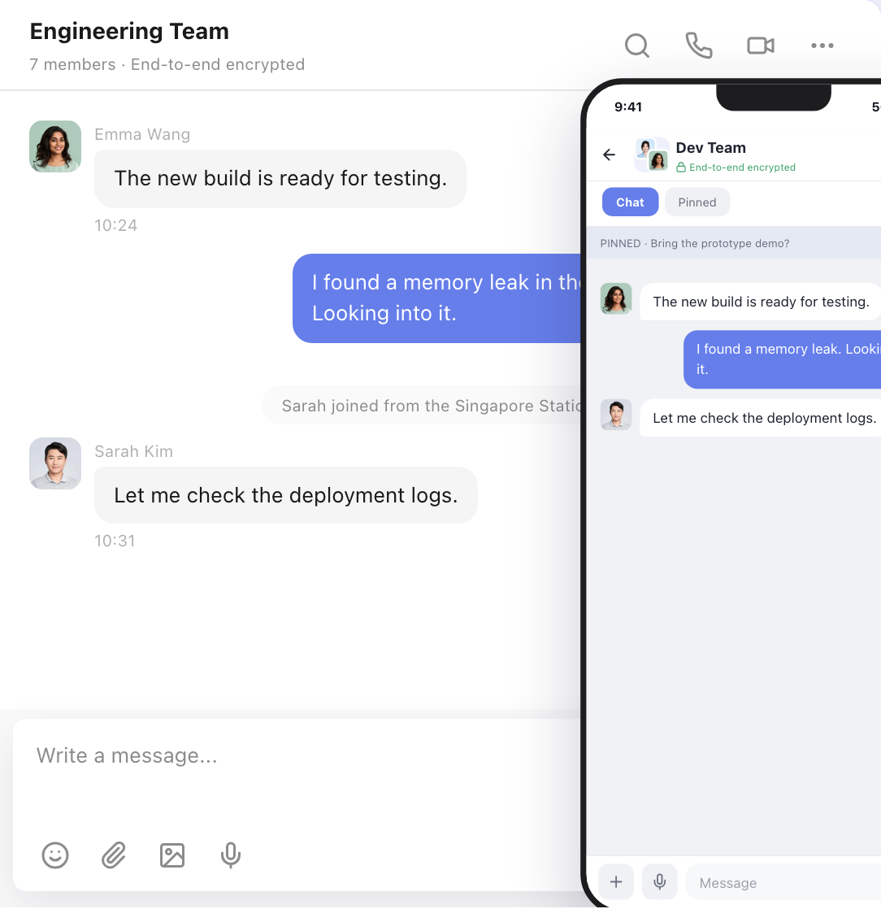
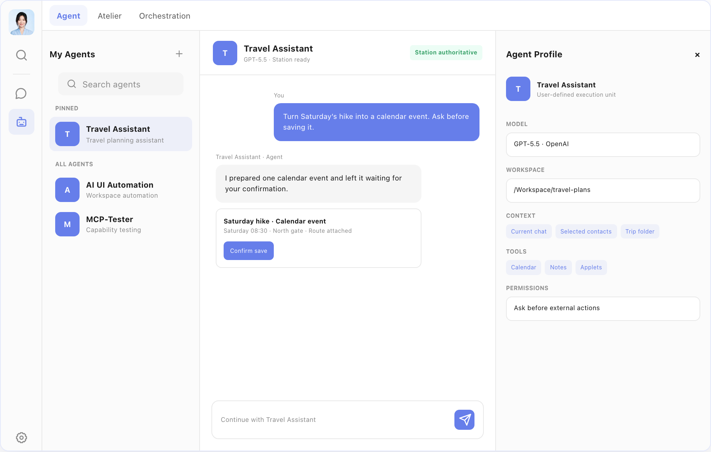
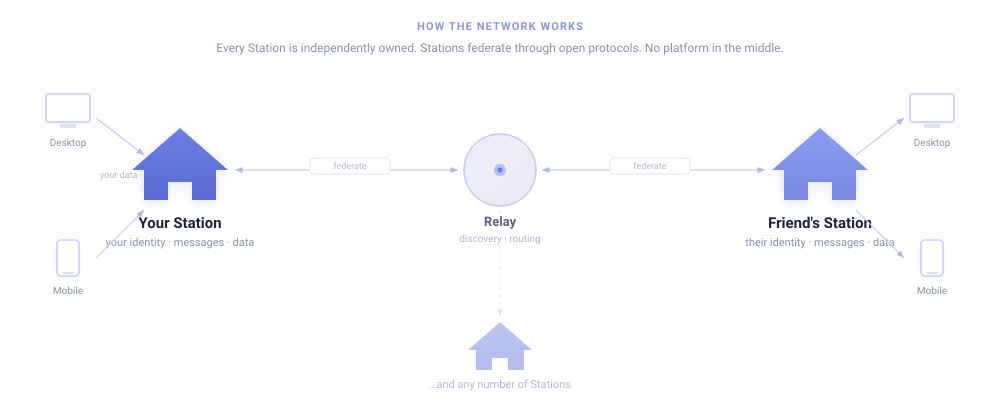

<div align="center">

# Peers-Touch

**Chat, share, and stay connected — on a social network nobody else controls.**

Your friends, messages, and memories live in a **Station** you own — not on a company's servers.<br>
Stations talk to each other like email. You reach anyone, anywhere, with no platform in the middle.

[Website](https://peers-touch.vercel.app/) · [How it works](https://peers-touch.vercel.app/en/product) · [Roadmap](https://peers-touch.vercel.app/en/roadmap)

</div>

---



<table>
<tr>
<td width="50%">

<p align="center"><sub>Desktop + Mobile Chat</sub></p>
</td>
<td width="50%">

<p align="center"><sub>Agent — your personal AI on your Station</sub></p>
</td>
</tr>
</table>

## What you can do

- **Chat** — direct messages and group conversations, with reactions, photos, and rich media.
- **Share** — post to a private feed (Moments) visible only to friends you choose.
- **Connect** — add friends across independently run Stations.
- **Ask your AI** — an assistant on your devices and your data. Pick your model, set the rules.
- **Extend** — install applets on your Station.
- **Use it daily** — native macOS, Android, and iOS apps that work offline and sync in the background.

## How it works

Every user runs (or joins) a **Station** — a personal server on a NAS, Raspberry Pi, or cloud VM. Your Station holds your identity, contacts, messages, and content. Stations connect through open protocols, forming a federated network. Think of it like email: you pick your provider (or run your own), and you can still talk to everyone.

## Architecture



## Can I use it today?

**As a regular user: not yet.** Peers-Touch does not currently have a verified
public Release, downloadable Desktop installer, or hosted Station. The product
features exist in source, but the distribution and native-update checks are
still being completed.

**You will not need an AI agent or a development environment to install
Peers-Touch.** Agent instructions under `AGENTS.md` and `tooling/skills/` are
only for contributors working on this repository.

## Install

The following user flow becomes available after the first verified stable
Release is published:

1. **Install your Station** on a Linux machine with Docker and Docker Compose
   v2:

   ```bash
   curl -fL https://github.com/peers-labs/peers-touch/releases/latest/download/install.sh \
     -o peers-install.sh
   sh peers-install.sh install
   ```

   The installer downloads an immutable Station image, verifies release
   checksums, generates private credentials locally, and stores the instance
   under `~/.peers-touch/station`. By default it is available only on the same
   machine at `http://127.0.0.1:18080`.

2. **Install the Desktop app** from the
   [latest GitHub Release](https://github.com/peers-labs/peers-touch/releases/latest):
   macOS uses `.dmg`, Windows uses `-setup.exe`, and Linux uses `.AppImage` or
   `.deb`.

3. Open Peers, enter your Station address, and create or sign in to your
   account.

Until a stable Release appears at that link, these installation commands are
expected to return 404 and there is no supported end-user installation path.
See the [Station installation and maintenance guide](tooling/distribution/README.md)
for backup, upgrade, rollback, remote access, and uninstall details.

## Develop from source

The supported local path runs a private Compose Station and the native Desktop
app:

```bash
corepack enable
corepack prepare pnpm@9.12.0 --activate
make profile-init local
make profile local
make doctor
make desktop
```

Requires Node.js 22, pnpm 9.12.0, Rust, `protoc`, Docker with Compose v2,
and the native Tauri prerequisites for your OS. Station source work also uses
Go 1.24.10. Windows uses the equivalent
[`tooling/dev.ps1`](tooling/dev.ps1) commands.

See [Develop Peers-Touch](docs/development/README.md) for setup, platform
guides, workflow, verification, and Agent collaboration.

---

## Acknowledgements

| Project | What it means for us |
|---------|---------------------|
| [Tauri](https://tauri.app) | Native desktop and mobile — not Electron |
| [Hertz](https://github.com/cloudwego/hertz) | Station's Go HTTP framework |
| [LobeHub / Lobe UI](https://github.com/lobehub/lobe-ui) | Desktop UI components |
| [SimpleX Chat](https://simplex.chat) | Privacy-first messaging inspiration |
| [Protocol Buffers](https://protobuf.dev) + [prost](https://github.com/tokio-rs/prost) | Cross-platform contracts |
| [libp2p](https://libp2p.io) | Peer identity for federation |
| [SQLCipher](https://www.zetetic.net/sqlcipher/) | Encrypted on-device storage |
| [React](https://react.dev) + [Ant Design](https://ant.design) | Frontend rendering and design |
