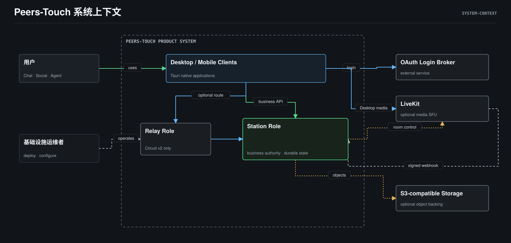
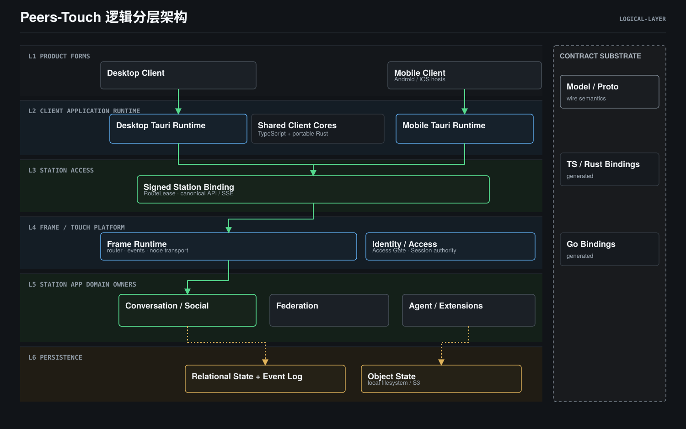
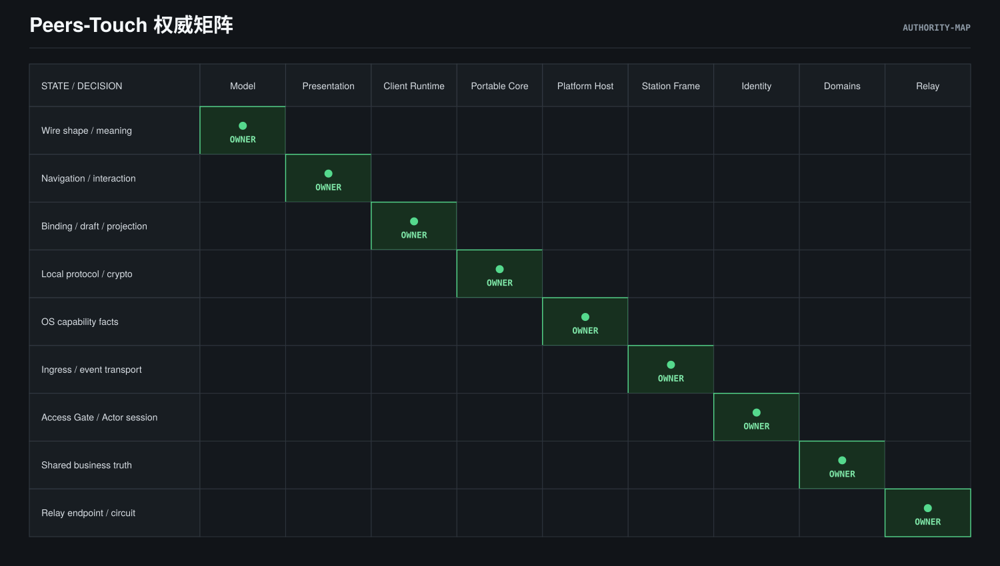
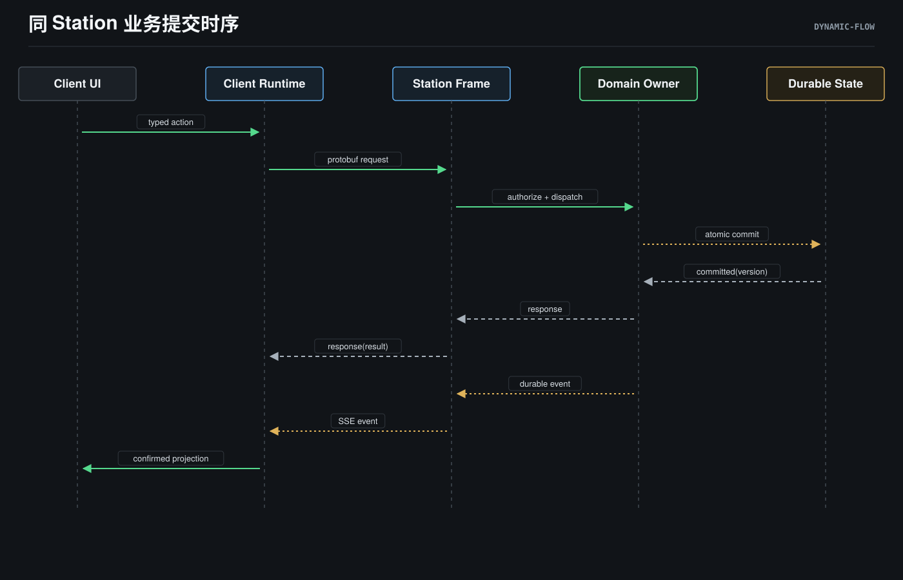
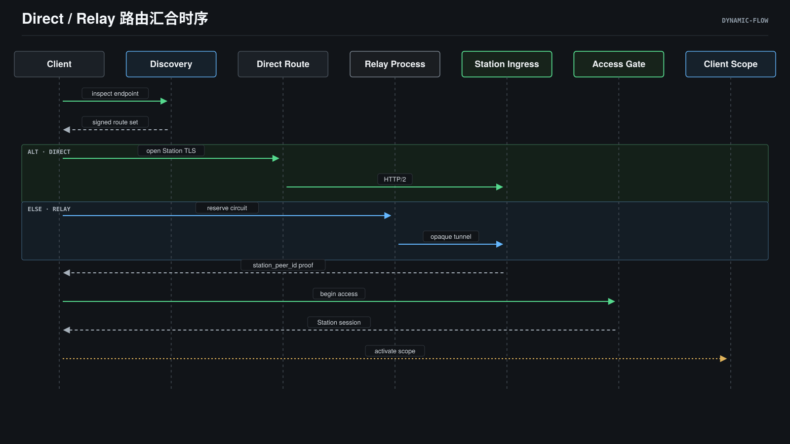
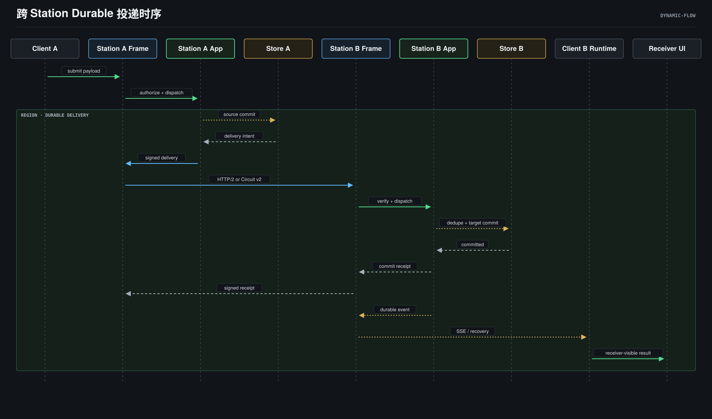
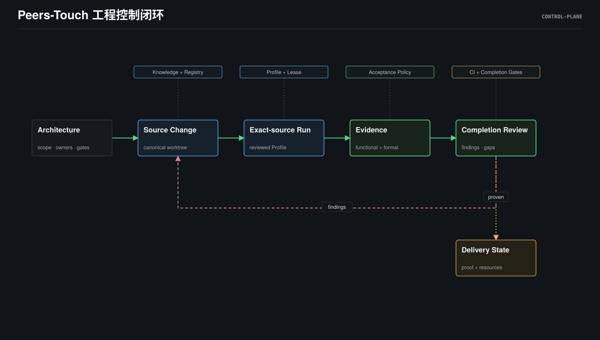

# Peers-Touch Project Architecture

> **Status**: active
> **Version**: v4.0
> **Created**: 2026-04-20 | **Updated**: 2026-10-20
> **Owner**: Architecture Team

---

## 1. Document Scope

本文档定义当前源码能够支持的项目级结构：

- 产品系统边界与外部系统；
- Client、Station App、Station Frame 和持久状态的逻辑分层；
- Desktop、Mobile、Station、Relay 的真实运行实例；
- 状态真源与 mutation authority；
- 同 Station、Direct / Relay 接入、跨 Station 投递三条关键链路；
- 与产品运行时分离的工程控制面。

本文档不把 `docs/architecture/{domains,platform,shared,engineering}` 的文档分类
画成产品架构，也不以目录数量推导运行时层级。

源码存在只证明实现入口存在，不自动证明某个部署形态、平台或 Journey 已通过
当前源码绑定的 Acceptance。证据状态由对应模块和 Gate 单独负责。

## 2. Source Basis

本轮项目视图以以下当前源码为主要事实基准：

- Desktop composition：
  `apps/desktop/src/`、`apps/desktop/src-tauri/src/main.rs`、
  `apps/desktop/src-tauri/src/state/mod.rs`；
- Mobile composition：
  `apps/mobile/src/`、`apps/mobile/src-tauri/src/lib.rs`；
- shared client assets：
  `packages/client-*`、`packages/messaging-core/`、
  `packages/secure-content-core/`、`packages/station-trust/`、
  `packages/station-libp2p-http/`；
- Station composition：
  `apps/station/app/main.go`、`apps/station/app/subserver/`、
  `apps/station/frame/`；
- Station / Relay role boundary：
  `apps/station/frame/core/runtime/role/role.go`；
- Station durable state and events：
  `apps/station/frame/core/store/`、
  `apps/station/frame/core/facility/storage/`、
  `apps/station/app/subserver/events/`；
- shared contract source：
  `model/domain/**/*.proto`；
- OAuth broker：
  `apps/oauth2-client/`。

## 3. System Context

**Viewpoint: System Context.** 箭头只表示源角色或系统发起的在线交互。

Peers-Touch 的核心产品系统由两个 Client Form、Station role 和可选 Relay role
组成。OAuth Login Broker、S3-compatible object storage 和 LiveKit 是独立部署的
外部服务，不取得 Station 业务 authority。Client 直接完成 OAuth browser handoff
；Desktop Client 可直接连接 LiveKit media，Mobile 当前没有 Group Call runtime
或产品面。Station 使用外部 S3 backing，local filesystem 则仍位于 Station
deployment 内。Station 还通过 LiveKit control API 管理 room/participant，并接收
LiveKit 签名 webhook。

## 4. Logical Layered Architecture

**Viewpoint: Logical Layer.** 箭头只表示业务请求进入方向；响应和事件沿相同边界
返回。

### 4.1 Product forms

- Desktop 是一个 Tauri native application，React/TypeScript 运行在 embedded
  WebView 中。
- Mobile 是一个产品形态，Android 与 iOS 是两个 Host，不是两套业务模型。

### 4.2 Client runtime

- Desktop Tauri Rust 通过 `AppState` 持有 `StationRuntime`、本地能力和 scope-bound
  runtime。
- Mobile Tauri Rust 组合 `StationTransportRuntime`、Messaging、Social、
  Reliability、OAuth 和 platform plugins。
- portable Rust cores 与 shared TypeScript packages 是进程内库；每个安装拥有独立
  实例和本地状态。

### 4.3 Station access boundary

Client 最终绑定签名 `station_peer_id`，而不是某个 URL。Direct 和 Relay 是可替换
route candidate；它们在 `RouteLease`、Access Gate、Session 和 canonical Station
API 处汇合。

### 4.4 Station runtime

Station 使用一个 binary 的互斥进程角色：

- `PEERS_NODE_ROLE=station`：加载 Frame、Touch 和 App subservers；
- `PEERS_NODE_ROLE=relay`：只加载 Relay plugin subserver，不加载 Touch 或 App
  business subservers。

Station Frame / Touch platform 拥有 router、Access Gate、Actor / Device Session
签发与撤销、event stream、node transport、runtime lifecycle 和基础设施。
Station App 拥有业务 domain state machine、业务授权和业务策略。

### 4.5 Contract substrate

`model/domain/**/*.proto` 是 Client 与 Station 共同消费的契约源码真源。生成的
TypeScript、Rust 和 Go bindings 是派生物。

Model 没有进程、路由、生命周期或业务状态，因此不位于 Client → Station 的 live
runtime path 中。

## 5. Runtime And Deployment Topology

**Viewpoint: Runtime Topology.** 箭头只表示真实网络请求或事件流。

### 5.1 Client instances

每个 Desktop 或 Mobile 安装独立持有：

- UI renderer 和 native runtime；
- Station binding / route state；
- Messaging / Secure Content 等 portable-core instance；
- SQLCipher/local files/cache；
- OS keyring 或 secure storage；
- 本地 draft、command、projection 和 recovery state。

客户端之间不直接共享本地数据库。跨设备收敛通过 Station-owned contracts 完成。

### 5.2 Station and Relay instances

- Station process 组合 Frame ingress、App domain owners、durable relational state、
  event stream 和 object storage。
- Relay process 拥有 enrollment、signed route、Circuit reservation 和 admission；
  它看不见也不解释业务 payload。
- Home Station 与 Remote Station 各自拥有独立逻辑 identity 和 durable business
  state。

### 5.3 State providers

当前源码支持：

- PostgreSQL：shared-node Station deployment 和 durable event wake-up；
- SQLite：single-node / local profile；
- local filesystem 或 S3-compatible object backing；
- optional LiveKit media runtime；
- independent OAuth Login Broker。

## 6. Authority Map

**Viewpoint: Authority Map.** 本图不使用箭头；各区域表示互斥的状态 owner。

核心规则：

1. 跨设备业务状态、业务授权和业务策略属于 Station App domain owner。
2. Station identity / route proof 由 Node Connectivity 与 Station root
   signature 约束；Access Gate 和 Actor / Device Session 由 Frame / Touch 内的
   Identity / Access owner 裁决。
3. device-local binding、draft、cache、command ledger 和 projection 属于对应
   Client Runtime。
4. portable core 只拥有自己的本地协议、安全和事务状态。
5. OS capability observation 属于 Platform Host。
6. navigation、layout 和 interaction 属于 Desktop 或 Mobile Presentation Policy。
7. shared wire shape 和 meaning 属于 Model。
8. Relay 只拥有自己的 endpoint、operator policy、reservation 和 Circuit admission。

## 7. Critical Dynamic Flows

### 7.1 Same-Station business mutation

**Viewpoint: Dynamic Flow.** 箭头只表示一次业务动作的时间顺序。

共享业务成功以 Station owner 的 durable commit 为边界。本地 optimistic state
可以改善交互，但不能替代确认结果。

### 7.2 Direct / Relay route convergence

**Viewpoint: Dynamic Flow.** 箭头只表示 Station Access 状态机的推进顺序。

两条 route 必须汇合到同一签名 Station identity、Access Gate、Session 和
scope-bound runtimes。Route failure 不得静默改写 Station identity。

### 7.3 Durable cross-Station delivery

**Viewpoint: Dynamic Flow.** 箭头只表示一份跨站业务 payload 的时间顺序。

对 durable Conversation / Social payload，跨站完成条件不是源站 `accepted`。
需要目标站验签、去重/排序、domain commit、target-device delivery，以及接收端
SSE 或 recovery 后的 receiver-visible 结果。Typing 等 ephemeral signal 使用
独立的 transient receiver 语义，不要求 durable commit。

## 8. Engineering Control Plane

**Viewpoint: Control Plane.** 箭头只表示工程产物与证据向交付结论推进。

工程控制面约束源码、运行环境和证据生命周期，但不进入产品业务请求路径。其主要
owner 是：

- `docs/architecture/` 与 module registry：架构与 capability ownership；
- `pt-dev-workflow`：研发闭环；
- `devctl` 与 `tooling/scripts/local-dev/`：Profile、slot、lease 和 runtime lifecycle；
- `tooling/acceptance/`：current-source formal proof；
- Review / Completion：findings、gap 和 readiness judgment。

## 9. Allowed Dependency And Call Rules

- Desktop / Mobile presentation 通过 typed runtime actions 进入 native runtime。
- Client runtime 通过签名 Station binding 和 canonical API 访问 Station。
- Station App 可以依赖 Station Frame；Station Frame 不得依赖 App business
  semantics。
- Station domain owner 通过 repository、event 和 object-storage ports 持久化。
- Federation domain 依赖 authenticated Station-to-Station transport，但不拥有
  Relay / Circuit implementation。
- generated bindings 可以被消费，不能成为手工维护的第二份 shared contract。

## 10. Forbidden Relationships

- Client cache、projection 或 portable core 成为跨设备业务真源。
- Android 与 iOS 分叉出两套 Mobile 产品状态机。
- Presentation 直接调用 OS SDK 或绕过 typed native boundary。
- Relay 签发 Station Session、替代 `station_peer_id`、解释业务 payload 或取得
  Federation membership。
- Station Frame import App business semantics。
- Model 被画成 live service、request broker 或 runtime tier。
- 工程 Workflow、Acceptance 或 CI 被画进产品 data plane。

## 11. Related Sources

- [Cross-Client Runtime](./platform/client/cross-client-runtime/README.md)
- [Desktop Runtime](./platform/client/desktop/runtime.md)
- [Mobile Shell](./platform/client/mobile/README.md)
- [Station Access](./platform/station/access/README.md)
- [Node Connectivity](./platform/runtime/node-connectivity/README.md)
- [Federation](./domains/federation/README.md)
- [Station Platform](../station/base.md)
- [Domain Model](../global/domain-model.md)
- [Architecture Diagram References](./references.md)
