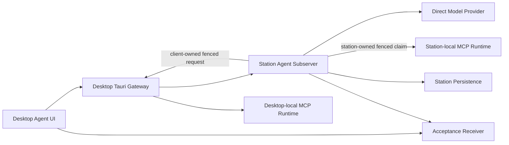

# Agent 架构设计

> **Status**: active
> **Version**: v1.1
> **Created**: 2026-10-02 | **Updated**: 2026-10-03
> **Owner**: Peers-Touch Agent Team
> **Module**: `model/domain/agent/`, `apps/station/app/subserver/agent/`, `apps/desktop/`

---

## 1. 核心原则

1. **Station 单一真源**：Agent、Conversation、Turn、Message、ToolCall 和能力绑定的业务状态由 Station 持有。
2. **执行位置显式化**：MCP transport 与 execution owner 正交；Desktop
   Rust 执行设备本地 MCP，Station 执行 Station 运行时本地 MCP。
3. **显式能力绑定**：Agent 只能使用已声明、已绑定且当前 ready 的能力。
4. **可恢复执行**：Turn、ToolCall 和最终回复必须具备稳定身份，可在进程重启后读回。
5. **证据不越权**：Acceptance Harness 只驱动生产路径并读取结果，不创建替代业务路径。

普通 Agent Chat 的模型所有权由 Settings 与 Topic 持有。Settings 提供全局
默认，Topic 可保存完整 `(provider_id, model_name)` 覆盖；更新和清空必须
同时提交两个字段并受 Conversation version 约束。Agent Profile 只持有身份、
SOUL.md、AGENTS.md 与能力扩展，不再作为普通 Chat 模型选择的回退来源。
SOUL/AGENTS 分别投影到 Station `AgentDefinition.identity_prompt` 与
`agent_config_prompt`；`config_json` aliases 和名称、描述、头像不能进入
Provider Prompt。
所有创建入口复用同一 mutation，创建 Local Agent 后立即进入 Profile。
Station 在真实 turn 中装配类型化文档，并只从版本化
`AgentCapabilityBinding` 构建 Skill index；`skill_view` 再按需加载同一固定
版本正文。客户端保存成功、文档回读、重启恢复、Provider prompt 消费和
ContextLedger 版本归因必须分别取得当前源码证据。

详细产品、失败语义和运行时合同由
[`modern-chat-agent/`](./modern-chat-agent/README.md) 定义。

## 2. 系统架构



Station 决定 MCP Server 目录、配置元数据、能力 manifest/binding/readiness、
Turn、ToolCall 与审计的权威状态。每个 MCP Server 声明
`STATION` 或 `CLIENT_CAPABILITY` execution owner：

- `CLIENT_CAPABILITY` 在 Desktop Rust 所在设备执行 stdio/http/sse，并通过
  capability session 回传 fenced receipt。
- `STATION` 在 Station 运行时执行 stdio/http/sse，直接复用 Station ToolCall
  claim/receipt/continuation；Desktop 离线不阻断执行。

secret material 与进程状态只保留在执行位置，Station 配置真源仅持有 secret
reference。Direct Model Provider 通过 Station 适配器调用，不向页面暴露凭证。

## 3. 核心合同

```text
AgentCapabilityBinding
  -> CapabilityReadinessSnapshot
  -> Turn admission
  -> Station ToolCall
  -> execution-owner dispatch
       -> Station MCP executor
       -> fenced Desktop capability executor
  -> Station continuation
  -> final Assistant message
```

合同要求：

- Actor 与 device identity 在能力会话建立前完成验证。
- 一个 ToolCall 只产生一次受认可 side effect 和一个权威 result。
- MCP transport 不推导 execution owner；owner 只来自固定版本的 Server/Tool
  manifest。
- cancel、retry、reconnect 和 replay 由稳定 Turn/ToolCall identity 约束。
- 最终 Assistant message 的 ID 与内容可由 Station 和客户端独立读回。
- Native 重启不得创建新的 Agent、Conversation 或替代回复。

普通 Chat 澄清使用注册的 Station-owned `ask_user` 工具。问题与可选答案
固定在授权 ToolCall 参数中；无论普通工具采用何种自动策略，澄清都等待人工
提交。选项与 Other 仅修改 UI 草稿，Submit 通过现有工具决策命令提交答案。
Station 在同一决策事务保存答案与 revision，执行器将答案写入既有工具结果，
由 ToolBatch continuation 恢复原 Turn、attempt、模型与预算。Renderer 不将答案
作为新用户消息发送，也不维护独立 intervention 执行状态。工具能力仍需通过
现有 manifest、binding 与 readiness 授权，不能绕过授权集合。

## 4. 组件关系

| 组件 | 责任 | 禁止承担 |
|---|---|---|
| `model/domain/agent` | 跨层 Agent 协议与稳定类型 | 页面状态 |
| Station Agent subserver | 业务权威、MCP 配置目录、Station-local MCP 生命周期与执行、Turn 与 ToolCall 编排 | 控制 Desktop 本地进程 |
| Desktop Tauri Agent/MCP application | 网关、Desktop-local MCP secret/进程与设备能力回执 | 持有 MCP 目录或绑定真源 |
| Desktop Agent UI/runtime | 用户操作、事件消费、可见状态 | 持久化业务真源 |
| `packages/agent-catalog` | 受信 Agent/Skill/MCP catalog 合同 | 用户凭证 |
| Agent Acceptance Gate | 真实 Journey 驱动与接收方证据 | mock/fallback 业务路径 |

## 5. 运行时与接口

共享接口以 `model/domain/agent/` 为 proto 真源。Station Agent handler 暴露
Agent、Conversation、Turn、Provider、Capability Binding 和 ToolCall 操作；
Desktop 通过既有 Tauri gateway 访问这些接口，并通过 Agent runtime 投影事件。
MCP 配置接口返回已脱敏的 Station 权威投影；Desktop 只为
`CLIENT_CAPABILITY` Server 保存本机 secret material。每个已发现 MCP tool
发布独立 manifest，使 `execution_owner` 在 admission 前固定，禁止由模型参数
或客户端临时选择。

最小可用 Native Journey 的正式证明入口为
`agent-minimum-usable-chat-native-e2e`。MCP 双运行时追加证明必须分别覆盖
Desktop-local 与 Station-local stdio，并证明 Station-local 调用在 Desktop
executor 离线时仍成功。Browser、Mobile 与更广能力矩阵保持显式
`UNPROVEN`，不能由相邻 Gate 推断。
