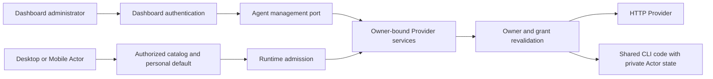

# Provider Station Ownership — Design

Status: accepted. Owner: Agent domain. Updated: 2026-10-30.

## Authority and boundaries

[Provider Control Plane](../provider-control-plane.md) owns shared-management
semantics. Agent owns all Provider, model, credential, grant and runtime policy
services. Dashboard contributes administrator authentication and management
views through `ProviderManagementPort`; it creates no second Provider database
or execution service.

Actor JWTs authorize consumer reads, personal defaults and policy-enabled
personal configuration. They cannot manage shared records, grants, installation
or Federation lifecycle. Dashboard sessions must pass live session validation
and an administrator role check on each management request.

## Effective owner

Providers carry explicit `actor` or `station` ownership. Station resources have
an empty Actor owner; Actor resources require a non-empty canonical PTID.
Consumer resolution checks shared identity first. If shared identity exists,
enablement, model enablement and grants determine availability. Denied shared
identity never exposes a personal resource of the same name.

Only when no shared identity exists and the personal policy is enabled may the
Actor's own Provider be selected. Queries by storage UUID additionally verify
the logical Provider ID and owner. Model catalogs, encrypted credentials and
discovery revisions follow that effective owner. Session, conversation and
workspace identity always remain the requesting Actor.

## Mutation and revocation

Configuration and model writes use optimistic versions. Credential set is a
full-key replacement; credential deletion uses the observed credential version.
Policy and access writes have separate revisions. Access replacement commits atomically
under the observed access revision. A stale write returns conflict and requires
authoritative refresh before a new user action.

Credential replacement or deletion bumps the Provider configuration revision
so old runtime snapshots cannot continue using retired credentials.
Admission snapshots bind Provider and capability source revisions.

The execution boundary checks owner, model and grant immediately before every
dispatch, including resumed tool continuations. A request already sent upstream
may complete; later requests must pass current authority again.

## CLI lifecycle

The Station installer owns shared Node, tool versions, wrappers and atomic
activation. Jobs deduplicate per registered adapter. Failed upgrades preserve
the active version. Registered argv is structured; user-supplied executable
paths and arbitrary shell templates are forbidden.

Each invocation and discovery operation receives an explicit environment.
Private HOME, XDG, tool configuration, cache and temporary state cannot be
overridden. Credentials come only from the selected encrypted envelope.
Machine PATH executables follow the same isolation. These directories isolate
application state and are not an OS sandbox.

The detailed lifecycle and official installation sources are defined in
[Managed CLI Installation](../provider-managed-cli-install.md).

## Client behavior

Desktop Rust is an authenticated Station transport. It has no Provider executor,
credential resolver for inference, local catalog or app-global default registry.
Applet `ai.chat` calls Station QuickCompletion with an explicit Provider/model
pair or the Actor's Station default.

Desktop Web owns only projections, selection and form drafts. Account or Station
changes clear projections and fence all pending reads, writes and rollback
effects by Session epoch. Dashboard applies equivalent authentication fencing.

Ordinary Provider Settings is read only for shared resources. Personal editing
exists only under the Station policy. AI / Models changes the account-scoped
composite default. Streaming turns use Station SSE; QuickCompletion returns a
typed one-shot response with the actual Provider/model identity.

## Contracts

- `model/domain/agent/provider.proto`: consumer Provider, model, check,
  discovery, policy and default contracts.
- `model/domain/agent/agent.proto`: turn and one-shot completion contracts.
- `provider_management_port.go`: Dashboard-to-Agent management boundary.
- `provider_authority.go` and `runtime_admission_service.go`: effective owner
  and current runtime authority.

Source checks, structural reviews and native product observations are separate
evidence classes. Passing source checks alone does not prove these journeys.
