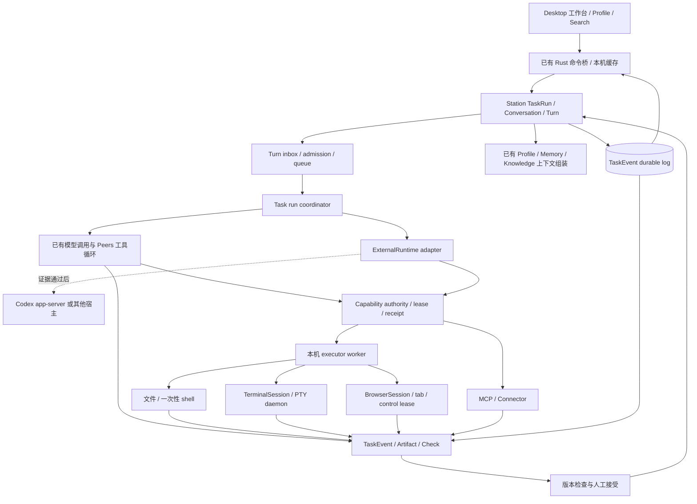

# 工作台架构

> **Status**: accepted（Owner 2026-11-02 确认；实施承接：TW-20261102）
> **Version**: v2.0
> **Created / Updated**: 2026-11-01
> **Owner**: Peers-Touch Agent Team

## 目标与原则

一个任务从目标、资料、实际执行、介入到成果、反馈、验证和重开，始终引用同一组身份与版本。Agent 是复用角色，执行器提供实际工作能力，工作台呈现和控制这一条链。

Station 保持跨端业务真源；Model 定义协议；Rust 管本机资源、进程、桥接和设备缓存；React 只管视图及本机未发送输入。复用责任和可证明的实现，不以旧名称、文件数量或已经投入的工时决定保留。

原型作为交互合同：连续栏、自定义标签、原位搜索、紧凑标题/工具栏、Profile内部管理、反馈回原草稿、版本选择与宽窄返回。业务规则由对应Owner实现，不复制 `agentTaskSimulation`、fixture、计时器或原型localStorage。

## 系统关系

本图中的名称是责任概括，不要求为每个框创建一个新服务。TaskRun、Conversation、Turn、ToolDispatch、TaskEventWriter、MemoryService与本机worker均已有实现。

## 责任

- **TaskRun / ChatTaskService**：任务目标、接收条件、当前资料集合、连续对话归属、运行准入和完成判定。当前一会话一TaskRun关系收口为一任务一用户可见Conversation；宿主thread映射是内部恢复细节，不暴露成可切换会话。
- **ConversationService / TurnService**：连续对话、消息、每轮冻结上下文、审批、澄清、顺序、取消与恢复。草稿和输入按任务保存；同一任务同一时刻只有一个活动执行轮。
- **TaskInbox / RunCoordinator**：记录已接收但未完成的输入，在不可逆 provider 请求前合并当前轮 amendment，终态后串行 drain 队列；不同任务可有限并行。
- **TaskEventWriter及产物持久化**：durable event 游标、成果元数据、正文与校验摘要。流式 delta/progress 是 ephemeral projection；text/tool/execution 终态必须可重放。共享身份语义，不让消息文本提取成为第二成果真源。
- **Dashboard / Station Provider Owner**：承担复杂 Provider/运行环境配置，包括 Provider 注册、CLI 安装与连接、凭证、模型目录、运行时参数、账号授权、readiness 与分配；沿用 ACCEPTED `provider-runtime-strategy.md`。Desktop Rust 只是类型化传输适配，不执行 Provider CLI、不解析 CLI 输出、不维护第二套 Provider registry，也不从裸 model ID 推断 Provider。
- **Desktop Profile / Composer Owner**：只做当前用户的轻量直接使用设定：全局默认模型、当前 Agent/任务选择、必要的会话覆盖、连接状态/失败恢复入口，以及“前往 Dashboard 管理复杂配置”的明确跳转；Desktop 保存选择时必须引用完整 `(provider_id, model_id)` 和当前授权快照。
- **Profile / Memory / Knowledge / Capability Owner**：角色规则、已确认记忆、资料检索、绑定及授权。能力安装、复杂配置和账号管理沿Dashboard/Station；Desktop引用授权结果并在当前任务中消费。
- **Rust本机worker**：能力租约、资源引用、实际执行、设备浏览器/PTY生命周期、结果回执和清理。工作台不能自行执行系统命令或绕过授权；Provider CLI 不放入本机 worker。
- **Desktop Runtime / Store / Page**：订阅、游标恢复、缓存及页面投影；工作面标签、打开对象、跟随和布局是本机视图状态。切任务不重新初始化全局消息，身份切换清除无权投影；草稿按任务和成果版本定位。

## UI/UX与能力消费

保留已认可紧凑布局；已完成历史与活动尾部分开投影，实际Item分组按轮与邻接关系，分页保持详情展开和阅读锚点。流式回执只更新活动对象，不重建全局消息/列表；手动阅读时不被新输出拉回底部。后台批准/回答通过任务提示定位对应request，不抢当前task/draft焦点。搜索原位展开，保留查询/命中/手动展开，历史读取失败不是无结果。

工作面/消息/Search/通知共享resource/version/anchor opener，reader返回保留选区、版本和原触发点；宽窄只变布局，不变对象身份。Profile入口仍在Agent更多菜单，Settings保持全局，必要能力配置完成后返回原task/draft，不增加第二任务或插件一级入口。

插件是Skills/MCP/Apps/hooks等交付组件的包，Provisioning与Profile binding沿既有Owner扩展。发现/安装/配置或登录/角色绑定/有效目录/实际调用/结果/停用卸载分别回读；installed、enabled和readiness不能互代。Codex `disabledPluginIds`尚未过滤能力，须核对实际授权组件和宿主隔离；不同角色授权集不能共用扩大权限的host配置。

真实Browser按设备 attachment 建模：Desktop browser host 连接到任务后，Agent 才具备 browser 能力；每次操作绑定 task/turn、device、browser session 和显式 tab，snapshot ref 短期有效，command/result 有请求关联，页面内容始终按 untrusted data 处理。人工接管取得控制租约并暂停Agent点击/输入，归还后必须重新 snapshot/observe，不能沿用旧 element ref。成熟Playwright/MCP可作为host实现候选，但必须通过现有worker/CapabilityOperation验证session/page/account/task/控制租约，不直接把MCP配置当作就绪。网页预览归成果reader，Computer Use归独立设备能力，两者不当真实浏览器执行证明。运行记录、下载资源、选区反馈和发布回读均回当前任务。

## 执行模型

执行内核分两层建设，但对Task/Turn暴露同一合同：

1. **Peers runner（默认首条链）**：Station 侧按 durable inbox + per-task run coordinator 串行 drain 一个任务；现有模型接口、文件/shell capability、MCP/Connector 共用 TaskEvent、TurnAttempt、CapabilityOperation 和 receipt。CLI Provider如保留一次性模型调用，其临时目录仅属于该调用，不能作为任务工作环境。
2. **ExternalRuntime adapter（证据门后接入）**：适配 Codex app-server 或其他具有会话恢复能力的宿主。实际设备Rust worker持有双向连接和宿主进程，Station负责绑定、路由、准入及事件归并。适配器必须实现相同Peers能力合同，不能靠解析一段stdout冒称双向控制，也不能在证据门通过前把任何CLI设为唯一内核。

对外只展示当前适配器已经证明的能力。协议必须保留命令结果/退出码、文件版本/Diff、计划、审批请求、错误和中断；敏感内容在授权与展示边界转换为安全引用，不能因隐私要求把所有事实压成“completed”标签。

一次性命令和持久Terminal是两类资源：`shell.execute` 返回有界输出与退出码；TerminalSession由设备worker持有进程、output cursor、resize/stdin/kill和exit状态，UI WebSocket/Tauri channel只是subscriber。viewer关闭取消订阅但不杀进程；worker重启后不推断旧进程仍活，必须回读为unknown/dead或通过持久daemon证明保活。

Station是Peers决定与执行准入的Owner，也独占任务目标、预算、用户队列和持续推进。Codex持久queue与active goal均能触发执行，因此Peers不使用宿主queue写接口，关闭宿主自主Goals；恢复前核对既有队列/目标，不允许它们绕过Station发轮。一个用户可见Conversation只允许一个活动Turn；内部subagent或宿主thread不获得任务导航入口，也不能与主Turn并发写同一工作根。

外部宿主的批准请求映射到同一有效Station request。宿主原生命令/文件工具由宿主执行，Peers处理准入、批准与结果；Peers Memory/知识/连接器等工具经动态调用回既有ToolDispatch。禁止通知到达后再让Native shell执行一次。实际沙箱/网络权限不得超过当前设备授权，没有可核对的权限边界时拒绝配置；prompt不是权限机制。

按actor、设备与授权配置隔离host home，不继承本机其他用户目录账号、Memory或隐含工具。Dashboard/Station仍持 Provider 与外部 runtime 的安装、复杂配置、登录、凭证、模型目录和分配 Owner；Desktop 只呈现并选择已授权配置、报告本机设备连接状态和提供恢复入口，worker报告本机实际就绪；服务器CLI安装不等于用户设备安装。

连接归Rust supervisor，与Page生命周期分开。绑定包含host instance、thread、connection epoch及配置/schema版本；普通页面切换可保留宿主，worker/app-server退出不能承诺进程存活。恢复先read/resume及分页核对实际轮/Item和文件状态；旧epoch的process不能标成新连接活跃。未知副作用禁止盲重放。

Codex binary、schema、adapter版本固定一起验证；握手只声明实际能力，不保证实验项可用。复用二进制和协议schema，不把一次性TS exec SDK作为持续控制适配，也不默认引入依赖整个core/app-server的Rust facade。

Browser通过成熟MCP/浏览器控制组件接入现有能力worker，引用任务资源、会话与授权；人工接管时暂停Agent操作，归还后重新观察账号与页面。持续进程按需打开Terminal，命令、输出、退出码与检查结果保留在任务执行记录，关闭查看不终止进程。按连接范围验证stdin、resize、终止和清理；服务资源可打开Browser，失败可返回对应进程。Diff引用真实版本，再把反馈送回任务。查看集合、当前标签、布局和跟随属于本机视图，执行生命周期沿原Owner。

## 上下文与Memory

沿现有PromptAssembly冻结目标/资料/Profile/Memory/能力manifest，记录版本、来源和摘要；宿主接收到的实际instructions和工具目录另核对。不同执行方式消费同一授权上下文，不重复拼装两份长期规则。运行中补充以明确amendment追加到指定活动Turn，初始快照不覆盖；角色/Memory修改默认影响下一轮。

MemoryService是唯一跨端记忆生成、纠错和消费Owner。Codex自有Memory feature、generate/use及专用工具关闭；仅传Station已确认快照，详情经受控Peers工具读取。仅关闭写入不能防止宿主读取旧记忆。借鉴Codex有界提取、来源修订、空输出、ownership-token提交和串行增量整理；沿现有job/lease/persistence扩展，不复制一套用户目录Memory数据库。

## 操作与失败合同

- 首次发送以命令ID及输入摘要去重；相同ID不同输入拒绝。任务和首会话的创建不得因重复点击产生两份工作。
- 队列只在Station按任务准入，项绑定目标会话、输入版本及资料引用；同任务不同会话不能并发写同一工作根。每次dispatch重新核对权限、租约及宿主活动轮。不同任务通过现有配额及租约有限并行。
- 开始、活动轮补充和排队是不同命令。Codex `turn/start`可能steer已有轮，适配器必须核对返回Turn；补充显式用`turn/steer(expectedTurnId)`，身份冲突先暂停核对。
- Stop仅作用于指定任务活动轮，并暂停后续队列；客户端显示停止请求和实际停止回执。未知外部副作用先核对，不能重放。
- 断连通过现有TaskEvent游标恢复已入库事件；事件去重且只归并匹配的task/turn/attempt/host epoch。宿主未入库通知不由该游标覆盖，须分页回读终态Item/文件补充核对；无法恢复的输出缺口显式记录。恢复持久宿主会话不等于重跑非幂等操作。
- supervisor复用回执账本先记录命令意图，再发送及保存响应；跨库发送不宣称exactly-once。stdout持续消费，控制请求独立排程，大输出沿有界磁盘chunk/Blob传输，缓存或落库异常停止新准入并核对当前执行，不无界累积或伪造成功。
- 资料撤权、角色停用和能力撤权立即阻断新准入，活动请求按Owner停止和回读；不暗中换角色，也不宣称已发出的数据被追回。
- 大正文沿现有正文存储/对象引用传输，事件仅含必要元数据；既有10MB附件限制按输入能力扩展，客户端不得把正文重复注入每轮或打印凭据。
- 并发更新使用当前版本前置条件；失败返回冲突和可回读当前版本，不覆盖另端修改。
- 删除先停止并核对活动/独占资源；清理失败保留可重试状态。分享、提交与发布分别授权。

## 禁止关系

禁止React决定任务完成或将消息、Turn completed、command exit 0、插件成果操作标记当作成果检查；禁止新Task store复制Station业务状态；禁止临时CLI目录冒充持久任务资源；禁止多个能力注册表各自决定授权；禁止检索失败注入任意历史记忆；禁止借fork继承活动请求、写权限或完成证明。Codex附件只表达当前关联，不能作为成果版本字节真源。

不恢复Project CRUD、Atelier或第二个Agent/Task一级入口。现有协作、调度或连接器有真实消费者的部分继续沿原Owner工作，其结果进入统一任务/成果链；无消费者部分在对应切换中删除。

源码机制与实际接入命令见 [Codex 分析](./codex-source-review/source-analysis.md) 和 [接入合同](./codex-source-review/integration-contract.md)；这些均为设计依据，外部 runtime 适配尚无运行证明。
