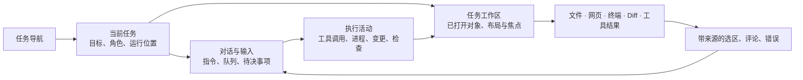

# 任务工作区交互提案

状态：accepted 交互合同（Owner 2026-11-02 确认；原型点击不构成生产证据）。2026-11-02。本文定义工作区关系；原型的已实现及未证明范围见 prototype/README.md。

## 产品判断

用户委托一件工作后，应能看到 Agent 正在操作什么，直接打开同一个文件、网页或进程，介入后让任务继续，并在离开再回来时保留工作现场。任务列表、对话、执行活动与工作面共同实现这件事。

工作区同时容纳多个正在处理的对象。不能把它缩成一个成果阅读器，也不能用能力分类页代替实际对象。文档处理、网页研究和代码制作都必须有完整路径；当前原型的人工网页正文表单、任务笔记及文档行差异不足以承担 Browser、Side Chat 和代码 Diff 的目标合同。

## 空间关系

Shell 仍持全局导航、Settings、Search；不增加第二任务产品或 Project CRUD。已有 Agent roster 的角色选择、Profile 管理和任务标签保留，但不是所有列都必须常驻。可按用户操作收起角色/任务列表，给当前工作让出空间。

任务头部只解释当前任务、执行位置和状态。位置显示用户能辨认的本机、设备或授权工作目录；权限改变操作可能性时显示范围。详细配置不挤进日常输入路径。

中间对话承担沟通、进展和决定，右侧工作区承担阅读、制作、浏览和调试。默认并排，可拖动分隔、放大工作区、恢复并排或收起。窄屏以“对话 / 工作区”切换，同一任务身份、草稿与对象状态保持不变。

## 已打开对象与入口

工作区顶行显示**已经打开的实例**，例如“方案.md”“文档站”“预览 :3201”“bash”“修改 3 个文件”。不预置一排永远存在的功能标签，也不把全部实例藏进单一分类下拉。标签溢出时提供已打开对象列表；文件名称与网页标题截断时可查看全名。

“+”表达打开工作面：找文件、打开浏览器、打开终端、任务摘要、旁聊。文件树、浏览器页面和终端会话有各自的实例与状态。一个已有对象从消息、文件树、Search 再次打开时定位同一对象；明确“另开查看”才建立另一阅读视图。

插件有三处不同用途的入口：

- Settings：安装、连接账号、全局可用性。
- Agent Profile：角色可使用哪些已就绪能力。
- 输入与执行活动：本次任务选择/使用能力，打开该次调用及结果。

工作区“+”不承担插件安装；输入旁的能力菜单也不代替浏览器本身。具有界面的工具结果从具体调用打开，绑定该次调用的状态与结果；普通工具仍可以只有活动明细，不要求每种工具都有标签。

## 返回、关闭、折叠和停止

**收起工作区**只隐藏整个右侧空间，保留标签、当前对象、阅读位置、编辑草稿和进程。恢复入口留在同一侧固定锚点，语义为“展开工作区”。

**关闭标签**关闭一个查看对象，不删除文件、不结束任务、不暗中杀掉进程。对仍运行的终端或浏览器保留任务摘要中的运行入口；“结束进程”“结束浏览”是明确的对象操作。未保存编辑要保留对象草稿，或明确询问放弃，不能用关闭标签静默丢弃。

**放大 / 恢复并排**只改变布局，不创建新的任务或阅读对象。

**返回**只出现在存在下钻关系的地方，例如检查详情返回该检查列表、工具详情返回调用结果。标签切换不生成通用后退历史。网页前进/后退在地址栏内，只操作该网页历史。Profile 返回恢复原任务、草稿与焦点。

**版本**属于文件或成果的操作行。编辑、下载、选区评论属于对象；核验与接受属于成果审阅。任务停止属于执行控制。不能为了减少按钮，把这些不同作用域合成一个无说明图标。

## 执行活动与阅读控制

活动行必须回答做了什么、操作哪个对象、现在怎样、下一步需要谁。展开后可读取本次命令输出、退出码、工具结果或错误；对象链接打开对应工作面。

已经结束的活动与当前活动分开更新。只合并同一轮中相邻且同类的操作，不吞掉失败、等待介入或版本边界。长输出可按需展开，文件全文不重复铺在对话中。

跟随仅作用于当前任务。用户选择标签、阅读旧内容或编辑时退出跟随；新结果以提示保留，不能覆盖当前阅读对象。用户明确恢复跟随后，才切到当前执行对象。后台任务只更新其状态与待处理提示。

切任务恢复各自的标签、当前对象、滚动、布局、输入草稿和未保存编辑。关闭页面后的运行是否持续，由真实执行环境决定；界面不能从缓存里的“运行中”推断进程仍活着。

## 浏览器与 Computer Use

浏览器的常态是 Agent 在获授权的浏览会话中导航、读取和操作，用户看到同一页面。界面包含地址、页面、前进/后退/刷新、当前控制者及必要连接状态。任务生成的页面预览可以使用同一浏览工作面，但必须保留其服务/成果来源。

当需要人登录或操作时，用户接管当前浏览会话，Agent 停止操作。归还后系统重新读取页面与账号状态，再决定继续还是报告失败。用户不需要把 Agent 本应读取的网页正文复制进表单。页面片段或元素反馈带来源进入当前任务草稿，由用户发送后形成修改要求。

同一浏览任务保留页面身份、历史、下载结果和对应活动；关闭查看不能伪造浏览结束。连接失败、账号改变、页面过期或任务绑定不符时，保留工作并给出具体恢复动作，不生成模拟成功结果。

Computer Use 沿同一任务的设备控制关系表达，但权限、目标应用、人工控制与恢复单独成立。它不能由浏览器页面或远程截图替代。本提案不声称已验证其生产能力。

## 文件、终端和 Diff

文件工作面读取任务授权目录和资料；输入附件只是来源之一。打开产物和打开实际文件要能回到同一来源关系，不能建立互不相通的“资料库”和“成果库”。

终端按实际进程提供输出、运行状态、输入和停止。短命令可留在活动展开项；持续服务、交互命令和长日志可在工作区查看。可用服务能进入浏览器的运行服务入口，浏览器失败能回到产生该服务的进程。终端是否常驻由工作决定，不能预先规定永久删除。

Diff 绑定实际文件前后版本，评论定位到文件与变更范围。修改、运行检查、失败输出、再次修订和复测在同一任务内连续完成。进程退出、检查通过、人工接受和任务完成仍是不同事实。

## 两条必须贯穿的原型旅程

**网页研究到文档。** 输入研究目标与来源 → Agent 打开网页并显示活动 → 用户查看同一页 → 需要时接管登录并归还 → Agent 继续读取 → 产出文档 → 用户选段反馈 → 生成新版 → 回读来源与验证 → 切任务再返回，网页、文档、草稿和待处理事项仍在。失败分支包含网络错误、登录未完成、旧页面失效和停止后恢复。

**制作页面到验证。** 选择任务工作目录 → Agent 修改文件 → 从活动打开文件与 Diff → 启动服务 → 从运行服务打开浏览器 → 发现问题并选区反馈 → 查看失败日志 → 修订 → 复测 → 回读变更与结果。收起面板、关闭查看和停止进程分别验证；后台其他任务不被误停。

这两条旅程应复用唯一 Desktop Shell 和既有原型组件。场景驱动、模拟回执与未接后端范围应在评审说明中标明；不得把“载入示例”、粘贴网页正文或关键词核验表变成用户正常工作的必经步骤。原型状态转换不能算真实 Browser/Terminal/模型执行证明。

## Peers 责任与复用

保持既有 TaskRun、Conversation、Turn、资源版本、Profile/Memory/Capability 和 Desktop Runtime 责任。布局只保存本机视图状态，不成为第二任务执行器。浏览器、进程和插件结果沿既有资源与执行 Owner 接入；复用成熟控制器、reader 和终端组件。

Codex 适配保留 thread/turn/item、命令、process、输出、退出码、文件变更、计划与审批，不能压缩成通用 completed 文本。独立 `command/exec` 的连接级进程不等同于持久任务资源。插件呈现信息可以被保存和回读，但声明界面、安装成功、角色绑定和执行授权不能互相替代。

## 评审与待定稿范围

当前原型不能作为本提案的完成证据。评审应由上述贯穿旅程驱动，检查每次打开是否是正确对象、后台更新是否抢焦点、接管是否停止 Agent 操作、关闭是否误终止资源，以及重开是否还原现场。不能用“头部恰好两个按钮”“没有任何 tab”这样的实现形状断言证明设计正确。

`experience-contract.md`、`benchmark-disposition.md`、`implementation/{design,decisions,integration,execution-outline,tasks}.md` 和原型说明共同采用多对象、按需终端与控制权合同。用户确认前不冻结 A02/A05/A06 的空间设计，也不声称整体原型已经获认可。

## 源码与现场依据

- TRAE：2026-11-02 操作本机 Agent 窗口；观察工作面标签、打开菜单、文件树、对话产物 reader、Browser 导航、Terminal、折叠/恢复和新任务入口。没有发起模型任务、编辑文件、执行终端命令或验证自动浏览/接管。证据包：`agent-workspace-review-20261102`。
- Codex `67f0994b532b8740f14b5b738af7b7b2a915b1d6`：[类型化 Item](https://github.com/openai/codex/blob/67f0994b532b8740f14b5b738af7b7b2a915b1d6/codex-rs/app-server-protocol/src/protocol/v2/item.rs#L299-L439)、[steer 前置条件](https://github.com/openai/codex/blob/67f0994b532b8740f14b5b738af7b7b2a915b1d6/codex-rs/app-server/src/request_processors/turn_processor.rs#L1077-L1190)、[中断回执](https://github.com/openai/codex/blob/67f0994b532b8740f14b5b738af7b7b2a915b1d6/codex-rs/app-server/src/request_processors/turn_processor.rs#L1470-L1537)、[恢复 pending request](https://github.com/openai/codex/blob/67f0994b532b8740f14b5b738af7b7b2a915b1d6/codex-rs/app-server/src/request_processors/thread_lifecycle.rs#L1230-L1265)。
- Codex：[活动分组](https://github.com/openai/codex/blob/67f0994b532b8740f14b5b738af7b7b2a915b1d6/codex-rs/tui/src/thread_transcript/computer_groups.rs#L16-L104)、[草稿恢复](https://github.com/openai/codex/blob/67f0994b532b8740f14b5b738af7b7b2a915b1d6/codex-rs/tui/src/chatwidget/input_restore.rs#L27-L104)、[后台请求](https://github.com/openai/codex/blob/67f0994b532b8740f14b5b738af7b7b2a915b1d6/codex-rs/tui/src/app/thread_routing.rs#L465-L510)、[连接关闭与进程](https://github.com/openai/codex/blob/67f0994b532b8740f14b5b738af7b7b2a915b1d6/codex-rs/app-server/src/command_exec.rs#L388-L414)。
- LobeHub `483c4a343e437bf6e812b5f71a9a47ce7b5c7be4`：[工具视图绑定](https://github.com/lobehub/lobehub/blob/483c4a343e437bf6e812b5f71a9a47ce7b5c7be4/src/store/chat/slices/portal/action.ts#L798-L872)、[结果 renderer](https://github.com/lobehub/lobehub/blob/483c4a343e437bf6e812b5f71a9a47ce7b5c7be4/src/features/Portal/Plugins/Body/ToolRender.tsx)、[导航与关闭](https://github.com/lobehub/lobehub/blob/483c4a343e437bf6e812b5f71a9a47ce7b5c7be4/src/features/Portal/components/Header.tsx#L34-L85)。只描述该 checkout，不推断线上版本。

源码阅读证明具体机制，TRAE 现场证明具体操作后的界面；两者都不是跨产品可靠性比较。Codex 开源 TUI/app-server 不等于商业 Codex app 的全部界面源码。
