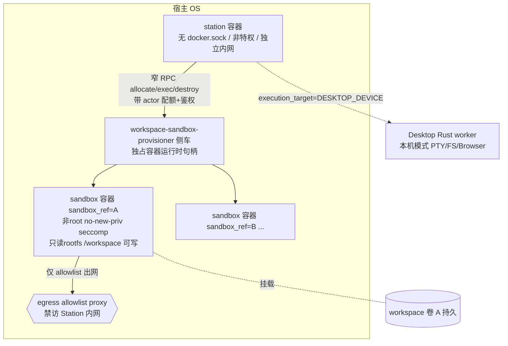

# 工作区执行落点架构

> **Status**: accepted（Owner 2026-11-04 确认）
> **Version**: v1.0
> **Created / Updated**: 2026-11-04
> **Owner**: Peers-Touch Agent Team

## 1. 目标与原则

Agent 的命令执行（一次性 `local_shell_exec`/文件工具与持久 `TerminalSession`）支持两种执行落点（execution target）：

1. **本机模式 `DESKTOP_DEVICE`**：进程/PTY 在用户 Desktop Rust worker 上执行（现状，D4/D5）。用于交互、GUI、本机凭据/Browser、长服务本机观测。
2. **Station 沙盒模式 `WORKSPACE_SANDBOX`**：Station 不亲自执行，而是把命令派发到**已分配给该 agent 工作区的隔离沙盒**。用于无人值守/跨设备、需要隔离的服务端任务与 CI 式 fail→fix→retest。

原则：

- **大脑/身体分离**：Station 编排决策，绝不持有容器运行时特权；能创建沙盒的能力收敛到一个独立 provisioner。
- **沙盒即 OS 边界**：Station 模式只开放给已分配沙盒；突破沙盒的动作不在应用层开特权，直接由 OS 拒绝（EACCES/EPERM/ENOENT/exit≠0），错误如实回传。提权走线下 owner 授权（改沙盒绑定/挂载/角色，升 binding revision），不在对话里开"允许 sudo"。
- **fail-closed、禁止回退**：沙盒不可用或 binding 未 READY，则 station 模式不可用；**严禁沙盒失败悄悄回落到本机桌面**（横向提权路径）。
- **proto-first、复用现有合同**：落点复用已预留的 `ExecutorKind`；Terminal/工具的回执、退出码、diff、check、lease/fencing 合同不变，只增加落点维度。
- **目标 OS 与宿主 OS 解耦**：执行面是容器/VM，沙盒目标 OS 由镜像决定（首期 Linux）；宿主平台差异收敛到 provisioner 内部的 `ExecutorBackend` SPI。

## 2. 证据基线（evidence ledger）

| Claim | Class | Evidence |
|---|---|---|
| 当前 TerminalSession 仅 device-held | verified_fact | `model/domain/agent/terminal_session.proto`（PTY 归 Desktop worker，Station 只存元数据） |
| ExecutorKind 已预留 WORKSPACE_SANDBOX=2 / REMOTE_CONNECTOR=3 | verified_fact | `model/domain/agent/orchestration.proto` L133-140 |
| Go 侧无沙盒执行器，CLI 全部 defer 给 desktop | verified_fact | `orchestration_service.go agentExecutorKind/desktopExecutorRequiredSummary`（"Station hosted orchestration cannot run local CLI commands yet"） |
| Station 容器当前无 docker.sock、非特权、仅挂数据卷、独立网络 | verified_fact | `docker inspect pt-tw-d1-station-1`（2026-11-04） |
| 工作根已是 agent 配置 | verified_fact | `agentWorkspaceRoot`（rootfsPath/workspaceRoot） |
| 工具 dispatch 已有 capability/version/readiness 闸门 | verified_fact | `tool_dispatch_service.go`（capability READY 才派发） |
| 沙盒内非 root/no-new-priv 是"自然报错"成立的硬前提 | inference | OS 强制访问控制语义；若以 root 跑则越界不报 EACCES |
| 直接挂 docker.sock 进 Station ≈ 宿主 root | verified_fact | Docker 官方安全语义 + DefCon 2026 对 agent 默认沙箱的逃逸研究 |
| Linux 容器可在 mac/Win 经各自 Linux VM 一致运行 | verified_fact | Docker Desktop / OrbStack / WSL2 运行时事实 |

## 3. 系统拓扑（sibling，不是 DinD）



关键约束：

- **Station 不挂宿主 docker.sock、不 privileged、不 DinD**。保持当前容器姿态。
- **provisioner 是独立部署单元**（侧车/独立进程/独立 ServiceAccount），唯一持有容器运行时句柄（docker.sock 或 containerd gRPC）。对 Station 暴露极窄 RPC：`Probe / Allocate / Exec(一次性与PTY) / Signal / Reattach / Stats / Release`。
- provisioner 只接受**镜像白名单 + digest 固定**、**固定安全模板**、**按 actor 的配额**；不接受任意镜像、任意挂载、特权请求。
- 沙盒网络与 Station 内网（Postgres、内部端口）隔离，默认仅经出网 allowlist 代理访问外网。

## 4. 执行落点合同（统一抽象）

一次性 shell/file 工具与持久 TerminalSession 共用落点属性：

- `execution_target`：`DESKTOP_DEVICE` | `WORKSPACE_SANDBOX`（对应 ExecutorKind；本期不用 REMOTE_CONNECTOR）。
- `sandbox_ref`：station 模式下已分配沙盒实例的不透明 id（= agent 工作区分配身份）。
- `workspace_root`：沙盒内工作根（挂载为唯一可写区）。
- 同一 turn 的落点由该 turn 绑定 capability 的执行面唯一决定；**同一 turn 不允许混用两个落点**，跨 turn 可切换。

落点选择默认：本机 desktop 优先（交互/GUI/本机凭据）；显式选择或任务计划指定时用 station 沙盒（无人值守/隔离）。选择与回落规则在 decisions（WE-D04）固化。

## 5. ExecutorBackend SPI（跨 OS 差异只活在这里）

provisioner 内部以后端接口隔离平台差异，Station/上层系统零感知：

```text
WorkspaceSandboxBackend:
  Probe() -> available, platform            // 该宿主是否存在标准 OCI 运行时
  Allocate(ref, image@digest, SecuritySpec, WorkspaceVolumeSpec, Quota) -> handle
  Exec(handle, argv, opts{pty,cwd,env-allow}) -> stream|exit
  OpenPty(handle, command,args,cwd) -> ptyId   // 持久 TerminalSession
  WritePty/ResizePty/SignalPty/ReadPty(cursor)
  Reattach(handle|ptyId) -> live proof + ring
  Stats(handle); Release(ref, opts{keepVolume})
```

- `SecuritySpec` 是**平台无关的安全意图**：非 root、no-new-privileges、drop caps、seccomp、只读 rootfs、仅 `/workspace` 可写、网络隔离+出网 allowlist、CPU/内存/pids 配额。后端把意图翻译成本平台原语；**翻译不出强隔离即 fail-closed**，不降级到弱隔离或宿主直跑。
- 首期后端：
  - `ociLinuxBackend`：Linux 生产，containerd（实现可先以 docker CLI/API 跑通，接口对齐 containerd）。
  - `ociDesktopVmBackend`：macOS（OrbStack/Docker Desktop/Lima）与 Windows（Docker Desktop on WSL2）dev；沙盒目标仍是标准 Linux，跨宿主行为一致。
  - 未来 `microvmBackend`（Firecracker/Kata/gVisor）为可插拔强隔离实现，不改动上层合同。
- `Probe()` 不可用时：station 模式对该部署报"不可用"，不静默启用，更不回落本机。

### 跨 OS 矩阵

| 宿主 | 后端 | 沙盒目标 OS | 不可用时 |
|---|---|---|---|
| Linux 生产 | OCI（containerd/docker），microVM 可选 | Linux（镜像决定） | fail-closed |
| macOS dev | OrbStack/Docker Desktop/Lima（Linux VM 内 OCI） | Linux | fail-closed |
| Windows dev | Docker Desktop（WSL2 内 OCI） | Linux | fail-closed |
| 需要 Windows/macOS **目标 OS** | `REMOTE_CONNECTOR` 专用 runner（后置） | Windows / macOS | 本期 non-goal |

## 6. 分配、持久身份与生命周期

- **持久单元是 workspace（工作区），不是 agent，也不是每条命令**：`sandbox_ref` 绑定 (actor, agent, workspace_root) 的一次分配。一个 agent 可有多个工作区；容器一次性，**workspace 命名卷持久**（代码/产物/家目录状态在卷里）。
- **懒启动**：该 workspace 首个 station 模式工具调用时 Allocate。
- **空闲回收**：空闲超时后停容器（卷保留）；再次调用冷启动并 Reattach；重建后 pid 变化如实反映（Terminal 复 D5 的 UNKNOWN/新 pid 诚实语义）。
- **配额与排队**：按 actor 限制容器数/CPU/内存/pids；超额进入现有 FIFO，不无限起容器。
- **终结**：工作区删除（owner 授权）时连同卷一起释放；默认 Release 保留卷。
- TerminalSession 在沙盒模式下由 provisioner 持有 PTY 与 bounded ring（与 device 模式 worker 持有同构），Station 仍只存元数据/事件引用，不存无限输出或密钥环境变量。

## 7. 组件关系

| 组件 | 职责 | 不得做 |
|---|---|---|
| Station orchestration/turn | 决定落点、组装 turn、登记 tool call/terminal 元数据与事实 | 不执行命令、不持容器句柄、不直接触宿主 |
| Capability authority / dispatch | 校验 (capabilityId,version,bindingId) READY、lease/fencing、回执绑定 | 不给未绑定/未就绪沙盒派发 |
| **workspace-sandbox-provisioner**（新，独立） | 独占运行时句柄；后端 SPI；allocate/exec/pty/release；镜像白名单/模板/配额 | 不做业务编排、不读业务库、不接受特权/任意镜像 |
| ExecutorBackend（OCI/microVM/…） | 把安全意图翻译为平台原语 | 翻译不强隔离时必须报错 |
| Sandbox 容器 | 执行非 root 工作负载，写 /workspace，经 allowlist 出网 | 访问 Station 内网/宿主/其他沙盒 |
| Desktop Rust worker | 本机模式执行体（不变） | 沙盒模式不参与执行（仅展示） |

禁止关系（forbidden）：

1. Station → 宿主 docker.sock / 宿主 shell / DinD / privileged。
2. 沙盒执行失败 → 回落到 desktop device（任何形式）。
3. agent 命令在沙盒内以 root / 提权身份运行。
4. 沙盒 → Station 内网（DB、内部端口）或跨沙盒直连。
5. provisioner 接受未在白名单/digest 固定的镜像，或任意宿主路径挂载。
6. Terminal UI 从 session id 推断沙盒内进程存活（必须 live proof）。

## 8. 失败与操作语义

- **越界即 OS 原生失败**：写只读路径、访问未挂载宿主路径、需要提权 → 执行器回传真实 errno/exit code/stderr，映射为有类型 tool result（`SANDBOX_PERMISSION_DENIED` 等，保留原始 OS 文本），既不伪造成功也不弹应用层提权。
- **提权线下化**：需要更高权限时产出"沙盒授权请求"工件；owner 在带外调整该沙盒绑定（挂载/角色/capability），binding 升 revision 并重新 READY 后下一条命令直接执行。
- 命令超时/取消/断连/重放沿用 D4/D5 语义；provisioner 不可用属基础设施失败，turn fail-closed，可重试但不换落点。
- 沙盒重建导致 pid/pty 变更：Terminal 状态转 UNKNOWN 直到重新 live proof；输出 ring 有界、可按 cursor 回放。
- 幂等等价于 D4：同一 bounded 结果回执可被 Station 校验归属与 digest。

## 9. 质量门（falsifiable）

- **隔离门（确定性，Go/集成）**：沙盒内 `id -u`≠0；写 `/` 与只读 rootfs 被拒；访问 Station Postgres 主机:端口超时/拒绝；跨沙盒互访拒绝；no-new-priv 下提权失败。
- **不回落门**：provisioner Probe=false 或 binding 未 READY 时，station 模式 turn 必须 fail-closed，且日志/合同中无 desktop 落点执行记录。
- **持久身份门（native journey）**：容器回收/重建后 workspace 卷文件仍在；新容器 pid 变化被 Terminal 如实标注，重连可从 cursor 回看。
- **OS 原生失败门**：沙盒内越界命令返回真实非零退出与原始 stderr，Station 落为有类型结果而非成功。
- **跨宿主门（dev）**：macOS（OrbStack/Docker Desktop）与 Windows（WSL2）上 `Probe` 通过并能跑同一 Linux 镜像的 `uname/write/grep` 闭环（后置任务）。
- 所有 journey 在 `make desktop`/受控 Station cell 的当前源码 exact-source 验证；不允许 mock 沙盒结果冒充。
