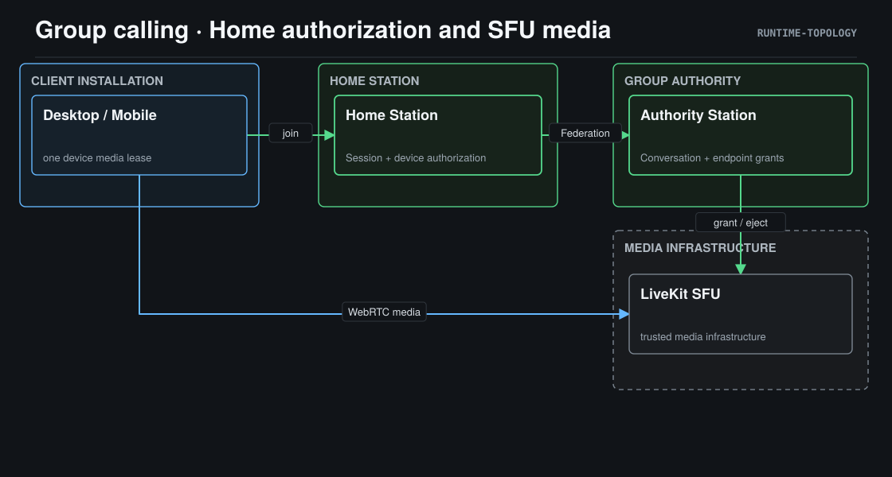

# 群聊音视频设计

> **Status**: active
> **Version**: v1.0
> **Created**: 2026-11-13 | **Updated**: 2026-11-13
> **Owner**: Chat Product Team

## 1. 核心原则

| ID | 合同 |
|---|---|
| GC-A01 | Conversation 是群成员和 Authority 的唯一 owner，Session 和 Actor Identity 是设备授权 owner。 |
| GC-A02 | 客户端只访问 Home Station；Home 经原 Federation route 请求 Authority；媒体直接连接授权 SFU。 |
| GC-A03 | 单聊和群聊共用一个设备媒体 reservation；在捕获与连接清理完成前不得释放占用。 |
| GC-A04 | 取消、账号切换、旧 SDK callback 不得恢复过期通话、发布迟到媒体或修改新会话。 |
| GC-A05 | group-call grant 绑定 Actor、device、session、Home、群与 Authority epoch；token 不广播。 |
| GC-A06 | 签发 token 不等于媒体授权；可重放 token 初始不具备 publish/subscribe 权限。 |
| GC-A07 | 群移除/退群/解散、设备或 Session 撤销在原 mutation fence 内撤销 grant 并确认 SFU ejection；失败不得返回权限变更成功。 |
| GC-A08 | SDK participant/track/connection events 是客户端媒体状态来源，SSE 只通知房间可加入或结束。 |
| GC-A09 | 清理、拒绝或失败不删除消息、群、草稿；错误分别表达权限、容量、网络、媒体和占用。 |

### 证据账本

| 声明 | 类别 | 来源 | 缺少证明 |
|---|---|---|---|
| Desktop 已使用 LiveKit 2.22.3 | verified_fact | `apps/desktop/src/modules/groupCall/`，lockfile | 当前原生媒体 |
| Mobile 丢弃 ROOM_ACTIVE/ENDED | verified_fact | `features/social/socialWire.ts` | 接入后的 SSE |
| Session 可解析真实 device，Actor Identity 提供事务设备行锁 | verified_fact | `auth/types.go`，`actor_identity/infrastructure/persistence/authorization.go` | 群媒体接入 |
| Conversation mutation 经 UOW 锁定群与成员 | verified_fact | `conversation/application/command/service.go` | 群媒体 fence |
| RemoveParticipant/CloseRoom 无生产调用 | verified_fact | `groupcall/provider.go` 与调用点 | fence 和重放负例 |
| SDK disconnect 返回 Promise，RoomConnectOptions 支持 rtcConfig | verified_fact | 安装的 LiveKit 类型与实现 | 原生清理、TURN |
| 当前媒体未配置 E2EE | verified_fact | 原 `livekitAdapter.ts` | UI 不得声称 MLS 媒体加密 |
| 有限、设备绑定的授权与预提交撤销可保留权限边界 | accepted_decision | GC-D03，GC-D04 | 事务竞争、SFU 实测 |

## 2. 系统架构

视角：Runtime Topology。箭头仅表示网络调用；共享 Model 和 Client Chat Core
是被运行时消费的源码合同，不是网络节点。

单聊仍使用原 Direct 信令和 WebRTC；群聊使用 LiveKit，禁止群 P2P mesh。
客户端不持有 SFU 管理密钥。Station 不处理 SDP、音视频帧或客户端媒体。

### 媒体隐私边界

当前 SFU 媒体通过 WebRTC DTLS-SRTP 在客户端与 SFU 之间传输；SFU 属于可信
媒体基础设施，能访问转发的解密媒体。该传输保护不等于 MLS/SFrame 媒体 E2EE。
客户端只展示实际能力：不得显示固定“端到端加密已开启”。消息、附件和语音消息
的 E2EE 合同保持不变。任何将 SFU 改为不可信媒体节点的产品要求必须另有客户端
key exporter、epoch rotation、编码帧能力和双平台媒体验收合同。

## 3. 核心接口

| 组件 | 输入、输出与 owner | 生命周期与禁止关系 |
|---|---|---|
| MediaReservation | 设备内 Direct/Group attempt ID → lease | 开始 capture 前 acquire；迟到资源 stop 后 release；不访问 Station |
| GroupCallController | Host join/ICE ports、Provider → immutable snapshot | 一个 attempt；取消立即失效，异步完成清理；不导入 UI、auth store 或 Host API |
| LivekitAdapter | URL/token/RTC config → participants/media/events | 一次 Room；await disconnect，detach DOM/stop tracks；不授权成员、不解析业务 JWT |
| Mobile social runtime | 已验证 session、原 SSE → Direct 与 typed room ingress | activate/suspend/resume/teardown；不新增 SSE stream |
| Home groupcall | canonical Subject/session device → Authority grant | 原 authenticated native transport；禁止客户端断言替代设备解析 |
| Authority groupcall | Conversation membership/device grant → token/ejection | 原 owner fence 串行化 admission 与 revoke；禁止直读别的 owner 私有表 |
| SFU provider | admission/ejection/room operations → verified callbacks | token 初始无媒体权限；签名 webhook 检查 grant 后才启用权限 |

## 4. 组件关系

Host 提供认证、可取消 join、ICE 和 UI。共享 controller 与 provider 不复制
Desktop/Mobile 业务 owner。DOM attach 使用 participant ID，显示身份用 Actor PTID。
摄像头切换和麦克风控制串行化；只有 SDK 成功后更新投影。新 track publication
提高 media revision，视图重新 attach；远端音频与视频分开挂载，禁止播放本地音频。

权限收回与签发共用原 owner 的事务 fence：先验证当前版本，撤销匹配 grant，
确认 SFU eject，再提交原权限 mutation。网络错误保持原 mutation 未成功；事务
回滚也允许参与者被保守断开，合法成员可重新申请 grant。禁止仅依赖 SSE、
客户端 heartbeat 或过期 TTL 证明恶意客户端已被移除。服务重启必须恢复 grant
撤销状态；未知 grant、未知 webhook、缺失 device 和错误 epoch 一律无媒体权限。

## 5. 端点 / API

`POST /group-call/join` 保持 Home 入口；request 是 canonical group ID，身份全部
来自 authenticated Subject 和持久化 Session。response 包含 URL/token/room name
与当前 endpoint grant identity。跨 Station 的 device/session/grant 字段先定义在
`model/domain/realtime/group_call.proto`。原 `ROOM_ACTIVE/ROOM_ENDED` carry
group/room，只作提示；重放和乱序不得关闭不同 attempt。

`/hooks/livekit` 只接签名 SDK webhook。媒体授权确认不得依赖客户端广播。
权限撤销的 Federation control 请求只允许设备 Home 撤销其自身 endpoint；
群 Authority 只能撤销所辖群参与者。

## 6. 运行语义和质量 Gate

Join 可取消；重复点击被 reservation 拒绝。连接上限 30 秒；重连失败终态释放
媒体，重试产生新 attempt。整个 cleanup promise 被 teardown 等待；cleanup 未成功
不得显示 idle 或允许另一个 capture。最多 50 个参与者、空房 300 秒，来自现有
Station provider；没有未经测量的性能数字。数据面不得借 SSE 搬运媒体。

Gate `CHAT-G14` 通过原 `lifecycle_group_live.py` 验证至少三位 native 成员、Mobile
参与、音频/视频、late join、控制、重连、移除/设备撤销、旧 token 重放拒绝、
取消与媒体释放。身份及媒体来自实际 runtime，不从 fixture 注入结论。
iOS 模拟器与 Android 实体分别证明平台能力；SOURCE_CHECK 不替代实际媒体。
权限改变前后用 RTP 接收计数和 SFU roster 观察，撤销成功后的未授权新增帧为零。
慢 SFU、连接中 logout、toggle 中 leave、SSE 重放和重复点击均须有失败恢复证据。
