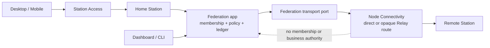

# Federation Architecture - 架构设计

> **Status**: active
> **Version**: v1.1
> **Created**: 2026-05-31 | **Updated**: 2026-10-10
> **Owner**: Architecture Team

---

## 1. 核心原则

1. Federation 是持久虚拟实体，Station 是成员节点，Actor 是参与者。
2. Federation Ledger 记录治理事实；Chat、Social 等业务数据不上账本。
3. Station app 拥有 membership、policy、ledger 和业务裁决真源。
4. Station frame 提供 signing、locator、resolver 和 transport port，不积累
   Federation 业务规则。
5. 所有 discovery、Catalog、Resolver 和 peer capability 显式带
   `federation_id` 或 `station_peer_id`。
6. Node Connectivity 只提供 authenticated transport，不提供 membership、
   Federation role 或业务权限。

## 2. 系统架构



Station Access answers how a user reaches Home Station. Federation answers
which Station belongs to which network and what governance facts are valid.
Node Connectivity moves authenticated bytes between Station identities.

## 3. Federation Core Model

### 3.1 Federation And Membership

Federation owns stable `federation_id`, metadata, policy, member Stations,
active sequencer and ledger head. A Station can join multiple Federations.

Membership is derived from Ledger replay:

```text
pending -> active -> suspended | left | removed
```

A reachable Relay route or Station mount is not membership. Joining/leaving a
Federation does not create/delete transport enrollment.

### 3.2 Actor And Roles

Cross-Station identity uses `ActorRef`, persisted federated handle and
`station_peer_id`. URL, Host, proxy or route endpoint cannot generate or alter
`ActorRef.acct`.

| Layer | Roles | Authority |
|---|---|---|
| Station | `station_owner`, delegated Station roles | local governance admission |
| Federation | `federation_owner`, `federation_admin`, `moderator` | Federation governance |
| Transport | authenticated Station peer | connectivity only |

Ordinary Actors may search, contact, chat, follow and manage personal
visibility. They cannot mutate membership or transport operator state.

## 4. Federation Ledger

Ledger is a permissioned append-only hash chain:

```text
genesis(seq=0)
  -> event(seq=1, prev_hash=genesis_hash)
  -> event(seq=2, prev_hash=event_1_hash)
```

Formal events carry actor, origin Station and active sequencer signatures. v1
uses one active sequencer:

- non-sequencer Stations submit signed proposals;
- sequencer validates policy and assigns `seq/prev_hash/event_hash`;
- same sequence with different hash enters `fork_detected`;
- sequencer loss follows explicit read-only/handover/orphaned policy.

Ledger never stores token, Session, private key, email, ordinary message,
Moment or presence data.

## 5. Discovery And Catalog

Three layers remain distinct:

| Layer | Answers | Source |
|---|---|---|
| Federation manifest | what Federation this is | signed manifest + genesis |
| Station membership | which Stations are members | Ledger replay |
| Actor catalog | which Actors are discoverable in scope | member Station + visibility |

All Station list, Catalog, Resolver and public Actor queries carry an explicit
`federation_id`. Node Connectivity route discovery answers reachability only
and cannot publish/derive membership, policy or Actor catalog.

## 6. Transport Port

Federation app depends on a narrow transport-neutral port:

```go
type PeerTransport interface {
    Deliver(ctx context.Context, frame *delivery.Frame) (delivery.Result, error)
}
```

The app owner selects the destination Station and constructs the typed,
idempotent domain frame. Node Connectivity selects a valid direct/Relay route
and returns a transport result.

Target Station validation remains:

1. authenticate caller Station identity;
2. validate capability audience and frame contract;
3. validate Federation membership, role and domain policy;
4. enforce replay/idempotency;
5. commit receiver-owned state and return typed disposition.

Transport failure cannot decide business acceptance or mutate Ledger state.

## 7. Federation Route Policy

Federation may define which authenticated Station-to-Station routes are
acceptable. That policy is separate from:

- Station Access client route choice;
- Relay enrollment/admission;
- Federation membership;
- business capability authorization.

No policy is implicitly converted into another. A route must first satisfy Node
Connectivity security and then the target Federation/domain policy.

## 8. User And Operator Surfaces

- Daily user entry remains people, Contacts, Chat and Social.
- Settings may show current Federation context and connection diagnosis.
- Dashboard/CLI owns Federation creation, join/leave, member administration,
  Ledger and policy.
- Transport operator surfaces belong to Node Connectivity, not Federation UI.

## 9. Failure Semantics

| Failure | Federation behavior |
|---|---|
| target Station unreachable | retain pending/retry state under domain policy |
| caller Station identity invalid | reject before membership check |
| Station not active member | reject typed `STATION_NOT_MEMBER` |
| sequencer unavailable | follow explicit read-only/handover/orphaned policy |
| duplicate idempotency key | return prior disposition or typed conflict |
| replay/stale event | reject without mutating materialized state |
| route changes for same Station | preserve membership and business identity |
| Relay/mount revoked | connectivity failure only; no membership mutation |

## 10. Quality Gates

Required proof:

- Ledger signature/hash/replay/fork semantics;
- explicit Federation scope for discovery and Catalog;
- ActorRef account projection remains independent from transport host;
- direct and Relay routes produce the same typed receiver result;
- Relay cannot inspect Federation payload;
- transport unavailability does not create/drop membership;
- Station app/frame dependencies remain one-way and no transport implementation
  leaks into Federation business owners.

Relay framing, enrollment, runtime role and resource-limit proof are delegated
to [Node Connectivity](../../platform/runtime/node-connectivity/design.md).
