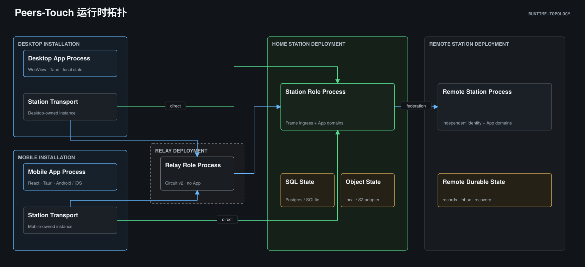

# Mobile Scan Login — Architecture

> **Status**: active
> **Version**: v1.0
> **Created**: 2026-10-27 | **Updated**: 2026-10-27
> **Owner**: Identity and Access

## 1. 设计目标与证据

目标是省去手机输入站点与账号凭据，同时保留 Station 准入、网络身份验证、
设备撤销和 E2EE 身份连续性。下文新行为是已审查的目标合同，不能当成当前证明。

已核实的当前源码事实：

- `model/domain/peer/access_endpoint.proto` 已有 Direct/Circuit 路由证明、
  `StationConnectionEnvelope`、有次数及期限限制的连接 grant。
- Desktop `infrastructure/station_discovery.rs` 与 Mobile
  `runtime/station_route.rs` 都接收 `ptc1:` 和 `peers-touch://connect#`。
  现有入口只有连接语义，不授予账号登录。
- `native/relay/station_control.go:IssueConnectionMaterial` 签发新 grant；
  对外现有入口在 Dashboard 管理域。普通 Actor 不能据此获得管理权限。
- `packages/station-trust` 验证逻辑 Station root、Node 授权、路由与 SPKI。
  “同源 Station”是同一 `station_peer_id/root`，不要求 URL、Node 或 Relay 相同。
- `frame/core/facility/session/db_store.go` 定义 desktop/mobile/web 会话类别；
  同 Actor 的 Desktop 与 Mobile 可以占不同类别。当前active唯一索引是
  `(user_id, device_type)`，同类别新登录会撤销旧Session，尚不支持多手机同时在线。
- `actor_identity/domain/device.go` 拒绝 Actor 身份公钥变化，设备证书必须由
  Actor 身份签名。Mobile 与 Session 必须复用同一个 `device_id`。
- Mobile `domain/crypto/identity_keys.rs:ensure_identity` 在没有本机身份时生成
  新 seed；`messaging-core/crypto/prekeys.rs:upload_request` 使用 Actor 身份密钥
  签名预密钥。因此仅复制 Session 或仅传一个设备证书，不能闭合当前消息身份。
- 当前 camera 插件提供拍照/权限能力；尚未发现本需求的连续 QR 解码入口。
- bootstrap connection material 文档仍把生产自签名引导列为未闭合能力。
  本设计不把有 proto 字段误报为已具备原生能力。

推断：可复用现有网络、Access、Session、Actor Device 真源，但还缺 Device Link
事务、按设备并发的Session合同、受保护的身份传递、扫码器和统一 Schema。
原生成功率与性能尚无测量证据。

## 2. 核心原则与运行边界

1. 二维码传递“接入与请求授权的邀请”；Station 单独决定登录。
2. Schema 只处理链接/码图；Node Connectivity 只处理路由/连接权限。
3. Station Device Link 协调跨端事务，Access Gate 保留最终准入权。
4. Mobile 自己生成设备 ID、设备签名密钥、传输密钥和接收密钥。
5. Desktop 的 token、refresh token、设备私钥、数据库密钥不离开本端。
6. 当前 Actor 身份 seed 的传递必须端到端加密、明确授权；不改造整套身份 PKI。
7. 路由变化不改变账号；不同 Station root 必须在凭据提交前拒绝。
8. 一次授权事务只批准一个目标设备；一个账号允许多台手机分别授权、同时在线。
   二维码的claim/source名额不是账号设备数量上限。

运行拓扑沿用上游图，箭头表示运行时通信；本方案没有新增云登录代理：

在上述拓扑中，扫码传递是 Desktop 屏幕到 Mobile 相机的带外输入。
授权控制和最终凭据交付都通过 Mobile/ Desktop 各自验证的 StationTransport；
Relay 继续只转发加密流量。

Model 是 Client 与 Station 消费的 proto 合同，不是运行时中间节点。

## 3. 网络注入算法

Desktop 用当前已授权账号向 Station 请求新 Device Link。Station 从
Node Connectivity 获取**新签发**的连接材料，不能导出 Desktop 正在使用的旧
grant、PeerID 私钥、SSH 隧道或 `localhost`。

构造过程：

1. 固定预期 Station root、Actor、Desktop device、事务期限和 Desktop 临时公钥。
2. 收集有当前证明的 Direct discovery 候选与独立 Relay 候选。
   剔除过期授权、维护别名、桌面回环及不可发布监听地址。
3. 私有 Relay 路线由 Station 根据设备连接策略签发短时、单用途引导 grant。
   每码最多允许4个source兑换，各source幂等取得有限permit；不能让第一台
   扫码手机耗尽唯一连接名额。获批Mobile后续使用独立、单source连接材料。
   每条 Relay 有自己的 grant 与身份；不复制 Relay operator/node credential。
4. 生成签名 `DeviceLinkOffer`，由 Schema 决定内联或引用编码。
5. Mobile 扫码后先做语法/长度/期限检查，再验证 endpoint 与完整 Station root。
   每次使用新的 discovery challenge，不能以二维码里的旧证明代替现场握手。
6. 先试可用 Direct；失败后试验证通过的 Circuit。全部候选共享同一个
   expected root。只有 Mobile 能证明手机侧可达，Desktop 预检只是提示。
7. 接通后固定 Mobile Access attempt 和 route lease，再提交设备申请。
   换 Node/Relay可继续；换 root必须失败。

公有 HTTPS discovery 可以自动引导。带外导入的 SPKI/CA 必须经过现有
endpoint-scoped trust 路径；缺少生产支持时返回明确能力缺失。
已验证身份的公共 HTTP discovery 只允许无凭据 challenge；业务始终走加密流。

无可达 Direct、也无已接入且允许新设备的 Relay 时，显示
“手机暂时无法连接此站点”，提供同网络重试或由站点管理员配置 Relay。
扫码不承诺穿透任意 NAT、防火墙或运营商网络。

## 4. 长载荷与引导死锁

完整 Node 授权、route attestation、多个 grant、CA 与头像不能全部堆入展示码。
头像只进入渲染参数，永不进入 wire。

默认使用短引用；内联仅在 Schema 密度预算内使用。引用仍携带**最小可信引导**：
原始Station Ed25519公钥、一个受验证的canonical retrieval endpoint身份/TLS材料、
独立Relay公钥（仅Relay）、完整offer摘要、期限和bootstrap secret。
lookup与解封密钥只在native由绑定公开上下文的HKDF派生；Desktop临时公钥留在
digest覆盖的签名offer中。不能把它简化为“先连上私有 Station 才能下载连接私有 Station 的材料”。

完整 offer：

- Direct 场景由可公开接触的 Station bootstrap 提供。
- 私有 Station 场景可由已绑定 Relay 的 control listener 托管短时 sealed blob。
  Relay 的新职责只限于 enrolled Station 上传的网络引导 blob：
  定长配额、TTL、源 proof、HKDF lookup；无 Actor、审批、Session API。
- 该扩展属于 Node Connectivity，**当前不存在**。不能将它归为 Schema HTTP
  服务，也不能在 App 中绕过 Relay role allowlist。
- 先验证 retrieval endpoint，再发送 lookup/source proof；从 HTTPS/scoped
  encrypted control 取得 blob，解封并核对摘要、签名和预期 root，随后兑换 grant。
  QR bootstrap secret与解封密钥不进入 URL query、Referer 或服务器请求。
- 不使用中心短链、网页统计重定向、任意 URL 下载或递归引用。
- retrieval只允许引导材料里的canonical endpoint和固定control路径，禁止redirect。
  不探测网段、不使用loopback/云metadata地址；明确的LAN候选按本机网络权限处理。
  DNS变化不能跳过每次TLS及endpoint身份检查。

若没有合适的 retrieval endpoint，自动尝试单路线内联；仍超过预算时拒绝出码，
提示配置可达引导端点或使用连接文件。不能降低身份检查或缩小模块骗过预算。

## 5. 设备授权与身份传递

Mobile 本机生成密钥并提交 proof-of-possession。Station 只保存有限、独立的
claim，不采用“第一个扫码者自动获得账号”的策略。Desktop 看到待授权设备及
与 Mobile 相同的短核对码，选择并确认一台设备；其他 claim 立即失效。
这只限定当前offer的授权对象。添加第二台手机创建独立offer，不撤销第一台；
已完成面板提供“添加另一台设备”，沿用当前账号与站点，签发新的登录码。

核对码取自完整 transcript 摘要，绑定 offer、Station、Actor、双方设备、双方
临时公钥、Access attempt 及当前 revision。它只用于人眼核对，不是兑换凭证。
Mobile 公钥不能靠 Station 返回的一段未核对信息决定。

确认后：

- Desktop 通过标准 HPKE 的现有成熟库，将 Actor 身份 seed 加密给选定 Mobile。
  密文绑定 transcript 与用途，随approve请求一起提交；Station只在CAS批准
  同一claim后保存密文。密钥暂不可用时保留本机解锁/恢复动作，不发送空material。
- Mobile 解封、验证公钥指纹后，在安全存储中暂存该 Actor 身份；生成自己的
  Actor Device certificate。已有相同身份则复用；不同 seed禁止静默覆盖。
- 最新 profile revision 由 Station 真源取得。过期 revision 必须更新并重新签名。
- Station 验证移动设备证书和 proof，再执行 Access Gate，包括设备策略、维护、
  allowlist、terms 与本设备Session状态。Desktop 批准不能跳过它们。
- 未获批手机只能使用有期限的引导permit申请连接，不能访问已认证业务。
  Station提交后给选定source独立的可续期路线；共享引导permit在短TTL结束时失效，
  未选中的source不会继承新grant，不能把取消码误报为即时擦除全部旧transport。
- Access 真源为 GRANTED 后生成 Mobile 专属 inactive Session。凭据加密给
  Mobile，Mobile 安全保存并 ack；Station 才原子激活 Session 和设备绑定。
- Mobile 经正常 identity/PIN/runtime pipeline进入 Shell；Desktop保持原会话。
  其他已授权手机也保持在线；每台设备拥有独立Session、inbox和撤销边界。

Session owner的候选新合同按`Station root + Actor PTID + device_id`管理活跃会话。
`device_type`保留为分类及策略输入，不再是唯一会话槽。相同设备重登/轮换只替换
自己的旧Session；不同设备互不替换。所有登录方式共用该owner合同，禁止扫码
绕过现有索引或为Mobile另建平行Session表。设备数量限制若存在，属于Station
显式设备策略；达到限制时明确拒绝或让用户选择撤销设备，不能按类别隐式踢人。

这是**共享现有 Actor 身份密钥**，不是“所有密钥始终不跨设备”。代价是新增可信
设备扩大 Actor 身份密钥的暴露面；设备撤销也不能远程抹掉已经交付的 seed。
未来硬件不可导出密钥/委托身份需要独立身份架构，不在此流程暗中改协议。

身份指纹使用现有 Actor Identity 合同的 `SHA-256(Ed25519 public key)`，
不能改为 seed 摘要。Mobile 解封后从 seed 派生公钥，与完整已签名 offer 的
身份公钥比较。Desktop 用已注册 Actor Device 签名 approval transcript；
Mobile 验证证书、offer 绑定和短码，不能把 HPKE Base 模式当作来源认证。

历史消息数据库、ratchet state、MLS group state、Social recovery master不随登录
复制；历史可读性由既有 Recovery/群组加入合同决定。UI不得承诺“扫码恢复全部历史”。

## 6. Owner、生命周期与接口

- **Station Device Link**：事务/claim/审批/密文交付/audit的唯一跨端 owner；
  使用 PostgreSQL 共享真源和 CAS。只通过 Access、Session、Actor Identity端口
  修改其状态，不重复准入策略。
- **Desktop DeviceLinkRuntime**：账号/窗口 scope内的可取消临时会话与密钥；
  UI仅投影，不在组件 mount中轮询。离开、锁定、登出或换账号时撤销审批能力。
- **Mobile DeviceLinkRuntime**：扫码、网络验证、暂存、ack/reconcile；App前后台
  生命周期控制相机与监听，同 scope的运行时不重复创建。
- **Node Connectivity**：连接材料、短引用引导、grant与route lease；不识别账号。
- **Schema**：纯编码、严格解析与二维码渲染；不能拿 Session、调用批准或自动登录。
- **Mobile Native QR Adapter**：Android/iOS系统相机和成熟解码库；只回传载荷，
  不持有认证/账号真源。Web预览只能证明交互，不证明原生扫码。
  Android 使用官方 Tauri barcode-scanner 的 CameraX/ML Kit 路径，应用直接
  依赖 `com.google.mlkit:barcode-scanning:17.3.0`，将模型随 APK 打包。
  首次扫描不依赖 Play Services 下载；应用和插件 classpath 由 Gradle 锁固定。
  扫描及相机取消期间，原生预览位于透明 WebView 后方，HTML 根节点与扫描页
  保持透明。说明和取消按钮集中在底部卡片，中央区域留给相机；退出该阶段后
  自动恢复认证页背景。扫描提示描述对码动作，不将整个等待期间标作相机启动。

候选 API：`/auth/device-link/{create,claim,approve,deny,cancel,status,material,ack}`。
生成 protobuf 请求/响应；每个接口的身份、幂等与限制见
[data-model.md](./data-model.md)。审批 API 必须同时验证原 Desktop Session、
Actor device、事务与 claim scope，不能只接受 offer ID。

原子提交由现有 owner 的 transaction-aware 端口参与同一 PostgreSQL 事务：
Access 从该事务读取当前策略并重新求值；Actor Identity 校验证书、身份连续性、
当前 profile revision 与撤销状态；Session 准备/激活设备绑定。
没有 bearer 的 Mobile 只在选中 claim 的 scope 内提交 enrollment，
不能调用普通已认证设备注册入口。Device Link 不直接维护另一套 Actor Device 表。
各 owner 按 Actor → offer → Access attempt → device → Session 的顺序锁定，
批准、撤销、ack 和清理必须保持一致，禁止持有事务后再打开第二条 DB 连接。

## 7. 失败与验证

旧码、取消、并发审批、grant replay、身份替换、路由变化、Session撤销、
进程重启、ack丢失和本设备Session冲突均由 Station 单调状态处理；
客户端展示不得把等待授权或安全存储成功等同于登录成功。

本设计的可证伪合同见[验收合同](./acceptance-matrix.md)。性能数值都是候选预算，
必须使用真机、真实屏幕码和实际 Direct/Circuit路线验证；源码事实不等于原生证明。
