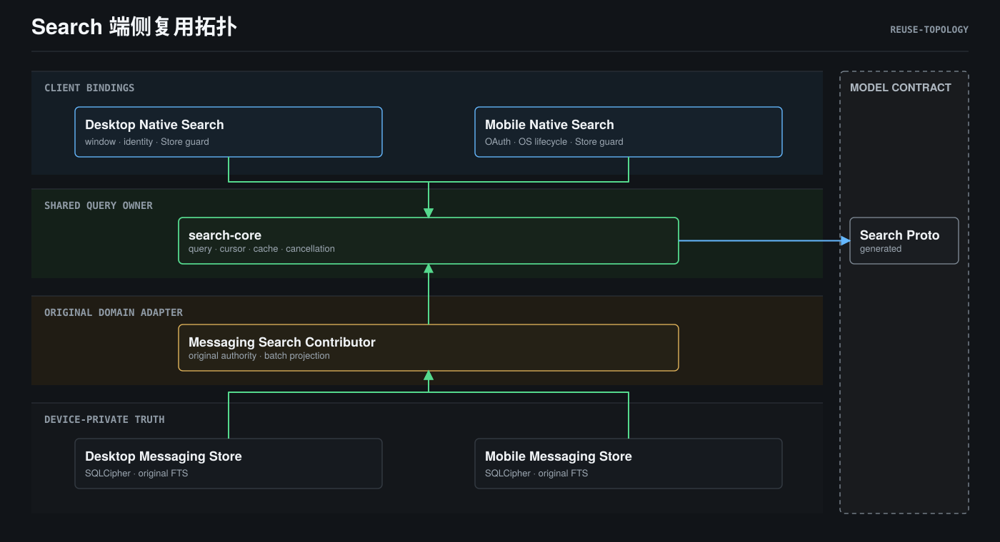
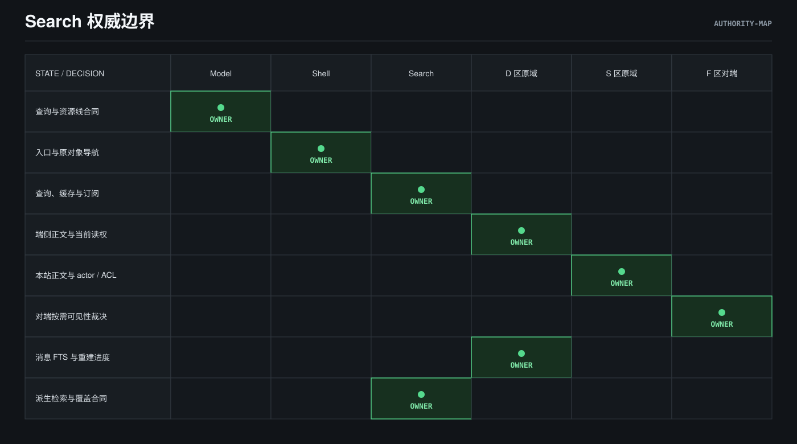
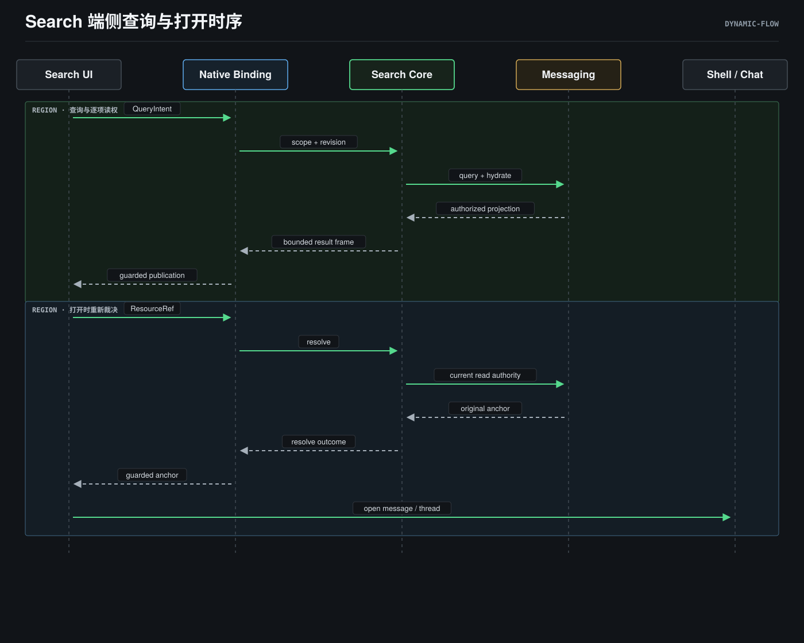

# Search 架构视图

> **Status**: active（端侧已实施；S/F 与其他来源为目标合同）
> **Owner**: Search / Client / Station
> **Scope**: Peers-Touch 域内对象，只返回当前 actor 有权限的内容（D-19）。
> 配套：[技术设计](./design.md) · [目录职责](./module-layout.md) ·
> [数据合同](./data-model.md) · [决策](./decisions.md) ·
> [原生证明快照](./acceptance-evidence.md)

## 1. 端侧复用拓扑

该视图表达当前实现的共享能力消费，包含关系表达模块边界。
Desktop/Mobile 宿主提供身份与原 Store 发布屏障；统一查询、缓存、
cursor 和请求/订阅取消位于 `packages/search-core`。
Messaging 的共享 contributor 与读端口位于 `packages/messaging-core/src/search.rs`，
两端原 Store 实现该读端口。Model 是生成类型的契约底座。
这些连线不表示进程部署或一次查询的消息流。

Desktop Shell 使用单例覆盖层；Mobile 使用既有全局/会话入口与按需详情。
Renderer 只持有有界呈现及返回上下文，不持有另一份检索执行器。
源码位置以 [module-layout.md](./module-layout.md) 为准。

## 2. 三个信任区与原域权威

矩阵表达已接受的权威边界，S/F 两区对应目标合同，不宣称已部署 Search adapter。
**D 区**为端侧私有，永不出端；**S 区**为本站授权，按 actor/ACL 过滤；
**F 区**为联邦授权，由对端按需裁决。Search 不拥有原文或业务写操作。

一份语义、两级执行：Client 查询 D 区，Station Search application 未来调度
S/F 区。原域提供候选权限谓词与批量 read-policy hydration；
title、snippet、count、facet、建议和 AI evidence 发布前都需当前可读。
deny/unknown 直接丢弃，不泄漏“存在但无权”。Federation 不抓取或整站索引，
仅携带已认证联邦身份按需查询；对端不可见与不存在不应可区分。
Station 从不回拉端侧 E2EE 明文，也不集中存其向量。

D 区后续来源包括端侧 Agent 记忆、私有附件与默认关闭的搜索历史；
S 区后续来源包括 Social、人员/会话目录、Agent/知识/笔记、Peers 管理附件
与能力目录。它们必须由原 owner 提供真实 descriptor、读取、coverage 与证明。
未接入来源不由可用的 Messaging 来源推导为 ready。

## 3. 端侧查询与打开

该时序表达当前本机消息读取和打开。缓存命中可省略来源 query/hydrate，
仍需原生 scope/revision/expiry 与发布屏障裁决；失效引用不得继续展示或打开。

四道权限链持续成立：

1. Admission 仅接受域内 kind 与受支持 scope；公网、OS 文件和外部 connector
   返回 `SCOPE_OUTSIDE_SEARCH_DOMAIN`。
2. 候选按原域授权过滤；D 区按账号密钥隔离，S 区带 actor 谓词，F 区由对端裁决。
3. Hydration 发布前逐项验证原域当前读权；缓存内容版本与读权有效性分开核对。
4. Preview/open 按当前 revision、身份与可达性再校验；Shell 打开原对象 anchor，
   写操作仍由原模块表单确认。

Station 查询的目标流程也遵循该链：认证上下文取得 actor，S 区候选过滤，
可选 F 区按需查询，原域批量 hydration，再只发布授权投影与真实 coverage。
端侧和 Station 结果未来融合使用单一叶子、稳定分页及原授权到期点；
RRF 目前仅为共享核心资产，不宣称完整混合排序质量。

## 4. 索引、附件与撤权生命周期

原业务域拥有正文、密钥、恢复 cursor、索引写入时机与父对象读权。
Search 派生物可重建，不成为业务原文真源。当前两端 Messaging 复用原
SQLCipher/FTS5；Desktop 业务写入/恢复直接生成共享 token stream，
Mobile 由原 Store 分批重建既有 FTS 并保留 checkpoint，未完成返回 `INDEXING`。
没有第二套索引或兼容查询。后续来源的可靠投影采用已接受的
transactional outbox 或 watermark snapshot，再执行 snapshot/catch-up/ready。

撤权、删除、隐藏或受众缩小时先阻断读取并置 deny/tombstone，
随后清理索引、向量、预览、cursor 和 AI 引用，tombstone 压住迟到 upsert。
Peers 管理附件没有独立授权：附件名、正文、缩略图和 count 随父对象一起
出现或消失。D 区正文/chunk/向量只留本账号受保护存储；
新设备历史未恢复时显示真实 coverage，不回退 Station 搜 E2EE 正文。

## 5. AI、功能导航与否定边界

处理位置不扩大检索范围。D 区 query/embedding/evidence 仅由端侧 inference
处理，无端侧模型时保留 lexical，不能静默转远端。S 区内容交给 Station
Agent 需要来源策略和显式授权；外部 model provider 需要第二次独立授权，
外发前说明已经发送的内容无法追溯撤回。回答仅使用本轮当前可读的域内证据。
Agent 工具原始输出、内部推理与 Secret 不进索引；独立 tool-call 检索仍待确认，
当前锚点是消息/轮次。

功能关键词、ID 与别名不依赖模型：受信 catalog 以 module/capability/action
描述真实入口，只显示当前账号 eligible 功能。打开仅导航，业务写入由原面板
确认；描述性语义匹配未来也只在有界候选内执行。

公网搜索商、Peers 之外的 OS 文件/目录、外部网站/SaaS connector 不属于检索域。
UI 设置、实验开关、Applet、MCP 或 Skill 不提供旁路；Applet 只能贡献自己的
域内对象。Station Launcher 历史 mock 不得成为本机搜索 fallback。
Desktop 旧页面/成功空 stub/provider 设置链与 Mobile 旧 Search IPC 已删除。

端侧所选原生证明与准确源码绑定见 [证据快照](./acceptance-evidence.md)。
S/F、其他 contributor、Ask、完整 V-01～V-10、实机/OS 后台锁屏与现场性能
仍为 UNPROVEN；图中的目标 owner 和边界不是产品 PASS。
