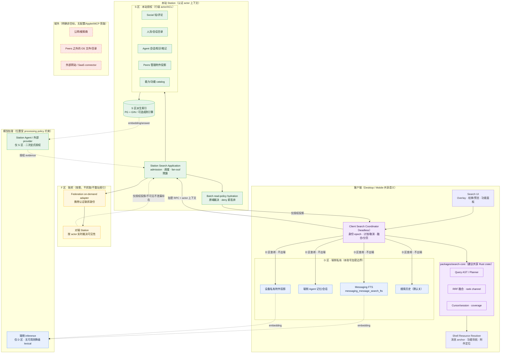
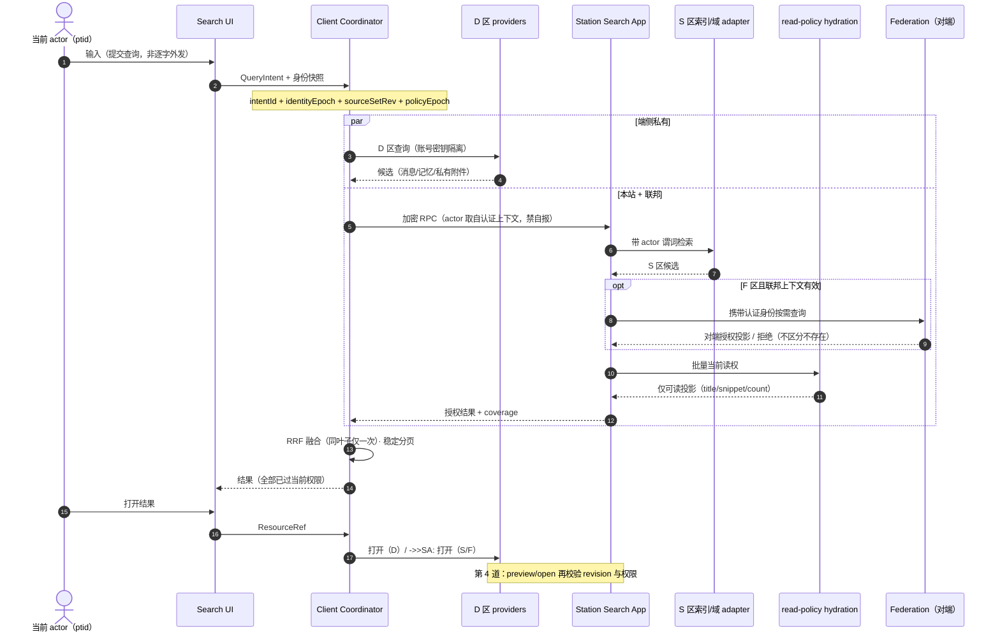
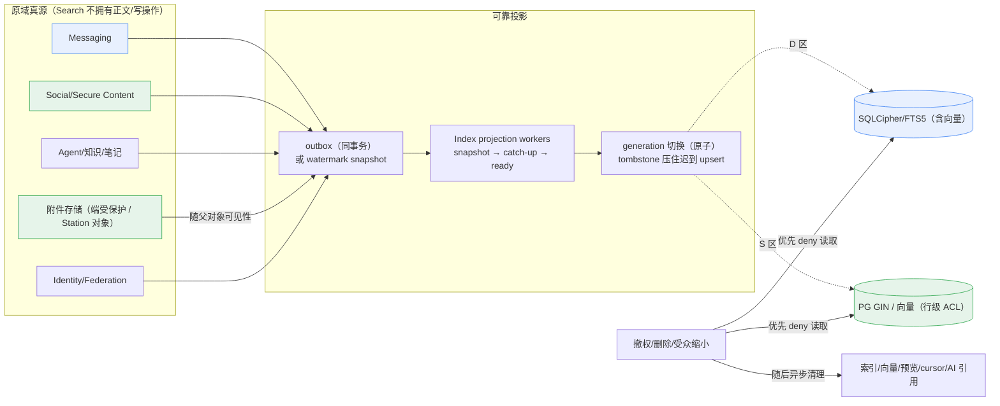
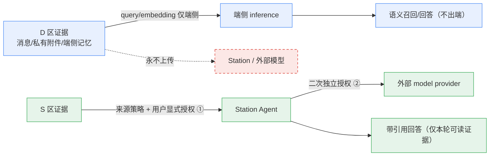
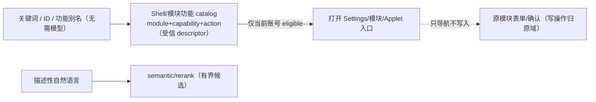
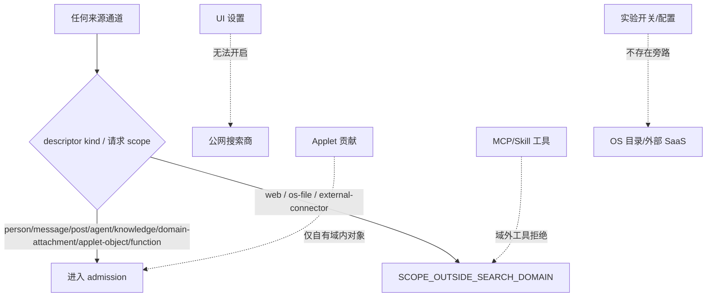

# Search 目标架构图

> **Status**: draft / target architecture（D-19 封闭检索域）
> **Date**: 2026-10-22
> **Scope**: 仅 Peers-Touch 域内对象（端 + Station），只返回当前 actor 有权限的内容。
> 配套：[技术设计](./design.md) · [数据合同](./data-model.md) · [决策](./decisions.md)

图例约定：**D 区 = 端侧私有**（永不出端）、**S 区 = 本站授权**（行级 actor/ACL）、**F 区 = 联邦授权**（对端按需裁决）。

## 1. 总图：信任区与两级执行



关键含义：

- 检索宇宙只有 **D / S / F 三个信任区**；域外三类对象在 admission 与请求 schema 两层都被拒绝（`SCOPE_OUTSIDE_SEARCH_DOMAIN`）。
- **一份语义、两级执行**：共享 `search-core` 负责 AST、融合、cursor、取消；端上跑 D 区，Station 跑 S/F 区；Renderer 只做投影。
- Station **从不回拉端上明文**，也不集中保存 E2EE 正文或其向量。

## 2. 一次查询的时序与权限执行链



四道链，缺一不可：

1. **Admission**：descriptor 仅允许域内 kind；公网/OS/外部 connector schema 拒绝。
2. **候选过滤**：D 区按账号密钥隔离；S 区查询带 actor 谓词；F 区由对端裁决。
3. **read-policy hydration**：title、snippet、count、facet、建议、AI evidence 发布前批量过原域当前权限；deny/unknown 直接丢弃，不泄漏“存在但无权”。
4. **preview/open 再校验**：Resource Resolver 打开时按 revision/联邦可达性再判一次。

撤权/删除/隐藏事件：先阻断读取（deny/tombstone），再异步清理派生物（索引/向量/预览/cursor/AI 引用）。

## 3. 索引、更新与附件生命周期



- Peers 管理附件没有独立授权：**父对象 read-policy 即附件权限**；附件名/正文/缩略图/count 随父对象一起出现或消失。
- D 区正文、chunk、向量只写本账号受保护存储；新设备历史未恢复时显示真实 coverage，不回退到 Station 搜 E2EE 正文。
- Search 派生索引可重建，业务原文/恢复 cursor/密钥不进 Search。

## 4. AI 处理边界（处理位置 ≠ 检索范围）



- 模型只在**当前 actor 可读的域内证据**上工作，不能借模型扩大可读范围。
- D 区无端侧 inference 时保留 lexical，不静默改走远端；外部模型已收到的内容不可追溯撤回，外发前如实告知。
- Agent 的工具原始输出、内部推理、Secret 不进索引；工具调用是否可独立检索（anchor 到 tool-call）为待确认项，当前锚点是消息/轮次。

## 5. 功能导航与结果对象



## 6. 否定边界（必须持续成立）



## 7. 落地形态（建议目录，不代表已实现）

```text
model/domain/search/                     Proto：QueryIntent/ResourceRef/Result/Coverage
packages/search-core/                    共享 Rust：AST/planner/RRF/cursor/session（无 Tauri/DB/模型依赖）
apps/desktop|mobile/src-tauri/.../search/  D 区 adapter（FTS/私密附件/功能）+ Client coordinator
apps/station/app/subserver/search/       S 区 application + index/domain adapters + F 区 federation on-demand
docs/architecture/domains/search/        本合同（product/design/data-model/extensions/decisions）
```

现状提醒：门户 `application/search` 与 Launcher 搜索仍返回空/mock；`tools_search_providers` 固定 `all/web` 与 `web-search` Applet 公网路由在实施时移除；以上均为目标态，产品 Journey（V-01～V-09）当前 UNPROVEN。
