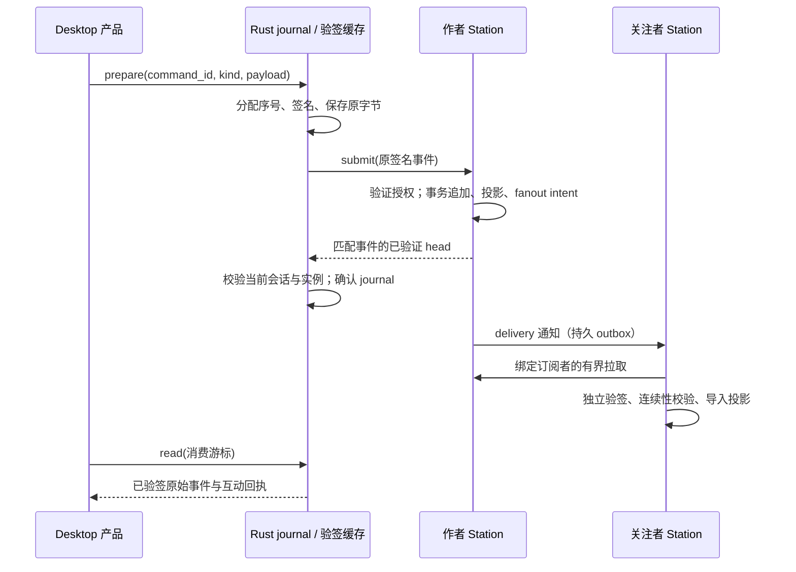

# 朋友圈主权架构 v1：研发接入与流程

架构真源是 [actor-feed-log.md §6.0](./actor-feed-log.md)，协议真源是 `model/domain/social/feed_log.proto`。用户行为单独说明于 [用户指南](./actor-owned-moments-user-guide.md)。

## 权威与信任

Actor Identity 保留 Actor 根公钥、Home Station 和已验证设备证书；Social 通过能力接口读取，不能另查身份私表或从待验证 FeedBundle 自行建立信任。

根密钥签署 FeedGenesis 与固定 FeedWriterGrant；设备密钥签署事件。v1 唯一链名为 `public/v1`。每条事件绑定 Actor、writer grant 哈希、序号、前条事件哈希、事件类型、payload 哈希和时间。

字节级 canonical protobuf、SHA-256 和 Ed25519 原语归 Frame `core/signedlog`。Social 负责业务准入、连续性、幂等和 fork；治理账本仅复用原语，保持原有 wire。Rust 规则位于 `packages/station-trust/src/feed_log.rs`，跨语言向量位于 `model/domain/social/testdata/feed_v1.json`。

## 本机命令



上图的 Rust/Go 和 Desktop 消费路径已落源码；接收者可见行为仍待 AFL-J01..04 验证。

Renderer 提交意图：`command_id`、`kind` 和 canonical FeedPayload 的 `payload_b64`。Renderer 不提供 Actor 身份、设备私钥、可信根或序号。

`social_public_feed_prepare` 从窗口会话解析 Actor 与账号，复用已登记的设备签名密钥和本地根密钥。首次发布建立根签创世和 writer grant，随后在 Actor 隔离的 SQLCipher journal 中分配序号、签名并保存准确字节。

`social_public_feed_submit` 复用 journal 中的事件，调用 `POST /api/v1/social/feed/events/submit`。发出请求前与收到 ACK 后检查账号、JWT、设备/key ID、MessagingEngine 实例、Station Peer ID 和生命周期代次。即使设备 ID 和密钥相同，更换 Engine 实例后的迟到 ACK 也被拒绝。只有正确成功信封与匹配签名事件的 head 才能确认 journal。

`social_public_feed_status` 恢复已验证 head 与待确认的 command、kind、payload 和事件字节。超时后重新提交同一 command；不得换 command、重新分配序号或修改原 payload。确认前下一条命令返回 `FEED_PENDING_ACK`。同一 command 的不同意图返回 `FEED_COMMAND_CONFLICT`。

## Desktop 与 Mobile 接入

Desktop `services/publicFeedNative.ts` 串行提交公开意图，并从 Native status 恢复待确认 command。重试保留原 payload 与对象 ID；账号或 Station 生命周期切换会清空 Renderer 的内存投影与消费游标，迟到结果不能进入新会话。

`services/publicFeedProjection.ts` 从 Native 已验证事件和互动回执重放正文、评论与反应。普通列表/详情 API 只提供本地对象 ID 和展示壳；公开正文、受众、媒体、时间、回复引用和 mentions 必须绑定重放结果，否则返回 `FEED_PROJECTION_TAMPERED` 或 `FEED_PROJECTION_UNVERIFIED`。消费游标在有界读取后推进，进程重启可从 Native 保留字节重新重放。签名成功且 journal 已确认即为本机提交成功，后续列表读取暂时离线不会把这次提交伪装成失败。

公开发布、编辑、删除标记、评论和反应已通过 `services/social_api.ts` 接到原有 Store/Runtime；非公开 composer 仍调用原有私密 Owner。公开编辑从已验证的原始 `CreatePostRequest` 克隆请求，仅修改正文并追加 `POST_UPDATED`，保留对象身份、媒体和受众；Store 在确认后更新投影，迟到确认仍受原生命周期栅栏约束。产品入口使用 peers-ui Menu、Dialog 和 TextArea，失败保留输入。Desktop `App` 持有一个生命周期稳定的 `UIProvider` 与 OverlayHost，跨页面共享同一主题/浮层环境，不在每张卡里重新建 Host。

Mobile composer 在拒绝公开发布前等待草稿持久化，保持输入、附件和受众；`momentsGateway.createMoment` 也在发送请求前返回 `FEED_SIGNED_WRITE_REQUIRED`。在役 iOS/Android Moments 套件改用真实 `CUSTOM_ALLOW` 私密种子，公开拒绝通过实际输入框提交、拒绝提示、输入值和持久草稿断言，并在清理测试草稿前保留截图。Mobile Search 套件仍含旧公开种子创建，须由现有 Runtime Owner 接入有授权的 Desktop 签名作者后才能继续其公开搜索验收，不能用 Mobile 代签或将私密种子冒充公开数据。

## Station 提交

圈子与拉黑仍消费其原始关系 Owner。圈子成员页使用绑定 Circle ID 的
`(added_at, actor_ptid)` 游标；Desktop 将所有页读完后才替换成员投影，
在一个 20 秒预算内最多读 100 页，每页 20 项。重复游标、超时和中途失败均拒绝部分结果；
本地成员命令、删除与 Session 切换会失效对应在途读取。
圈子创建与初始化成员属于一个数据库事务。编辑保存复用原增删与 rename 命令，
每条分别提交，失败保留草稿并读取真实成员。

拉黑使用原 `social_block_actor` / `social_unblock_actor` 的设备签名命令。
Renderer 把 int64 observed revision 编码成规范十进制字符串；Native 保留其完整范围，
拒绝不安全 JSON 数字。Store 只接受 COMMITTED/DUPLICATE 和匹配目标、动作、
revision 的投影，禁止相反方向的并发意图。原 Social Runtime 在启动和周期同步中
遍历原 `/relationships/blocked`，完整成功后替换名单；后续读取发现关系变化时发出原失效事件。
Actor、Session epoch、Station 和本地已确认关系变更均能阻止迟到投影覆盖当前状态。
这些源码接入仍待 Native Journey。

服务端从认证上下文取得 Actor 与设备，验证 Home Station、保留根公钥、设备来源、登记时间、撤销状态、签名与 canonical payload。

Social 原有读取 Owner 继续控制互动和转发目标的可读性。首次提交执行准入，精确重放不受后来目标策略变化干扰。

同一数据库事务追加事件、应用公开投影和登记 fanout intent。事务不枚举所有关注者。精确重放返回 duplicate；同序不同哈希或前链哈希冲突隔离作者链。必须提交隔离结果后返回冲突，不能把隔离标记一起回滚。

先收到互动回执、后取得互动者作者链时，作者链的同序事件必须与已保留回执完全一致，否则在投影前隔离作者链。线程导入事务遇到真正的作者事件 fork 时回滚导入后另行保存隔离；Station 提供的到达游标冲突是无效响应，不能据此指控互动者分叉。

公开旧入口返回 `FEED_SIGNED_WRITE_REQUIRED`。非公开受众继续走在役 Secure Content prepare/submit。

## 跨站同步

订阅变化按单调 revision 持久化并经现有 `/federation/delivery` 总线发送。周期对账从原始 follow 关系恢复遗漏的订阅变化，包括其他关系 Owner 的写入和撤除。候选扫描只决定调度；每次应用前持有原关系 Owner 的作者锁并重新读取 follow，避免用过期候选重新开启已撤订关系。

作者站工作线程每次枚举最多 32 个不同目标 Station，把 FeedNotification 写入共享 outbox 并推进 cursor。Relay 仅转发 opaque 字节，不决定复制目标、不保存 Feed 副本。

接收站只把通知当作同步提示。它持久化 dirty revision，通过绑定请求哈希、作者、链和订阅者的 peer token 有界拉取。通知丢失或过期仍由周期同步修复。接收站独立验证根授权、设备、每条事件和连续性，事务内导入投影；完整取得尾部后才把广告 head 当作已验证 head。

非关注者的反应和评论携带创世、writer grant 与单条签名事件，进入独立线程 receipt 存储。receipt 证明作者真实性，不证明该作者完整历史。目标作者站按其帖子订阅站扇出；缺失帖子或前置评论的投影持久化等待，失败条目延后重试，不能阻塞后续条目。

帖子作者站持有线程头锁分配 arrival cursor，索引与回执同事务保存。原有 feed/read 请求增加 `include_thread` 和 `after_thread_cursor`；响应带 `thread_entries`、`thread_cursor`、`thread_has_more`，每页最多 32 条且整个 protobuf 响应不超过 1 MiB。订阅者逐条验证互动者身份、设备授权、签名和目标帖子作者，在同一导入事务中推进自己的线程游标。后来关注与丢失即时转发均通过此路径补齐。游标只表示作者站提供的到达顺序，不构成线程完整性或不可遗漏证明。

源站互动投递保存 `OutboundFrameID` 和 `DeliveryRevision`；共享 outbox 的送达 ACK 才置 `Forwarded`。过期后增加 transport revision 创建新 frame，回执及作者事件序号保持不变。终止拒绝不会被伪装为送达。

## 读取与投影

Station 本地 object ID 与作者分配的 portable ID 分开。签名 payload 使用 `oss://<home-station>/post/<id>` 和 comment 引用，不能放入接收站的数字主键。Reaction 按目标、Actor、kind 去重并以作者事件序号比较版本；Comment 编辑和删除必须属于原作者，tombstone 不能被迟到编辑复活。

客户端必须从已验证事件得到正文，或把 Station 投影逐字段绑定到已验证事件重放结果。只检查 Station head 不能证明正文未被篡改。`verify_read_page` 验证 bounded page 与已有可信前缀，未见的远端尾部不会提前钉住。

`POST /actor/endpoint-manifest` 由 Actor Identity 提供原始 Home Station 签名的根公钥证明。远端获取复用已有 Endpoint Manifest peer route、Home Station 验签与 Identity 连续性存储；公开链首次导入不依赖私密聊天预热身份表。

`social_public_feed_read` 从当前窗口会话确定本机存储分区，获取 manifest，使用已钉住的 Home Station key 验签并持久保存 Actor 根公钥。首次 Station key 建立信任时，签名 Profile 中的 PTID 必须与目标 Actor 匹配。Renderer 的 handle 只用于路由提示，不能提供可信根。命令从本机已验证前缀发起有界拉取，检查完整响应的 canonical 字节，在 SQLCipher 事务内验证并导入原始事件。

同步游标与界面消费游标独立：输入 `after_sequence` 指定已消费位置，输出 `bundleB64` 重放本机保留的最多 64 条、总计不超过 1 MiB 的原始事件；`nextSequence` 与 `pageHeadB64` 表示本页消费位置，`sequence` 与 `headB64` 表示本机已验证同步位置。`hasMore` 包括本机未消费页与远端未同步页。丢失响应或进程重启后使用原消费游标即可重放。界面应从这些签名事件形成正文；普通 Moment API 返回的可变正文不获得此验证状态。根公钥或 Home Station 改变、链头回滚、正文篡改、丢失本地前缀都会拒绝读取。

线程输入 `after_thread_cursor` 是界面消费位置，输出 `threadEntriesB64`、`nextThreadCursor`、`threadCursor` 和 `threadHasMore`。Rust 从每个互动者原始 Home 签名 manifest 取得独立根，保留 Actor 根、Home 和固定授权，在 SQLCipher 内验签并绑定到已验证的目标发帖事件。重放缓存时仍验证回执，不能将普通评论投影标成已验证。

签名投影通过原有 `MomentEventPublisher` 和事务 EventBus 写入持久化失效提示，提交后唤醒客户端；当前提示范围为自回声和帖子作者。订阅者的正确性由周期补拉保证，不能宣称所有关注者均有即时推送。公开内部 Comment/Reaction 服务拒绝无签名写入。私密本地及跨站反应使用原 private interaction 的设备签名命令、结果日志和原子权限事务，帖子及评论目标独立保存；`ReactionService` 只派生汇总。评论 target 已进入生成协议、Go 原权限事务、Desktop/Mobile Native、Runtime 与 peers-ui 评论行。内容版本和反应版本独立合并，身份栅栏阻止旧读取或反应结果覆盖新会话；源码回归不构成 Native 产品证明。

## 当前验证边界

公开 Native Suite 的漏通知控制由原 Fixture 父进程通过 ephemeral capability
通道管理。原 Station 组合根仅在 `social_acceptance` 构建中注入控制器，普通构建
排除该文件；原 Docker/部署管线只为已绑定接收站投影 run/profile，Suite 清理在
释放源/服务 lease 后由原 equipment Owner 恢复普通构建。

父进程通过已审查 SSH 的容器 stdin 写入一次性规则，目录 `0700`、普通文件
`0600`、同 UID 与 OS flock 约束共享访问；规则绑定当前 commit、run、Profile、
接收站、Actor、源站和最小 head，最长 90 秒。控制只在实际 Actor Home 检查之后、
原 dirty 标记之前丢弃一次真实提示，记录原 Frame canonical SHA-256。
原有 32 项/1 MiB 拉取、验签、导入、线程和周期调度保持原 Owner。

只有本次丢失的 head 尚未见过、随后真实有界拉取成功验证并导入到该 head，才能
记录 causal repair。Native 场景从作者当前已验证序号推导下一 head，并在一个
80 秒预算内等待原 Station 修复和接收卡片连续两帧绘制；不由 oracle 主动刷新。
场景同时保留与普通提交同源的实际回读和提交到绘制样本。
文件、通道及接收站普通运行形态的恢复都属于清理义务。

已运行的 Rust/Go 源码检查验证签名向量、身份拒绝、重放、fork、分页 head、journal ACK、投影生命周期、订阅 revision/CAS 与有界 fanout。这些属于 SOURCE_CHECK。Go 凭据冲突与过早送达的受控变异分别触发 `TestFeedStoreAuthorPrefixCannotReplaceIndependentReceipt` 和 `TestFeedInteractionExpirationRenewsTransportAndOnlyACKMarksForwarded` 失败；恢复后注册源码门禁通过。Native 可信链头变异也已检出，不能因此推导界面或跨站行为已通过。

客户端检查已运行：Desktop 36 项、Mobile composer/gateway 27 项；两端 TypeScript 检查通过。移动端验收脚本和拒绝 oracle 共 62 项源码检查通过。关闭 Desktop 正文匹配校验和改变 Mobile typed 拒绝码的受控变异均触发对应检查失败，恢复后复验通过。这些结果不代表 Native 用户行为已验证。

统一源码门禁为 `social-public-feed-source`，通过原有 Acceptance runner 执行：

```bash
python3 tooling/scripts/acceptance-run.py --gate social-public-feed-source
```

CI 或外部证据目录运行时必须设置 `PT_ACCEPTANCE_ARTIFACT_ROOT` 为仓库外的真实目录。Python 依赖采用 `tooling/acceptance/requirements.txt`；`station-api-ownership` 使用 Go 1.24.6 或更高版本的本地工具链，不依赖运行时自动下载。源码门禁分别执行客户端、移动端 oracle、Go 回归、station-trust Rust 向量和 Native journal/cache 测试。

Feature、Capability 与路径映射分别位于 `tooling/acceptance/features/social-public-signed-feed.yaml`、`capabilities/social.yaml` 和 `registry.yaml`。门禁运行源码测试并保留日志，不能代替以下产品 Journey：

- **AFL-J01**：Alice 原生公开发帖、编辑、tombstone，丢弃 ACK 后原操作精确重试且无重复投影。
- **AFL-J02**：Alice/Bob 在两个隔离 Station；屏蔽一次通知后补拉收敛，晚关注者取得帖子历史和历史互动。
- **AFL-J03**：非关注者评论、回复和反应；作者和关注者验签读取，互动 outbox 过期后换传输帧、保持原凭据，送达 ACK 前不得报告完成。
- **AFL-J04**：进程重启恢复 journal 和消费游标；撤订停止后续复制；第二设备拒写；回滚链头、篡改正文和凭据均拒绝。

四条 Journey 必须复用同一个当前源码双站 Native Suite。`social-public-feed-native-e2e` 复用原 Native 启动/登录/重启、Search 输入/绘制 oracle 和 Social Federation/Actor 夹具 Owner；编排发布后晚关注、非关注者评论/反应、公开编辑、重启读取更新版本、接收站公开搜索、删除标记及根评论/回复点赞七个场景。搜索绑定 Bob Station 签发的真实对象 ID，删除还断言同一打开的 Search 结果消失。夹具在发布前明确撤订，场景操作通过真实按钮和输入框，读取断言包含 DOM 与 computed-style，截图作辅助证据。该套件尚未实跑；完整四条 Journey 的故障和原型视觉范围仍有缺口。

私密评论沿用原 CSS-09 Suite：AS20 在 Alice/Bob 的真实评论输入框提交根评论和回复，分别点击两端的点赞与取消按钮，读取各自的已确认计数和 viewer 状态。原 Native journal 的持久命令 ID 驱动两次 committed retry；AS23 在既有替换设备上验证同一评论身份和保留计数，同站回归覆盖 Alice 经原作者站提交的私密根评论/回复反应。每个计数断言消费现有 Native visibility/paint-frame 原语，并保存当前截图与 DOM；验证器核对源身份、目标、会话、双端状态和 artifact digest。已提交命令的本机重放不等于丢 ACK 后向服务器重投，后者仍需真实故障证明。私密 Suite 的历史手动消费者尚需接入当前 Runner preparation，不能把缺失 Suite artifact 的读取当成产品 Journey。

故障注入须经原 Runtime Owner，不能直接写界面 Store 伪造结果。远程同源部署需要可寻址的源码 checkpoint；用户已授权本任务范围内的本地 checkpoint。双站 Provisioner 消费 Machine Dev 验证过的工作区 slot，按实际 slot 派生客户端端口，并继续要求 active Profile 等于 Alice 的 Station role Profile；环境合同没有固定 slot。运行仍须校验真实 capability、lease、远程拓扑与源码 attestation。

交付仍需真实双站 Journey 和变异验证覆盖通知丢失、补拉、非关注者互动、重启重试、撤订、第二设备拒绝、head 回滚与投影篡改。原有跨站 Native Suite 验证私密动态，不能作为新公开 Feed 的证明。

生产 MomentService 的旧创建/删除方法与 PublicPostRepository 的对象创建/删除方法已经移除，测试夹具仅存在于测试二进制。搜索原有 PostgreSQL 索引直接绑定原始公开正文列，签名投影更新这些列后索引自动更新。

实时投影、历史互动补拉、Desktop 事件消费和 Mobile Moments active 契约已接入源码，双站当前源码证据仍须在对应验收完成后核销。全仓结构验证另发现 `agent-memory-system` 引用已不存在的 `apps/desktop/src/store/memory.ts`，属于本任务外的注册缺口。本文不把未运行或缺失的范围标记为通过。
