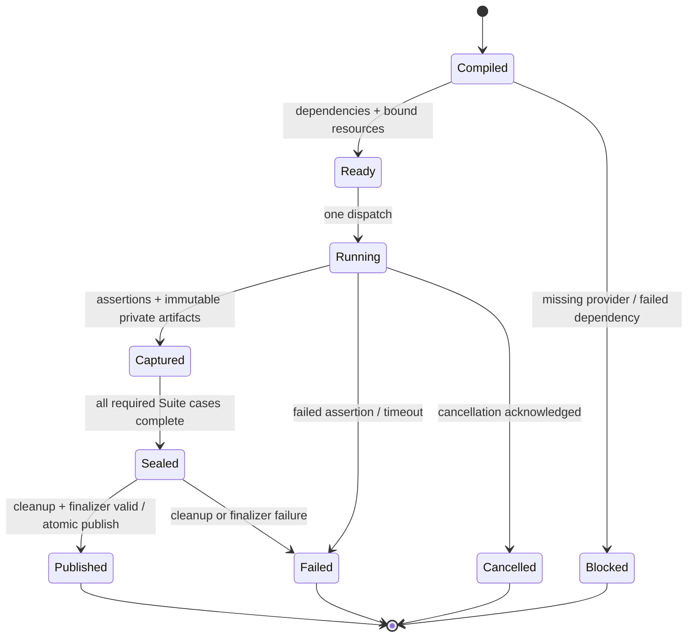

# 执行身份与证据关系

> **Status**: draft
> **Created**: 2026-10-22 | **Updated**: 2026-10-22
> **Owner**: Acceptance

## 注册模型

以下为拟议的内部类型关系，不是已上线 schema；不创建 Plan schemaVersion、
协议版本升级、跨应用 RPC 或新的审批状态。

```text
Feature
  assertionDefinitions[]     # 稳定 ID、期望结果、证明强度、负向条件
  steps[]                    # 唯一 authored Operation + Visible Result

SuiteDefinition
  producerEntry              # 业务运行入口
  scenarioRefs[]             # 引用已有 Step/case；不复制动作和断言语义
  prerequisiteRefs[]         # readiness / evidence / state 三类边
  resourcePolicy             # 所需平台、拓扑、资源与 reset/replacement 边界
  runtimeReuse               # 复用既有契约

GateDefinition
  requiredAssertionRefs[]    # 判定集合及必要 case/cell
  evidencePolicy             # 既有正式证明规则

CompiledExecution
  selectedGateIds[]
  dependencyNodes[]
  suiteGroups[]
  producerCases[]
  gateJudgments[]
```

Catalog 和 Feature 仍各司其职。Gate 不能重写 Step 的产品含义，
Suite 不再维护第二份登录/收发用例。
上述稳定 ID 必须能追到业务 owner 和合同；未知引用、循环或孤立断言 fail closed。

## 三个身份域

**运行身份**绑定源码 commit/工作区摘要、客户端实际产物与服务 attestation、
Profile 配置摘要、runtime cell、拓扑、账号/设备与 launch generation、
Suite runtime ID、fixture epoch、当前权限和密钥 epoch。
只记录非敏感 identity/digest，不把凭据、密钥或原始 handle 写入 evidence。

**语义身份**绑定 producer 注册、case 参数、Step、provider、oracle、
依赖与期望结果的合同摘要。相同命令不代表相同语义，
不同 Gate 标签也不代表不同执行。

**证据身份**保留原始 run ID、producer/case/attempt ID、assertion ID、
ArtifactRef/manifest hash、证据 class、观察端、业务产物 ID 和 cleanup 关系。
Gate verdict 显式引用这些身份；不得修改 producer 身份伪装成另一 Gate 自己运行。

```text
caseExecutionKey = canonical_digest(
  executionMode,
  sourceAndContractIdentity,
  runtimeAndSecurityIdentity,
  producerCaseAndInputs
)

AssertionResult = {
  assertionId, caseExecutionKey, attemptId,
  result, evidenceClass, observerIdentity,
  artifactRefs, dependencyRefs, businessOutputRefs
}

GateVerdict = {
  gateId, expectedSource, requiredAssertionResults,
  missingRequirements, sourceArtifactRefs, result
}
```

这不是全局缓存。去重只发生在本次编译运行里，
或由本次显式选定且通过完整身份验证的不可变 producer 输入实现。
禁止从 latest 指针猜测合适的旧 PASS。

## 生命周期



Blocked/Failed/Cancelled 不能复用作成功证据。
diagnostics 保留具体原因，但不形成正式 Gate PASS。
retry 创建新 attempt，并通过受控 reset/reconcile 验证输入状态；
不是重复派发一个未知结果的 mutation。

## 状态失效

源、运行产物、provider/oracle/Step 合同变化令相应执行身份不再匹配。
Actor 切换、Session 撤销、设备替换、密钥 epoch 变化、fixture reset
令依赖旧状态的 readiness 与后继 case 重新计算。

结果必须注明自己证明的是操作前还是操作后的状态和确切业务产物。
接管前 message M1 的成功仍是 M1 的历史事实，不能证明接管后 M2 的投递。
与该变更无关且合同完整匹配的不可变 source-contract 证据不因名字相邻而失效。

## 输出与清理

过程数据写入当前 Suite 私有 transaction 区，最终证据使用既有 Evidence Store。
Suite 结果附既有 runtimeReuse report，以及 compiled graph 与实际 dispatch
计数的关系；finalizer 仍只读 sealed snapshot。

Gate 层只保存判定和原始引用，不能复制、编辑或补写 producer 的截图/轨迹。
Suite 内原子发布沿用 D-21；resource lease、secret 和大证据继续保留仓库外。
本次提案文档也不是 Runtime report、正式 Gate result 或新 proof schema。

## 计量与执行策略

沿用 OpenTelemetry span/context/event/link 模型表达实际执行，
内部存储仍在既有仓库外 artifact/profile 根，不创建第二套证明存储。
最低关系如下；字段是拟议内部模型，不是新的 Plan schema。

```text
StageSpan
  traceId / spanId / parentId / links
  executionId / suiteId / caseId / attemptId
  stage / monotonicStart / monotonicEnd
  sourceContractRuntimeDigest / operationRef
  outcome / failureClass / lastConfirmedStateRef
  probeCount / progressCount / artifactCount / artifactBytes

CostProfile
  mode / caseContractDigest / platform / resourceProfileDigest
  coldWarmClass / outcomeClass / sampleWindow / sampleCount
  stageDurations / resourceSeconds / quantileAlgorithm
  invalidationReasons / uncertainty / observedOrEstimated

ExecutionPolicy
  compiledGraphDigest / costProfileRefs / fixedCandidateIdentity
  resourceGrouping / concurrency / readyNodeOrder
  observationPolicy / cacheInputRefs / hardBudget / mandatoryWaitFloor

OptimizationAssessment
  strategyBefore / strategyAfter / changedPolicy
  requiredCoverageDigest / identityIsolationChecks / faultDetectionChecks
  matchedWorkloadIdentity / measurementRefs / timeAndResourceDelta
  acceptedOrRejected / fallbackPolicy / unresolvedOwnerChanges
```

时钟使用进程内 monotonic duration；跨进程使用 trace 关联和对齐后的时间线，
跨机器不能直接相减未经校准的 wall timestamps。
阶段汇总必须消除父子/并发重叠，历史 manifest 时间只作粗粒度区间观察。

统计 profile 不能成为业务真源或可继承 PASS。样本不足、标签不匹配或
输入/策略变化时明确 unknown/estimated，不能自动生成“实测 P95”。
正式证据引用保留完整身份；metrics 标签保持低基数，不带消息内容和凭据。

同一 execution fingerprint 的效率检查与策略选择各只有一个 owner。
优化记录说明采用什么策略、为什么满足合同、测得或预测的成本；
不包含伪造的业务结果、签名审批链或隐式新授权。
