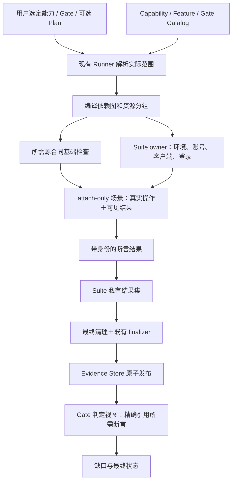
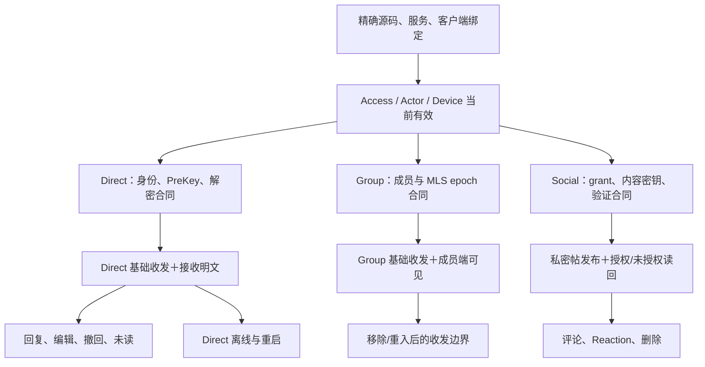

# Acceptance 执行模型

> **Status**: draft
> **Created**: 2026-10-22 | **Updated**: 2026-10-22
> **Owner**: Acceptance

## 核心原则

1. Gate 是判断合同；场景是执行单元；两者不要求一一对应。
2. 基础证据、运行前置、业务操作顺序采用不同类型的依赖。
3. 共享资源属于 Suite，业务状态隔离属于 case；独立故障条件保留。
4. 复用的是当前运行的不可变断言证据，不是历史 PASS。
5. 沿用 Operation → Visible Result → Step 的唯一意图来源。
6. 首次有效反馈、最终判定、返工和框架自身成本必须可计量且有预算。

验收效率的目标、实际耗时调查和自优化控制关系由
[时延与自优化设计](performance-design.md) 与
[耗时调查](performance-research.md) 定义。框架同时回答“能否使用、是否达标、
为什么慢、下一次如何减少成本”；性能优化不能改变前三项证明含义。

## 系统关系

Graph 是现有 Runner 的内部执行模型，使用当前注册与显式选择；
不要求额外 Admission、Development Session、OWNER receipt 或 PlanMount。
Plan 是可选输入，不是运行授权；保持当前隐式 V1，不引入版本升级。

## 三种依赖

**运行前置**表达“接下来能否执行”：当前源码/服务绑定、账号、session、
设备身份、页面和相应 Runtime readiness。它们不自动成为完整登录/加密验收。

**证明依赖**表达“这项结论需要哪些独立断言”：基础断言满足后才能运行或判定
依赖它的上层 case，缺失则保留具体 blocker。source-contract 与 receiver-UI
等证据强度必须匹配，不准互相替代。

**状态依赖**表达“必须先发生哪些业务变化”：创建会话、加入群、发基础消息、
修改同一条消息、撤销设备、观察撤销后拒绝。它引用当前 case 的产物身份；
不能用另一个 case 的类似消息替代。

三个边类型都做闭包和循环检查。基础失败只阻断其下游，
不把未执行的上层 case 报为业务 FAIL，也不停止没有该依赖的其他分组。

## 基础能力与上层能力

图表示能力关系，不承诺所有节点必须独立发一条消息或新建一个 Gate。
既有基础收发可以一次产生“发送端提交”“指定接收端正确明文”
“对应 delivered receipt”等不同断言，业务 Gate 分别消费。
密码学负向 case 独立产生防篡改、错误身份/密钥拒绝、撤销后拒绝等断言。
Direct 成功不证明 MLS 或 Social 成功。

Runtime readiness 不应通过发消息探活，除非发消息本身就是该 case 的被验收行为。
普通 Chat setup 不依赖 Social 激活，普通登录不夹带 WebView restart。
登录、恢复、logout、takeover 是独立可选产品 case；其真实操作仍必须留证。

## 唯一生产者与多 Gate 判定

同一来源、case 参数、平台、拓扑、Actor/Device scope、generation、
fixture 状态、密钥 epoch、provider/oracle/Step 合同的执行只有一个 producer。
一个 producer 可产生多项断言；多个 Gate 可以引用同一断言的 ArtifactRef。

例如 Direct baseline 的一次真实收发可同时服务 Chat 基础能力与 Session
共存证明，前提是该次收发处于要求的 class 状态且完成两端可见性。
takeover 之后必须发新消息，证明新端可用和前任不可用，不能消费接管前的成功。

同一 producer 中一次操作可服务多个断言，但每项断言具有自己的条件、
观察对象和证据强度。执行器不根据“sendMessage”字符串猜测等价。
重试是单独的 attempt，保留原 logical command 身份；未知结果先对账，
不能因为“测试重试”再产生一次业务提交。

## Suite 资源所有权

资源组以当前源码、Profile/拓扑、隔离策略、平台能力、客户端集合和破坏性
状态边界分组，不以 environment 名称或 Gate 名称分组。
共享同一环境名是候选条件；不同账号隔离、设备数、平台或故障合同可要求独立组。

Suite owner 通过现有 Provisioner、RuntimeBinding、Driver 与 launch context
准备服务、账号、客户端、存储及登录。Core 只编排接口、校验、计量和生命周期；
不得理解 Alice/Bob、Chat、Social、MLS 或具体 selector。

场景只获得受限的已绑定运行接口。普通 case 无 provision、deploy、launch、
login-setup、全局清理权限；不能绕过 owner 直接调用底层准备函数。
仅靠手工记账不足以约束，实际边界调用同时形成账本事件。

业务 case 的 restart/logout/takeover 经声明的状态转换操作执行，
必须给出目标资源、允许替换、期望 generation 和后继状态。
这类操作属于被验收的产品动作，不伪装成普通准备。
它们令依赖旧 generation/session/key epoch 的证据失效；
后续 case 重新读取所需 readiness 和基础身份，不默认把所有历史断言重跑。

Scenario 结束前保留所需 UI 状态。owner 捕获证据后才 reset namespaced
业务数据；既有密钥、账号和客户端热状态不靠全量重建实现隔离。
Suite 结束或失败后由 owner 逆序清理一次。只有租借、未由本次创建的
Profile 服务遵守原 owner 的释放策略，不扩大删除范围。

## 调度与失败语义

编译期验证依赖闭包、唯一 producer、断言可达性、实际入口、资源预算、
case 状态隔离和合法复用。新增或变更定义在执行前失败，不耗时部署后才发现。

同一资源组默认串行状态操作；不同资源组可在显式预算内并行。
并发须取得整组所需资源，不能无界排队、超卖设备或与其他运行争抢端口。
无人可执行且无运行节点时报告图错误或明确资源阻塞，不无限等待。

每个节点有 deadline、有限 retry policy 和确定的 cancellation/cleanup owner。
源漂移、绑定丢失、超时或未知业务结果停止相关变更，保留私有诊断。
重试不消费失败 attempt 的 PASS；先对账恢复，再形成新有效 case 证据。

Suite 中间断言先进入 owner-private 区；运行中可用于调度后继，
但不能向聚合器发布子 Gate 的正式 PASS。
按现有 D-21，全部 required case、最终清理和既有 finalizer 有效后，
整个 Suite 结果 generation 原子发布。失败/取消不得暴露可拼接的半套 PASS。
Gate 判定仍要求自己的所有 assertion，不能用其他 Gate 整体 PASS 顶替。

## 功能验证与正式证明

开发阶段保留现有规则：聚焦 source check 和一条真实功能 Journey，
不运行相同的大 Gate 列表两次，也不自动做 full release。
正式闭环从开始即使用正式取证合同和选定 producer 图，
正式生产者可一次服务多个 Gate，末尾执行只读判定及聚合。

已运行的功能证据只有在它从生产时就满足对应正式合同、源码和全部身份，
且当前 Workflow 明确允许该方式时才能作为输入。
本提案的默认方式是正式 producer 新运行一次，不追认历史 proof。
“functional-before-formal”不要求两轮相同 19/5 Gate。

## 防复发与可证伪目标

把以下条件接入现有 structure validation、pipeline audit、Runner 和 Gap Detector：

- 每个 selected Gate 的每项 required assertion 有且仅有一个当前 case producer。
- 同 identity 的 producer dispatch 数为 1；重复消费者不会增加 dispatch 数。
- 普通 case 的重新部署、创建账号、启动客户端、登录准备次数为 0。
- 每个资源组准备一次；声明的 restart/replacement 另计，不混入 setup 指标。
- 每项所需 UI 断言关联实际操作、观察端和 immutable artifact，不能只登记事件名。
- 编译图预算、实际边界事件与 Suite report 相符；不接受漏记账的“热复用”。
- source/runtime/provider/oracle/Step 或权限/密钥状态改变后，相关证据不可复用。
- Gate 拆分前后的要求覆盖等价，平台/拓扑/负向 case 和证明强度不丢失。
- failed/cancelled Suite 没有正式子结果，cleanup 失败不能产出 PASS。

基准用相同源码、Profile、平台和业务 case 集合比较准备次数、重复 dispatch、
消息 logical ID、每类操作耗时及总代价。记录首次运行与已有构建缓存两种情况。
当前没有耗时基线，因此不宣称节省比例；先证明上述确定性计数再评估耗时。
源码/框架检查可证明图和生命周期，Chat/Social 可用性仍由原生双端 E2E 证明。

## 时延与自优化责任

Runner 在解析选定范围后使用同一图编译器和按类成本 profile，
执行前估计关键路径、不可压缩等待和预算，执行中记录真实边界。
早期反馈只发布可定位观察或 blocker；正式 PASS 仍等待 Suite 终态证据。

Acceptance Core 的策略控制器仅调整合法的复用、缓存、有限并发、
独立节点顺序和只读观察方式；业务 owner 定义 assertion、fault 与产品时延。
框架自己的轻量效率 Gate 使用图与既有 spans 检查成本/性能回退，
不递归执行业务 Gate。需源码或合同变更的改进仍进入现有 Development Workflow。

同一候选保持固定，不因后续提交反复重置整个正在验证的图。
跨源码 Native 历史证明不改标；新候选选择其实际所需范围再验证。
热/冷态、首个失败反馈与最终闭环分别约束，不用一个 timeout 隐藏全部阶段。
