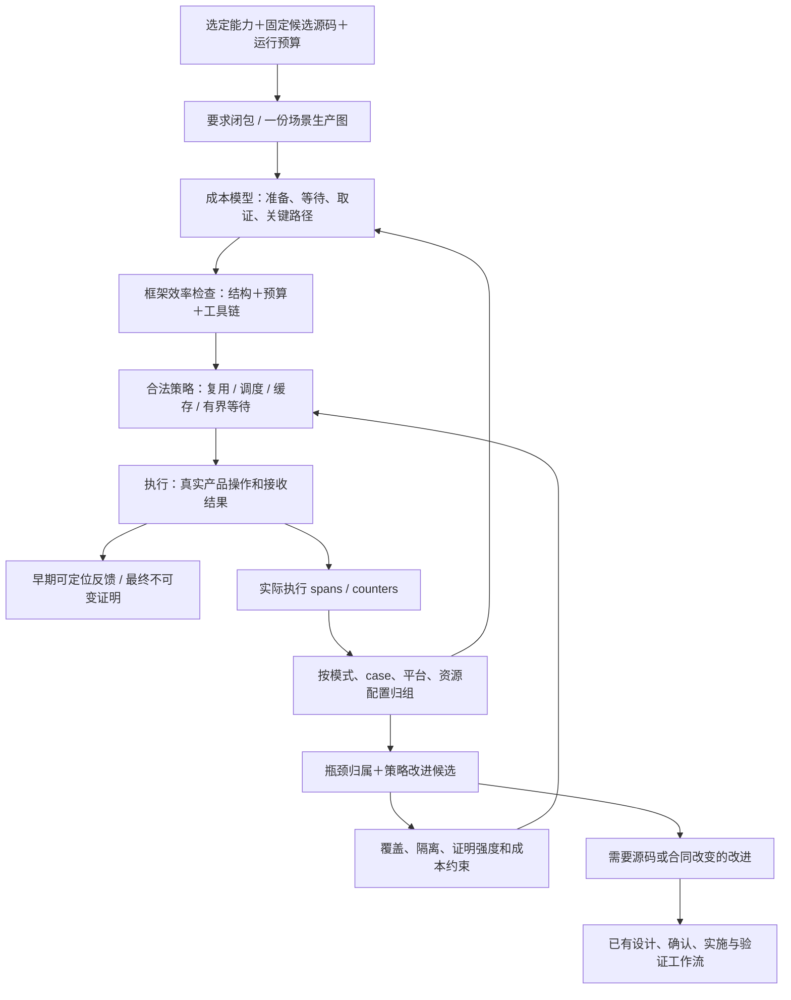

# 验收反馈时延与自优化

> **Status**: draft
> **Created**: 2026-10-22 | **Updated**: 2026-10-22
> **Owner**: Acceptance

## 工程北极星

在保持选定能力、平台、故障条件和证明强度的前提下，
让小范围修改的有效反馈进入秒级、热态闭环进入分钟级。
验收执行时长、失败定位时长和验收自身成本是架构合同，
不能等所有 Gate 跑完后才讨论“是否太慢”。

可用性、安全性和成本分别报告。产品确实有缺陷时，快速、正确定位缺陷就是
有效反馈；不得以提高通过率或压低耗时为由删要求、跳 case 或延长等待。
本文件提出目标和机制；历史测量见 performance-research.md，
下文数值均为 proposed SLO，不是已经达到的性能结论。

## 四个闭环

生产图决定“必须证明什么”；执行策略决定“如何减少等待和重复工作”。
效率检查消费当前图和已有计量，不递归发起一轮业务验收。
控制器不得成为新的范围、授权或证明真源。

## 端到端时间模型

从 Runner 接受明确请求起计时，直到返回该次请求的最终结果并完成 required
cleanup、finalizer 与本地 Evidence Store durable publish。
排队、规划、资源准备不能被排除在“总耗时”之外。

分别记录：

- **首次有效反馈**：首个受控操作/接收端观察，或能定位到具体根因的失败。
  “环境开始启动”“Gate 正在运行”不算有效反馈。
- **产品效果时延**：实际输入完成到要求的处理、提交、接收和 UI 呈现。
  业务 owner 定义其达标条件；“执行器很快”不能证明产品反应快。
- **最终判定时延**：选定要求全部判定并完成终态清理、证据持久化。
- **跨次返工时延**：从缺陷首次暴露到同一问题被修复并完成回归；
  保留 build/debug/resource-wait 等间隔的类别，不把未知间隔猜成人工耗时。

阶段包含 request queue、snapshot、plan、source checks、build、deploy、
account、client launch、login、fixture reset、input、transport、processing、
receiver/render wait、assertion、capture、cleanup、finalizer、publish。

每阶段以 span 表达，嵌套阶段记录父关系；多个消费者使用 links。
聚合计算 exclusive time 与时间区间并集，不能把父子 span 和并行工作相加当 wall time。
关键路径含业务依赖和资源串行边，不能只看静态 DAG 的最长依赖链。
CPU、设备占用和 artifact I/O 另计，降低 wall time不能靠无限增加资源。

## 首批时延目标

支持配置为受控同 Station、一个 macOS Desktop cell 与一个 iOS Simulator cell。
使用固定 case 集合、依赖版本、设备/宿主资源、工具链和证据强度。
冷/热态分别报告，后台负载或资源等待仍计入总时间并单独归属。

1. 图编译、控制面检查 P95 不超过 **2 秒**。
   不可用工具链或错误配置须在 **5 秒内**返回具体失败，不能进入长 Journey。
2. 已有合格候选产物和就绪 Suite 时，一个受影响能力的首次有效反馈
   P95 不超过 **30 秒**，完整受影响原生证明不超过 **3 分钟**。
   这里仍包含所需 case reset、断言、取证、最终清理与发布。
3. 已有构建缓存的小范围修改，从请求到构建/部署与受影响原生闭环
   P95 不超过 **10 分钟**。图须解释本次为什么需要每个节点。
4. 冷态准备单独设初始目标 **15 分钟**，不伪装成热态结果。
   慢编译、设备/服务不可用必须及时诊断，不能无界等待。
5. 固定候选的完整发布图初始预算 **60 分钟**；
   该数字不是从各 Gate 的宽松 timeout 简单相加得到。
   真实时间过期、长时稳定性、外部人工条件等特殊 case 显式声明最短必要时间，
   属于独立 slow lane，报告其范围、下界与 budget，不藏入普通修改闭环。

产品 input→receiver/render 时延由具体能力合同定义；
不能给 login、图片上传、消息和 group recovery 强行使用同一个毫秒阈值。
有效历史不足时显示样本数和实测范围，不输出虚假的 P95。
首轮少量固定候选测量只用于校准；P95 的常态声明采用至少 100 个同类正常工作样本，
注明窗口、样本数和分位数算法，必要时给出尾部不确定性。
任何目标调整必须注明是合同变更，不准控制器自行抬高目标“达标”。

## 效率、可靠性和证明质量指标

**执行去重**：
同一 caseExecutionKey、同 attempt 的非重试 producer dispatch 应为 1；
多 Gate consumer 增加不应增加 dispatch。
duplicate-work ratio 为额外非合同重复 dispatch 的耗时占 producer 工作耗时。
目标为 0；不同 fault/平台/输入、合同中的 retry 不算重复。

**资源放大**：
actual build/deploy/launch/login setup 次数除以兼容资源组所需次数。
普通 Scenario 自行准备次数为 0；声明的 replacement/restart 单列。
记录准备耗时、热复用次数、失效原因，不能只用 environment 名称声称命中。

**失败定位与返工**：
time-to-first-actionable-failure、失败阶段、最后确认状态、blocking dependency、
attempt amplification、失败后重跑的 case 数和重新准备秒数。
产品缺陷、预期 fault、工具链/资源失败、未定位和同条件 flaky 分开。
不能把 75.4% 的历史 failed/blocked 当成基础设施失败率。

**等待效率**：
pending 时间、probe 次数/成本、retryable/terminal exception 次数、
每次实际状态推进、observation lag、最大静默间隔。
可恢复等待必须有硬 deadline；terminal failure 不等整个 deadline。
要求“不发生某事”的负向断言必须保留合同规定的观察窗口。

**控制面和取证成本**：
planning/source-discovery/registry parse/hash 成本、重复读取/解析、
artifact 次数与 bytes、capture/scan/flush/finalizer 耗时、队列和设备占用。
观测开销目标不超过匹配基准 wall time 的 5%，并有自己的绝对时间/byte 上限。
5% 不能靠缩短被验收步骤来实现；由开关观测的同工作负载配对测量。

**证明完整性**：
选定要求的记账覆盖必须为 100%：每项有实际断言结果，或有可验证的上游 blocker。
产品正式 PASS 仍要求全部 required receiver/negative proof 完整；
stale reuse、跨 epoch 代证、未知 outcome 的盲重放为 0。
产品缺陷被快速发现时可以满足失败反馈 SLO，但不能把未执行下游写成通过。
缺失证明被隐瞒或非法代证时不得性能 PASS。
框架故障检出用已知、受控故障的回归验证，不能把“Gate 很快”当成检出有效。

指标标签只含有界的 mode、stage、case/producer、platform 与 failure class。
run/source/input digest 放入 traces 或引用，避免 metrics label 无界增长；
不得保存密码、密钥、消息正文或私密内容。

## 减少重复与全量重跑

用户的验收问题先转为明确的能力与达标条件。小修改只选择受影响要求及必要前置，
全产品 surface/viewport/text-size 矩阵由明确 full-UX 请求选择。
“本次受影响范围通过”不等价于“全发布通过”，两者各自返回结果。

Suite 跨 case 保持服务、Actor、设备和存储的隔离热态。
failed retry 默认只重跑失败前沿及实际失效下游；
如果 fault 破坏了共享密钥、Session 或 fixture，就重建该状态闭包，
而不是悄悄沿用污染数据。若无法证明边界，保守重建并报告原因。

一次验证固定候选源码和实际产物，后续开发的新提交不把进行中的候选
反复重启成混合版本。既有源码投递/产物机制提供固定快照；
不自动创建新 worktree，不将旧版本结果改标成新版本。
新候选使用最新闭包再验证，release 只对一个固定候选汇总。

缓存分三类：

- 解析/图缓存：由完整内容摘要、相关 registry/合同和解析器版本决定，
  任一输入变化即失效；目录/依赖集合发生变化也必须发现。
- 构建缓存：复用既有 BuildKit/Cargo/Node 等的确定性输入产物，
  保留当前 candidate 的必要链接/身份验证，不重新创建无关资源。
- 运行证据复用：默认仅在同一当前执行里，完整身份、状态和合同匹配的消费者
  引用同 producer。遵守现行 current-snapshot proof 规则。

Native 跨源码旧 PASS 不进入新候选最终 PASS。
跨候选的可迁移静态证据如需采用，必须有显式 hermetic-input 和证明可迁移合同，
作为独立架构决策审查；控制器不能自行开放。
优化收益应首先来自上述合法范围、热资源、构建复用和单次生产，
避免为了缓存证明重新制造两套真源。

## 等待、故障与快反馈

统一 observation contract 返回 pending、satisfied、retryable 或 terminal，
并记录最近状态、进度和具体依赖。尽可能使用真实事件/状态变化及稳定可见结果；
事件只是唤醒，最终 assertion 仍观察实际业务或 UI 结果。

既有 adapter 没有可靠事件时允许有界条件轮询。
probe 只读，每次 RPC 和总等待都受剩余预算约束，
没有进展时增加间隔而不是密集截图/整页扫描。
selector/schema/session 明确无效时立即停止相关分支。
自适应 polling 不能缩短 required negative window。

早期反馈流包含已观察条件、当前 blocker 和预计剩余成本。
未完成 Suite cleanup/finalizer 时标为 provisional，
按 D-21 禁止发布正式子 Gate PASS；最终判定可以失败，也可以保持 UNPROVEN。
让人提前知道问题，不等于提前宣布正式通过。

## 自优化控制器

控制器拥有执行策略，不拥有业务合同；使用约束调度和按类成本统计，
不要求 LLM 每次阅读全部源码、全部日志或重新设计流水线。

每次请求：

1. 编译 required closure，标注唯一 producer 和资源/状态冲突。
2. 从合格历史 profile 获取各阶段成本；缺样本时使用声明预算并标注 unknown。
3. 选择合法的资源复用、缓存、拓扑顺序、有限并发和 observation 策略。
4. 运行前计算资源关键路径、不可压缩时间下界与预算；
   预算明显不可能满足时提前报告具体节点，不能静默缩范围。
5. 运行中根据真实事件更新剩余成本；只重排尚未开始且允许独立的节点。
   不取消后偷偷重放已提交 mutation，也不在不同 source/state 间混用证据。
6. 结束后计算瓶颈、失效/返工放大，生成下一次策略建议和结构改进候选。

能自动做的事有明确边界：

- 同合同、完整 identity 匹配时合并 producer 与消费者。
- 兼容资源组复用、缓存命中、独立任务有限并行。
- 只读 probe 的有限间隔调整、明确 terminal 状态的 fail-fast。
- required artifact 保留前提下复用相同内容，异步导出非必需诊断。
- 由已有 span/index 自动给出失败上下文和耗时前几项，避免 Agent 扫描全部产物。

不能自动做的事包括删除 assertion/cell/fault、改业务阈值、
把 Harness 升格为 UI、缩短负向窗口、抬高 SLO、改 schema/协议、
跨候选继承 Native PASS、扩大资源/操作权限或直接修改生产代码。
这些候选进入已有 owner/workflow，经过设计、确认和验证。

策略升级先通过覆盖、隔离、失效与 fault-detection 校验，
再在同固定候选/工作负载比较时间、资源与证明质量。
只对瓶颈 Suite 做有界实验；默认实验预算不超过 10 分钟，
不为寻找改进反复运行完整发布。小样本结果是估计，不报 P95。
每次只有一组可解释策略变更，效果不好恢复前一合法策略；
持续样本主要来自正常工作，避免“优化器本身跑一周”。

## 框架自己的效率 Gate

拟议能力 `acceptance-execution-efficiency` 属于 Acceptance Infra，
在现有 `acceptance-infra-validation` / pipeline audit 中执行一次轻量判断。
它读取 compiled graph、runtimeReuse、toolchain preflight、成本 profile 和 span 摘要。
不重新 provision，不运行 Chat/Social，不递归启动自己。

校验包括重复 producer、场景拥有昂贵准备、非法复用、重复解析、
无子 deadline、缺阶段计量、不可满足预算、取证超限与性能回退。
自身目标 P95 不超过 2 秒，使用输入摘要去重；
每个 execution fingerprint 最多执行一次，无递归子 Gate。

性能回退与产品结果分开输出：产品 proof 有效但运行超过成本目标时，
产品结论保留，框架效率为 FAIL 并明确其 owner。
缺少同类样本或完整计量时效率是 UNPROVEN，不编造通过率；
仍可运行显式受限的业务验证，不因无历史 profile 阻塞全部业务。

## 可验证的落地条件

在相同固定候选、case、平台、Profile 与 required evidence 上测量：

- 重复消费者只增加只读判断，不增加 producer/setup。
- 同一 UI 故障在 terminal boundary 及时停止，输出最后正确状态和 blocker。
- 核心小改动不展开完整产品矩阵；完整请求仍保留全部要求。
- warm/cold、成功/预期 fault/产品缺陷/基础设施失败有独立统计。
- 框架能自动指出最高成本节点与可验证的改进策略，
  并证明新策略没有降低覆盖、隔离、检出和证据强度。
- 新提交不让正在验证的候选身份漂移；历史证据不改标。
- 自身诊断与观测有预算和终止条件，不能成为下一层重复验收。

该合同与 execution-model 的数据模型、决策和集成要求共同审查。
落地后以测量判断是否达标，现有源码与历史记录只支持上述问题和设计输入。
