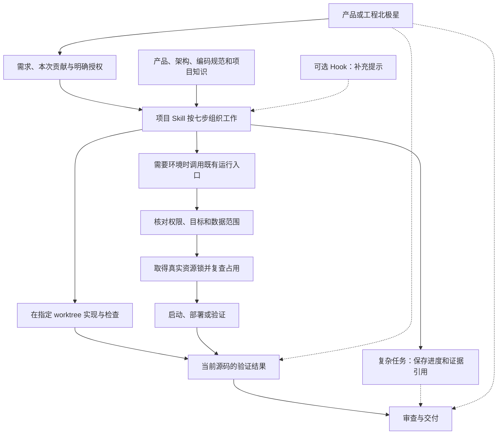

# 开发流程工具重构设计

> **Status**: active
> **Created**: 2026-09-13 | **Updated**: 2026-10-14
> **Owner**: Platform Team

## 1. 目标与范围

本设计落实[规范研发流程](../../../global/workflow.md)：目标 worktree 使用项目的方法论和编码标准；小改动不背整套任务管理手续，复杂任务能够恢复进度并保留验证依据。目标实现必须支持多个 worktree 各自推进而不串状态，但本次调研、修改和验证只针对明确选定的目标 worktree。

设计只涉及研发工具。Station、Desktop、Mobile 的产品行为与业务接口不变。实现保留在本仓库，不引入外部流程引擎、服务或技能依赖。

北极星是流程的上游输入，不由任务状态机生成。工作组织读取对应产品或工程目标，
保存本次贡献和引用；小改动可直接继承用户目标，非平凡产品工作缺少北极星时返回
PRODUCT 阶段。任何 Plan、Task、Gate、进度百分比和关闭回执都不能替代北极星结果。

本文描述当前已落地的工具边界。实施依据与验收安排见
[冻结执行计划](./execution-plans/20261013-development-flow-rebuild-accepted/plan.md)。

## 2. 当前问题为什么会连着发生

旧流程曾把 IDE 身份、Hook OWNER、Action Receipt、任务登记、PlanMount 和多份
状态记录串成通用前置链，并把这条链接入运行准入。DWF-D42 已将其硬切为三个
独立问题：任务要做什么、具体副作用得到什么授权、实际资源是否可用。

当前 `workflow-kernel.mjs` 只解析工作区并生成建议上下文；
`task-progress-store.mjs` 只保存可选进度；`machine-dev-registry.mjs` 和
`machine-dev-lease.py` 独立执行真实运行权限、目标、源码身份和资源锁检查。

## 3. 三类职责怎样配合

**工作组织**由 `pt-dev-workflow` 和相关方法论 Skill 负责。它们从已明确的需求、工作区与授权组织动作。小改动可直接调用小修纪律和编码标准；复杂任务才使用进度记录。调用 Skill 不取得系统权限，也不强制建立计划。

**规范提示**由 Hook 补充。它读取当前工作区的规范和相关知识，返回上下文；不能决定普通工具能否执行，不能签发部署权限、创建 OWNER 或要求用户重开窗口后才能工作。

**运行环境**由既有 `devctl`、Profile 管道、Local Dev 和 Acceptance Runtime 负责。启动服务、部署、重置、独占设备必须核对实际权限与资源。这些入口独立于 Hook 和开发任务记录，也不由 Hook 的放行结果授权。

三者共同服务一个需求，不各自建立一套任务系统。只有工作组织保存任务进度；只有运行入口持有实际资源；Hook 的失败最多影响提示。

## 4. 普通修改的执行依据

执行普通源码或文档修改，需要明确需求、选定的 canonical worktree、修改范围及当前授权。工作区由用户指定或已确定的当前任务继承；不能从 Skill 路径、活动编辑器或随意一个搜索结果推断。

worktree 是可长期复用的开发位置，不是一次性任务容器。任务完成、取消或记录损坏
都不会封存 worktree；检查当前分支、未提交改动、修改范围和实际资源后，同一个
固定 worktree 可以继续承接下一项开发。Agent 不因开始新任务自动创建、复制、
切换或删除 worktree。

创建 worktree 是独立的用户授权动作。只有用户显式要求创建 worktree 时才能执行；
Plan、Task、流程恢复、冲突检测、测试或任何机器记录都不能隐含、继承或代替该授权。
未获得显式要求时，流程只能使用用户指定的既有 worktree，不能通过创建临时或永久
worktree 规避脏工作区、占用、冲突或旧流程错误。正式测试使用临时目录、合成
workspace fixture 或独立临时 Git 仓库，不调用 `git worktree add`。

Agent 在动手前核对目标 worktree 的真实目录、分支和已有改动。除非用户另行指定，
不读取、比较或验证目标外 worktree 的实现；写入仅限本次已授权工作区。
生成物和符号链接也要检查目标位置。

不再要求全机 `work.json` 登记、OWNER 身份、Action Receipt 或 PlanMount。短任务不为满足工具制造任务文件；是否使用计划由实际需求和用户指令决定。

这仍是 Agent 必须遵守的范围规则。可选 Hook 不构成针对任意 shell 的强制沙箱，不能声称它能够阻止所有越界写入。受控运行和验证入口对自己的路径、参数及目标执行检查；代码审查和 CI 检查已产生的变更。

## 5. 复杂任务的记录与恢复

复杂任务保存一份明确选定的任务记录，内容限于目标、范围、阶段、下一步、授权引用、验证引用和待收尾资源。每个任务使用一个带 checksum 的原子 `task.json`，更新采用 revision/CAS 和短时任务锁；不再维护事件日志、第二快照或 mount、run、Session、active-work 的相互强一致门槛。

工作记录放在当前 worktree 已被忽略的 `.dev-workflow/` 下。稳定设计和实施计划仍在 `docs/`，运行日志和正式 Acceptance 证据仍放在各自的既有存储中，不混入任务文稿。

一个 worktree 可以存在多份不同任务记录。恢复必须指定任务，或有唯一明确选择；多份记录不能按更新时间、分支名称或目录顺序猜选。记录只锁定自身的短时写入，不能占用整个工作区。

恢复先检查当前工作区和源码，再读取任务进度。源码或计划内容变了，重新评估受影响工作与证据；不能把任务记录当作源码真相。

中断的写操作如果结果不明，先检查操作结果或使用原操作幂等键查询。能确认已成功则补记录；能确认未执行才重试；不能确认时暂停该操作，禁止盲目再次部署、重置或提交。

任务记录损坏时，该任务的自动恢复不可用，但不能阻止另一项已明确授权且不冲突的工作。新任务仍检查实际修改范围与资源；损坏记录不自动删除，也不能用人工填“成功”补齐。

## 6. 运行环境与真实资源冲突

复用 `make profile`、`make station`、`make desktop` 和当前平台入口。Make 保持薄转发，不再增加 `dev-quick` 等快任务专用入口。

运行入口依次核对：

1. 当前工作区与请求的环境目标，不能默认换站、换主机或创建环境。
2. 操作权限：连接、启动客户端、部署、重启和重置分别判断，已有精确授权复用。
3. 实际共享影响：部署环境、数据库范围、账号、设备、客户端存储及端口。
4. 所需真实锁：在临界操作前取得，并在锁内复查目标和占用，失败则不执行。
5. 操作后结果：健康检查、源码或产物身份、实际进程，以及资源释放或保留去向。

现有 OS advisory lock 和进程组管理可继续使用。锁保护真实的部署目标、端口组、设备或数据范围，不能因为聊天结束、回执过期或文件 mtime 变旧就释放。

计划只说明预计使用什么；拿到计划记录不等于拿到资源。PID、启动时间和监听端口用于核对本机进程，不能单独证明远端部署安全。远端操作仍需环境定义、目标校验与对应运行权限。

具体运行请求包含 canonical worktree、操作、已评审 Profile、实际部署目标或数据范围、
源码/产物身份及已有授权引用。复用现有 capability 和操作授权处理：
连接能力不授予部署，部署不授予重置；明确用户授权或用户已批准计划中的精确
`authorization.runtime` 范围可以复用，但不要求计划存在、挂载或登记。
Agent 不能自行填写 `allowed`、扩大 capability 或生成授权引用来证明自己获准。
环境创建的既有人工授权机制保持独立。

资源键由运行入口从规范化目标派生；Profile 别名指向同一部署目标时共享独占键。
默认保护范围是本机多个 worktree 的竞争。跨机器同时部署需要该远端环境已有的
协调能力；本机 OS 锁不能被描述成分布式部署锁。未知协调状态下不宣称可安全并发。

缺少授权、目标不明确、stable 保护或真实独占冲突时，相关操作必须拒绝或等待。其他独立工作继续推进。缺少任务登记、Hook 身份或无关关闭记录不进入这类拒绝条件。

多个场景共用一个测试环境时，由 Runtime/Suite 统一准备和清理。场景只创建自己的数据并执行验证，不能各自抢建客户端、重复登录或关闭共用服务。

## 7. 验证结果与完成判断

源码检查、真实功能验证、正式验收和资源收尾分别报告。它们的依据是实际结果，不能由一张通用回执替代。

复用当前证据记录中的源码、产物、场景、断言、时间和证据摘要。审查显式接收本次范围与证据引用，不要求先建立 IDE 身份或开发 Session。证据缺失、过期或无法验证时，对应结论保持未验证。

业务正式验收仍由 Acceptance 的规范入口产生；不允许调用者提交任意 PASS 文件。框架自测通过与业务场景通过分别记录，不以一个通过替另一个通过。

任务状态写为完成前检查本次承诺的结果。交付授权另行检查：功能通过不授权 push、合并、发布或环境重置。尚需用户亲自验证的事项保持待确认。

结束时只处理本次持有的资源。关闭记录可恢复，但只能描述本任务的收尾，不能成为同 worktree 的全局新任务门禁。仍有资源未释放时明确列出并阻止相冲突的操作，不能因为缺少一张总关闭回执就封住整个工作区。

## 8. Hook 与安装的失败边界

复用现有插件和安装入口，删除与任务授权有关的绑定、grant、Stop 阻断和回执依赖。保留事件归一化与上下文输出。

安装时发现本机解释器并生成正确引号包裹的绝对命令；验证必须执行落盘命令原文，在宿主的受限 PATH 下运行。不能用重拼 argv 或完整终端环境冒充安装验证。

解释器不可用或回调自检失败时报告提示功能不可用，不阻止 Skill 单独安装，也不把安装失败表述为整个研发无法继续。实际宿主端是否执行、是否接受上下文需要另做真实验证，离线回放不替代它。

运行时从结构化 task root、工具工作目录及文件目标解析项目；多根冲突时跳过错误归属的自动注入并提示 Agent 检查，不能自动绑定其他 worktree。未知工具也只影响自动提示，不拒绝执行。

会话字段仅关联诊断，不建立 OWNER 权限。不要求每个宿主都提供同名 ID；缺失时不伪造稳定身份。缺少 task 选择时不自动写任务轨迹。

不新装全局 Hook，不修改其他窗口的投影或共享 workspace descriptor。现有项目级 Hook 按宿主支持方式更新，保留不属于本项目的配置。需要新窗口加载时，只说明新提示尚未生效，不能停止正常开发。

## 9. 本设计的明确取舍

采用工作区明确、任务记录可选、提示失败不阻断的方式，减少通用前置依赖。代价是不能把提示层称为任意 Agent 行为的硬隔离；这项能力不在本设计承诺中。

真实资源锁、稳定环境保护和操作权限继续保留，它们不是该删的“重流程”。完全删除锁只看进程，会留下检查与启动之间的争抢窗口；因此不采用。

不采用仅将旧 DENY 改成 WARN 的方案。旧命令和 Skill 仍会因回执、登记和关闭记录停止，外围降级不能解掉内部依赖。

不采用新的 Python 流程引擎、另一本任务账或独立 Make 快入口。已有 Node/运行工具的确定职责可以复用；解释器发现和提示降级在现有安装、插件入口处理。

## 10. 必须证明的使用结果

- 无 Hook、无会话 ID、无 OWNER、无开发登记时，已授权的局部源码和文档修改可以完成。
- 一个无关旧关闭记录异常，不阻止当前任务；实际修改重叠与资源冲突仍被识别。
- 两个不同 worktree 分别工作，知识与任务记录不串，且不修改对方源码和服务。
- 任务中断后恢复正确进度；结果不明的部署、重置等操作不能盲目重放。
- 未授权部署、stable 自主重置、抢占设备以及冒用资源标识被实际操作入口拒绝。
- 多场景复用环境，场景不重复准备资源；清理只释放本任务持有的资源。
- 验证与审查不依赖 Hook，旧证据不能证明新源码，框架通过不能代替业务通过。
- 新旧实现切换后，正式入口、Skill、规范和测试采用同一套职责；不能留无限期兼容开关。

正式设计评审和实现验收都按这些结果检查。本次文档成形不能替代任何运行通过结论。
