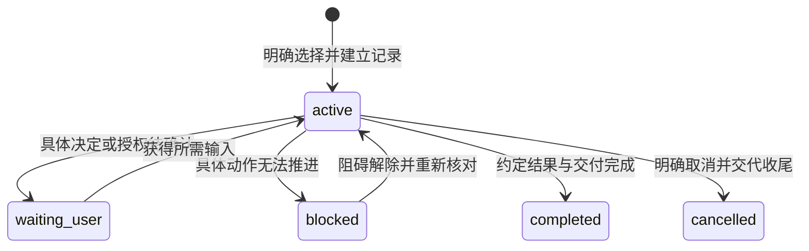

# 工作进度、工具状态与验证状态

> **Status**: active
> **Created**: 2026-09-26 | **Updated**: 2026-10-14
> **Owner**: Platform Team

本文约束当前状态呈现，存储字段见[数据约定](./data-model.md)。状态查询只读，不签发权限，不修复上游记录。

## 1. 各种状态分别表达

工作进度回答“这项需求推进到哪里”；提示状态回答“自动规范提示是否可用”；运行状态回答“实际服务和资源怎样”；验证状态回答“哪些结果已有证据”。

北极星不是状态。它是这些状态共同服务的上游结果；任何 `completed`、百分比、
健康状态或 PASS 都不能单独证明北极星已经实现。

无进度记录不等于工作区不可用，Hook 不可用不等于产品失败，服务健康不等于当前功能通过。查询必须保留这些区别。

## 2. 可选任务状态

图中的 `waiting_user` 对应记录值 `waiting-user`。阶段使用规范七步；阶段和状态是两项字段。未选择任务时不创建 `idle` 任务来填空。

`blocked` 必须指明受影响动作、事实原因和解除条件。其他可独立推进的动作继续；不能因记录问题把整个 worktree 标成禁止开发。

`completed` 需要约定结果对应的有效证据。记录曾经完成不表示新源码已通过；源码改变后呈现受影响结论过期，重新评估需要的工作。资源明确保留时显示去向；收尾未知不能显示全部释放。

## 3. 提示与安装状态

- Skill 投影有效：可以读取项目能力。
- 自动提示已离线验证：落盘命令和输出合同通过，宿主真实执行仍待观察。
- 自动提示已在宿主验证：实际工具事件产生正确工作区上下文。
- 自动提示不可用：缺解释器、配置未加载、回调失败或归属不明；直接读取规范继续。

这些是诊断说明，不是新的强制生命周期。未知宿主事件不产生权限拒绝。

## 4. 验证与审查状态

每项证据使用其既有分类和结果，显示当前、过期、缺失或不可读取。源码、功能、正式验收分别呈现；禁止汇成没有依据的全局“已通过”。

审查可为待审、通过、有问题或过期。未选择 Plan 时直接审查需求范围和完成标准，不补造计划。过期判断覆盖本次源码与产物、义务、检查实现和依赖；不能只比较一个分支名称。

## 5. 运行状态

从运行入口读取目标、权限、健康、实际进程、锁及操作结果。保留 prepared、running、succeeded、failed、outcome-unknown 等既有操作语义。

锁是否持有由 OS 锁和实际运行对象核对，不由任务、Hook 或聊天存活推断。不同 Profile 名称如果解析到同一部署目标，必须显示同一真实资源竞争。

等待资源只影响需要它的动作。资源结果未知要求核对目标，不能自动重启或重置来恢复“绿色”。

## 6. 状态查询的约束

明确 worktree；复杂任务还需明确任务选择。查询输出当前 Git、相关任务、验证和运行事实，无关机器记录损坏只产生局部诊断。

不创建监听器、后台刷新、任务、租约或修复事件。没有可靠活动事件时显示“最近活动未知”，不能仅凭缺少 Hook 心跳断言 Agent 停滞。

有效证据和未知项同时保留。任何投影都不能授予源码之外的写权限或合并、发布、重置权限。
