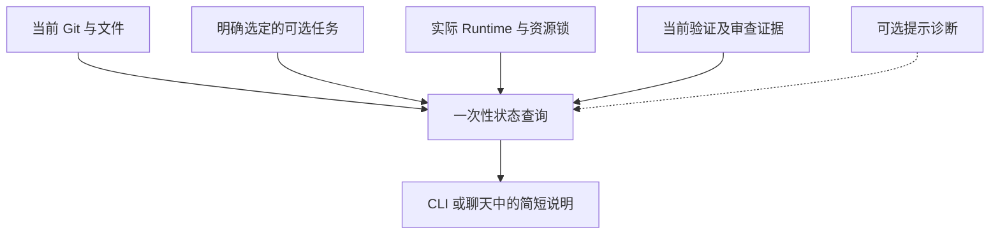

# 工作状态的只读呈现

> **Status**: active
> **Created**: 2026-09-26 | **Updated**: 2026-10-14
> **Owner**: Platform Team

## 1. 查询目的

帮助开发者理解当前工作区、选定任务、验证结果和运行资源。状态含义见[状态模型](./product-state-model.md)。

查询不修复记录、不改变任务、不授予权限，也不要求多个机器记录先一致才能输出。

## 2. 事实来源

Git 决定源码事实；明确选定的任务快照决定已记录进度；Runtime 决定操作和资源持有；证据存储决定验证。Hook 只提供提示诊断，不能成为其他来源的前提。

任务不存在时显示未选择记录。某一来源不可读时保留其他有效结果，说明受影响部分；不自动选择另一个 worktree 或最近任务。

## 3. 输出约定

一次查询说明当前工作区和源码、继承的北极星、本次贡献、明确目标、最近已记录
步骤、下一步、验证结果、阻碍及相关资源去向。无关机器记录不纳入当前任务准入。

活动信息只使用有界、脱敏的诊断事实。不保存原始工具参数、stdout、prompt、凭据或原始会话 ID；无可靠事件时显示未知，不凭沉默推断 Agent 卡死。

不以执行命令数、测试数或 Hook 心跳计算任务百分比。明确分步计划可显示已经完成的闭环数量，但状态不得替代有效证据。

## 4. 完成与资源呈现

已完成进度、当前验证、正式证明和资源释放分别显示。某任务历史完成后源码变了，不能继续用历史百分比表示新源码已经通过。

工作结束不自动停止保留给用户的服务。收尾未完成时列明真实资源及下一步；无关旧关闭记录只作诊断。

## 5. 运行成本与验证

状态查询输出后退出，不启动 server、browser、SSE、polling 或新租约。不跨全机强制恢复记录，不吞掉已读取的局部事实。

验证查询前后任务文件、机器存储、进程和端口无新增；验证无 Hook、无任务、部分损坏与旧证据场景。具体映射见 FLOW-A18 的[验收清单](./acceptance-matrix.md)。
