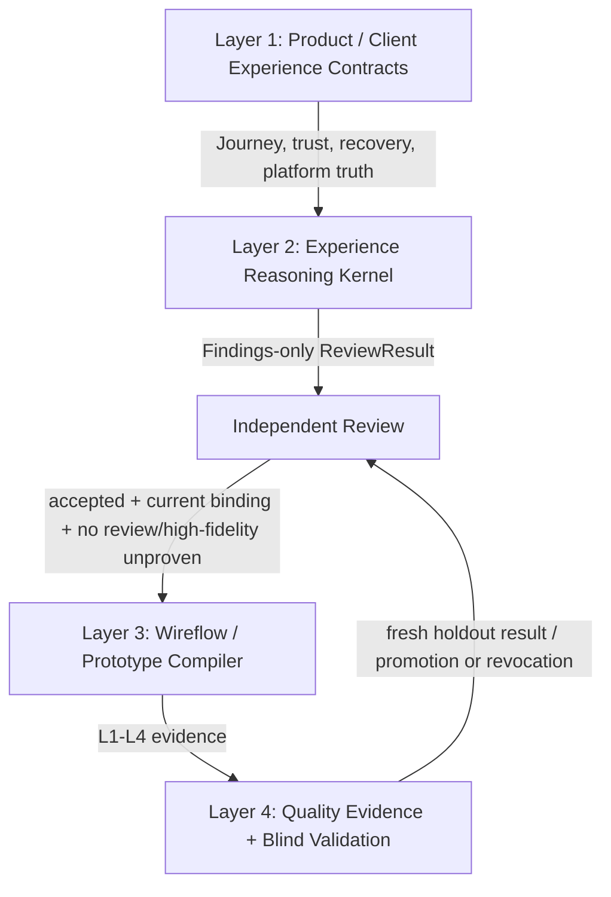

# Experience Reasoning Kernel - Architecture

> **Status**: active
> **Version**: v1.0
> **Created**: 2026-10-19 | **Updated**: 2026-10-19
> **Owner**: Experience Design

---

## 1. Core Principles

1. **Product truth stays upstream.** Product and Client contracts own Journey,
   trust, recovery and platform semantics. The Kernel only reviews their visible
   expression.
2. **Visible failure before source risk.** A primary UI/UX Finding requires an
   in-scope, reachable state with a visible action and response.
3. **Contract before rubric.** An accepted contract outranks a general rubric.
   A conflict invalidates the case; the rubric never weakens product truth.
4. **Deterministic priority, independent judgment.** Candidate priority is
   mechanically recomputable, but semantic correctness still requires an
   independent reviewer.
5. **Missing proof remains unproven.** A clean schema or empty Finding list
   cannot manufacture visual, dynamic, accessibility or runtime evidence.
6. **Holdouts burn on exposure.** Any case admitted to a run is permanently
   ineligible for future fresh promotion proof.

## 2. Evidence Ledger

| Claim | Class | Evidence | Confidence | Missing proof |
|---|---|---|---|---|
| The first blind run scored `70/100` with no hard failure | `verified_fact` | `docs/architecture/engineering/quality/blind-validation/`; frozen machine-local score artifact | high | none |
| The run missed the primary missing-recovery failure in the federated search case | `verified_fact` | frozen score and report set | high | none |
| The run missed identity, scope effect and next-gate meaning in Station switching | `verified_fact` | frozen score and report set | high | none |
| Source discipline and positive-control behavior were sound | `verified_fact` | frozen score and reports | high | none |
| Deterministic primary selection should prevent secondary implementation risks from displacing earlier contract failures | `inference` | failure pattern across the two missed cases | medium | fresh holdout |
| A contract-projected trust and recovery model is the minimal corrective architecture | `accepted_decision` | EDX-D01 through EDX-D09 | n/a | minimal tooling and fresh holdout |

The old six cases are calibration and training inputs only. They cannot prove
generalization of this architecture.

## 3. Four-Layer Architecture



### 3.1 Layer 1: Product And Client Contracts

Product and Client sources define:

- bounded Journey and promised outcome;
- explicit visible states and legal transitions;
- trust-sensitive identity and scope meaning;
- required next Gate and failure meaning;
- recovery obligations and preserved user state;
- platform-specific interaction refinements.

The Kernel cannot add a runtime fence, infer a trust claim from reachability, or
invent a recovery promise that the accepted source does not define. Missing
upstream semantics are recorded as `UNPROVEN` or a contract gap.

### 3.2 Layer 2: Experience Reasoning Kernel

The Kernel owns:

- the review procedure;
- closed result schema and reference integrity;
- Journey state ordering;
- trust and recovery projection checks;
- candidate eligibility;
- deterministic primary/secondary ranking;
- exact source and report bindings.

The Kernel emits findings. It does not approve the product, prototype, code or
release.

### 3.3 Layer 3: Wireflow And Prototype Compiler

The compiler consumes an accepted ReviewResult and preserves stable Journey,
state, action and evidence references through Wireflow and high fidelity.

High-fidelity work is admitted only when:

- the evaluation binding matches current inputs;
- `verdict=NO_BLOCKING_FINDING`;
- independent review is `accepted`;
- no `unproven` entry is required for review or high fidelity.

Any `FINDINGS`, stale binding, contract/rubric conflict or unproven cell
required for review/high fidelity fails closed.

### 3.4 Layer 4: Quality And Blind Validation

Quality owns:

- sealed holdout packages and answer keys;
- run lifecycle and report freezing;
- scoring and hard-failure policy;
- immutable exposure/training ledgers;
- promotion and later revocation.

The Kernel may read a sealed run envelope and case sources. It must not read
the answer key, score, promotion decision or Promotion Ledger.
Sealing atomically creates the immutable run envelope and burns every case in
Exposure Ledger; a partial write is invalid.

## 4. Review Pipeline

```text
sealed case + current source fence
  -> facts / contracts / inferences / unproven
  -> JourneyStateGraph
  -> TrustBoundaryCheck + RecoveryPath
  -> finding candidates
  -> eligibility filter
  -> deterministic ranking tuple
  -> frozen ReviewResult
  -> independent review / Quality scoring
```

### 4.1 Source Fence

Every run binds:

- package and run envelope;
- case and source revision;
- manifest and rubric;
- every supplied source blob.

Digest drift invalidates the run. Stored prose that claims a matching source is
not evidence.

### 4.2 Evidence Separation

The reviewer records:

- `facts`: directly observable source or rendered behavior;
- `contracts`: accepted Product / Client clauses, then rubric clauses;
- `inferences`: consequences derived from facts and contracts;
- `unproven`: material points that supplied evidence cannot establish.

Every Finding references these records by ID. Unsupported inference cannot be
primary.

### 4.3 Journey State Graph

The graph contains:

- one starting state;
- case-explicit states;
- additional source-reachable derived states;
- source-backed visible actions and response edges.

State order uses shortest reachable action distance from entry. Cycles do not
increase priority. Equal-distance states sort by case explicit order when
present, then source path, line and state ID.

### 4.4 Trust Boundary Projection

`TrustBoundaryCheck` projects only an accepted contract transition. It checks
whether the UI exposes the contract-defined:

- identity evidence and diagnostic evidence as different meanings;
- scope effect;
- next Gate;
- failure meaning;
- visible consequences;
- treatment of previous-scope projections.

When the accepted contract does not define one of these semantics, the result
is `UNPROVEN`; the Kernel does not define runtime behavior.

### 4.5 Recovery Path

A recoverable blocker must record:

- why recovery is needed;
- a visible entry action;
- distance: same surface, named adjacent surface, or implicit;
- user state preserved;
- return state and semantic return target.

Implicit recovery is invalid. Named-adjacent recovery must have an explicit
visible pointer and a valid return path. A return target may be keyboard focus,
touch action/surface anchor or navigation target. `null` requires a
contract-backed not-applicable reason.

### 4.6 Primary Finding Selection

Candidates are ineligible for primary selection when they are:

- outside the bounded Journey;
- unreachable from entry;
- missing a visible action and response;
- supported only by an unaccepted inference.

Eligible candidates sort by a non-weighted tuple:

```text
contractStrength
-> impactRank
-> stateOrdinal
-> explicitCoverageRank
-> severityRank
-> confidenceRank
-> candidateId
```

The tuple is fully defined in [data-model.md](./data-model.md). Secondary
findings retain their tuple and `deprioritizedBecause`; they are not silently
dropped.

## 5. Components

| Component | Responsibility | Must not do |
|---|---|---|
| Source Fence | Verify exact package, source and blob binding | fetch ambient source or rewrite inputs |
| Evidence Ledger Validator | Check closed fact/contract/inference references | decide whether prose is semantically true |
| Journey Graph Validator | Check states, edges, reachability and stable order | invent missing states or runtime behavior |
| Trust Projection Validator | Check the accepted trust transition is visibly represented | own Station or Federation semantics |
| Recovery Validator | Check locality, preservation and return contract | fabricate a recovery path |
| Candidate Ranker | Recompute eligibility and total order | assign semantic impact from source code |
| ReviewResult Validator | Enforce verdict, finding and unproven invariants | approve a result |
| Quality Holdout Validator | Check lifecycle, hashes and ledger references | read keys during a Kernel review |

All minimal tooling is process-local, deterministic and side-effect free for
validation. Quality-owned ledger mutation remains outside the Kernel.

## 6. Allowed And Forbidden Relationships

Allowed:

- Product / Client contracts supply semantic truth.
- The Kernel references accepted contract clauses and supplied source facts.
- Prototype Compiler consumes an independently accepted current result.
- Quality scores only frozen complete reports from a sealed holdout.
- Reviewers add source-backed findings without mutating frozen Kernel output.

Forbidden:

- Rubric overrides an accepted Product / Client contract.
- The Kernel defines a Station, Federation or Identity runtime state machine.
- Source-only race, code smell or architecture risk becomes the primary UI/UX
  Finding without visible action and response evidence.
- Prototype polish compensates for a blocking finding or missing recovery.
- Quality exposes an answer key before `scoring`.
- An exposed, aborted, invalidated or retired case returns as fresh holdout.
- Zero deterministic findings is relabeled as product approval.

## 7. Evidence Levels

- `L1_CONTRACT`: exact sources, IDs, graph and result binding.
- `L2_VISUAL`: inspected render cells for required states and viewports.
- `L3_DYNAMIC`: real action, transition, retry, cancellation and return paths.
- `L4_RUNTIME`: exact runtime, accessibility, performance and receiver-visible
  behavior required by the claim.

The Kernel records evidence references and unproven cells. Artifact existence
alone does not prove visual or interaction quality.

## 8. Quality Outcomes

Architecture promotion requires a fresh holdout that:

- scores at least `80`;
- has no hard failure;
- covers every required hidden challenge class;
- produces no blocking false positive on positive controls;
- has a mechanically recomputable primary tuple for every Finding case;
- contains no case present in exposure, training or terminal-run ledgers.

Required hidden challenge classes are:

- `primary-visible-blocker`;
- `trust-boundary-propagation`;
- `recovery-locality`;
- `positive-control-non-finding`;
- `evidence-boundary`;
- `platform-semantic-parity`.

Positive, negative and boundary calibration remains separate from fresh
holdout promotion. Passing source checks proves the mechanism, not UI/UX
judgment quality.
