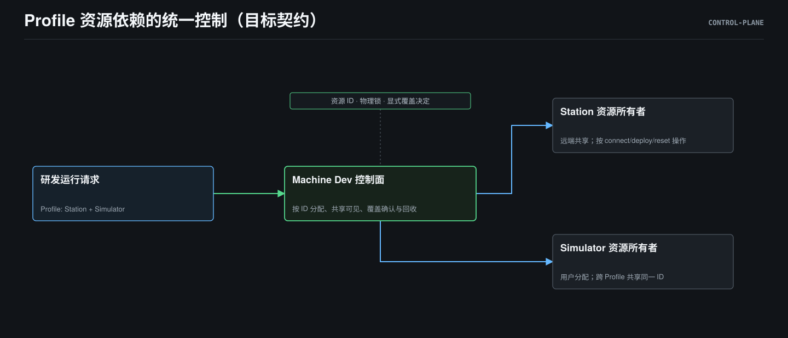

# Local Dev Control Plane - Architecture Design

> **Status**: active
> **Version**: v2.1
> **Created**: 2026-09-13 | **Updated**: 2026-11-15
> **Owner**: Platform Team
> **Module**: `tooling/scripts/local-dev/`

---

## 1. Core Principles

1. **One machine owner**: machine-local allocation truth lives under
   `~/.peers-touch/dev/`, never in one arbitrary worktree.
2. **Independent worktree binding**: profile and slot selection are keyed by
   `workspaceId`, so changing one worktree does not change another.
3. **Definition is not allocation**: the `env` repository defines deployable
   topology; the machine registry allocates local resources and permissions.
4. **Observed state is not declared state**: process and port probes verify live
   state; stale PID files or symlinks cannot establish ownership.
5. **Capabilities before mutation**: connecting, deploying, and resetting a
   Station are different permissions with different lease strength.
6. **Fail closed**: duplicate slot, conflicting exclusive Station capability,
   stale identity, or dirty untracked environment definition blocks mutation.
7. **Product namespace isolation**: development artifacts never write under
   the formal product Application Support root.
8. **Repository cleanliness**: transient debug sessions, logs, traces,
   screenshots, DOM dumps, and ad-hoc reports are machine development state,
   not repository-root content.
9. **Profile-authorized environment lifecycle**: a reviewed non-stable Profile
   authorizes routine selection, registration, provisioning, deploy, restart,
   and reset within its declared capabilities. A worktree-local Profile may be
   created directly; remote topology still comes from tracked source. Stable
   Profiles default to connect-only and require explicit binding for mutation.
10. **Profile-ID reset policy**: the canonical Profile ID is the only reset
    policy source. A case-insensitive terminal `stable` suffix protects the Profile
    from autonomous reset; every other reviewed Profile is Agent-resettable.

An operation may name `targetProfile` without selecting a new workspace Profile.
Machine Dev resolves the target through the same reviewed definition owner;
the registration, local slot and current Git source remain workspace-owned.
The operation requires the workspace capability, target policy and exact
deployment identity. Stable deployment additionally requires the workspace's
explicit binding to that stable Profile. A target never borrows a non-stable
Profile's reset policy. The target is frozen into lease validation and inherited
command projection; admission is repeated after locking and before mutation.

Acceptance Station equipment calls this operation through native `devctl`
readiness/deploy. Equipment completes before the Suite retains its remote
source lease; source/runtime/protocol attestation then runs under that retained
lease. This prevents nested source-lock deadlock and closes the readiness-to-use
race. Equipment is bounded by the caller's deadline; its logs and errors are
observations, while product oracles remain business-owned.
    The policy never replaces capabilities, exact reset scope,
    leases, topology validation, or source identity.
11. **One read-only development projection**: Workflow Snapshot joins each
    worktree's optional task facts with topology, leases, and observations
    without becoming a mutation or truth owner.
12. **No dashboard runtime**: the projection is an on-demand CLI/library call;
    it starts no server, opens no browser, and reserves no fixed port.
13. **Stable binding, live source**: the registry owns durable root, branch,
    profile, slot, and capability binding only. Current Git HEAD is read from
    the worktree for each operation and revalidated after OS-lock acquisition.
14. **One Desktop install lifecycle**: `desktop-install` resolves one
    platform adapter, freezes source identity before build, installs only the
    native platform artifact, verifies receiver-side registration, and rolls
    every replaced file back on failure. Adapters do not own orchestration.

## 2. System Architecture

```text
Sibling env repository
  env/peers-touch/<profile>/
  - Station/Relay topology definition
  - deploy environment definition
                 |
                 | profile reference
                 v
Machine Dev Control Plane
  ~/.peers-touch/dev/
  - workspace registry
  - local slot allocation
  - Station capability leases
  - observed process/port projection
  - Acceptance Evidence Store
                 |
Worktree
  - source and branch
  - independent active binding
  - no machine-global allocation truth
                 |
                 | resolved runtime manifest
                 v
make desktop | make mobile | make station | Acceptance
```

The following roots remain separate:

```text
~/.peers-touch/                                  product and Agent data
~/.peers-touch/dev/                              machine dev control plane
~/.peers-touch/dev/acceptance/                   Acceptance evidence
~/.peers-touch/dev/workspaces/<workspaceId>/     worktree-scoped development state
~/Library/Application Support/peers-touch/       Desktop runtime instances
~/Library/Application Support/PeersTouch/        formal product namespace
```

`~/Library/Application Support/PeersTouch/acceptance` is a legacy development
artifact root. It is retained only until a verified one-time migration and must
not remain as a symlink, fallback, or second read owner.

## 3. Sources Of Truth

| State | Owner | Canonical source |
|-------|-------|------------------|
| Deployable Station/Relay topology | Environment repository | `env/peers-touch/<profile>/` |
| Profile reset policy | Canonical profile identity | Case-insensitive terminal `stable` suffix in the verified directory/`PT_DEV_PROFILE` ID |
| Machine-local Profile creation | Current worktree | `make profile-init PROFILE=<name> SLOT=<n>` |
| Worktree registration identity | Canonical filesystem path + registered branch | `workspaceId = sha256(realpath(root))[0:16]` |
| Current worktree source identity | Git | Current branch and HEAD captured at operation time |
| Worktree profile selection | Machine Dev Control Plane | `bindings[workspaceId].profile` |
| Local port slot | Machine Dev Control Plane | `bindings[workspaceId].slot` |
| Station connection/deploy/reset permission | Machine Dev Control Plane | capability lease |
| Live process and port state | OS observation | PID identity + listening socket |
| Runtime evidence | Acceptance Evidence Store | `~/.peers-touch/dev/acceptance/` |
| Read-only workflow projection | Development Workflow | `workflow-snapshot.mjs` |

Profile files may describe remote topology defaults, but they must not remain
the authority for machine-local slot allocation.

## 4. Runtime Units

### 4.1 Environment Repository

Owns named, reviewable environment definitions. It must not record which local
worktree currently uses an environment.

Missing remote topology is a fail-closed boundary. It does not authorize an
agent to invent a host, credential, or untracked deploy definition. A new
tracked remote Profile is an ordinary source change only when the environment
repository is explicitly in task scope. A worktree-local development Profile
may be created directly with `make profile-init`.

Remote deployment resolves exactly one Git-tracked, clean deploy definition
directly from this repository. A `.local/deploy/envs/` copy is never topology
authority.

Reset policy is derived after the selected directory name and
`PT_DEV_PROFILE` value are proven identical:

| Derived policy | Canonical Profile ID | Agent reset authority |
|---|---|---|
| `stable-protected` | ends in `stable`, case-insensitive | autonomous `station.reset` is denied |
| `agent-resettable` | does not end in `stable` | Agent may choose exact-scope reset without human involvement |

No profile field stores or overrides this policy. Former control-mode metadata
has no reader. Renaming a Profile across the `stable` boundary is therefore a
reviewed topology change, not a runtime toggle.

For a non-stable Profile, reset still requires `station.reset` in the workspace
binding, the same exact reset scope on the command boundary, remote
tracked-clean topology, matching current source identity, and the OS-held
reset lease. These are scope, topology, identity, and concurrency guards; none
is a human-permission prompt. A stable Profile fails with
`PROFILE_RESET_PROTECTED` before lease acquisition.

An existing reviewed non-stable Profile and the current workspace binding
authorize deploy and restart within their capabilities. Non-stable reset is
likewise Profile-authorized. Stable Profile selection grants only
`station.connect`; a user-directed explicit binding is required to add
`station.deploy`, while stable reset always fails before lease acquisition.
Every operation still resolves the exact target, current source, clean remote
topology when applicable, and OS-held lease.

`profile-init` creates one worktree-local compose Profile and never overwrites
an existing definition. Runtime accepts only a private, current-user-owned
regular file directly inside the worktree Profile root with shell-safe literal
assignments. It creates development topology, not another worktree and not
delivery permission.

### 4.2 Machine Registry

Owns durable machine-local declarations:

- Registered worktrees.
- Independent profile selection per `workspaceId`.
- Local slot allocation.
- Allowed Station capability mode.
- Detected conflicts.

It does not own Plan selection. Development Workflow stores the immutable Plan
binding in the workspace workflow namespace beside, not inside, the mutable
environment registration. The registry must not contain credentials, JWTs,
passwords, private keys, user messages, or Acceptance artifacts.

Registration is explicit. Discovery through `git worktree list`, a branch name,
an existing directory, a project `active_work` row, or a legacy profile pointer
must not register a worktree automatically.

Registration is reusable machine allocation and remains after normal task
completion. It is removed only for an explicitly authorized worktree removal.
Unregister requires the exact registration owner and no OS-held lease.
Deleted-worktree cleanup uses the exact workspace identity; no registry row is
removed by path guessing or direct file edits. Optional task records do not
occupy the registration.

Worktree activity is a derived runtime fact:

| State | Definition |
|-------|------------|
| `active` | A live process/listener or held lease has matching `workspaceId`, PID and process-start identity |
| `idle` | Explicitly registered, but no matching live process or lease exists |
| `stale` | Explicit registration exists, but canonical root or registered branch no longer matches |
| `unregistered` | Discovered or observed only; cannot acquire managed runtime resources |

A profile pointer alone does not make a worktree active.

### 4.3 Acceptance Evidence Store

Owns immutable Acceptance runs under:

```text
~/.peers-touch/dev/acceptance/<workspaceId>/<gateId>/<runId>/
```

It remains logically independent from registry and lease mutation. Artifact
root overrides may redirect CI and isolated tests, but they must never redirect
machine-global lease authority.

### 4.4 Debug Session Store

Transient debug sessions resolve to:

```text
~/.peers-touch/dev/workspaces/<workspaceId>/debug/<sessionId>/
```

This store owns debug logs, traces, screenshots, DOM snapshots, temporary
reports, and reproduction notes. A session must be deleted after closure.
Reusable conclusions move to the governing design, operational knowledge, or
Acceptance Evidence Store; transient files do not move into the repository.

### 4.5 Optional Task Records

Development Workflow may keep task-local progress and recovery records, but
Local Dev does not read them for runtime admission, binding changes, or
unregister. Historical `work.json`, PlanMount, Session, active-work, close, and
resource-plan files are diagnostic history only during removal.

### 4.6 Lease Manager

Owns bounded live exclusivity. Required lease classes:

| Capability | Sharing | Meaning |
|------------|---------|---------|
| `station.connect` | shared | Client may connect without deploying or resetting |
| `station.deploy` | exclusive per deploy environment | Current source may deploy/restart Station |
| `station.reset` | exclusive per Station + fixture scope | Destructive fixture reset is authorized |
| `local.slot` | exclusive while local clients run | Desktop/Mobile ports for one workspace |
| `runtime.profile` | exclusive when environment requires isolated runtime state | Acceptance/runtime profile state |

This table includes required target classes. Current `LEASE_RESOURCE_KINDS`
implements only `local.slot`, `station.deploy`, and `station.reset`.
The simulator physical lease below is implemented by the canonical machine owner.
OS-held lock checks do not replace native application or data proof.

A durable binding does not prove a live lease. A live lease does not rewrite the
durable binding.

The canonical implementation is split by responsibility:

- `machine-dev-registry.mjs` owns registration, binding, topology validation,
  slot allocation, capability checks, current-source validation, and status
  projection.
- `machine-dev-lease.py` owns the OS advisory-lock file descriptor and the
  bounded child process group; the mutation child inherits that descriptor and
  verifies the exact held lease before entering the critical section.
- `machine-dev.mjs` is the only CLI composition point used by Make and runtime
  scripts.

This is one control plane, not a Secure Content lease implementation.
`station.deploy` is keyed by the exact reviewed deploy-environment name.
`station.reset` is keyed by the exact Station/Fixture reset scope and requires
that same value as run-scoped authorization input. `local.slot` is keyed by the
machine binding's slot.

Lease acquisition snapshots the current branch and HEAD from the exact
canonical worktree. After acquiring the OS lock, it revalidates that source,
the authoritative binding, capability, reviewed Profile, normalized target,
reset policy, and exact scope under the lifecycle and registry locks. This
closes registration/source-change races without treating task records as
permission.

Remote exact-source synchronization may force-update
`refs/peers-touch/deploy/<environment>/<branch>` in a dedicated internal
transport repository. The ref carries Git objects to one deployment target; it
is not a collaboration branch, delivery publication, or authorization to push
origin/GitHub.

### 4.7 Runtime Observer

Projects current OS facts:

- Listening ports.
- PID, start time, executable, and cwd.
- Runtime profile and workspace identity when attestable.
- Active lease owner.

PID files are hints only. A PID must match process identity before it is treated
as running.

### 4.8 Workflow Snapshot

`workflow-snapshot.mjs` assembles one bounded read-only view of current Git
source, explicitly stored task progress, task-local corruption, and an
optional runtime status supplied by its caller. The primary key is
`workspaceId`, never basename.

The projection does not infer a selected task, join retired workflow ledgers,
or decide runtime authorization. Missing or malformed sources remain local
typed findings. The command prints one result and exits; it has no HTTP
endpoint, browser asset, refresh loop, mutation endpoint, or resident owner.

## 5. Resolution Contract

Every mutating runtime command resolves in this order:

```text
canonical worktree root
  -> workspaceId
  -> machine binding
  -> environment definition
  -> local slot allocation
  -> required capability lease
  -> observed conflict check
  -> immutable resolved runtime manifest
  -> execute
```

No command may infer profile from a sibling worktree, a branch name, basename,
or whichever `.local` directory happens to contain a file.

## 6. Allowed And Forbidden Relationships

Allowed:

- Multiple worktrees share one remote Station with `station.connect`.
- One worktree holds `station.deploy` while other clients remain connected,
  provided the Profile capability and lease checks allow it.
- A reviewed non-stable Profile authorizes direct deploy, restart, runtime
  provisioning, and exact-scope reset without another prompt.
- An Agent may add `station.reset` to the current binding and request an exact
  reset scope for any non-stable reviewed Profile without human confirmation.
- Each worktree has its own profile and slot binding.
- A worktree-local compose profile is created only by canonical
  `make profile-init` and remains scoped to that worktree.
- Acceptance acquires stronger temporary leases without changing the user's
  durable worktree binding.

Forbidden:

- Two live worktrees use the same local slot.
- Two owners hold `station.deploy` or `station.reset` for the same resource.
- A profile's static `PT_DEV_SLOT` silently overrides the machine allocation.
- One worktree's `.local/dev/active` acts as global truth.
- Runtime commands read untracked environment definitions as approved topology.
- An Agent invents a remote host, credential, or untracked deploy definition
  outside the canonical Profile pipeline.
- A stored field, alias, Station mode, worktree name, or legacy cache overrides
  the canonical Profile ID reset policy.
- An existing non-stable Profile reset is converted into a user authorization
  request.
- A non-stable Profile bypasses exact reset capability/scope/lease checks.
- A stable Profile is granted `station.reset` or reaches reset lease
  acquisition.
- Workflow Snapshot writes registry, mount ledger, work ledger, lease, profile,
  workflow, or runtime state.
- A workflow inspection command starts a server, opens a browser, or reserves a
  fixed port.
- An arbitrary `PT_DEV_PROFILE_FILE` bypasses reviewed topology; only a
  contained Acceptance runtime-manifest profile is allowed.
- Machine registry stores secrets or product data.
- Acceptance or other development artifacts write under
  `~/Library/Application Support/PeersTouch/`.
- Missing registry state falls back to slot 0 or loopback Station.

## 7. Failure Semantics

| Failure | Result |
|---------|--------|
| Worktree not registered | `WORKSPACE_UNREGISTERED` |
| Binding absent | `WORKSPACE_BINDING_MISSING` |
| Profile missing or unreviewed | `PROFILE_UNAVAILABLE` |
| Stable Profile requests `station.reset` | `PROFILE_RESET_PROTECTED` |
| Workspace binding lacks a requested capability | `WORKSPACE_CAPABILITY_MISSING` |
| Reset command scope differs from the requested resource | `RESET_SCOPE_MISMATCH` |
| Slot already live | `LOCAL_SLOT_CONFLICT` |
| Station capability held | `STATION_CAPABILITY_CONFLICT` |
| Deploy host/URL mismatch | `DEPLOY_TARGET_MISMATCH` |
| Observed process identity mismatch | `RUNTIME_IDENTITY_MISMATCH` |
| Registry malformed | `MACHINE_REGISTRY_INVALID` |

All failures occur before service start, deploy, restart, or destructive reset.

## 8. Quality Gates

The target implementation must prove:

- Two same-basename worktrees receive distinct `workspaceId` bindings.
- Switching one binding does not change another.
- Concurrent allocation cannot assign the same live slot twice.
- Shared `station.connect` coexists; deploy/reset exclusivity fails closed.
- Stale PID and stale lock metadata do not establish ownership.
- Dirty or untracked env definitions are visible and cannot authorize deploy.
- `make env-status-all` reports declared binding and observed runtime separately.
- Every reviewed profile derives exactly one reset policy from its canonical
  ID and the resolved status projection exposes it.
- Mixed-case terminal `stable` suffixes reject `station.reset`; IDs with only a
  non-terminal `stable` token admit it
  only when binding capability, exact scope, current source, and lease all
  match.
- Workflow Snapshot joins every worktree's active requirements/Journeys and
  declared/held resources without exposing secret-bearing profile fields or
  providing mutation controls.
- Active source and docs contain no dashboard server, browser asset, fixed
  4177 resource, `make dev-ui`, or browser Gate after cutover.
- Workflow Snapshot returns one bounded view and exits without a live process.
- Evidence root migration preserves every manifest, latest pointer, content
  hash, workspace identity, and file count before deleting the legacy root.
- Product Application Support contains no Acceptance writer, symlink, fallback,
  or residual `acceptance/` directory after cutover.
- Every registered Git worktree proves the canonical root contract before
  cutover; an old worktree cannot silently recreate the removed directory.
- After closure, the live registry and active docs contain no legacy-root
  field or migration branch.
- No runtime command defaults to loopback, slot 0, or an arbitrary profile when
  a binding is missing.
- Existing non-stable Profile reset never requests human authorization; missing
  capability, scope, topology, identity, and lease failures remain separately
  typed and fail closed.
- `desktop-install` keeps one orchestrator for dependency preparation,
  generated sources, applets, source freeze/recheck, Tauri build, install and
  result projection. macOS owns `.app` resolution/codesign; Linux owns
  AppImage/XDG paths and protocol registration.
- Linux installation is user-scoped, rootless and transactional: the
  AppImage, source receipt, launcher, desktop entry and hicolor icon are
  staged in their destination directories, fsynced, renamed and read back.
  A running old inode remains valid, the next launch resolves the new inode,
  and any verification failure restores the prior files and handler.
- Missing WebKitGTK/GTK/GLib/Soup/Rsvg build modules return
  `DEVCTL_DEPENDENCY_MISSING` with exact `pkg-config` evidence and package
  hints. No adapter invokes an OS package manager or silently substitutes a
  bare debug binary.

## 9. Profile Resource Dependencies

**Contract status: implemented consumer cut, native proof pending.** LDCP-D23/D25/D26/D27
extend this existing control plane. Station and Simulator are peer Profile
dependencies; there is no second simulator control plane.

### 9.1 Evidence And Ownership

| Finding | Evidence class | Source | Limit |
|---------|----------------|--------|-------|
| Definition and machine allocation have separate owners | verified_fact | LDCP-D03; `machine-dev-registry.mjs`, `machine-dev-resource-store.mjs` | Native effects require provider readback |
| Current leases fence slot and Station operations | verified_fact | `machine-dev-lease.py`; `LEASE_RESOURCE_KINDS` | Releasing a lease does not delete a device |
| Base, selected-client and layout Provisioners bind canonical Profile resources and retain their locks | verified_fact | `mobile_simulator.py`, `mobile_ios_resources.py` | Fixture source tests are separate from native proof |
| Normal Mobile Make checks Station connectivity without deployment | verified_fact | `mobile-ios-sim.sh` | No Station restart/reset authority is implied |
| Simulator is a Profile dependency, allocated and shared by ID | implemented_contract | `machine-dev-resource-store.mjs`; LDCP-D23/D26 | Native/data scope remains unproven until its Gate passes |

Profile owns logical requirements. Machine Dev owns user-directed Profile-to-ID
assignments, physical identity, leases, current content, retention and recovery. Platform adapters
execute provider operations. Client/Fixture owners retain accounts, sessions,
databases, data isolation and product evidence.

### 9.2 Control Plane View

**Viewpoint: Control Plane. Arrows denote control requests only.**



The view projects the accepted target. Station remains remote/shareable for
connect; a simulator is local and may be referenced by multiple Profiles.
Physical mutations remain exclusive. Same-level dependency
status does not make their capabilities or deletion semantics interchangeable.

### 9.3 Admission And Data Boundaries

Requirements are projected by the existing Profile parser. Shared Profile
definitions do not store machine UUIDs, PIDs or ownership. Node and Python
callers consume the same resolved contract and cannot independently allocate
devices. The [data model](./data-model.md#12-resource-dependency-contract)
separates requirements, instances and leases.

The user specifies a count, purpose or readable device selection. Agent/control
plane inspects the real provider inventory and existing assignments, offers
eligible named resources or matches the delegated request, and resolves the
internal IDs. The user never has to discover, memorize or enter UUIDs.
Assignment produces an explicit internal ID set; its cardinality is display
information, not an identity, ownership rule or conflict detector. There is no
default simulator count, machine-wide count cap or mandatory client role.
Each Profile may arrange those IDs for its own scenarios.

The selection view shows readable device name/label, model, runtime, observed
state, assigned/shared Profiles and actual current contents. Unknown references
are marked unknown rather than inferred from a generated device name.
Readable names/labels are separate from identity; renaming a label does not
change resource ownership or locks. Duplicate names are differentiated by
model/runtime/purpose/context or a temporary list choice bound to this inventory.
List positions are not persistent IDs and cannot silently select another
device after refresh. Names or quantity-only requests are valid user inputs.

Multiple Profiles may attach the same ID. One machine-owned instance is
resolved for that ID, and all attached Profiles see the reverse reference list,
current installed content and actual holder. Sharing a reference is normal;
it does not clone the instance, transfer exclusive ownership or silently
grant overwrite authority. Caller roles are Profile-local labels, not physical IDs.

Operation admission checks provider compatibility and the actual resource
state. Merely attaching or inspecting a shared ID needs no overwrite prompt.
Installing different content, replacing a binding or changing a conflicting
data scope requires the explicit overwrite protocol below. Shared references
cannot silently mix Actor/Station credentials or databases. Uninstall alone
does not establish an iOS keychain reset.

### 9.4 Lifecycle And Recovery

Physical-device locking is distinct from `local.slot`; all boot, installation,
reset and deletion consume the physical lock. Acquire a resource set in stable
order, use bounded waits, and unwind partial acquisition on failure. Station
equipment and remote source leases retain their existing owner-defined order.

Persist the user-directed ID assignment, preparation intent and nonce **before** provider
creation. Retry recovers the same preparation. A crash between create and UUID
writeback is reconciled from that intent and provider identity evidence;
a name prefix alone cannot prove ownership. Ambiguous matches remain
`ownership-unknown`, unavailable for automatic mutation.

On release, end only the owned operation/session and verify provider state.
Profile assignments and installed contents remain; releasing one holder does
not shut down a device still used by another holder, detach another Profile,
erase its contents or delete the physical resource. Removing a Profile reference
changes that reference only. Removing the last reference does not itself
authorize physical deletion.

Task-disposable data may be settled only within its exact owned scope; shared
state changes still require the overwrite protocol. Requested physical deletion
requires classified ownership, a notice to affected Profiles and verified
device/directory absence. Manual handoff records retained purpose. Unknown
resources cannot be mutated without first establishing ownership.

Timeout or crash triggers reconciliation of OS-held locks, child identity,
provider state and retention. A timestamp or stale PID does not authorize
cleanup. Failed cleanup preserves instance identity and failure reason;
lease release and instance cleanup have separate results.

### 9.5 Explicit Overwrite Notice

Before an operation would replace an existing installation/provider binding,
reset another Profile's data or disrupt its active session, show:

- Readable device name, model/runtime and context, bound internally to the
  exact resource ID/provider identity. Raw UUIDs are optional diagnostic detail.
- Every attached Profile and any observed active holder.
- Current and requested installation/source, binding or data scope.
- What will be replaced, which sessions would be interrupted and the exact data effect.
- The choice to decline or explicitly force this operation.

Decline, cancellation or no response causes no overwrite and leaves existing
contents and references intact. Assignment or sharing alone is not an approval.
An Agent cannot manufacture a force decision, infer it from a non-stable Profile,
persist a blanket force default or reuse approval for another operation.

Acquire the physical lock and recheck the reference set, holder and content/
binding revision before mutation. If the confirmed impact has changed, show a
fresh notice. Force never bypasses the OS lock or grants Station deploy/reset.
If force would require stopping an active user's process, the notice must name
that effect and obtain explicit permission for that stop before the original
owner cooperatively releases its hold.

After overwrite, one canonical current-content record is updated and every
attached Profile sees the new writer/source and invalidated prior expectation.
Failed or partial overwrite remains visible; do not report a completed replacement
until provider readback confirms it. These are target semantics, not an implemented UI.

### 9.6 Operation Permissions

Mobile connect-only never enters Station deploy/reset, even when the Station
is unavailable. Report the dependency state or preserve the product connection
flow. Profile reset policy continues to follow LDCP-D21, but does not classify
user-retained simulator data as disposable.

Historical devices require explicit ownership classification before adoption
or deletion. These contracts grant no historical cleanup permission.

### 9.7 Falsifiable Resource Requirements

These are requirement IDs, not registered or passed Gate IDs:

| Requirement | Binary evidence |
|-------------|-----------------|
| LDCP-R01 explicit assignment | User-requested ID sets and counts are reflected exactly; no hidden allocation or fixed role/count |
| LDCP-R02 visible sharing | Different Profiles referencing the same ID resolve one instance and see each other; equal counts do not imply sharing |
| LDCP-R03 physical exclusivity | Concurrent worktrees requesting the same UUID cannot both mutate it |
| LDCP-R04 recoverable preparation | Crashes at preparation/create/install/release boundaries recover without duplicate allocation or silent residue |
| LDCP-R05 data and retention | No silent credential/database overwrite; refusal preserves retained state and unknown resources are not adopted |
| LDCP-R06 connect-only | Native Mobile startup has zero Station deploy/reset operations |
| LDCP-R07 truthful cleanup | Detach/release/delete are separate; another Profile's references/data survive; failed cleanup cannot claim removal |
| LDCP-R08 overwrite decision | Notice names affected IDs/Profiles/content; refusal changes nothing; explicit force affects only the confirmed operation |
| LDCP-R09 post-confirmation race | Changed references/content/holder invalidate an old force decision; physical locking is never bypassed |
| LDCP-R10 readable discovery | Count/purpose/name requests resolve via observed inventory; users see names/state/shared Profiles; duplicate names, renamed labels and stale list positions cannot change the selected internal identity |

Platform evidence is initially iOS-only. No Android lifecycle or data-isolation
claim follows from the generic resource vocabulary. Provider readback and
native client evidence must corroborate unit tests before runtime claims.
