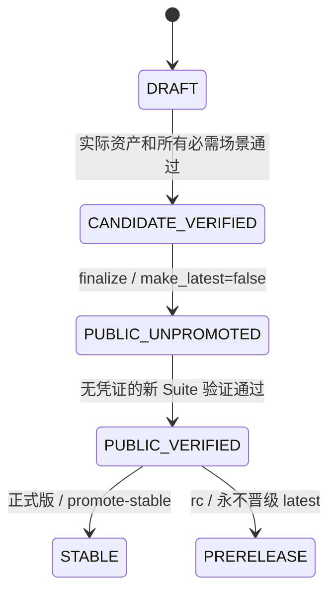
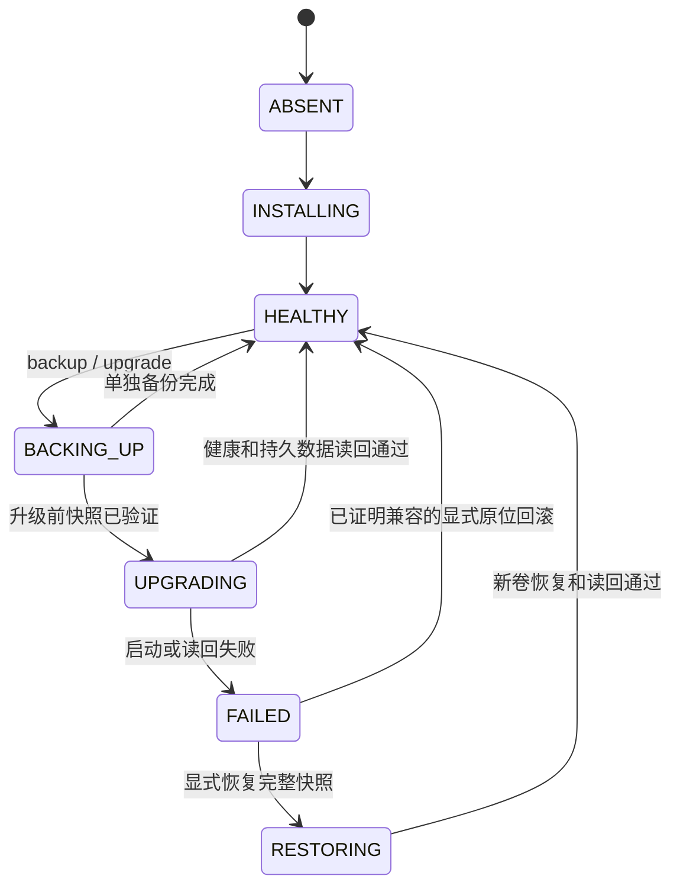

# Release Distribution — 状态与持久化契约

> **Status**: active
> **Version**: v1.0
> **Created**: 2026-10-21 | **Updated**: 2026-10-21
> **Owner**: Architecture Team

## 1. 契约边界

Tauri `latest.json`、GitHub Release API 和 OCI 是外部协议，复用其原生格式。安装器状态与备份清单是单机内部持久化，不是跨应用业务模型；它们不替代 `model/domain/` 中的 protobuf。未来跨应用安装/管理 API 必须先定义 proto。

## 2. 发布状态机

- 发布身份绑定 repository、完整 tag、source commit、GitHub run ID/attempt、Release ID、镜像 index/platform digest 和资产 SHA256。
- candidate 验收下载 draft 使用受限 token；Suite 私有 HTTPS 文件服务提供字节相同的实际资产。安装器和被测客户端不读取 token。
- updater 候选测试清单仅将 package URL 投影到该 HTTPS origin，保留 version、平台键和 signature；实际更新包逐字节不变，原始发布清单的固定 tag URL 另行验证。endpoint override 只存在于测试 runtime，不持久化进正式客户端。
- 公开阶段失败时保持 `PUBLIC_UNPROMOTED`，不把 HTTP 可下载视为匿名安装成功。旧稳定 Release 继续提供发现入口。
- GitHub Release 与 GHCR 更新是分别可失败的动作。重试先读回既有身份，字节或 digest 不同则拒绝覆盖；不能移动已发布 tag、复用旧 run 证据或删除失败现场来制造通过。
- 只有完整正式 Release 能成为 latest；晋级串行执行并比较当前稳定 SemVer，禁止迟到任务把入口倒退。不存在首次稳定 Release 时，404 表示尚无稳定更新。

## 3. 安装器实例状态

`state.json` 至少持有以下语义字段；实现可以使用相同含义的结构化命名：

- 实例身份：install root、compose project、规范化 Docker target、已登记卷。
- 已健康部署：tag、Station image digest、PostgreSQL major、schema 身份、compose SHA256。
- 当前操作：operation ID、`phase`、from/to tag 和 digest、目标 schema、错误代码。
- 恢复引用：上一健康部署、backup ID、backup manifest SHA256、失败现场的卷引用。

应用 JWT、数据库口令、Dashboard bootstrap 密码和 Dashboard JWT secret 只存在于 0600 `.env` 及其私有备份中，不复制进 `state.json`、Suite 报告或 receiver evidence。重复安装和版本切换只重绑 image/volume 字段，不轮换这些实例 identity。

原子写入采用同目录临时文件、同步和 rename；密钥和状态目录仅当前用户可读写。每个 Docker target/project 持有 OS 锁并锁后重新检查状态。中断恢复先核对真实容器镜像、卷和构建身份；不确定则保持失败状态，不能把尝试版本写成健康版本。

再次 install、升级、回滚都复用本实例登记的卷和端口；外部同名项目不能被接管。普通 uninstall 停服务但保留数据及恢复信息；purge 仅针对登记资源，经显式确认，备份另需独立删除意图。

## 4. 备份与回滚

备份必须在 Station 停止写入后捕获 PostgreSQL 一致快照、`peers_data`、身份密钥、附件、`.env`、compose、旧镜像 digest 和 schema 身份。清单记录每项路径、大小、SHA256、版本和实例身份；秘密内容不写入可分享报告。

- 备份完整性检查失败时不启动升级；自动删除或猜测缺失项均禁止。
- 原位回滚需要版本对和 schema 身份对应的真实读写兼容证据；空缺、仅同 major 或目标未登记均拒绝。
- 不兼容时必须指定完整备份恢复。先保留失败现场，恢复至新卷，用旧镜像读回业务数据、身份和附件，再切换运行绑定。
- 恢复旧快照的写入损失边界必须明确确认。任何失败保留原卷，状态不得晋级 HEALTHY。

## 5. 更新清单

稳定入口是一个可推进的完整正式 Release 清单，包地址固定完整 tag。`platforms` 包含 `windows-x86_64`、`linux-x86_64`、`darwin-x86_64`、`darwin-aarch64`；两个 darwin 键可引用同一 universal `.app.tar.gz` 和 signature。

manifest `version` 必须等于包内版本；两个更新测试产物必须有严格递增的完整 SemVer。`signature` 验证包字节，不替代清单元数据认证；URL 和平台由发布检查独立断言。

## 6. Suite 证据

每个多场景 Task 的 `runtimeReuse` 用现有 Suite Runtime 格式定义资源预算、entry check 和场景 ID。build、账号、客户端、Docker daemon、HTTPS asset 服务与命名空间由 Suite 建立；场景只附着并执行产品动作。升级、恢复、重启和卸载是声明的产品动作，不是重复准备隔离环境。

结果绑定 source、run/attempt、target、Fixture Epoch、二进制或镜像 digest；每个场景包含动作和 receiver 读回，最后记录清理。Station candidate 使用 A/B 两套实际 Release 资产：旧 A 在独立卷克隆 B schema/数据后执行真实 API 读写，生成 source/schema/report digest 绑定的兼容证明；主实例只在该证明通过后原位回滚。损坏备份和错误证明必须先于任何切换被拒绝。

Station Suite 的 `FUNCTIONAL_PASS` 只覆盖 RD-T03/RD-T04 声明的服务端场景。RD-T05 需要独立的 OS-native report；缺失时发布 workflow 主动失败。仅 CI conclusion=success、缺场景、缺报告或报告身份不符均不足以建立功能通过；静态计划审计只能证明契约结构。
