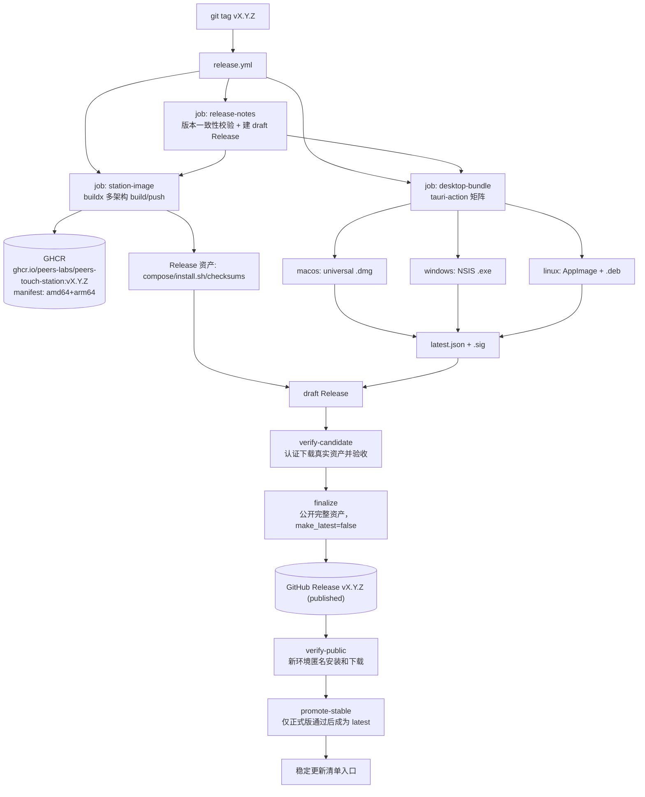
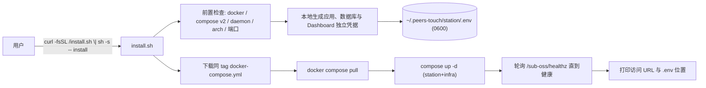
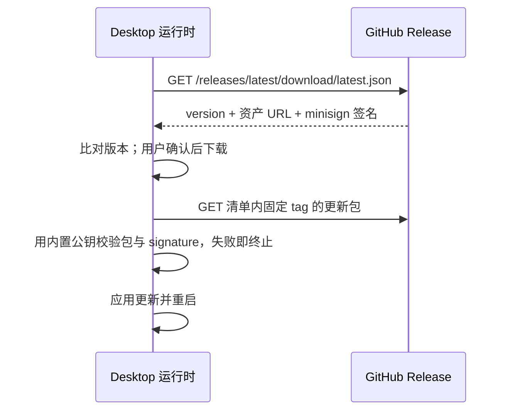

# Release Distribution — 架构设计

> **Status**: active
> **Version**: v1.0
> **Created**: 2026-10-21 | **Updated**: 2026-10-21
> **Owner**: Architecture Team

---

## 1. 证据账本

| # | 断言 | 分类 | 证据 | 置信度 |
|---|------|------|------|--------|
| E1 | 仓库已有独立的用户向 Station 安装面 | verified_fact | `tooling/distribution/` 包含引导脚本、用户 compose、状态 owner、资产/证据校验与维护文档；不复用 IDE agent 集成安装器 | 高 |
| E2 | 内部部署不推 registry，公开发布由独立 workflow 拥有 GHCR | verified_fact | deploy-station 保持 `contents:read` 和远程本地构建；release.yml 的 station-image job 独立获得 `packages:write` 并发布不可变 candidate digest | 高 |
| E3 | compose 面向测试机、非产品化 | verified_fact | [compose.yml](../../../../tooling/docker/compose.yml) 两个服务均为 `build:` 段，build.args 仅转发 BUILD_COMMIT/LABEL/TIME；`PEERS_AUTH_SECRET`/`PEERS_DB_PASSWORD` 用 `:?` 强制外部注入；profiles 含 relay/livekit/webhook | 高 |
| E4 | Station 与 Relay 共用同一镜像，角色运行时选择 | verified_fact | compose.yml relay 段注释；`PEERS_NODE_ROLE` 在 entrypoint 决定 composition allowlist | 高 |
| E5 | 镜像源已统一参数化，默认官方校验链、受限网络显式覆盖 | verified_fact | station/builder-base Dockerfile、测试 compose、devctl、deploy env 与 acceptance compose 共享 `APT_MIRROR`/`GO_TARBALL_MIRROR`/`GOPROXY`/`GOSUMDB`/`GONOSUMCHECK` 契约 | 高 |
| E6 | Station 静态编译（CGO_ENABLED=0） | verified_fact | station.Dockerfile L63/69 | 高 |
| E7 | release.yml 拥有 draft→candidate→public-unpromoted→public-verified→stable 生命周期 | verified_fact | workflow 分离 release-notes、Station image、Desktop bundle、manifest owner、candidate/public Suite、finalize 和 promotion；native updater 证据缺失会显式失败 | 高 |
| E8 | Desktop 使用 Tauri 2.0.1，并已注册 updater 2.0.0 | verified_fact | Cargo/JS lock、Builder、capability、`createUpdaterArtifacts`、稳定 endpoint 和 identifier `com.peers.touch.desktop` 同步接线；公钥仍为空并由发布检查拒绝 | 高 |
| E9 | entrypoint 以 env 投影配置 overlay，镜像本身环境中立 | verified_fact | [entrypoint.sh](../../../../tooling/docker/entrypoint.sh) hierarchy-merge 机制，`PEERS_NODE_ROLE` 必填，密钥全部来自环境变量 | 高 |
| E10 | GHCR 对公开镜像匿名可拉取，CI 用 GITHUB_TOKEN 即可推送 | verified_fact | GitHub 官方文档（GHCR 权限模型，public package 不计流量费） | 高 |
| E11 | Apple Developer Program US$99/年；未签名/未公证的 macOS app 受 Gatekeeper 检查 | verified_fact | [Apple 会员说明](https://developer.apple.com/help/account/membership/program-enrollment)；能否由用户放行取决于系统版本和策略，不能承诺统一右键绕过 | 高 |
| E12 | Windows 安装不要求购买代码签名证书；未知来源可能触发 SmartScreen | verified_fact | 系统策略允许时用户可选择继续运行；警告次数、企业策略和 Smart App Control 的行为不能承诺为“一次弹窗” | 高 |
| E13 | `tauri-apps/tauri-action`（当前主版本 v1）支持三平台矩阵、releaseId 挂载既有 Release、updater 产物（latest.json + .sig）默认上传 | verified_fact | tauri-action 官方 README：releaseId 挂载时必须同时提供 tagName；既有 Release 为 draft 时必须传 `releaseDraft:true`，否则 latest.json 下载 URL 会错误指向 `/releases/latest/download/` | 高 |
| E14 | Tauri updater 签名（minisign 密钥对）免费，与 OS 代码签名证书相互独立 | verified_fact | Tauri v2 updater 官方文档 | 高 |
| E15 | 自托管用户主流部署心智是 Docker + compose；裸二进制/systemd 套件维护成本高 | inference | 同类自托管服务（Immich/Memos/Uptime Kuma）均以 compose 为唯一官方路径 | 中 |
| E16 | 自有短域名（get.* → GitHub Pages/CNAME）在项目早期无收益 | inference | 无独立站点运维；tag 固定的 raw URL 已满足不可变性要求 | 中 |
| E17 | arm64 服务器在自托管场景占比将上升（树莓派/Apple Silicon 机房/Graviton） | hypothesis | 无一手数据；构建成本低（Go 静态交叉编译），保留双架构是低成本对冲 | 低 |
| E18 | 公开 tag 不再触发内部测试机部署 | verified_fact | deploy-station.yml 只保留 pull_request 和 workflow_dispatch；release.yml 不持有 SSH secret | 高 |
| E19 | GHCR 发布镜像显式绑定 source/tag/time | verified_fact | station-image job 注入 `BUILD_COMMIT`、`BUILD_LABEL`、`BUILD_TIME`，Suite 再读取 `/app-meta/version` 与固定 image digest | 高 |
| E20 | Tauri updater 在 tauri 2.0.1 上对 deb 的更新支持与 AppImage 不同步，版本行为需实测 | hypothesis | Tauri updater changelog 显示 deb/rpm 支持晚于 AppImage；锁定 2.0.1 行为在执行阶段以真实包验证 | 低 |
| E21 | 更新清单入口必须能够发现新版本，清单中的包地址可以固定版本 | verified_fact | [Tauri updater 官方示例](https://v2.tauri.app/plugin/updater/#tauri-configuration)使用 `/releases/latest/download/latest.json`；static JSON 内 `platforms.*.url` 指向版本化产物 | 高 |
| E22 | draft Release 的资产不能作为匿名安装入口 | verified_fact | [GitHub Release API](https://docs.github.com/en/rest/releases/releases#list-releases)：draft 仅对有相应访问权的用户可见；公开资产才可匿名下载 | 高 |
| E23 | Tauri updater 已在 Rust Builder 初始化 | verified_fact | `main.rs` 注册 `tauri_plugin_updater::Builder`，acceptance-webdriver 构建提供调用真实 `check/download/install` 的 command；跨平台运行仍未证明 | 高 |
| E24 | Station 升级可以改变 schema 并删除列 | verified_fact | `apps/station/app/subserver/conversation/infrastructure/persistence/schema.go` 的 `AutoMigrate` 和 `DropColumn`；不能仅凭同 major 或人工确认断言旧程序能读新库 | 高 |
| E25 | Dashboard 的源码开发配置包含公开默认 super-user，且空 JWT secret 会退化为进程级随机值 | verified_fact | `apps/station/app/conf/sub_dashboard.yml` 与 `apps/station/app/subserver/dashboard/subserver.go`；用户分发必须通过最终 overlay 覆盖，不能把开发值当产品默认值 | 高 |

## 2. 核心原则

1. **不可变版本真源**：git tag `vX.Y.Z` 是唯一版本真源；镜像 tag、Release、compose 资产、updater manifest 全部从同一 tag 派生，CI 对不一致 fail-closed。
2. **用户分发面与测试基础设施分离**：`tooling/docker/` + deploy-station.yml 继续服务 4 台测试机；新增 `tooling/distribution/` 服务自托管用户，二者不共享可变状态。
3. **密钥安装时本地生成**：镜像与仓库不含任何用户分发默认密钥；应用 JWT、数据库、Dashboard 密码和 Dashboard JWT secret 只在安装时生成，落本地文件且不打印不日志。
4. **官方组件优先，不自建轮子**：桌面构建用 tauri-action；镜像分发用 GHCR 原生能力；更新用 Tauri updater 原生协议。
5. **发现与下载分离**：稳定清单入口随通过验收的正式版本推进，清单内的安装包 URL 与镜像 digest 固定；更新包必须通过内置公钥验证。
6. **不被采购阻塞**：代码签名是独立后置层；未签名阶段的系统摩擦如实写入安装文档，不伪装成已签名。

## 3. 系统架构

### 3.1 发布时（tag 触发，GitHub Actions）

### 3.2 Station 安装时（用户主机）

### 3.3 Desktop 更新时

## 4. 所有权与真源

| 事实 | 唯一真源 | 变更权限 | 禁止复制/派生处 |
|------|----------|----------|-----------------|
| 版本号 | git tag `vX.Y.Z` | 发布操作者 | 任何硬编码版本（tauri.conf.json 必须与 tag 一致，CI 校验） |
| Station 运行构件 | GHCR 镜像 `ghcr.io/peers-labs/peers-touch-station:<tag>` | release.yml `station-image` job | 本地 `build:` 段不得出现在用户 compose |
| Station/Relay 角色分化 | 同一镜像 + `PEERS_NODE_ROLE`（延续 E4） | entrypoint | 禁止为 relay 构建第二镜像 |
| 用户编排清单 | `tooling/distribution/docker-compose.yml`@tag | 本模块 | 不复用/改写 `tooling/docker/compose.yml` |
| 安装时密钥 | 用户主机 `~/.peers-touch/station/.env` | install.sh 生成、用户所有 | 应用/数据库/Dashboard authority 相互独立；禁止入库、入镜像、入 CI、打印日志 |
| Desktop 安装包 | GitHub Release 资产 | release.yml `desktop-bundle` job | 不在其它存储二次分发（Phase 1） |
| 更新信任根 | Tauri updater minisign 公钥（烘焙进二进制） | 持有私钥 secret 的发布流程 | 私钥只存 GitHub Secret，禁止落盘仓库 |
| 稳定更新入口 | 通过公开验收后成为 latest 的完整正式 Release | `promote-stable` | candidate、prerelease、Station-only 中间产物不得推进此入口 |
| 产品身份 identifier | `com.peers.touch.desktop` | tauri.conf.json | 首发后不可改（Keychain/通知/升级链断裂） |

## 5. 组件与契约

### 5.1 release.yml（重构现有工作流）

单一 tag 对应一份候选资产，生命周期为准备、构建、候选验收、公开、匿名验收、稳定晋级；详细状态和持久化契约见 [data-model.md](./data-model.md)。本轮仅设计这些关系，任何触发、上传或公开仍需后续显式发布授权。

- `release-notes`：完整 tag 去 `v` 后必须与三处包内版本相同，含合法 prerelease 后缀；lockfiles 同步。校验脚本包含不匹配、无效 SemVer 和同版本更新负例。校验通过后唯一创建 draft Release，输出 release id；扫描候选内容中的秘密值并区分合法变量名，扫描错误和缺文件均失败。版本提升属于后续显式发布准备，本轮不修改任何真实版本。
- `station-image`：`needs: release-notes`。官方 buildx 工具构建 `linux/amd64,linux/arm64`，注入 `BUILD_COMMIT=$GITHUB_SHA`、`BUILD_LABEL=<tag>`、`BUILD_TIME=<CI UTC>`。构建输出不可变 OCI digest；candidate 验收后才绑定公开版本 tag。单个 OCI index 的发布不等于跨 GitHub Release/GHCR 的原子事务。用户 compose 由仓库模板和本次 digest 渲染，installer 保持源文件内容；流水线对实际候选资产生成 `checksums.txt`、`station-release.json`，不再要求渲染后的 compose 与模板逐字节相同。
- `desktop-bundle`：官方 tauri-action 各构建腿使用 `releaseId`、`tagName`、`releaseDraft:true` 附着同一 draft；macOS target 为 universal。该 action 以读取、删除、重传方式增量合并 `latest.json`，因此矩阵 writer 串行执行；最后由独立 owner 把 action 的资产 API URL 规范化为固定 tag 的 `browser_download_url` 并校验完整平台集合。稳定清单 endpoint 与包下载 URL 按 §5.5 分离。工具版本锁定到完整 commit；显式安装 Node、Rust、Ubuntu WebKit 等前置。
- `verify-candidate`：等待全部要求的构建和资产上传。Station Suite 下载器用受限 token 取 draft 实际文件，独立进程的私有 HTTPS 文件服务向真实 `install.sh` 提供同字节资产，token 不进入安装器或产品。Suite 执行 checksum 拒绝、A→B、真实业务数据读回、旧 A 克隆 B schema 的读写兼容证明、回滚、损坏备份拒绝、新卷恢复和范围化卸载。Desktop native updater 的跨平台安装、签名拒绝、apply/restart 尚未实现时，candidate job 显式失败，不能把 Station 通过扩大为完整候选通过。
- `finalize`：仅在 `verify-candidate` 成功后公开本次声明的完整资产并绑定镜像版本 tag；所有 Release 初始 `make_latest=false`，rc 另设 `prerelease=true`。中间 Station-only 实验只能成为显式 prerelease，不能伪装为完整正式 Release。镜像包的可见性和 digest 读回是公开前条件，实际匿名拉取由公开后的 `verify-public` 证明；局部失败按 tag/digest 幂等恢复，不能移动已发布 tag。
- `verify-public`：在新的干净 Suite 中、不提供 GitHub/GHCR 凭证，执行固定 tag URL 下载、校验和验证、镜像拉取及安装。失败时保留诊断和已公开产物，但该版本不晋级稳定入口，旧稳定版本继续供用户发现。
- `promote-stable`：等待 `verify-public`，且只有完整正式版才设置 `make_latest=true`。首次正式版之前稳定入口可返回 404，客户端应解释为尚无更新；重复晋级、旧版本回放和多个 tag 并发需串行判定，不能把稳定入口倒退。

禁止关系：发布 job 不得 SSH 测试机；创建、公开、稳定晋级各有唯一 owner。候选验收不得伪装为匿名公开验收；`verify-public` 不得使用访问凭证；任何 job 失败都不能让候选或 rc 成为 latest。

### 5.2 Station 镜像契约

- 单镜像双架构；OCI labels 继续使用现有 `org.opencontainers.image.{revision,version,created}`（station.Dockerfile L82-84）。
- 运行契约不变：entrypoint、`PEERS_NODE_ROLE`、所有配置仍以环境变量投影（E9）。用户 Station 额外投影 `dashboard.docker.yml`，覆盖开发 super-user 和 JWT secret；Relay 角色不加载该 overlay。分发不引入新的配置通道。
- **镜像源参数化必须一次覆盖全部四个构建消费方**（E5 证明现状不止一处硬编码），默认值全部官方源：
  1. `station.Dockerfile` 新增 `APT_MIRROR`/`GO_TARBALL_MIRROR`/`GOPROXY`/`GOSUMDB` ARG；多阶段文件中 **builder 与 runtime 两个阶段各自重新声明并消费 `APT_MIRROR`**（runtime 阶段 L86-93 现有第二处 tuna sed 必须一并接线，ARG 不跨 FROM 继承）；
  2. `tooling/docker/compose.yml` 的 `build.args` 改为从环境变量转发这些 ARG（大陆测试机经 `.env.<env>` 传 tuna/aliyun/goproxy.cn），因此该文件是**改造**而非零改动；
  3. `builder-base.Dockerfile` 同步参数化（`warm-builder-cache.sh` 消费方）；
  4. acceptance runtime 两个 compose 保留内网 `BUILDER_IMAGE=hub.byted.org/...` 能力，镜像源 ARG 在内网路径显式降级覆盖。
  `make station`（devctl runCompose）与 deploy-station.yml 的 env 合成段必须把覆盖值真正传入，不能假设默认值。GOSUMDB 默认恢复官方校验，大陆/内网路径显式关闭——任何路径都不得静默关闭校验链。
- 镜像 tag 集合：`vX.Y.Z`（不可变，用户 compose 固定引用）；`latest` 仅作维护者便利，**不写入任何用户文件**。

### 5.3 install.sh 契约

- 分发：`tooling/distribution/install.sh`，进入 Release 资产；推荐入口为固定 tag 的 raw URL（`raw.githubusercontent.com/peers-labs/peers-touch/vX.Y.Z/tooling/distribution/install.sh`），不经分支引用。
- 子命令：`install`、`backup`、`upgrade`、`rollback --to <tag>`、`uninstall`。固定 tag 的 curl 指令必须显式传同一 `--version`；无版本时经 `/releases/latest` 发现完整正式版并重绑该版本整套资产。rc 仅允许显式选择，不能由稳定入口发现；`--purge` 才允许删除本实例登记的数据。
- 信任锚：脚本自身、`docker-compose.yml`、`checksums.txt` 都来自**同一不可变 tag** 的 GitHub HTTPS 路径。`checksums.txt` 由发布流水线从实际 Release 资产生成（非仓库提交文件，无 pre-tag 生成步骤）；安装器下载 compose 后强制用同 tag 的 checksums.txt 校验 sha256，不符即退出。不引入额外签名体系（信任根 = GitHub TLS + tag 不可变）。
- 本地状态：目录、compose project 与 Docker target 共同绑定一实例；`state.json` 原子记录当前健康版本、尝试版本、上一版本、镜像 digest、schema 身份、卷和备份引用。操作持有同一 Docker target/project 的 OS 锁，跨目录调用不能规避冲突。字段、恢复和原子写入规则见 [data-model.md](./data-model.md)。
- 升级必须先停止写入并完成可验证的完整备份，包含 PostgreSQL、`peers_data` 中身份密钥和附件、`.env`、清单及旧镜像 digest。备份失败则不得启动新版本。仅支持同 major 升级；PostgreSQL major 变更需独立迁移方案，不能由安装器自动切换。
- 失败升级保持现场，不自动降级。只有本次 schema 与目标旧程序的读写兼容性有版本对和 digest 绑定的验证证据时，`rollback --to` 才可原位执行；仅凭“上一 tag”“同 major”或人工确认均不充分。兼容性缺失或不匹配时拒绝原位回滚，提示显式 `rollback --to <tag> --restore-backup <ref>`。
- 恢复备份先保留失败现场，向新卷恢复整套一致快照，用旧镜像验证健康和已存数据，再切换实例状态。备份后的写入不在恢复范围内，操作需显式确认这一损失边界；备份损坏、身份/版本不匹配或恢复验证失败均保持原现场和非零退出。
- 幂等：重复 `install` 不覆盖密钥，同版本健康实例不重建；本实例已占用的端口不当作外部冲突。首次安装或升级前识别外部占用，健康检查使用实际配置端口。候选 Suite 的文件服务 origin 仅作为真实资产下载传输覆盖，必须验证 TLS 并绑定源与文件 digest；默认正式 URL 固定 GitHub，不转发凭证、不替换业务 API。
- 前置检查 fail-closed：docker 缺失/daemon 不可达/compose v2 缺失/架构不在白名单（amd64,arm64）/18080 或 4001 端口占用，均以明确错误码退出，不做半初始化。密钥生成能力要求 `openssl` 与 `/dev/urandom` 至少其一可用；两者皆无才退出（优先 openssl，缺失时回退 urandom+hex）。
- 密钥：系统随机源生成应用 JWT、数据库口令、Dashboard bootstrap 密码和 Dashboard JWT secret；四者相互独立，`.env` 权限 0600，任何输出不显示内容。
- 完成语义：在配置的 `STATION_PORT` 上有界探活并核对构建身份，失败输出去敏排障指引并非零退出；healthz 只证明启动，升级/恢复还必须读取预置数据验证持久性。
- 安装范围：仅 `station` + `infra`（postgres）两个 profile 等价服务；relay、livekit、webhook 不在用户安装面。
- 质量门禁：shellcheck `severity=warning`（与现有 deploy 脚本同级门禁）；shell 单元测试；在干净 ubuntu runner 上执行真实安装 Journey（见 §7）。

### 5.4 用户 docker-compose.yml 契约

- 两服务：`postgres`（pgvector/pgvector:pg16，内部网络，无 host 端口）、`station`（**只 `image:` 不 `build:`**，tag 固定）。
- 命名卷 `pg_data`、`peers_data`；`restart: unless-stopped`；healthcheck 沿用现有定义；端口默认 18080/4001 可由 `.env` 覆盖。
- 变量集收敛为安装器拥有的最小集：`PEERS_AUTH_SECRET`、`PEERS_DB_PASSWORD`、`PEERS_DASHBOARD_USERNAME`、`PEERS_DASHBOARD_PASSWORD`、`PEERS_DASHBOARD_JWT_SECRET`（首次安装生成并保留），以及用户可调的 `STATION_PORT`、`LIBP2P_PORT`。测试机专属变量一律不出现。
- 联邦变量分级，不静默降级：一期默认安装是**单节点独立站**；`PEERS_NODE_SERVER_BASEURL`、`PEERS_LIBP2P_PUBLIC_ADDRS`、`PEERS_BOOTSTRAP_NODES` 作为安装器可选高级参数（安装文档明示语义——compose.yml 现状注释已警告 Docker 下不设 public addrs 会导致 DHT 通告 bridge IP、联邦静默失效）。安装器在用户选择联邦模式但漏填必填变量时 fail-closed，禁止带残缺联邦配置启动。

### 5.5 Desktop 打包与更新契约

- identifier 首发前固定为 `com.peers.touch.desktop`；`com.peers.touch.desktop.dev2` 从未公开发布，无升级链需要兼容。
- macOS 使用 universal dmg 及 `.app.tar.gz` 更新包；同一更新包在 static JSON 的 `darwin-x86_64` 和 `darwin-aarch64` 两个键下引用，不能省略运行机器对应的键。`lipo` 证明切片存在，不能替代两种 CPU 的运行验证。
- Windows 单一 x64 NSIS 包（arm64 Windows 不在一期）；Linux 只产 x86_64 AppImage + deb。
- NSIS 使用 **currentUser 安装模式**（免管理员权限），适配未签名分发。
- updater：静态清单入口为 `https://github.com/peers-labs/peers-touch/releases/latest/download/latest.json`，不强制添加 `{{target}}`/`{{arch}}` 路径。清单内 `platforms.*.url` 固定到发布 tag 的更新包，`signature` 是包签名内容。只有完整 Desktop 正式 Release 晋级 latest；将来独立发布产品必须先拆分频道，不能复用这个 latest owner。
- `Cargo.toml` 依赖、`tauri.conf.json`、capabilities 与 `apps/desktop/src-tauri/src/main.rs` 中 updater Builder 初始化同时落地。插件注册失败不得吞掉；测试通过实际注册的插件调用 `check()` 和下载验证，不能仅证明打包生成了 `.sig`。公钥入配置、私钥仅由签名 job 读取，OS 代码签名仍独立。
- Linux 更新覆盖差异（E20）：AppImage 是 tauri 2.0.1 updater 的确定支持形态；deb 内更新能力需在执行阶段以锁定版本实测固化——若不支持，安装文档明示 deb 用户走手动升级，且 latest.json 不为 deb 做无法兑现的更新承诺。
- 更新失败语义：清单缺平台、JSON 不合法、HTTPS/下载失败、包篡改或签名不符均不得安装。Tauri 的包签名验证不等于清单元数据签名；仅更换 URL、仍提供同一合法签名包不应伪称必然拒绝。校验门以篡改包字节或 signature 为负例，并单独断言清单 URL、平台键和版本。
- 未签名期的平台事实写入安装文档：macOS 需右键打开（或 xattr 说明）；Windows 一次 SmartScreen 绕过；Linux AppImage 需可执行位。
- Phase 1 不内置"检查更新 UI 交互"的新设计——仅启用 updater 通道与构建侧契约；前端触发方式在执行阶段按 Desktop 运行时契约落地（归属 desktop 平台文档，不属本模块）。

## 6. 失败语义与边界

| 场景 | 行为 |
|------|------|
| 完整 tag 与任一包内版本不一致 | release-notes 失败，不创建候选；合法 rc 后缀也必须在真实包内一致 |
| 多架构镜像某架构构建失败 | 整体失败，不推送部分 manifest（buildx 原子发布） |
| rc tag（含 `-`）发布 | Release 标记 prerelease，不进 `/releases/latest`；install.sh 默认安装不选 rc；不滚动任何测试机 |
| GHCR 包首次创建默认可用性 | 包默认 private；发布文档必须包含一次性"设为 public"运维步骤，安装 Journey 以匿名拉取验证此步骤不可省略 |
| 安装时端口被占 | 退出并指明占用端口与可覆盖变量，不自动改端口 |
| 安装时密钥文件已存在 | 沿用，不覆盖；文件权限非 0600 时告警 |
| healthz 超时 | 非零退出 + 排障指引；卷与 .env 保留，允许重试 |
| upgrade 后新版本不健康 | 保留现场；有兼容证据才允许原位回滚，否则要求完整备份恢复 |
| updater 签名缺失/不符 | 拒绝更新，当前版本继续可用 |
| native updater runtime proof 缺失 | candidate/public job 显式失败；不 finalize、不晋级 latest |
| 更新清单入口 / 包 URL | 稳定入口可用 latest；包 URL 必须固定 tag，同产品、正确平台；静态断言拒绝包 URL 漂移 |
| 公开后匿名检查失败 | 保持该版本非 latest，旧稳定入口不变；不得记录公开安装通过 |
| Apple/Windows 签名 secret 缺失 | 构建继续，产物未签名；发布说明自动包含未签名警示段落（不静默） |
| uninstall 误删数据 | 默认保留卷；仅 `--purge` 删除命名卷，且需二次确认输入 |
| 测试机部署与公开发布 tag 冲突 | deploy-station 摘除 tag 触发后二者无共享触发器；测试机仅由 workflow_dispatch 显式部署 |

## 7. 质量门（可证伪）

1. **安装 Journey**：候选 Suite 认证取得真实资产后原样安装、探活、数据读回、幂等、备份、升级、兼容回滚及不兼容拒绝/恢复；公开后独立新 Suite 执行匿名固定 tag 安装。两者记录不同结果，默认卸载留卷，显式 purge 只删除本实例范围。
2. **多架构门**：`docker buildx imagetools inspect` 证明 manifest 同时含 amd64/arm64；arm64 以 QEMU 启动并通过 healthz；`docker image inspect` 断言 OCI labels 的 version=tag、revision=发布 commit（不允许 unknown/dev 默认值）。
3. **桌面产物门**：安装包可安装和启动；`lipo` 与 Windows 安装路径检查是支持证据，必须补充真实运行。static JSON 覆盖 Windows/Linux 和两个 macOS 架构键，macOS 更新资产包括 `.app.tar.gz.sig`；deb 更新支持按锁定版本实测。
4. **更新门**：通过已注册插件在旧应用中读取指向更高版本的候选清单、校验和安装真实包，重启后核对版本及持久状态；同版本无更新，包字节/签名篡改拒绝且旧应用可用。稳定入口晋级后能发现新清单，rc 不进稳定入口。
5. **版本门**：完整 tag 与包内版本及 lockfiles 一致，A→B 使用真实递增版本；错误 tag、缺版本、运行中/失败/跳过/错 source 的验收均不能通过。rc 包内后缀一致且不晋级稳定入口。
6. **基础设施不回归门**：`tooling/docker/` PR-gate（compose schema、shellcheck、cache-only build）行为不变；镜像源参数化后大陆覆盖路径（compose build.args、builder-base、acceptance 内网 compose、devctl）各至少一条构建验证；deploy-station 摘除 tag 触发后 workflow_dispatch 部署 4 测试机路径仍可用；release.yml 不持有任何 SSH secret。
7. **静态门**：install.sh 与 distribution compose 经 shellcheck 与 YAML 校验；**新增**发布产物/分发目录的密钥字面量扫描步骤（`secret|password|token|api_key|private_key` 模式，仓库现状无自动化 secret 扫描，本模块必须把它建进发布流水线，不得声称"复用现有"）；安装 Journey 中校验和门以真实 Release 资产验证（篡改 compose 后 sha256 比对必须失败）。

多场景资源由 Suite 一次建立并回收；Scenario 只附着、执行真实动作和读回。版本切换、故障注入、恢复和卸载作为产品动作不计作重复基础设施准备。Suite 报告绑定 source、run/attempt、target、binary/image digest 和清理结果；没有该报告不能从工作流 success 推出 `FUNCTIONAL_PASS`。

当前源码检查已覆盖版本、资产、清单规范化、安装状态、Dashboard 凭据、镜像源和证据验证器。由于本地无 Docker daemon，Station Suite 未执行；Desktop native updater runtime 也未实现。两者分别保持 `UNPROVEN` 和显式 fail-closed，不得据此声称可发版。

## 8. 非目标

- Apple Developer ID / 公证、Windows OV/EV 证书签名（Phase 2，采购驱动，见 RD-D05 反转条件）。
- Relay / LiveKit / webhook 的用户向一键安装。
- Homebrew cask/tap、Flatpak/Snap、Microsoft Store、Mac App Store。
- 自建更新服务器、差分更新、强制更新/灰度发布体系。
- Mobile 分发与 Mobile 应用商店。
- Station 裸二进制、systemd unit、Helm chart（以 compose 单一官方路径为约束，出现真实需求再评估）。
