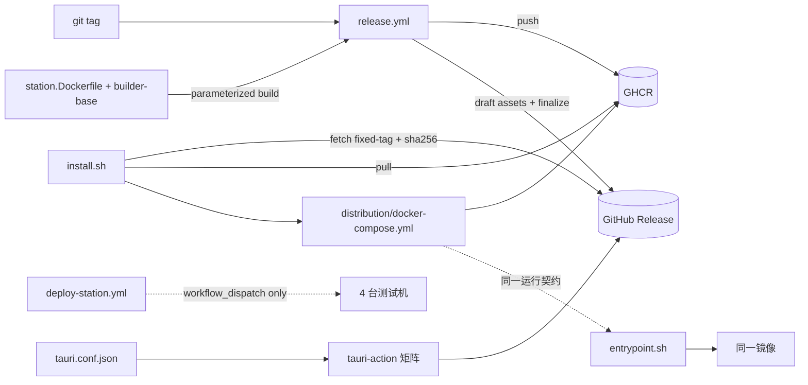

# Release Distribution — 模块目录结构

> **Status**: active
> **Version**: v1.0
> **Created**: 2026-10-21 | **Updated**: 2026-10-21
> **Owner**: Architecture Team

---

## 当前目录树

```text
peers-touch/
├── .github/
│   └── workflows/
│       ├── release.yml                 # 构建、候选验收、公开验收、稳定晋级
│       └── deploy-station.yml          # PR 门禁 + workflow_dispatch；无 tag 发布联动
├── tooling/
│   ├── distribution/                   # 用户分发面
│   │   ├── install.sh                  # 固定 tag 引导与资产校验
│   │   ├── install.test.sh             # 分发源检查入口
│   │   ├── installer.py                # 实例生命周期 owner
│   │   ├── installation_state.py       # 原子状态与 target/project 锁
│   │   ├── installer_test.py
│   │   ├── installation_state_test.py
│   │   ├── docker-compose.yml          # 固定 image digest 的 station+postgres
│   │   ├── .env.example
│   │   ├── release-asset-server.mjs    # candidate 私有 TLS 资产进程
│   │   ├── release-assets.mjs          # Station 资产生成与 updater manifest 契约
│   │   ├── release-lifecycle.mjs       # draft/upload/manifest/finalize/promote owner
│   │   ├── release-suite.mjs           # 真实安装、升级、兼容、恢复、清理 Suite
│   │   ├── release-evidence-check.mjs  # run/source/scenario/digest 精确读回
│   │   ├── release-version-check.mjs   # 完整 tag↔包内 SemVer 校验
│   │   ├── *.test.mjs                  # 资产、证据、生命周期、工作流负例
│   │   └── README.md                   # 用户安装/升级/排障入口
│   │   # checksums.txt 不入仓库：由 release.yml 在 Release 资产生成后计算上传
│   │   # release-version-check.* 是发布流水线脚本，不作为 Release 安装资产上传
│   ├── docker/                         # 测试机/运维面（共享资产，RD-D13 跨模块改造）
│   │   ├── station.Dockerfile          # [改造] 镜像源 + GOSUMDB 参数化，默认官方源
│   │   ├── builder-base.Dockerfile     # [改造] 同一镜像源参数契约（消费方 2）
│   │   ├── compose.yml                 # [改造] build.args 转发镜像源 ARG（消费方 3）；profiles 不变
│   │   ├── entrypoint.sh               # 共享 overlay；含 Station-only Dashboard 凭据
│   │   ├── warm-builder-cache.sh       # [验证] 适配参数化后的 builder-base
│   │   └── station_dockerfile_test.py  # [改造] 增加参数化/默认源用例
│   ├── devctl/                         # make station 开发路径
│   │   └── station.mjs                 # [改造] runCompose 透传镜像源覆盖（消费方 4a）
│   └── acceptance/runtime/
│       ├── node-connectivity-cluster.compose.yml      # [验证/最小改造] 内网构建路径（4b）
│       └── station-access-dual-relay.compose.yml      # [验证/最小改造] 保留 BUILDER_IMAGE 内网能力
├── apps/desktop/
│   ├── package.json                    # [改造] 增加 @tauri-apps/plugin-updater；版本入一致性校验
│   └── src-tauri/
│       ├── Cargo.toml                  # [改造] tauri-plugin-updater；版本入一致性校验
│       ├── tauri.conf.json             # [改造] identifier、updater endpoints/pubkey、bundle targets、
│       │                               #       createUpdaterArtifacts
│       ├── src/main.rs                 # 注册 updater Builder，传播初始化失败
│       ├── src/application/updater_verification.rs # native 验证 command（feature-gated）
│       └── capabilities/               # [改造] 授予 updater 权限（Tauri v2 capability 契约）
└── docs/architecture/engineering/
    └── release-distribution/           # active 模块文档
        ├── README.md
        ├── design.md
        ├── decisions.md
        ├── data-model.md
        ├── integration.md
        └── module-layout.md
```

用户主机运行时状态（非仓库文件，由 install.sh 创建，见 design.md §5.3）：

```text
~/.peers-touch/station/
├── .env                 # 0600，本地生成的密钥与端口变量
├── docker-compose.yml   # 固定 tag 下载，sha256 校验通过
├── state.json           # 健康/尝试版本、digest、schema、卷与操作状态
└── backups/             # 一致快照与校验清单，仅当前用户可读
```

## 文件职责

| 路径 | 职责 | 不承担 |
|------|------|--------|
| `tooling/distribution/install.sh` | 依赖检查、稳定版发现、同 tag HTTPS 下载和 SHA256 校验，然后进入 Python owner | 不保存状态、不持有 GitHub token、不编译任何东西 |
| `tooling/distribution/installer.py` / `installation_state.py` | 生成独立凭据，绑定 Docker target/project/root，拥有 install/backup/upgrade/rollback/restore/uninstall 和原子状态 | 不发现版本、不访问 GitHub、不输出秘密 |
| `tooling/distribution/install.test.sh` | 在无 Docker 条件下运行状态、installer、TLS 路由和 shellcheck | 不替代真实安装 Journey |
| `tooling/distribution/docker-compose.yml` | 用户面唯一编排清单，只引用 GHCR 固定 tag | 无 `build:` 段；无 relay/livekit/webhook |
| `tooling/distribution/.env.example` | 用户可调变量的完整清单与默认值说明 | 不含任何真实密钥 |
| `tooling/distribution/release-version-check.mjs` | 完整 tag、包内版本、lockfiles 和更新版本顺序校验 | 不被作为 Release 安装资产上传 |
| `tooling/distribution/release-version-check.test.mjs` | 版本校验单测，含错误 tag 拒绝反向用例 | 不替代发布流水线 |
| `tooling/distribution/release-asset-server.mjs` | 独立进程通过 Suite CA 信任的 TLS origin 提供 A/B 原始安装资产 | 不读取 GitHub token、不代理业务 API |
| `tooling/distribution/release-suite.mjs` | 下载真实资产，调用实际 `install.sh`，经 Actor/Dashboard/OSS API 建立数据，执行版本对、兼容、恢复和终态清理 | 不注入业务 mock；不向安装器或产品传 GitHub 凭证；不伪造 native updater proof |
| `tooling/distribution/release-evidence-check.mjs` | 校验显式 run ID/attempt、完整 tag、HEAD、必需场景、产物 digest 和清理 | 不从 CI success 字符串直接推导功能通过 |
| `tooling/distribution/README.md` | 安装指令（固定 tag URL）、系统要求、未签名平台说明、升级/回滚/卸载/备份 | 不复制架构设计内容 |
| Release 资产 `checksums.txt`（CI 生成，非仓库文件） | 对当次 Release 的 compose/install.sh 实际资产计算 sha256，安装器校验依据 | 无 pre-tag 手工步骤；不作为提交文件 |
| `.github/workflows/release.yml` | 版本一致性、draft Release、镜像发布、桌面矩阵、finalize 收口 | 不部署任何环境；不持有 SSH secret |
| `.github/workflows/deploy-station.yml` | PR 门禁 + 测试机 workflow_dispatch 部署 | 不再被 tag 触发；不获得 packages write |
| `tooling/docker/station.Dockerfile` | 唯一 Station/Relay 镜像构建定义，镜像源可参数覆盖 | 不区分受众；不内嵌密钥 |
| `apps/desktop/src-tauri/tauri.conf.json` | 产品身份、bundle、updater endpoint/公钥配置 | 不写版本号以外的发布逻辑 |
| `apps/desktop/src-tauri/src/main.rs` | 同依赖、权限和配置一起注册 updater | 不因编译成功而省略实际 check/download 验证 |
| `apps/desktop/src-tauri/src/application/updater_verification.rs` | acceptance-webdriver runtime 调用已注册插件的 check/download/install | 不进入普通产品命令面；缺少真实 OS runtime 时保持 UNPROVEN |

## 依赖关系



- `tooling/distribution/` 只依赖：docker CLI、GitHub Release/GHCR（HTTPS）、同仓库 tag 资产；不依赖 `tooling/scripts/` 的开发期库。
- `tooling/docker/`、devctl、acceptance runtime 不反向依赖 `tooling/distribution/`。
- Desktop 配置只被 release.yml 的桌面 job 消费，与 Station 发布无代码依赖，仅共享 tag、draft Release 与 finalize 收口。
- deploy-station.yml 与 release.yml 无共同触发器、无共享 secret。

## 注册约束

`architecture-modules.json` 以 `release-distribution` 登记当前模块：

- 特征：`stateMachine=true, persistence=true, ownership=true, moduleLayout=true, crossRuntime=true, integration=true`；业务 `protocol=false`，外部格式和单机持久化边界见 data-model.md；
- 推导必需文档：README、design、decisions、data-model、module-layout、integration；
- governedPaths 登记真实存在的路径：本文档目录、`.github/workflows/release.yml`，以及本模块拥有的 `tooling/distribution/` lifecycle 文件（`install.sh`、`installer.py`、`installation_state.py`、`docker-compose.yml`、`.env.example`、`README.md`、`release-*.mjs` 及各自测试）；
- 同目录分治（PR #159 之后的现状）：`tooling/distribution/channels.json` 是 XCFG-D06 的 checked-in channel registry，归 `x-config` 模块；`flavors.json`、`flavors.mjs`、`build-manifest.mjs`、`package.mjs` 属于打包 identity 层，与本模块 lifecycle 文件相互独立、无导入依赖。因此登记采用精确文件路径而非目录前缀，避免跨模块路径重叠；
- `tooling/docker/`、devctl、acceptance runtime 与 deploy-station.yml 因被既有开发/部署/验收流程共享，不纳入本模块路径所有权（见 integration.md §6），RD-D13/RD-D15 的改造以跨模块影响和源检查约束。
