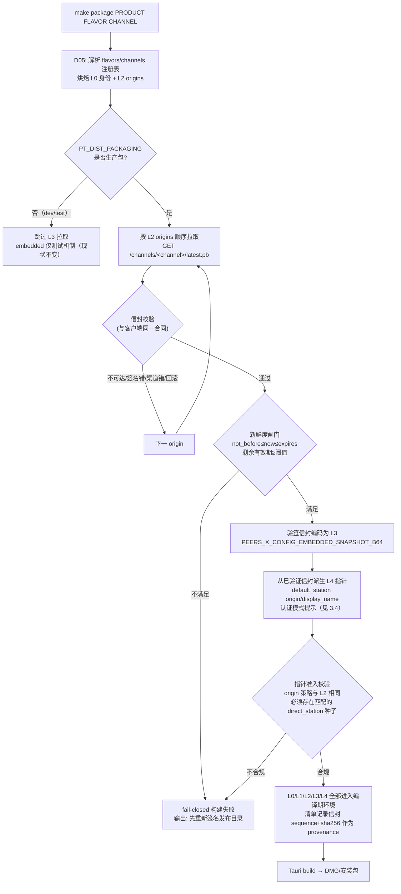
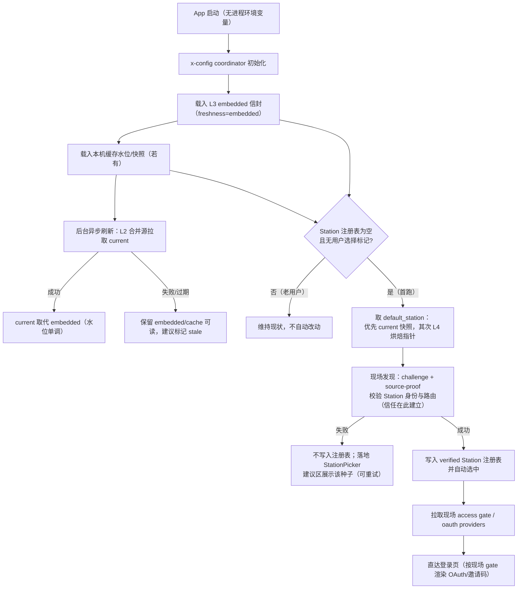

# Package-Time Bootstrap Meta Amendment（XCFG-D07 / XCFG-D08 / XCFG-D09 草案）

> **Status**: draft（待 Owner 评审，未接受；不得据此实施）
> **Date**: 2026-11-05
> **Owner**: Client Platform
> **Amends**: XCFG-D05（分发身份烘焙）、XCFG-D06（烘焙引导源 + 签名故障转移）
> **关联模块**: `apps/x-config/`、`tooling/distribution/`、`packages/x-config-core/`、
> `apps/desktop`、`apps/mobile`、`env` 仓库 Profile

---

## 1. 问题陈述（证据分级）

| Claim | Class | Evidence | Confidence |
|---|---|---|---|
| 生产安装包只烘焙 channel 身份与 x-config 引导源，不烘焙任何快照 | verified_fact | XCFG-D06 decisions.md L833-855；`packages/x-config-core/dist-build.rs` 变量表；`20261023` 计划 P1：embedded snapshot 仅用于离线引导/测试 | high |
| 客户端已存在编译期嵌入快照的消费端能力 | verified_fact | `apps/desktop/src-tauri/src/application/x_config/mod.rs` `embedded_snapshot()` 读 `PEERS_X_CONFIG_EMBEDDED_SNAPSHOT_B64`，initialize 时以 `Freshness::Embedded` 注入 coordinator | high |
| corpstable 线上快照已过期：statement 2026-11-01 到期，relay 种子可操作窗口仅 2026-10-24 前 | verified_fact | 2026-11-05 实拉 `/channels/corpstable/latest.pb`（sequence 2）解码：`expires=1793556944`、seed `available_until=1792858344` | high |
| 目录无自动续发机制；发布必须人工 GitHub operator 登录 | verified_fact | x-config 服务无 scheduler/cron 代码；`pt-x-config-catalog-publish` SKILL 明确小时级窗口与人工发布 | high |
| 客户端首跑只自动应用 `network.default_relay`，`default_station` 不自动接入 | verified_fact | `StationPicker.tsx` L317-337 仅消费 `defaults.default_relay`；`applySuggestion` 本身与种子类型无关 | high |
| dev 机 `PEERS_STATION_URL` 旁路对安装包无效 | verified_fact | `station_registry.rs` L124 仅读进程环境变量；Finder 启动的 .app 无该变量；且该 seed 只参与身份密钥作用域，不自动注册 | high |
| corpstable OAuth"已配置" | inference（冲突待证） | Owner 口述已配置；但公开端点 `/api/oauth/providers` 四个 provider `has_credentials=false`。可能：公开面不回显凭据态、或 18280 实际配置与预期不符。实施前必须用 Station 实际配置证伪 | medium |
| 伙伴安装后应零配置直达登录页 | proposal（本修正案目标） | Owner 2026-11-05 指令 | — |

**核心矛盾**：x-config 的既有哲学是"包只烧去哪儿找配置（origin），配置内容全部运行时拉取"。
但目录内容是短时效签名对象（小时/天级），而试用包的生命周可能跨越多个续发周期，且不存在
自动续发。纯运行时方案在续发断档时必然退化为"手填 Station"。需要引入一个受约束的
**打包期初始元配置（Bootstrap Meta）层**，同时严格区分哪些配置允许烧、哪些只能运行时取。

## 2. Meta 配置生命周期分类（XCFG-D08 提案）

按"可变性、信任来源、失效后果"把客户端引导数据分为五层。这是本修正案的核心合同：

| 层 | 类别 | 示例 | 真源 | 烧录进包 | 运行时策略 | 失效/轮换 |
|---|---|---|---|---|---|---|
| L0 | 发布身份 | product/flavor/channel/version/commit/identifier/labels | `flavors.json`（D05） | 是（编译期，已实现） | 不可变 | 仅随发布 |
| L1 | 控制面信任根 | publisher Ed25519 公钥环 | `apps/x-config/public-keys/` | 是（已实现） | 校验全部 L3 字节 | 只能随发版轮换（D06 既定） |
| L2 | 引导源 | x-config base origins | `channels.json`（D06） | 是（已实现） | override→广告源→烘焙尾锚合并 | 签名快照可零发版漂移 |
| **L3** | **初始控制面快照（新）** | 打包时拉取的**已签名** `latest.pb` 信封 | x-config 服务，经 L2 拉取 | **是（本修正案新增）**：仅烧签名信封，不烧裸配置 | 以 `embedded` 新鲜度首跑可见；后台刷新成功即被 `current` 取代；水位单调，禁止回滚 | 信封自带 expires；过期变 stale |
| **L4** | **端点引导指针（新）** | 默认 Station 的 origin/显示名；认证模式提示 | **打包时从 L3 已验签信封派生**（单一真源仍是目录，不在 flavor 里手填 Station） | **是（派生制品）** | 仅作"去哪儿发现"的指针；**信任在现场发现时重新建立**（challenge/attestation）；注册表为空时自动发现一次；用户做过选择后永久让位 | 指针可用不受 L3 过期影响（与 L2 同级：只是 URL）；现场身份校验失败即弃用 |
| L5 | 运行时状态 | 会话、Station 注册表、快照缓存、水位、用户选择标记 | 设备本地 | 否 | local-first；控制面刷新永不改写这些状态（data-model §7 既定） | 设备作用域 |

**分类原则（回答"哪些烧、哪些启动时拉"）**：

1. **烧"寻址类"，不烧"断言类"**：origin/显示名/认证模式提示可以烧（它们只告诉客户端去哪、
   预期看到什么门）；peer 身份预置钉扎、路由授权、连接授予等断言材料**绝不烧**，永远以运行时
   现场签名发现为准。因此 L4 不降低任何安全保证——它等价于"用户手输 URL"，只是免输入。
2. **烧的是签过名的信封，不是配置裸值**：L3 必须是能被 L1 公钥环独立验签、被水位机拒绝回滚的
   完整信封。打包工具不得自行拼 JSON 配置烧进包。
3. **L4 是 L3 的派生物，可在 L3 过期后继续用于发现**：因为发现动作本身会重新建立 Station 身份
   信任。L4 的 provenance（来源 sequence/信封摘要）写入构建清单用于审计，运行时不依赖该摘要
   做信任决定。
4. **一切可变业务行为仍以运行时 `current` 快照为唯一权威**：L3/L4 只覆盖"首跑、无缓存、
   x-config 不可达或快照已断档"的引导窗口；后台刷新一旦成功，embedded 永远不再参与指令求值。
5. **认证状态以 Station 现场为权威**：L4 的认证模式字段只是 UI 提示；实际 gate/provider 状态
   永远在发现/登录时现场拉取，提示与现场冲突时以现场为准（fail-closed 到现场 gate）。

## 3. 目标流程

### 3.1 Dynamic Flow — 打包期 Bootstrap Meta 生成



要点：

- **单一真源**：默认 Station 只来自目录的 direct_station 种子 + `network.default_station`
  指令求值结果（targeting 用 L0 身份），打包工具和 flavor 注册表都不允许手填 Station URL。
- **fail-closed**：拉不到合法信封或缺 station 种子时，生产包构建直接失败并给出明确补救
  （重新发布目录），绝不静默产出一个"零配置失效"的包。
- **新鲜度阈值**：建议 `expires_at - now ≥ 72h`（参数化）。低于阈值拒绝打包，强制目录先续发。
  注意这不保证安装包在货架上长期新鲜——它只保证**出厂时**引导有效；货架期保护由 3.3 的
  L4 独立于 L3 过期的语义承担。
- **校验器单一实现**：打包期校验必须复用与客户端相同的验签/水位/准入规则。优先在
  `apps/x-config` 增加无状态 `verify-envelope` 子命令供 package.mjs 调用；禁止在 Node 侧重写
  第二套密码学校验。

### 3.2 Dynamic Flow — 伙伴首跑零配置引导



- 自动接入复用现有 `applySuggestion` 通道（已与种子类型无关），新增的只是
  `default_station` 的首跑 effect，与已上线的 `default_relay` 自动应用同构。
- embedded 快照过期后，L4 指针仍允许发现；发现失败不阻塞，退化为建议区一次点击。
- 自动接入只在"注册表为空 + 从未手工选择"时发生；用户一旦操作即永久关闭自动选择
  （沿用 `storeStationAutoDefault` 的既有选择标记语义，需新增 station 维度的标记）。

### 3.3 L3/L4 生命周期对照

```text
打包时刻                    安装时刻            首跑                  日后任意时刻
  │                            │                  │                         │
  ├─ L3 信封验签后烧录          ├ 二进制不可变      ├ embedded 可读           ├ 仅当无缓存且拉取失败时兜底
  │  （自带 expires）           │                  ├ 刷新成功 → 被 current 取代（永久）
  │                            │                  └ 过期 → stale，不参与指令求值
  ├─ L4 指针派生并烧录          ├ 二进制不可变      ├ 注册表为空 → 触发一次现场发现
  │                            │                  └ 用户选择后 → 永久让位
  └ L2 origins 烧录（D06 现状） └                  └ 尾锚常驻（D06 现状）
```

关键不变量：**L3 是"会过期的引导快照"，L4 是"不过期的寻址指针，信任每次现场重建"**。
这使安装包即使在目录断档数月后安装，仍能发现 Station；而指令/路由/断言类配置永远不会
因烘焙而过时生效。

### 3.4 Control Plane — Profile 认证就绪字段（XCFG-D09 提案）

env 仓库 Profile 是"该渠道 Station 部署形态"的评审声明处。新增字段：

```text
# ../env/peers-touch/<profile>/profile.env.example
PT_STATION_AUTH_MODE=oauth        # 枚举：oauth | invite_code | unknown（默认 unknown）
```

- 用枚举而非布尔：认证模式可能扩展；`oauth` 表示该 Profile 的 Station 已配置可用 OAuth
  provider（即 Owner 所述"已配置"的正式声明位）。
- **消费方三处**：
  1. 打包期：仅当存在已签名目录的 direct_station 种子、且 Profile 声明 `oauth` 时，L4 才带
     `auth_mode_hint=oauth`；包不为 Station 的认证配置背书，只决定首跑 UI 是否直接渲染 OAuth
     面板，避免一次无谓的 gate 探测往返。
  2. 目录发布意图：发布 operator 据此确认渠道 Station 的认证形态（人工评审输入，不自动发布）。
  3. dev/Make 工具链：`make env-check` 增加一致性核对——声明 `oauth` 时对目标 Station 做一次
     现场 provider 探测（带认证的管理面探测，不以公开 `has_credentials` 字段为唯一证据，以解决
     §1 的证据冲突），不一致时告警。
- **权威仍在 Station 现场**：客户端登录前永远现场拉 gate；hint 与现场不符以现场为准。

## 4. 范围与非目标

**范围内**：打包期 L3 验签信封嵌入与 L4 指针派生；`default_station` 首跑自动接入（Desktop
先行，Mobile 同合同跟进）；Profile `PT_STATION_AUTH_MODE`；打包 fail-closed 闸门；
x-config 无状态验签子命令（若无现成可复用实现）。

**非目标**：

- 不做目录自动续发服务（scheduler）。这是独立运维能力；L4 语义保证它不阻塞试用安装。
- 不在包内烘焙 peer 身份钉扎、连接授予、access gate 细节或任何凭据。
- 不改变发布签名链、publisher key 轮换规则（仍须发版）。
- 不改变 Station 服务端的认证配置本身（corpstable OAuth 配置核验是部署侧动作）。
- Mobile 打包链接入可与 Desktop 同批设计、分步落地。

## 5. 对既有决策的修订

- **修订 XCFG-D06 / 20261023 计划 P1 的注记**："packages bake no snapshot …… embedded
  snapshot remains an offline bootstrap/test mechanism only" 放宽为：**生产包允许嵌入打包时
  验签的 L3 信封与派生 L4 指针，但仅限本修正案定义的类、闸门与新鲜度约束；裸配置仍禁止烘焙，
  embedded 永远不参与已刷新客户端的指令求值。**
- D05 的 BuildIdentity 扩展两个编译期字段：`embedded_snapshot_b64`（经现有 env 名透传）与
  派生的 `bootstrap_station`（origin/display_name/auth_mode_hint + provenance），均为可选；
  dev 包保持全空。

## 6. 质量门（设计级，验收细则留待执行计划）

1. 打包机断网/目录过期/签名不符时，`make package` 必须非零退出，且产物不含半截 L3。
2. 全新存储的安装包：无任何环境变量、x-config 不可达场景下，首跑仍能现场发现并选中
   default Station，直达登录页（L4 独立有效性）。
3. x-config 可达且快照更新时：current 快照生效后修改 Station/指令，无需发版即可改变客户端
   建议；embedded 被证实不再参与求值（结构+Journey 双证据）。
4. L4 指向的 Station 现场身份不匹配时：零写入、零自动选中、无信任确认绕过。
5. 用户手工选过 Station 后：任何重启动/新快照都不得再自动切换。
6. 二进制审计：包内不含裸 Station 配置 JSON，只含签名信封与经准入的 origin 字符串。

## 7. 待 Owner 决策的开放问题

1. L3 打包新鲜度阈值取值（建议 72h）与目录续发 SLA 的关系认定。
2. L4 provenance 是否需要进签名信封扩展字段，还是仅入构建清单（倾向前者最小化：只进清单）。
3. Mobile 是否同一批落地（其安装形态与伙伴分发路径尚未建立）。
4. corpstable OAuth 实际配置的证据冲突如何闭环（§1）。
