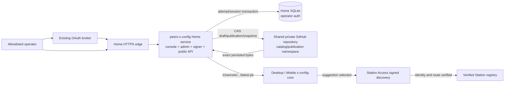

# X Config - Architecture Design

> **Status**: active
> **Version**: v2.1
> **Created**: 2026-10-17 | **Updated**: 2026-10-20
> **Owner**: Client Platform
> **Module**: `apps/x-config/`

---

## 1. Core Principles

1. X Config distributes reviewed suggestions; it owns no Station, Relay,
   Actor, Session, or Federation identity.
2. One Home service owns catalog mutation, sequence CAS, signing, persistence,
   and public readback.
3. Signed exact bytes in GitHub are publication truth; operator authentication
   state is separate Home-local runtime truth.
4. The single-user console requires explicit diff acknowledgement, but no
   separate approval authority.
5. Remote configuration is protobuf-first, closed, typed, size-bounded, and
   never executable.
6. Client launch is local-first and retains last-known-good state.

## 2. System Topology



The Home service can sign because the sole operator explicitly accepts the
single-user risk. Compromise of that service can publish a valid snapshot.
Client-side signature, channel, expiry, and monotonic sequence checks still
protect against CDN tampering, stale replay, and malformed data; they do not
separate admin and signer authority.

## 3. Runtime Units

### 3.1 Home Unified Service

`apps/x-config` provides:

- React/Vite operator console;
- OAuth callback and short-lived operator session;
- typed catalog validation and endpoint probes;
- Git-backed draft CAS;
- direct publication with Ed25519 signing;
- publication history and restore-as-new;
- unauthenticated public protobuf reads.

The browser never receives the GitHub App private key, operator record key, or
snapshot signing private key. The Go service consumes them from Home runtime
configuration sourced from the committed env repository.

### 3.2 Operator Authentication Store

The Home runtime owns one local SQLite database for:

```text
login attempts
attempt consumption
assertion consumption
operator sessions
CSRF digests
session expiry and revocation
```

The receiver verifier is encrypted with the dedicated operator record key.
Session and CSRF cookies contain opaque random values; persistence stores only
digests. Login completion marks the attempt and assertion consumed and creates
the session in one transaction after successful Broker redemption.

The database is mounted from a dedicated Home state directory and has one
active process owner. Missing storage, schema failure, lock exhaustion, or
corrupt records fail closed. An empty replacement database signs the operator
out; stale database restore is forbidden.

### 3.3 Shared Publication Repository

The existing OAuth storage App and repository are reused. Ownership is isolated
by stable prefixes:

```text
oauth-data/       # OAuth owner
x-config/         # X Config owner
```

Within `x-config/`:

```text
catalogs/<channel>.yaml
publications/<channel>/current.json
publications/<channel>/<sequence>.json
snapshots/<channel>/<sequence>.pb
```

One Git commit atomically writes the publication metadata, current pointer, and
signed envelope. The repository head is the CAS token. A concurrent writer
forces the operator to reload and re-review.

### 3.4 Public Read

The service maps:

- `/channels/<channel>/latest.pb` to the current publication;
- `/snapshots/<channel>-<20-digit-sequence>.pb` to one immutable publication.

Latest uses `public, max-age=300, must-revalidate`. Sequence reads use
`public, max-age=31536000, immutable`. Both return the exact persisted envelope,
an SHA-256 ETag, `application/protobuf`, and no credential.

### 3.5 Shared Client Core

`packages/x-config-core` owns:

- domain-separated Ed25519 verification;
- schema, channel, time, and size bounds;
- monotonic sequence and equal-sequence byte identity;
- last-known-good selection;
- endpoint and release projections.

Desktop and Mobile own HTTP, secure watermark persistence, scheduling, and UI
projection. Station identity proof stays in Station Access.

#### Desktop optional lifecycle

`XConfigRuntime::new` constructs in-memory owners only. It does not read
Keychain or snapshot files and does not fetch network bytes. The existing
async Tauri refresh command runs initialization and refresh in a blocking
worker. Profile discovery and the verified Station registry remain independent.

One worker owns the coordinator for the entire initialization/refresh round.
Concurrent refresh requests, including forced requests, return the published
read view instead of waiting or starting another round. Projection and
suggestion-material reads clone an immutable view under a separate short lock;
they never acquire the coordinator lock. Cached state is published after
initialization, before network I/O. Each read recomputes expiry and
actionability against the current clock.

macOS accesses the same login-keychain generic password service/account using
the Security SDK's per-query noninteractive failure policy for reads, updates,
and adds. It does not change global Keychain interaction policy or storage
backend. Only actual item-not-found represents absence. Denied access,
decode failures, and persistence failures preserve unknown watermark status
and do not admit a snapshot. Initialization failure stops that refresh before
network fetch, publishes an advisory error and backoff, and can retry later.

The coordinator publishes a remote snapshot only after exact-byte verification,
cache persistence and watermark commit. Failed rounds retain the last accepted
view; an expired view is stale and nonactionable. Worker unwind clears the
published refreshing flag and leaves reads available, with further refresh
failing closed if the worker state is poisoned. No refresh completion can
replace an active Station or import credentials.

## 4. Publication Transaction

```text
load draft at repository revision R
  -> validate exact catalog and live endpoints
  -> operator acknowledges exact digest
  -> repository CAS checks current head == R
  -> read current sequence N
  -> build statement with N+1 and bounded lifetime
  -> sign domain || statement bytes
  -> atomically commit metadata + current pointer + envelope
  -> return publication and new repository revision
```

No sequence is visible unless the corresponding signed bytes commit. A failed
CAS publishes nothing. Retry starts from the new head and therefore receives a
new explicit operator review.

## 5. Trust Boundaries

### 5.1 Snapshot

The signature proves accepted publisher-key origin and byte integrity.
Monotonic secure watermarks reject rollback. It does not prove endpoint
reachability or Station identity.

### 5.2 Endpoint

Relay and Direct Station seeds carry the peer-domain connection material owned
by Node Connectivity. Direct Station entries additionally require owner public
consent. Station Access performs signed discovery before any registry mutation.

### 5.3 Release

Release descriptors provide metadata and manifest location only. Platform
updaters independently verify release signatures and artifact digests.

### 5.4 Hosting

The Home edge owns public TLS and ingress. The Home X Config runtime owns
service availability, operator-state volume, and runtime-secret custody.
GitHub owns durable catalog history, publication bytes, and sequence state. The
env repository owns declared placement and runtime configuration. The
application repository owns adapters and contracts, not deployment placement.

## 6. Failure Semantics

- Home runtime unavailable: clients retain cache or embedded fallback.
- GitHub unavailable: catalog/publication operations and public reads fail
  closed; an existing operator session remains locally verifiable.
- Operator database unavailable or locked beyond the bound: login and protected
  admin requests fail closed; publication data remains unchanged.
- Operator database is recreated empty: all prior sessions are invalid and the
  operator signs in again; publication state is unaffected.
- Invalid catalog: draft is not saved or published.
- Stale repository revision: HTTP 409; local edit remains for rebase.
- Signing unavailable: publication commit is absent.
- Persisted metadata/bytes mismatch: public read returns unavailable.
- Snapshot signature/channel/expiry invalid: client rejects it.
- Lower sequence or equal sequence with different bytes: client rejects it.
- Catalog removal: only cloud suggestion disappears.
- Endpoint identity mismatch: Station Access rejects it.
- OAuth subject outside allowlist: no operator session.

## 7. Architecture Gates

1. Direct publication increments one sequence and persists exact signed bytes.
2. Stale draft CAS cannot sign or write publication state.
3. Latest and immutable reads return matching bytes with different cache
   policies.
4. Real OAuth login creates a session only for the configured subject.
5. Operator login, session readback, and logout perform no X Config GitHub
   mutation and survive one Home service restart.
6. Shared repository writes remain under the catalog/publication paths in
   `x-config/`; `x-config/admin-auth/` is not an active runtime path.
7. Desktop and Mobile verify the deployed envelope with the embedded keyring.
8. Tree-wide checks find no active Vercel X Config runtime, GitHub operator
   store, independent publisher, ledger repository, approval state,
   distribution project, or old client URL variable.
9. Sanitized timing spans separately report local attempt persistence, Broker
   redemption, local session commit, and session readback. Across twenty warm
   Home samples, the P95 of each X Config-local span is below one second; the
   Broker span is reported but remains owned by Identity.
