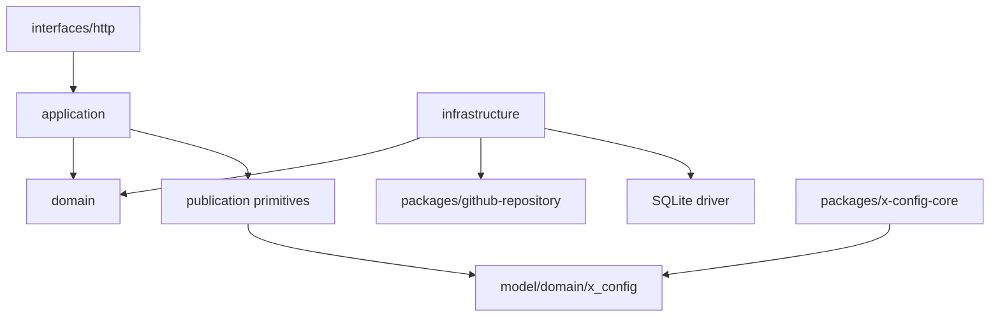

# X Config - Module Layout

> **Status**: active
> **Version**: v2.1
> **Created**: 2026-10-17 | **Updated**: 2026-10-20
> **Owner**: Client Platform
> **Module**: `apps/x-config/`

---

## 1. Source Layout

```text
apps/x-config/
├── cmd/server/
├── console/
├── internal/
│   ├── application/
│   │   ├── admin/
│   │   └── operatorauth/
│   ├── bootstrap/
│   ├── domain/
│   │   ├── catalog/
│   │   └── operator/
│   ├── infrastructure/
│   │   ├── catalogrepo/
│   │   ├── endpointvalidator/
│   │   ├── oauth/
│   │   └── operatorstore/
│   ├── interfaces/http/
│   └── publication/
│       ├── catalog.go
│       └── signer.go
└── public-keys/

packages/x-config-core/
model/domain/x_config/
packages/github-repository/
apps/desktop/src-tauri/src/application/x_config/
apps/mobile/src-tauri/src/runtime/x_config.rs
tooling/acceptance/gates/x_config/
```

There is no `cmd/publisher`, distribution source tree, Git ledger adapter,
Git-backed operator store, or active Vercel deployment adapter.

## 2. File Responsibilities

| Path | Responsibility |
|---|---|
| `cmd/server/` | Home HTTP process entrypoint |
| `console/` | Typed draft, diff, direct publish, and history UI |
| `application/admin` | Validation, draft, publication, restore use cases |
| `application/operatorauth` | OAuth assertion and operator-session lifecycle |
| `domain/catalog` | Catalog, draft, publication, and repository ports |
| `catalogrepo` | Test memory adapter and production GitHub CAS persistence |
| `operatorstore` | Test memory adapter and production Home SQLite transactions |
| `publication/catalog.go` | Catalog parsing and deterministic statement build |
| `publication/signer.go` | Domain-separated Ed25519 signing primitive |
| `public-keys/` | Client-embedded accepted publisher keys |
| `packages/github-repository` | Domain-neutral GitHub App and Git Data CAS |
| `packages/x-config-core` | Shared client verification and cache policy |
| `tooling/acceptance/gates/x_config` | Source, Home runtime, publication, and login evidence |

## 3. Dependency Direction



Allowed:

- application owns direct publication orchestration;
- repository adapter owns CAS and path layout;
- operator store owns only local attempt/assertion/session transactions;
- signing primitive owns only deterministic cryptography;
- public handler reads only persisted repository bytes;
- OAuth and X Config share the audience-bound login contract, not application
  sessions or operator storage.

Forbidden:

- a second publisher process or approval service;
- an independent ledger/data repository;
- a distribution project or distribution deployment credential;
- browser access to GitHub App, record, or signing keys;
- provider OAuth logic inside X Config;
- X Config operator records in GitHub;
- multiple active X Config processes over one operator database;
- writes outside `x-config/`;
- client adapters persisting suggestions as verified Stations;
- generic command/config maps in snapshot contracts.

## 4. Deployment Layout

```text
env/peers-touch-infra/x-config-preview/
├── README.md
├── inventory.yml
├── runtime.env
├── home.compose.yml
├── home-web.conf
└── home-edge.conf

Home
├── edge -> 127.0.0.1:18082
├── peers-x-config-web
├── peers-x-config-api
└── state/operator-auth.sqlite

GitHub
└── <github-owner>/peers-touch-oauth-client-data
    ├── oauth-data/
    └── x-config/
        ├── catalogs/
        ├── publications/
        └── snapshots/
```

The env repository decides placement and runtime values. The application
repository supplies the server/console artifacts, source adapters, and
Acceptance proof owners.

## 5. Generated And Secret Policy

- Protobuf bindings are generated through existing model tooling.
- Signed snapshots are durable GitHub data, not tracked application source.
- Signing private keys and operator record keys live only in git-crypt env
  assets and Home runtime configuration.
- Publisher public keys are tracked source and embedded by clients.
- Operator SQLite files, WAL/SHM files, runtime evidence, and secret values are
  not committed.
