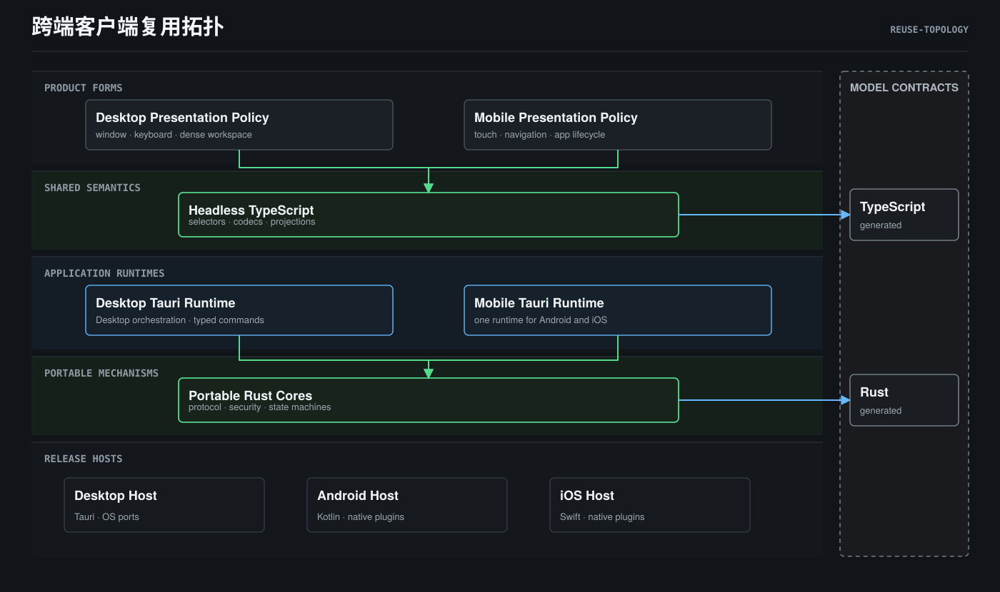

# Cross-Client Runtime Architecture - Design

> **Status**: active
> **Version**: v1.3
> **Created**: 2026-10-16 | **Updated**: 2026-10-20
> **Owner**: Client Platform Team
> **Module**: Desktop and Mobile client runtime boundaries

---

## 1. Goals

1. Keep Desktop and Mobile product behavior aligned without forcing identical
   UI or OS integration.
2. Reuse security-sensitive, stateful, and protocol-heavy logic through
   portable Rust libraries where reuse removes semantic duplication.
3. Keep Station as shared business authority and Model as the shared protocol
   substrate without presenting Model as a runtime tier.
4. Make Android and iOS two hosts of one Mobile product instead of independent
   feature trees.
5. Make platform claims evidence-based per release target.
6. Make reuse the default and require evidence for every semantic fork.

## 2. Reuse Topology



The spanning bands are the assets reused by both client forms. Split rows are
form-specific runtimes or release hosts. Runtime calls, contract generation,
and authority remain in separate views below. The right rail is the generated
Model binding substrate consumed at cross-runtime boundaries; it is not a live
runtime tier.

## 3. Runtime Topology

**View: Runtime Topology.** The bidirectional arrow means live business
request/event flow.

```text
┌────────────── CLIENT RUNTIMES ──────────────┐     ┌──── STATION RUNTIME ────┐
│ Desktop Client                              │     │ business domains         │
│ Mobile Client: Android Host | iOS Host      │  ⇄  │ policy and federation    │
│ one independent instance/store per install │     │ durable shared truth     │
└─────────────────────────────────────────────┘     └──────────────────────────┘
```

Model is absent from the runtime diagram because it has no live instance.
`model/domain/*.proto` defines shared wire meaning and generates bindings
consumed by both sides; it does not sit between them at runtime.

The two client forms may embed the same headless TypeScript semantics and
portable Rust cores, but they never share a live instance or local database.
Synchronization between devices occurs through Station-owned business
protocols, not through direct local-store replication.

## 4. Client Composition

**View: Reuse Topology.** Rows express module ownership and reuse boundaries;
they do not imply runtime call order.

```text
Product forms        Desktop Client         | Mobile Client
Presentation         Desktop policy         | Mobile policy
Shared TS semantics  packages/client-* reused across admitted consumers
Portable mechanisms  portable Rust cores embedded per consuming runtime
Runtime ownership    Desktop runtime        | shared Mobile runtime
Host boundary        Desktop Host           | Android Host | iOS Host
Local state          per installation       | per installation
Contract substrate   generated Model bindings at cross-runtime boundaries
```

### 4.1 Shared contract semantics

Generated from `model/domain/`. These contracts define common data and wire
meaning. A Rust type internal to a core does not replace a Model contract when
the concept crosses process, device, or Station boundaries.

### 4.2 Portable runtime semantics

Portable Rust cores are appropriate for logic that is:

- stateful and difficult to reproduce consistently;
- security or protocol sensitive;
- independent of a particular UI toolkit;
- testable through host-neutral ports;
- valuable to more than one client form or OS host.

Portability is not a reason to move all client code into Rust. Navigation,
layout, platform lifecycle wiring, and thin host adaptation remain outside a
portable core unless a narrower shared semantic owner is justified.

### 4.3 Presentation policy

Presentation policy maps shared state and actions into product behavior:

- Desktop windowing, keyboard, dense layout, sidebars, and multi-surface rules;
- Mobile stack navigation, touch, safe-area, keyboard, bottom-sheet, and
  foreground/background rules.

Android and iOS implement one Mobile presentation policy. OS differences may
change capability availability or native rendering details, not Mobile product
semantics.

### 4.4 Platform host and runtime ports

The host owns process lifecycle, plugin registration, OS callbacks, packaging,
and release identity. Runtime ports expose narrow capabilities to a core, such
as storage, clock, random, network, key material, notifications, and lifecycle
signals.

Ports express required behavior. Adapters implement that behavior for Desktop,
Android, or iOS. A port must not expose a general host escape hatch.

## 5. Reuse-First Classification

Every new client capability is classified before a platform implementation is
created. These are placement questions, not ordered runtime layers:

```text
Contract boundary     shared across process/device      Model / Proto
Mechanism boundary    protocol/security/state/storage   portable Rust core
Renderer boundary     selector/codec/cache/projection   shared TypeScript core
Entity UI boundary    policy-neutral anatomy/action     shared UI primitive
Product-form boundary Desktop/Mobile interaction        Presentation Policy
OS boundary           API/lifecycle/permission/package  Host / Port adapter
```

One capability may have artifacts in several rows. Each semantic decision has
one narrowest canonical owner whose lifecycle and variation axis match the
behavior. Classification is semantic, not based on which platform writes
first. Contract authoring order is not runtime topology or visual priority.

### 5.1 Reuse admission

Before adding a client component, package, crate, runtime helper, adapter, or
contract:

1. Query the architecture capability registry and workspace manifests.
2. Reuse the canonical asset when semantics already match.
3. Extend the canonical asset when the capability is incomplete but ownership
   remains the same.
4. Extract the host-neutral semantic core before a second implementation
   lands.
5. Specialize only at the accepted Presentation Policy or Platform Host axis.
6. Record a divergence only when shared semantics would be incorrect.

The proposer owns the search and divergence burden. Reviewers do not need to
prove that a duplicate already exists before rejecting an unclassified second
implementation.

### 5.2 Extraction timing

The "second consumer" rule is a latest boundary, not the default trigger:

- cross-client contract, security, protocol, persistence, and identity
  semantics are shared from the first implementation;
- a second consumer must use or extract the shared asset before merge;
- speculative general-purpose abstractions without an accepted semantic owner
  remain local;
- code stays local when only implementation mechanics match but product or
  lifecycle semantics differ.

### 5.3 UI sharing

UI reuse has two layers:

- product-entity semantics, state derivation, action contracts, accessibility
  labels, and stable markers are shared;
- Desktop/Mobile layout, density, navigation, gesture, focus, safe-area, and
  keyboard policy remain form-specific.

A React component is shared across Desktop and Mobile only when its internal
anatomy and interaction contract are policy-neutral. Otherwise the shared
asset is headless logic plus separate Desktop/Mobile shells. Android and iOS
do not fork Mobile React components.

### 5.4 Divergence

Desktop/Mobile shells and Desktop/Android/iOS port adapters are ordinary
specializations when they implement one shared Presentation Policy or runtime
port contract without redefining its semantics. They do not require one record
per adapter.

A parallel semantic implementation that cannot be expressed by those declared
contracts is allowed only through an accepted `DivergenceRecord` that
identifies:

- canonical capability and owner;
- exact variation axis;
- implementation roots and consumers;
- why ports, policy injection, or composition cannot express the difference;
- evidence that shared behavior would be incorrect;
- review or deletion trigger.

Compatibility convenience, team ownership, schedule pressure, and existing
duplication are not valid divergence reasons.

## 6. Authority Map

**View: Authority Map.** Rows are orthogonal ownership domains, not runtime
layers. Authority is assigned by state meaning, not by implementation language:

| State or decision | Authority |
|---|---|
| Cross-device business state and policy | Station |
| Device-local command ledger, cache, draft, lease | Owning client runtime |
| Portable local protocol/security state | Owning portable core instance |
| OS capability availability | Platform host observation |
| Product rendering and interaction policy | Desktop or Mobile presentation policy |
| Shared wire shape and semantics | Model |

A local core may be authoritative for its own encrypted local state while
remaining subordinate to Station for shared business outcomes.

## 7. Capability and Admission

Hosts report capability facts; they do not directly decide business or product
eligibility.

```text
Platform Host
  -> CapabilityFacts
       -> Client Runtime policy
            -> AdmissionProjection
                 -> Presentation
```

`AdmissionProjection` combines capability facts, runtime readiness, Station
policy, and product policy into an explicit state such as `available`,
`degraded`, `blocked`, or `unknown`. Unknown facts fail closed.
## 8. Compatibility Boundaries

Internal module boundaries use a hard cut when ownership changes:

- one active owner;
- no duplicate local model;
- no compatibility wrapper preserving two internal paths;
- callers migrate with the ownership change.

External compatibility is independent:

- persisted local data requires an explicit schema migration;
- Station wire contracts follow API and Proto compatibility policy;
- released deep links, plugin contracts, and user-visible data formats require
  versioned compatibility decisions.

Internal cleanup must not be blocked by unnecessary internal shims, and it
must not silently break external contracts.
## 9. Evidence Model

Architecture and product claims are evaluated per capability and runtime cell:

```text
EvidenceCell = capability x release target x runtime mode x source revision
```

Required cells distinguish Desktop native development, Desktop packaged,
Android native, and iOS native execution as required by the capability.

An iOS result cannot prove Android, and an Android result cannot prove iOS.
Shared unit tests prove portable semantics only; they do not prove host
integration, permissions, lifecycle, packaging, or provider setup.

Missing or stale evidence is `UNPROVEN`, never implicit success.
## 10. Invariants

- **CCR-I01**: There are two client forms: Desktop and Mobile.
- **CCR-I02**: Desktop, Android, and iOS remain separate release targets.
- **CCR-I03**: Android and iOS share one Mobile product contract.
- **CCR-I04**: Portable Rust cores are embedded libraries, not services.
- **CCR-I05**: Every device runs an independent core instance and local store.
- **CCR-I06**: Station owns shared business truth; Model owns shared contract
  truth.
- **CCR-I07**: Runtime ports and presentation policy are independent variation
  axes.
- **CCR-I08**: Host capability observations become explicit admission
  projections before UI use.
- **CCR-I09**: Internal ownership changes use a hard cut; external contracts
  use explicit compatibility policy.
- **CCR-I10**: Evidence cannot be transferred between release targets.
- **CCR-I11**: Every reusable asset has one capability ID, semantic owner, and
  canonical root.
- **CCR-I12**: A second consumer reuses or extracts the canonical asset before
  merge.
- **CCR-I13**: Cross-client contract, security, protocol, persistence, and
  identity semantics are shared from the first implementation.
- **CCR-I14**: Shared UI stops at the Presentation Policy boundary.
- **CCR-I15**: Every parallel semantic implementation outside a shared
  Presentation Policy or runtime-port contract has an accepted current
  `DivergenceRecord`.
- **CCR-I16**: Workspace dependencies shared by Desktop and Mobile are
  registered in architecture governance.
## 11. Forbidden Relationships

| ID | Forbidden relationship |
|---|---|
| CCR-F01 | A portable core directly owns Station business policy |
| CCR-F02 | Android and iOS maintain separate product state models |
| CCR-F03 | Presentation code reads raw OS capability state as business eligibility |
| CCR-F04 | A native plugin defines a parallel domain DTO for a Model-owned contract |
| CCR-F05 | Two clients share or replicate a local core database directly |
| CCR-F06 | A general-purpose FFI or plugin escape hatch bypasses typed runtime ports |
| CCR-F07 | Shared Rust unit tests are presented as native release proof |
| CCR-F08 | Evidence from one OS or runtime cell is used to mark another cell proven |
| CCR-F09 | Desktop and Mobile implement the same contract, codec, cache, selector, state machine, or entity semantics independently |
| CCR-F10 | A second consumer lands before shared extraction or registration |
| CCR-F11 | A platform-local package becomes a de facto shared owner through imports without architecture registration |
| CCR-F12 | A shared React component contains Desktop/Mobile navigation, density, safe-area, gesture, or window policy |
| CCR-F13 | Android and iOS maintain separate Mobile React components for the same product surface |
| CCR-F14 | A duplicate is justified only by schedule, team ownership, language preference, or compatibility convenience |
| CCR-F15 | A shared workspace dependency is absent from the positive architecture capability registry |
