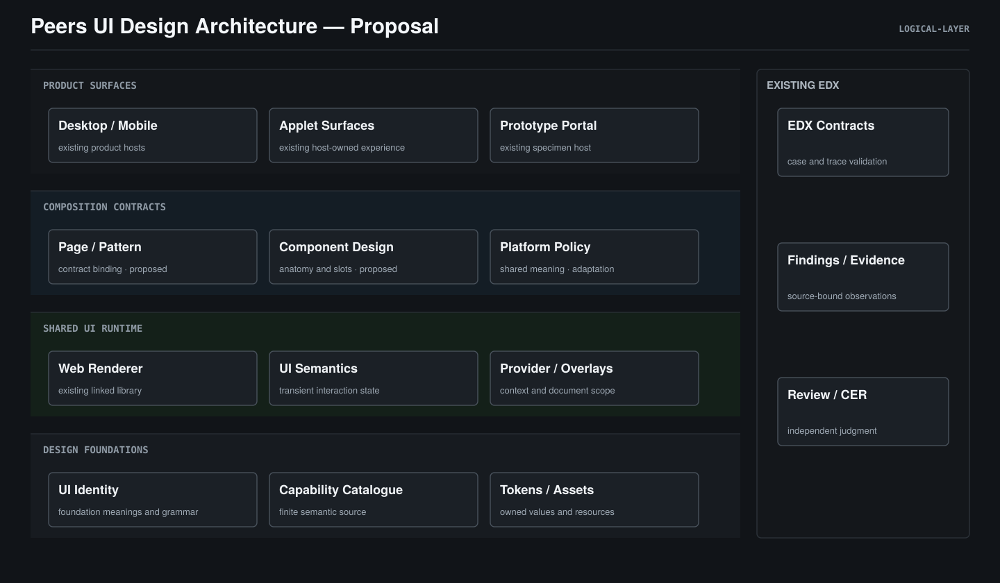

# Peers UI — Design

> **Status**: active
> **Created**: 2026-10-28 | **Updated**: 2026-10-29
> **Owner**: Client Platform / UI System
> **Target Design**: draft — 等待用户确认；UI-D01–UI-D04 保持 accepted

## 1. 设计目标与范围

建立 Agent 参与应用 UI/UX 整体事务的架构：从用户如何理解、行动、获得结果和
恢复，推导体验合同、页面、组件、状态与平台呈现，并在制作和演进中验证。
每个实现都能说明用户价值、设计选择、结构与状态归属、组合条件和证明范围。
观察回到原 Owner，成为下一次设计的共同依据。

本设计覆盖 Desktop、Mobile Web、Applet 内的共享 UI 与原型；
产品业务规则、客户端运行时和 EDX 推理继续由各自已存在的架构拥有。
130 项目录是覆盖清单，20 项基础只是当前审阅子集，数量不定义架构层次。
本轮产出整体设计提案，不授权实现新合同、推广候选 token 或继续批量制作组件。

已接受基线见 [UI-D01–UI-D04](./decisions.md)。以下目标结构对应
UI-D05–UI-D10，均为 proposed；文档所属模块 active 不等于提案已接受。

## 2. 事实基线与设计依据

- 源码事实：现有 packages/ui 分为 contracts、tokens、assets、semantics、web；
  公共入口和有限目录已经存在，具体平台证据分别记录。
- 源码事实：当前 CapabilityRecord 记录意图、anatomy、状态、变体、非法组合和
  源码位置；多数设计细节仍是描述字符串，尚无完整的组合与呈现绑定。
- 源码事实：既有 EDX SurfaceContract 约束主对象与 region 角色，
  UI Grammar 约束动作表示和平台适配；它们不直接决定控件的视觉数值。
- 现场事实：当前分段选择的父轨道与选中项分别使用内描边/材质，
  选中项还使用投影；无 hover/focus 时仍呈现多个空间层次。
- 推断：有公共组件和 token 不足以保证一致体验；结构、状态、表达与组合关系
  需要共同的推导合同。这一推断还需不同组件和真实 Journey 校准。
- 提案：按下述职责架构组织设计，用组件与场景检验覆盖面，禁止由单个反例
  直接产生普遍禁令。

约束真源：[UI Identity](../../../../client/common/ui-identity/README.md)、
[EDX](../../../engineering/experience-design/README.md)、
[Frontend Runtime](../frontend-runtime/README.md)。
参考风格只提供表达校准；不复制参考产品的业务模型、资产或品牌。

## 3. 架构总览

整体由七项职责及其合同关系定义，见下一节；它们是职责边界，不是七个新服务。
本模块拥有公共 UI 与组合执行，跨应用体验由 Product/EDX、UI Identity、
Frontend Runtime、Quality 和 Development Workflow 的原合同共同约束。

该图是共享 UI 实现的子视图，从产品表面、组合合同、共享渲染到设计真源
表达依赖。它不表示整体 UI/UX 的全部职责、施工阶段或新增进程拓扑。
右侧是既有 EDX 的工程控制职责。
组合合同是本提案需要补齐的设计信息；其核心是 Definition、Composition、
Resolution 三个对象，详细语义见下文和 [数据模型](./data-model.md)。
它们沿现有 contracts/semantics/web 落地，不增加服务、Store 或渲染引擎。

### 产品与体验合同

Product 拥有目标用户、任务、主对象、内容语义、信息架构、可见状态、
关键承诺和结果判断。页面首先是一个任务上下文，再选择组件。
共享 UI 不推导业务授权、持久成功、任务取消或消息送达。

### 设计基础与语法

UI Identity 拥有基础角色和合法表达关系；tokens/assets 提供数值与资源。
基础不是先完成配色再补交互，而是同时约束以下维度：

- 空间：阅读轴、内容/动作/元信息轨道、邻近关系、分组、遮挡和抬升理由。
- 文字：语义层级、正文节奏、数字与代码、扩展文案、光学对齐和可读性。
- 色彩与材质：画布、阅读、选择、主要动作、注意与浮层的角色；表达强度
  按用途分配。暖白、薄荷、灰青和琥珀仍是 draft 候选，不是全局默认。
- 几何与资产：方圆、尺寸比例、命中区、图标线重、人物/Agent/群身份与资源规则。
- 交互：选择、激活、导航、反馈、焦点、编辑、恢复和输入方式。
- 时间与可访问性：状态连续性、动效因果、reduced motion、辅助技术及布局稳定。

Grammar 说明哪些角色可组合、哪些关系保持同一面、哪些变化建立新层级，
以及状态如何改变表达。它不保存一套独立颜色，也不绑定供应商 props。
具体规则分别落在既有 foundations/tokens/layout/components/interaction 等 Owner，
机器绑定沿既有 grammar-bindings.json；本提案不创建第二份 Grammar。

### 能力与组件合同

有限目录按用户意图区分能力，不按相似外观合并：
命令、单选、多选、导航、信息展示、编辑、身份、反馈、布局、浮层与资源阅读。
各组件设计都从共享语法推导 anatomy、输入、状态、槽位、合法变体和使用条件。
静态图形不拥有业务 pending；导航不等于命令；选中不等于主要承诺。

组件合同定义“能做什么、什么由自己决定”，不把完整页面布局写成通用组件。
命令、草稿、查询 epoch、实体身份和资源解析继续引用已有 Owner。

### 组合与场景合同

组合合同决定组件之间的关系，而不是把独立外观拼接：

- Page/Pattern 声明主对象、阅读与动作轨道、边界、适配和恢复位置。
- Composite 声明整体状态、槽位关系、结构/焦点/命中所有权和表达上下文。
- Child 按槽位语义消费父合同；内部排版、图标等不自动创建新交互边界。
- 连续内容使用连续表面；浮层、独立资源舞台等按用途建立新的空间关系。
- 独立物体、身份插画、嵌套编辑区等可以有层次，但须有不同的语义职责。
  不设全局“只能一层”或“禁止阴影”，也不以 DOM 深度直接判错。

复用包含交互与语义，不要求复用独立组件的全部外观。例如组合中的命令槽位
可使用共享激活行为，但其边界、密度和材质由组合表达合同裁定。
组合语义通过显式上下文解析，不能依赖页面选择器和 CSS 加载顺序补救。

### 解析、渲染与平台策略

纯解析从定义、组合、状态投影和环境得出角色、归属、变体及诊断；
Web renderer 使用解析结果构造 React/DOM、绘制和事件绑定。
布局测量、订阅、焦点移动与资源释放仍由现有 renderer/OverlayHost 执行，
不能成为纯解析的副作用。页面不能用任意样式覆盖解析后的内部语义。
UIProvider 提供统一上下文；OverlayHost 绑定 document/window 和临时浮层栈。

Desktop/Mobile 共享含义与状态，允许输入方式、密度、导航和披露方式按平台适配。
组件树寿命、隐藏树订阅、资源预算沿 Frontend Runtime，不由视觉组件另建规则。
编辑、媒体、解析和虚拟化优先复用成熟底层能力；公共合同不泄露 engine instance。
本UI目录的Lynx renderer当前unsupported/unproven，Web样本不能变成原生证据。

### 证据与设计演进

EDX 拥有 case、trace、Finding、ReviewResult 和 CER；UI System 提供可绑定的
设计输入与渲染事实。验证分开回答合同是否一致、表现是否合适、行为是否正确、
真实任务是否有效。任一维度不由另一个检查数量替代。

## 4. 整体体验职责与应用制作周期

### 从用户与应用推导职责

完整范围来自用户的认知、动作、结果与上下文，以及应用承载它们的方式。
组件清单、具体缺陷和特别强调的四项要求只作为校验输入，不决定总边界。

1. **用户目标与价值**：目标用户、实际任务、首次有用结果、持续价值、
   风险与承诺。决定是否需要界面、哪些工作由系统完成、哪些判断留给用户。
   原 Owner 是 Product/领域；输出沿既有 ProductIntent/Journey/acceptance IDs，
   UI System 不能从组件外观反推产品目标。
2. **认知、内容与信息架构**：概念、文案、层级、全局入口、模块关系、
   导航/搜索/发现、阅读路径与上下文保持。原 Owner 是 Product/EDX，
   UI Identity 约束空间与内容表达；页面不是孤立 Surface 的集合。
3. **交互与时间过程**：动作含义、用户和系统的分工、任务转换、反馈、
   取消/撤销/恢复、数据保留、权限/信任与结果读回。原 Owner 是
   Product/EDX 的动作/状态合同及业务 Runtime；控件瞬时状态只是一部分。
4. **视觉与感知语言**：完整视觉 ID、空间与文字层级、色彩/材质/几何、
   图像/图标、动效因果、光学关系、文案语气和模块表达强度。
   UI Identity/模块合同拥有规则，tokens/assets 赋值；真实渲染检验感知效果。
5. **能力供给、组合生产与使用决策**：组件、实体组合、Pattern、页面结构，
   既有能力发现、合法组合、场景选型、相邻能力区分及复用/新建判断。
   UI System 拥有公共能力，Pattern 留在语义原 Owner，Product/Prototype
   作者形成使用决策；Definition/Composition/Resolution 是这项职责的执行内核。
6. **包容性、平台与运行品质**：keyboard/touch/辅助技术、语言与文字扩展、
   窄宽/缩放/主题/运动设置、设备与宿主、响应性、保活/卸载及资源预算。
   Accessibility/平台/Frontend Runtime 拥有政策，不以桌面静态截图代替。
7. **证据、交付与演进**：设计依据、原型和实现对应、真实任务效果、独立
   审查、发布范围、反馈、漂移、变更影响、过时能力退役与知识回流。
   EDX/Acceptance/Quality/Development Workflow 各持原职责，不能由作者自批结果。

这些职责有不同真源，按引用关系协作：任务约束信息和交互，信息/交互决定
Pattern与能力选择，视觉 ID 和平台政策共同约束呈现，证据检验真实结果。
Agent 通过现有 Development Workflow 组织同一次工作，不新增 UIUX Orchestrator
服务或“全能设计状态 Store”，也不将七项职责变成独立审批流水线。

### 使用与生产的决策关系

组件 Definition 描述“可以做什么”；用在当前任务中是否合适，需消费
Product/EDX 上下文与该能力的 usage policy。结构合法不等于选择正确。
使用决策引用任务/对象、动作含义、数据形态与选项规模、频率/风险、
用户是否需看见备选、精确度、输入方式、平台支持和已有 Pattern。

先排除语义、平台、状态或组合不合法的候选，再按当前任务的可发现性、
路径成本、认知负担和视觉表达比较剩余候选。硬约束由显式合同校验，
体验优劣由作者论证并以 EDX/CER 或真实任务观察验证；不发明通用美学分数。
两种能力均合法时记录选择依据；关键上下文未知时返回设计缺口，
不能依外观相似、目录顺序或默认包选第一项。

例如 Tabs/Segmented/Radio 的取舍从导航、模式转换和表单值选择推导；
Slider/NumberInput 的取舍从范围探索与精确输入推导。
这些是 proposed 选型依据，具体边界归原能力/Grammar合同，不另建例外清单。

组合生产从 accepted Journey/Wireflow 与现有 Pattern 出发，确定主对象、
信息/动作/恢复关系，绑定组件及状态 Owner，生成 Composition。
继承 Pattern 的是任务关系、行为和约束；平台可以适配呈现。
新组合不能只抽取一组 div；成为共享 Pattern 需要明确重复语义、适用边界、
可调整轴和跨场景证据。普通页面不被强迫注册为通用 Pattern。

### 在制作周期中的连接

总体覆盖通过三个坐标检查：**职责 × 制作阶段 × 用户状态/环境**。
七项职责的数量不是完成标准；每个重要体验义务必须能回答谁负责、
消费什么已接受输入、产生什么设计/实现结果、用户观察到什么、失败怎样处理、
怎样证明以及变化后哪些依赖失效。答案沿原Case/trace/工作流引用，不另建检查Store。
出现无法归属的新问题说明架构有缺口，由原Owner审定职责修订，
不能只把它塞进“其它”或追加页面例外。

下述是 UI/UX 对既有研发生命周期的职责投影，不是新的执行 Plan 或进度状态机：

- **接单与研究**：从用户目标、现场问题、受众和现有体验确定本次贡献；
  复用已有设计源、能力和基准证据，分清事实与假设。
- **体验方案**：将任务转为概念/信息/导航、动作与可见状态合同，
  决定 Pattern/能力使用、视觉 ID、平台与质量要求；输出设计依据引用。
- **原型与设计验证**：Wireflow、高保真与真实交互分别证明对应问题，
  比较取舍并保留失败/恢复路径，设计状态由原确认流程决定。
- **实现与适配**：从接受的合同推导 Composition/Resolution、平台呈现和
  Runtime 绑定；原型与生产对应，发现合同不足返回原 Owner。
- **验证与交付**：以当前源码验证用途、状态、实际绘制、输入、可访问性和
  性能；按授权交付，未执行平台/状态仍 UNPROVEN，检查成功不产生发布授权。
- **使用反馈与演进**：以真实问题或批准的研究输入识别体验漂移，
  回到产品、Pattern、能力、Grammar、renderer或平台的原 Owner 修订。
  原型、使用指南、实现和受影响证据共同更新。

每次工作只引用与其范围相关的合同，不为 Text/Icon 或例行沿用设计制造
完整产品文档。复杂度由新的用户判断、行为与影响确定，而非组件数量。
Agent 的恢复上下文沿已有工作记录保存本次范围、接受输入、已完成结果、
未证明部分和下一动作；不重复发现已存在的 SDK、Driver、Fixture 或登录流程。

### 制作事件与用户交互事件

必须区分两种事件。用户事件在产品运行时由动作/状态/Runtime处理；
制作事件通过既有工作流接单和 Finding 路由设计影响，两者不共用 EventBus。

- 目标、任务、信息、文案或业务承诺改变：Product/EDX重新裁定受影响体验，
  使旧选型/组合/原型及相关证据失效，不能只重画局部。
- 新增/修改/退役组件或 Pattern、调整 Grammar/视觉 ID：原 Owner 更新
  使用边界与依赖，找出真实消费者；不向无关页面自动推广候选规则。
- 提交、等待、失败、结果未知、权限变化、取消/撤销、离开/返回与恢复：
  在适用 Journey 中明确可达转换、用户工作保留、反馈与权威来源；
  本地关闭控件不能代表业务取消或持久成功。
- 输入方式、语言、宽度、主题、运动设置、资源/网络与生命周期改变：
  重新选择允许的呈现或由原 Runtime 恢复/降级；体验含义和业务 Owner 不变。
- 设计审查、发布目标或证据输入改变、用户反馈进入：Quality/EDX/工作流
  重新划定证明与行动范围，复用未失效资源，未验证部分明确保留。

不能枚举所有未来应用事件。完整性以本次 accepted Product/Journey 范围为准：
每个重要对象、动作、状态/转换、平台与结果有职责和证据引用；
未知事件与未定义行为返回原 Owner 的设计缺口。静态元素不适用的状态明确
NOT_APPLICABLE；缺失状态不被标为不适用以掩盖遗漏。

### 对整体验证的要求

除组件族外，需要跨入口、列表/详情、编辑/提交、信任中断/恢复和
跨平台输入的完整任务检验。一个表单所有组件均合法，但目标不清、
全局入口难找、文案重复、恢复丢失工作或信息隐藏关键风险，仍不符合体验合同。

既有 Product/EDX 已包含部分上述模型，源码事实不能推导新使用决策、
Pattern生产和跨制作事件绑定已实现。本节与新增目标字段为 proposed；
整体架构、机制实现及 Agent 能否独立完成未见任务，分别需要接受与证据。

## 5. 组件与组合的执行内核

**Definition 定义一种能力的合法空间。** 它连接既有 Capability ID、意图、
状态输入、具名槽位、基数、可接受子能力、表达职责、变体与平台绑定。
独立 Button 与分段选择的 option 是不同槽位身份；相似的激活行为不能
让它们自动拥有相同的命令语义或独立外观。复用既有交互算法和底层 engine。

**Composition 定义一次使用的关系。** 每个实例有稳定 ID、Definition 引用、
主对象绑定、所属槽位、外部投影与显式变体。组合边来自实际组件结构；
普通 Text/Icon 等内部 anatomy 由 Definition 展开，不要求页面重复登记。
列表使用业务稳定 key；React Fragment 和普通布局 div 不创建语义边界。

**Resolution 是可解释的只读结果。** 它给出每个实例的有效角色、绘制平面、
表达归属、交互目标、焦点策略、平台 recipe 和输入来源。
成功结果不含业务授权结论或持久状态；失败结果精确定位合同与实例。
同一冻结输入必须产生同一语义结果，不受 CSS 加载顺序或 DOM 嵌套深度影响。

三个对象的形状与默认规则在 [数据模型](./data-model.md) 规定。
架构不允许任意规则插件、组件定义继承链或第二棵手工维护的页面树。
React 仍负责渲染和组件寿命；EDX 仍负责体验合同、证据和评审。

## 6. 组合代数：继承、覆盖、隔离与冲突

### 6.1 槽位是父子关系的唯一入口

父 Definition 决定槽位接受什么、数量是多少、同谁关联，以及哪些表达
由整体拥有或委托子实例绘制。子 Definition 决定自身能力及局部状态。
父项不能把导航伪装成命令，也不能让一个 option 执行独立提交；
子项不能带入与槽位身份冲突的 standalone recipe。

每个槽位只有一种绘制关系：

- `shared-plane`：沿用父绘制平面，不创建独立外壳。选择标记、文本、
  图标及独立命中目标仍可存在，分别按其职责表达。
- `nested-plane`：槽位明确允许独立子表面，创建新平面。独立编辑区、
  阅读资源舞台等可以采用；新平面不自动创建新业务对象或焦点陷阱。
- `portal-plane`：临时浮层有自己的平面，并绑定 trigger、关闭和焦点恢复
  合同。逻辑父子关系仍保留，DOM portal 不切断产品主对象或环境来源。

独立根实例使用 Definition 中的 root binding，不能因没有父项就跳过检查。
这里的平面是绘制关系；EDX Surface 是任务与主对象合同，两者不互相替代。
多个绘制平面可以服务同一个 Surface；另一个任务 Surface 必须显式引用
自己的 EDX 合同，不能通过多加一层 div 获得。

### 6.2 归属与委托

表达分成 grouping、selection、focus、action、validation、separation 等职责；
所需职责由各能力声明，不要求所有组件都具备全部职责。
每项表达以 `(planeId, purpose, subjectId, targetId)` 标识其作用位置，
恰有一个语义 Owner；可以没有可见边框，但不能有两个独立 Owner。

Owner 可以将绘制委托给一个已声明槽位。委托保留 Owner 和同一表达 ID，
受托者不能新增自己的同用途外壳。一个 Slot 不声明委托时不自动获得它。
同平面的文本、选择填充和焦点线可以共存，因为用途不同；
不同用途仍须满足 Grammar 的合成约束、对比度及可辨识性，不能仅靠 ID
不同宣称材质没有冲突。

表达归属、键盘焦点策略和命中目标分别记录。例如 FieldFrame 拥有输入的
focus/validation 表达，Input 是实际焦点目标；分段组拥有 selection 和
roving 策略，每个 option 仍拥有自己的命中目标。Dialog 拥有 trap；
内部命令保留各自 actionId、可访问名称和执行投影。

### 6.3 继承

只沿显式组合边继承白名单环境：theme、density、locale、direction、
motion 与输入能力。字体家族等基础值可以沿环境消费，标题/正文/说明的
语义角色不能靠 CSS 继承猜测。Motion 可以收紧为 reduced，不能在子项恢复
系统或父级已经关闭的运动；密度不能突破平台的命中区和可读性下限。

主对象按槽位的 `inherit / self / explicit` 绑定政策解析；同属一个主对象
不代表共享 actionId、selected、pending、validation、dirty 或资源结果。
整体 value 可以由父 Owner 投影给 option，但必须声明关联与派生方式。
组的 interaction gate 只限制已声明子目标的本地激活，不写回业务 availability，
也不替代服务端授权。父 busy 默认不传给每个子命令。

### 6.4 覆盖

覆盖发生在声明的轴上，并采用替换，不深合并任意样式：
显式合法变体优先于该 Definition 默认；槽位指定的嵌入身份优先于
独立根绑定；局部合法环境值优先于父环境值，父环境优先于 Host 默认。
槽位身份与显式变体不兼容时直接报错，不能靠优先级静默吞掉变体。

意图、对象绑定政策、状态 Owner、表达归属、可访问义务及平台下限
均不可被页面覆盖。主题只给角色赋值；平台只在已声明适配中选择 anatomy
和输入策略；recipe 消费这些结果，不能反过来改选中、成功或主要承诺。

### 6.5 隔离与冲突

新绘制平面隔离材质与表达分配，不隔离全部逻辑上下文。
新业务对象、独立命令、独立焦点 scope 和新绘制平面分别显式声明；
不能用一个 `isolated` 布尔值同时切断这些关系。

未声明槽位、错误基数、不接受的能力、缺对象/投影、重复表达 Owner、
不合法委托、无授权新平面、冲突变体和缺平台绑定返回确定性诊断。
不会自动增加 wrapper、丢弃子控件、去除阴影或挑最后一条规则掩盖冲突。
合法性检查裁定合同；实际光学质量和未建模冲突仍需渲染观察。

## 7. 解析过程与执行边界

解析是现有 semantics 内的有限纯函数；平台Owner维护并注入有限绑定记录，
解析选出presentationRef，web落实其recipe与DOM，不再独立重选语义。
绑定记录的形状与状态分解见 [数据模型](./data-model.md)；
它读取已声明字段与绑定，不引入脚本化条件语言或通用规则引擎。

解析单位是组件自身拥有的语义组合闭包。父组件从同一份 options/field/actions
等调用数据构造具名槽位并渲染其结果；不递归猜测任意 ReactNode 的内部含义，
也不要求页面再写一份镜像 JSON。拥有语义的槽位只接受声明的能力绑定；
普通 label/content 输入不能暗中注册独立命令或表面。
独立嵌套组合消费父提供的 binding，再解析自己的闭包。

1. **核对输入**：合同引用、摘要、接受状态和 renderer 支持一致。
   Prototype study 可显式使用 draft 输入，但结果必须保持 draft；
   production 输入只允许 accepted 合同。
2. **展开结构**：解析 Definition anatomy、root/slot binding、稳定实例 ID、
   动态 slot 基数与主对象关系。循环定义、重复 ID 或悬空引用拒绝解析。
3. **确定语义与归属**：分配 plane、表达、命中目标和焦点职责；
   验证闭包内的继承、委托、隔离、合法变体和 Grammar 约束。
4. **绑定状态**：从各原 Owner 的只读投影计算当前可见状态和本地交互限制。
   selected 与 pressed、pending 与 unknown outcome 不互相折叠。
5. **选择呈现**：按 role/variant/state/platform/environment 选择已声明 recipe；
   角色值来自 tokens/assets。多个 recipe 同时匹配或无可用绑定均报错；
   仅允许合同声明的、保持语义的降级。
6. **给出结果**：返回完整 Resolution 或带位置/Owner/来源的诊断；
   不向页面输出部分成功的内部绘制命令。

Renderer 渲染成功结果，并执行既有事件、测量、焦点和清理逻辑。
动作通过既有 callback/intent 回原 Owner；新的投影触发重新解析。
纯解析不调用网络、不移动焦点、不发命令，不保存另一份状态。
文字实际尺寸、遮挡和辅助技术行为不能由纯解析保证，仍由 runtime 验证。

一个 Surface 中“最多一个主要承诺”等跨组合约束，沿现有 EDX 对完整的
当前 Surface 语义快照校验；单个组件的 resolved 不能证明全页满足约束。
缺完整快照保留该范围 UNPROVEN，不新增运行时注册 Store 搜集另一份真源。
公共绑定必须能导出当前范围和来源；EDX 的采集与验证继续由原 Owner 增强。

缓存只复用未变化的 Definition/绑定派生；状态、环境、槽位或输入摘要变化
重新计算受影响闭包。EDX 导出有相同引用和来源的语义事实供审查，
不要求把每次 hover 的运行时树持久化到 Evidence Store。

## 8. 用跨能力实例检验核心

以下是设计层推导，尚未成为运行证据：

- **命令**：Toolbar 的 action slot 可以允许独立 Button 平面；Button 保留
  actionId/pending/focus，不能继承 Toolbar 的业务成功。若整个 Toolbar
  被错误计作每个按钮的 action Owner，则归属冲突；合法的并列按钮保留。
- **选择**：Segmented 的 option slot 是 shared-plane，整体拥有分组和
  选中表达，option 提供选择意图、焦点目标和内容。standalone raised Button
  绑定无法进入此槽位；选中标记与焦点线是合法共存。Tabs 绑定内容导航，
  不能仅因外观相似就复用 Segmented 的 value-change 合同。
- **编辑**：Field 的 control slot 委托同一输入的 focus/validation 表达，
  label/helper/error 关联一个 fieldId。Input 再拥有同用途轮廓会冲突。
  Field 内的 reveal/clear action 可保留独立命中和语义；独立富文本编辑舞台
  只有在声明 nested-plane 的能力槽位中合法。
- **浮层**：Menu 使用 portal-plane，保留原 subject 和 trigger 关系。
  Dialog 内再开 Menu 仍合法，关闭 Menu 不能关闭整个 Dialog；
  关闭与焦点恢复由现有 OverlayHost 按各层合同执行。只有显式 Dialog
  focus policy 创建 trap，浮层平面本身不自动带来 trap。
- **身份与阅读**：Avatar 的 separation 表达用于与封面分离，
  Badge 的状态用于关联身份，均不因此获得 selection 或 action 外壳。
  重叠头像、连续阅读与文内代码可以合法呈现不同几何；
  Article 内部独立编辑区可有新平面，其业务草稿仍由原 Owner 持有。

必须再检验二级组合、动态插入/卸载、disabled+selected、pending+focus、
长文本、窄宽、深色和 reduced motion。每个族都保留成功例、拒绝例和
合法边界例；不能为了通过一个 Tab 案例而排除合法独立操作或身份分离环。

## 9. 每个组件必须可推导的设计内容

一个组件设计必须具有同一条引用链：
产品用途 → 基础角色/Grammar → 能力合同 → 组合条件 → 平台呈现 → 可证伪证据。
该链的信息存入现有能力目录、组件规范与 Experience Case；不是新审批表。

设计至少回答：

1. 意图、对象、使用场景、相邻能力选择和不适用条件。
2. Anatomy/槽位、阅读轴、边界和实际状态 Owner。
3. 业务投影、组件交互状态、资源状态与环境条件的适用范围。
4. 正交变体、默认值、非法组合、嵌入与独立使用条件。
5. 布局、文字、图标、色彩、材质、几何、反馈和动效如何共同表达意义。
6. keyboard/pointer/touch/辅助技术、长内容、窄宽、主题和降级。
7. 生命周期、并发输入、取消/恢复、资源清理和未证明范围。
8. 正例、反例、合法边界例；真实场景中是否支持原任务。

组件设计有缺口时先定位合同 Owner；实现只能消费已经裁定的设计。
复杂度决定证据范围，不能把命令组件的全套状态复制给文字或头像。

## 10. 扩展与允许的依赖

扩展先问现有 Definition/槽位/recipe 是否已能表达需求。
新的 Pattern 在原业务模块组合现有能力；新呈现只增加已有角色的合法绑定；
新能力才扩展有限目录并提供 Definition、平台实现与正反例。
新的通用语义必须修订原 Grammar/合同，不能在 renderer 或 Skill 偷加规则。

Definition 不支持多层继承、随意插入的优先级插件和任意 JSON/style 扩展。
新增变体必须表达实际用途，不能用 `flat / borderless / nested` 等临时开关
绕过组合关系。页级布局 wrapper 可安排轨道和外部空间，不获得内部绘制权。
接入成熟 editor/media/focus/virtualization engine 仍沿现有资产/依赖政策，
adapter 对外保持相同语义、归属和清理，不暴露 supplier props。

允许：Product 提供体验合同；UI Identity 约束组件设计；组合使用公共能力；
renderer 依赖纯合同/数值/资产/瞬时状态算法；平台提供已声明能力；
EDX读取合同和证据，向原 Owner 返回 Finding。

禁止：页面定义第二套基础风格；renderer反推产品语义；子控件越过组合的边界；
共享UI读取业务transport或原生资源解析；Skills复制Grammar/Rule Catalog；
评估器替作者生成期望或批准合同；用原型替代产品/runtime证据。

contracts 不依赖 React/DOM；tokens/assets 不依赖消费者；
semantics 只消费注入投影，不直接读取业务 Store；
Web 不依赖原型；业务组合不迁入通用UI的状态真源。
详见 [模块布局](./module-layout.md) 与 [集成](./integration.md)。

## 11. 可证伪的质量与失败语义

沿现有 UI-GATE-BOUNDARY / UI-GATE-SPECIMEN / UI-GATE-JOURNEY 与 EDX证据职责
绑定检查，不新增平行 Gate 体系。当前命令能证明的范围见
[UI verification](../../../../../tooling/scripts/ui-system/README.md)；
本提案新增的设计推导与组合覆盖仍为 UNPROVEN，不能宣布已有 Gate 已具备它。

结构检查验证引用、Owner、合法槽位、基数、表达分配、变体、平台绑定和源摘要；
渲染审查验证空间含义、阅读层级、光学关系和状态区别；
动态检查验证动作因果、恢复、输入保护、焦点和布局；
产品与平台检查验证真实结果、权限、资源及 runtime；
既有 CER 验证独立任务中的设计选择和纠偏收益。

Renderer只能绘制当前binding允许的表达和材质。共享平面并不物理阻止CSS
额外绘制阴影；实际多画一层属于renderer违约，需渲染证据检验。
形式上的Owner唯一与真实绘制之间必须核对，结构校验不能替代这一步。

校准须跨命令、选择、编辑、内容、身份、布局、浮层和复杂组合；
合法分组、独立浮层及有用途的图形层次必须作为正例或边界例保留。
Tab夹层只检验组合/表达职责，不能独自建立通用架构正确性。

诊断必须包含实例、slot、失败类别、冲突来源、责任 Owner 和相关合同摘要。
开发/设计审查将非法输入定位到作者；生产由既有错误边界显示可恢复失败，
不执行被拒绝组合的动作。没有平台实现返回 unsupported；
合法但缺证明仍是 UNPROVEN，三者不能混为一个“降级成功”。

缺合同返回设计缺口，非法组合返回确定性 Finding，缺视觉/动态/runtime证据
保持 UNPROVEN；原型状态不能被功能检查自动晋升。源码、合同、token、资产、
平台或 Oracle 变更后只复验受影响的依赖闭包，复用未失效的环境与资源。

## 12. 架构怎样从逐项设计中演进

Finding先归类为产品/架构假设、Grammar规则、组件合同、renderer、平台或证据缺口。
它附带观察、影响、当前合同引用和可反驳材料，不能直接转成全局禁令。
原 Owner 用更多正反例判断是否需要共同规则；只发生在一个合法变体中的问题，
在该组件或适配 Owner修正，不扩张架构。

需要改变共同规则时形成 proposed amendment，列出受影响合同、替代方案、
合法行为保留和重新验证范围。接受后再同步原真源及其派生消费者；
不得让组件先采用一个与架构冲突的新规则。
同一设计架构可以不断完善，但每次实现绑定的是明确、已接受的输入。

命令、选择、编辑、浮层、身份/阅读是共同原语的设计验证集。
整体接受不代表这五类已获实现或效果证明；具体工作顺序与预算由后续
执行计划冻结，并持续将该验证集的观察回到原 Owner。

本设计等待用户确认；当前不写 TS/JSON 新字段，不修改组件外观，
不生成新的执行 Plan 或声称整体框架已验证。
