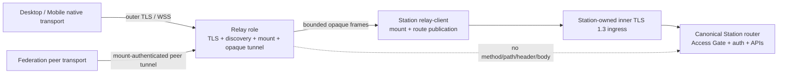

# Node Connectivity - Architecture Design

> **Status**: active
> **Version**: v1.1
> **Created**: 2026-10-10 | **Updated**: 2026-10-10
> **Owner**: Architecture Team
> **Module**: `apps/station/frame/core/plugin/native/subserver/relay/`, `apps/station/frame/core/plugin/native/subserver/relay-client/`

---

## 1. Core Principles

1. **Station identity ends at Station**: `station_peer_id` and the Station
   host key authenticate the destination; Relay identity authenticates only
   the transport endpoint.
2. **Opaque data plane**: Relay forwards bounded ciphertext and cannot inspect
   HTTP metadata, Station credentials, or business payload.
3. **Control and data planes stay separate**: enrollment, route publication,
   grants and revocation authorize tunnel creation; they do not become business
   authorization.
4. **Explicit runtime roles**: one binary supports `station` and `relay`
   roles through deny-by-default allowlists.
5. **One protocol truth**: this module owns Relay internals. Station Access
   owns user/session lifecycle; Federation owns governance and peer business
   authorization.
6. **No compatibility path**: transparent forwarding, request/response frames,
   target Authorization passthrough and Relay business routing remain deleted.
7. **One service-host contract**: Relay runs only on the reviewed Linux/POSIX
   runtime; Windows remains a client or separately governed Station platform.

## 2. Evidence Ledger

| Claim | Class | Evidence | Confidence | Missing proof |
|---|---|---|---|---|
| Relay exposes one WSS tunnel endpoint and no transparent forward route | verified_fact | `subserver/relay/handler.go`, `handler_tunnel.go`, source Gate | high | formal runtime Gate |
| Tunnel frames contain open/opened/data/cancel/close only | verified_fact | `model/domain/federation/relay_transport.proto` | high | none |
| Station terminates TLS 1.3 inside the tunnel and publishes its SPKI digest | verified_fact | `relay-client/inner_tls.go`, `connection_material.go` | high | formal runtime Gate |
| Peer transport validates Station route signature, Relay binding, capability digest and SPKI | verified_fact | `relay-client/peer_tunnel.go` | high | formal runtime Gate |
| Relay role excludes Touch and application subservers | verified_fact | `frame/core/runtime/role/role.go` and tests | high | deployed route inventory |
| Tunnel concurrency, byte, rate, queue and idle limits are enforced | verified_fact | `handler_tunnel.go`, `stream.go`, `tunnel_admission.go` | high | formal overload evidence |
| A direct libp2p/Circuit Relay rewrite is safer or better for current product traffic | hypothesis | uncommitted architecture-v2 candidate only | low | accepted product/security design and real comparative proof |

## 3. System Architecture



Direct Station routes and Relay routes terminate at the same canonical Station
router. Changing a route never creates a second Station identity, Session truth,
Federation membership, or business API.

## 4. Sources Of Truth

| Concern | Source of truth | Consumers |
|---|---|---|
| Station identity | Station host key and derived `station_peer_id` | Station Access, route verifier |
| Relay endpoint identity | Relay signing key and signed endpoint statement | Station relay-client, clients |
| Runtime role | `frame/core/runtime/role` | Station composition root |
| Enrollment/mount generation | Relay repository and credential authority | Relay ACL, Station relay-client |
| Station route statement | Station host-key signature | Relay directory, clients, peer transport |
| Connection grant use | Relay digest record | client tunnel admission |
| Tunnel lifecycle and limits | Relay stream/tunnel runtime | WSS endpoint, Station mount |
| Access and Session truth | Station Access/Actor owners | canonical router |
| Federation membership/policy | Federation app owner | peer request receiver |

No URL, DNS name, Relay PeerID, route ID, local label, request host or forwarded
header may substitute for Station or Actor identity.

## 5. Runtime Roles

`PEERS_NODE_ROLE` resolves exactly one role:

| Role | Loaded surface |
|---|---|
| `station` | application subservers, Touch routes, explicit Station plugin allowlist including `relay-client` |
| `relay` | Relay plugin only; no Touch or application subservers |

Missing or unknown roles fail startup. Relay production startup additionally
requires public origin, TLS, Relay signing key, operator policy and quotas.
Plaintext transport is allowed only by an explicit loopback development policy
and cannot produce production evidence.

Relay service hosting is Linux/POSIX-only. The reviewed deployment uses Docker
Compose, isolated Station/Relay data owners and an NGINX outer TLS terminator
that proxies only to Relay loopback control HTTP. The Relay tunnel stream keeps
its dedicated TLS listener. Windows runtime tooling rejects `relay`; Windows
Desktop connects to the Linux service as a client.

The current architecture does not define a `station+relay` hybrid role. Adding
one would require an explicit allowlist and proof that it does not widen the
Relay attack surface.

## 6. Endpoint And Route Discovery

Both direct Station and Relay endpoints expose the generated access endpoint
contract. The response is challenge-bound, signed and short-lived.

A Relay route is accepted only when:

1. the Station host public key derives the claimed `station_peer_id`;
2. the Station signature over deterministic route bytes is valid;
3. `relay_peer_id` matches the contacted Relay;
4. route generation equals the active mount generation;
5. route lifetime is current;
6. capability manifest digest equals the expected peer capability set;
7. the inner TLS certificate SPKI matches the signed digest.

Public routes require explicit Station publication. Private routes require a
Station-signed connection grant whose digest, route, generation, expiry and use
count are atomically enforced by Relay.

## 7. Station Enrollment

```text
operator creates one-time invite
  -> Relay issues challenge
  -> Station signs challenge + invite + Relay identity
  -> Relay derives Station PeerID from public key
  -> atomically consume invite and create mount generation
  -> issue short-lived mount credential
  -> Station opens authenticated TLS mount stream
  -> Station publishes signed route attestation
```

Invite plaintext is returned once and only a digest is persisted. Mount
credential issuer, audience, scope and signing key are separate from Station
application Sessions. Revocation advances generation, closes current streams,
rejects refresh/reconnect and withdraws route availability.

## 8. Opaque Tunnel Data Plane

Client access uses:

```text
wss://<relay>/.well-known/peers-touch/tunnel
  -> binary WebSocket subprotocol peers-touch.tunnel.v1
  -> RelayTunnelOpen
  -> RelayTunnelOpened
  -> sequenced RelayTunnelData(ciphertext)
  -> RelayTunnelCancel | RelayTunnelClose
```

Station peer access uses the same outer endpoint with an authenticated mount
credential and `FEDERATION_PEER` purpose. Client access uses a public route or
single-use connection grant and `CLIENT_ACCESS` purpose.

The inner connection is TLS 1.3 between caller and Station. Relay never
terminates it. Station bridges the decrypted stream to its loopback canonical
router only after inner TLS authentication succeeds.

Forbidden on the Relay data plane:

- HTTP method, path, query, headers, cookies or body fields;
- target `Authorization` or Session credential extraction;
- request/response frame types;
- business capability selection or payload decoding;
- text WebSocket frames, compression, redirect or protocol downgrade.

## 9. Bounds And Concurrency

Every direction enforces:

- 64 KiB maximum tunnel data frame;
- monotonic per-tunnel sequence;
- per-direction and aggregate connection byte ceilings;
- mount, route and source concurrency admission;
- mount-specific and global rate limits;
- bounded queues and single-reader stream discipline;
- handshake and idle deadlines;
- explicit cancellation and close reasons;
- deterministic overload and oversize rejection before dispatch.

The mount stream read loop may do only bounded in-memory dispatch inline.
Blocking work must run outside the sole reader so heartbeat and tunnel frames
continue to progress.

## 10. Policy And Caller Separation

| Caller | Admission | Inner authorization |
|---|---|---|
| Desktop/Mobile | public route or Station connection grant | Station Access Gate and Session middleware |
| Station peer | current mount credential with peer-tunnel scope | target Station peer capability and Federation/domain policy |

Federation route policy cannot authorize client access. Client route choice
cannot grant Federation membership. Relay mount membership cannot imply
Federation membership.

## 11. Failure Semantics

| Failure | Required behavior |
|---|---|
| Endpoint or route signature invalid | Fail before credentials or tunnel data |
| Relay mismatch, expired route or stale generation | Reject tunnel open |
| Inner TLS SPKI mismatch | Close tunnel; send no Station credential |
| Grant replay/exhaustion | Atomic rejection |
| Mount revoked | Close active generation and reject refresh/reconnect |
| Unknown purpose or malformed frame | Protocol close |
| Oversize/rate/concurrency breach | Typed close; no truncated dispatch |
| Slow consumer or blocked writer | Bounded queue/backpressure; no unbounded goroutine growth |
| Relay unavailable | Preserve Station identity and business state; report route unavailable |
| Direct/Relay route change | Rebuild transport only; preserve Station scope |

## 12. Quality Gates

Required evidence:

- source inventory has no transparent forward, Request/Response frame or
  Authorization passthrough;
- Relay role route inventory contains no Station business surface;
- enrollment proves host-key possession, invite one-time use, generation
  rotation and revocation;
- exact-source Station and Relay establish the mount and publish a signed route;
- a real caller completes inner TLS 1.3, SPKI verification and canonical
  Station request/response through the tunnel;
- Relay-side observation contains no decrypted marker, Station credential or
  business payload;
- oversize, protocol downgrade, wrong route, wrong SPKI, overload and cancel
  fail closed;
- all resources and temporary runtimes are released by the Acceptance owner.
