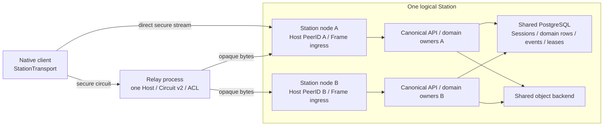

# Node Connectivity - Architecture Design

> **Status**: active
> **Version**: v1.1
> **Created**: 2026-10-10 | **Updated**: 2026-10-11
> **Owner**: Architecture Team
> **Module**: `apps/station/frame/core/plugin/native/`

## 1. Core Principles

1. A logical Station owns business identity; each physical node owns a distinct
   libp2p PeerID. A route is authorization to reach a node, never business identity.
2. One process owns one Host. Frame adapts its streams to the canonical Station
   HTTP router. Station and Relay are the only service roles.
3. Circuit Relay v2 carries encrypted connections. Model owns signed control
   contracts; the library owns transport, multiplexing and connection liveness.
4. Access, Session and Federation authorization terminate at Station. Relay
   controls transport admission only and cannot read application credentials.
5. One-node and many-node deployments use the same domain code and ownership.
   Cluster readiness requires shared truth and fenced execution.

This is the reviewed target architecture. The evidence below describes current
source; neither an accepted design nor a source check proves runtime delivery.

## 2. Evidence Ledger

| Claim | Class | Source | Missing proof |
|---|---|---|---|
| Station currently derives identity from a transport host key | verified_fact | `model/domain/peer/station_identity.proto`; `subserver/bootstrap/station_identity.go` | logical identity implementation |
| Registry can receive the transport Host | verified_fact | `node/native_init_top_comp.go`; `registry/options.go` | all constructors share one Host |
| Bootstrap and native client can construct extra Hosts | verified_fact | `subserver/bootstrap/bootstrap.go`; `client/client.go` | constructor cutover |
| Relay now uses standard Circuit service, ACL and finite resources | verified_fact | `native/relay/{runtime,admission}.go` | environment-backed renewal and revoke proof |
| Live event subscribers and fanout are process-local | verified_fact | `apps/station/app/subserver/events/bus.go` | cross-node live delivery |
| Durable replay sorts process-generated ULIDs and omits target device | verified_fact | `events/bus.go:defaultIDGen`; `events/store.go` | transactional order and durable targeting |
| Live Touch auth uses DBStore; class activation locks rows | verified_fact | `frame/touch/auth/auth.go:InitSessionManager`; `facility/session/db_store.go` | concurrent cross-node Session proof |
| Agent recovery uses database-time expiry, node incarnation and monotonic ExecutorLease fencing | verified_fact | `agent/service/chat_task_service.go`; `agent/infrastructure/persistence/executor_lease.go` | integrated Agent plus OSS cluster Gate |
| OSS scheduler explicitly receives MemLock | verified_fact | `oss/oss.go`; `oss/worker/lock.go` | fenced cross-process execution |
| Some handlers require Hertz RequestContext | verified_fact | `frame/core/server/handler.go:HertzHandlerFunc`; `touch/actor_router.go`; `oauth/oauth.go` | streaming ingress parity |
| Circuit library defaults reset at 2 min / 128 KiB per direction | verified_fact | pinned `go-libp2p v0.45.0`, `circuitv2/relay/resources.go` | reviewed workload limits |
| Standard transport reduces custom protocol ownership | inference | constructor/framing inventory above | runtime suitability; no speed claim |
| Shared state and fenced domain workers permit multiple nodes | accepted_decision | NCP-D12..NCP-D15 | all cluster Gates |

Pinned upstream API sources: [resources](https://github.com/libp2p/go-libp2p/blob/v0.45.0/p2p/protocol/circuitv2/relay/resources.go),
[ACL](https://github.com/libp2p/go-libp2p/blob/v0.45.0/p2p/protocol/circuitv2/relay/acl.go),
[reservation](https://github.com/libp2p/go-libp2p/blob/v0.45.0/p2p/protocol/circuitv2/client/reservation.go).
These were checked against locally installed source, not inferred from names.

## 3. Runtime Topology



There is no Gateway process, role, deployment or business service. “Ingress”
means a listener adapter inside the existing Frame transport/server boundary.
For N=1, only A exists; DB and object backend may live on the same host. For
N>1, all nodes address the same logical Station data owners. Another household
Station has another identity and is a Federation peer, not a cluster replica.

## 4. Identity And Trust

`station_peer_id` retains its existing public identity field and key derivation,
but is derived from a persistent logical Station root key, not a running Host.
Every Host uses a separate node key, including N=1. Existing public logical
identities can be retained by making their former identity key the root and
generating a fresh transport key. No global naming migration is required.

The root authorizes each node signing key, PeerID, capability set, lifetime and
authorization epoch. Nodes sign short-lived route/identity responses with their
authorized keys. The root stays in the operator's signing boundary; ordinary
nodes receive their own key and certificate, never another node's key.

Clients verify root identity, delegation, route signature, expiry/epoch,
destination PeerID and inner TLS SPKI before submitting Station credentials.
The circuit address also binds the chosen Relay PeerID. Relay substitution of
either endpoint fails verification. TLS uses the delegated node key; no shared
cluster TLS private key is needed.

Root rotation is explicit Station identity replacement. Node key rotation,
node removal and route changes preserve Station/Actor/Device scope. Short-lived
certificates bound offline revocation exposure; connected nodes check current
authorization against the authoritative registry before accepting new requests.
A removed node can remain malicious: revocation is not remote key erasure.

## 5. One Host And Canonical API Ingress

The composition root creates Host, resource manager and optional DHT once.
Transport, registry, bootstrap, Relay reservation, Federation dialing and native
client helpers receive borrowed handles. Consumers cannot close the Host.

Data path:

```text
native StationTransport
  -> signed direct/circuit route, verified destination PeerID
  -> libp2p secure connection and negotiated Station HTTP stream
  -> TLS 1.3 with authorized node SPKI and ALPN h2
  -> Frame HTTP/2 ingress and streaming loopback adapter
  -> existing Hertz router / canonical handler registration and wrappers
  -> Access / Session / Conversation / Events / OSS / other domain owner
```

Current profile selects Hertz HTTP/1 with streaming adapters; it does not prove
HTTP/2 support. Some handlers require Hertz RequestContext. Frame uses a standard
HTTP/2 server over stream-backed connections and a streaming `net/http/httputil`
loopback adapter to the existing Hertz listener, retaining its route registration
and wrappers. This is an in-process adapter, not another service or second
handler registry. Body streaming, Flush, cancellation, paths, query, auth and
error Proto retain identical semantics. Strip untrusted forwarding/peer headers;
domain peer identity remains cryptographically verified, never inferred from
loopback or proxy headers. Business services do not import libp2p.

Direct HTTPS remains an ingress to the same router. Direct and Circuit libp2p
are alternatives selected by one transport owner. A route switch cancels old
transport tasks, increments route revision and reconnects using the same Session.
Writes with unknown outcomes are reconciled by their domain idempotency key;
transport never blindly resends a business mutation.

Native Desktop and Mobile consume the same connectivity contract through their
Rust transport boundary. Mobile's dial-only Host advertises no application
listener, Relay service, DHT server or public peer API. Mobile adaptation remains
separate proof; Desktop evidence cannot claim Mobile readiness.

## 6. Relay Control And Admission

Relay role exposes health, signed discovery, operator enrollment, route/grant
control and standard Circuit hop only. Touch and app subservers remain excluded.
Service hosting retains Linux/POSIX. Bootstrap HTTP discovery contains no
Station credentials; Relay control also supports a generated protobuf stream.

Operator invitation enrolls the logical Station plus node authorization.
Authenticated node proof binds the root delegation and Relay identity.
Enrollment, node authorization generation and invite consumption are atomic.
Circuit ACL checks an in-memory projection of current enrollment:

- `AllowReserve`: enrolled, unrevoked destination node only.
- `AllowConnect`: published public destination with source quotas, or an active
  private connection permit bound to source PeerID and destination.
- Private grant exchange happens before Circuit CONNECT through authenticated
  Relay control; signature binds nonce, source PeerID, Relay, route, generation
  and expiry. Relay atomically consumes uses and issues a bounded permit.

An ACL callback performs bounded local checks only. Stale/unavailable policy
fails closed. Libp2p PeerID authenticates a transport caller; Station Session or
Federation/domain middleware independently authorizes the encrypted HTTP call.

Renewal refreshes credentials, routes and standard reservation before expiry
without closing healthy circuits or advancing authorization epoch. Actual
revocation advances epoch, removes ACL admission and closes Relay's connections
to the affected destination using public Host network APIs. This may interrupt
all circuits to that node and is acceptable for revocation, not renewal.

## 7. Bounds, Liveness And Shutdown

Circuit connection budgets are finite and apply to the whole multiplexed
connection, not an HTTP request. Initial evaluation policy is 60 minutes and
256 MiB per direction, reservation TTL 60 minutes, renewal before the last
third of the granted lifetime, 64 circuits per destination and 256 reservations.
These are proposed workload settings, not measured capacity. Operators must
also bound total connections, streams, memory and bandwidth through resource
manager and network policy. `WithInfiniteLimits` is forbidden.

Ingress caps headers at 32 KiB, handshake at 10 seconds, ordinary control Proto
at 1 MiB, in-flight HTTP/2 requests at 32 per connection and subscriber queues
at 1 MiB. OSS advertises its own upload limit; initial proof uses 32 MiB.
Attachments stream without whole-body buffers and have separate bulk connection
budgets so they cannot exhaust the realtime connection's aggregate allowance.

Transport liveness, ping and reconnection use library mechanisms. SSE heartbeat
remains an application contract, not a custom Relay ping protocol. Circuit
duration/data exhaustion is typed route failure; client resumes durable cursor
and reconciles pending operations. Graceful stop withdraws routes, rejects new
work, drains boundedly, cancels ingress and closes Host once.

## 8. Shared State And Cluster Readiness

Frame owns a PostgreSQL node registry: logical Station, node PeerID, boot
incarnation, authorization epoch, endpoint, lease and draining state. Registry
lease is admission/readiness information, not an exactly-once worker guarantee.
Cluster mode fails readiness unless all configured domain owners declare shared
storage and safe cross-node recovery; it cannot silently degrade to local state.

Sessions, Access attempts, OAuth acknowledgement, device inbox, Conversation
state, quotas and policy are shared database truth. Retain the existing Session
DBStore and class-row locking. Signing/encryption material needed to validate
or recover an Access transaction is a Station-scoped keyring with explicit key
IDs; per-process random keys cannot decrypt another node's transaction.

Events owner allocates a per-Actor sequence inside the same database transaction
as durable emission. It persists target device and payload before notification.
PostgreSQL LISTEN/NOTIFY carries wake hints only; a bounded log reconciler repairs
missed wakes. All nodes replay the same ordered log into local SSE subscribers.
Subscribe captures a high-watermark, replays through it and continues after it
without a gap; deduplication uses the durable event identity. Ephemeral events
never advance the durable cursor. Device filtering also applies to cold replay.

Domain workers own fenced leases: `(owner_node, incarnation, fencing_token,
expires_at)` and conditional writes check the token. Extend existing Agent
ExecutorLease and OSS lock ports. Recovery may settle only expired ownership,
never every RUNNING row at boot. External effects need domain idempotency or an
explicit ambiguous/interrupted outcome; a lease cannot guarantee provider
exactly-once. Object metadata and bytes are shared; node-local disks cannot back
randomly routed downloads or GC. OSS atomically claims/revalidates a zero-reference
immutable object generation before deletion. New references cannot attach to a
deleting generation; replacement upload uses a new generation. An idempotent
stale delete cannot remove replacement bytes. A database token alone cannot fence
an arbitrary object-store request. No new scheduler/broker service is introduced.

## 9. Failure And Quality Contracts

Wrong root/delegation/PeerID/SPKI: reject before credentials. Revoked/expired
route: refuse new admission. Relay failure: try another verified route and keep
Station scope. Node death: reconnect, resume cursor and reconcile writes.
DB partition: reject lease renewal/new mutations; stale workers cannot commit.
Object backend failure: report OSS unavailable, never return partial success.
Schema/keyring mismatch: node never publishes readiness.

Binary Gates NCP-G01..NCP-G08 in `integration.md` prove identity spoof rejection,
single Host, canonical HTTP/SSE/files, two-node Session/event recovery, fenced
worker behavior, renewal/revocation, overload and clean removal. Workload
evaluation uses 30 measured samples after five warmups, reports P50/P95/P99,
and compares exact same runtime/data against direct and pre-cut source.
Initial functional thresholds: 0 lost acknowledged messages, 0 unauthorized
deliveries, 0 duplicate domain effects, failover recovery within 30 seconds,
and admission rejection within 10 seconds. No latency superiority is claimed.
