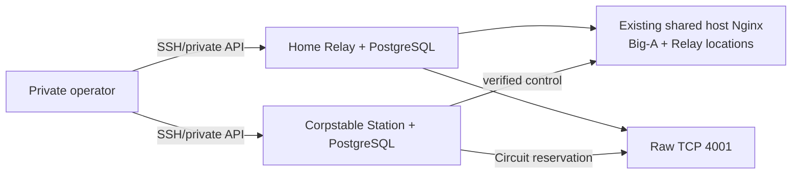

# Home Relay And Corpstable Station — Deployment Contract

> **Status**: active
> **Version**: v1.0
> **Created**: 2026-10-18 | **Updated**: 2026-10-18
> **Owner**: Node Connectivity

---

## 1. Scope And Sources

The user selected `env/peers-touch/home` for Relay and
`env/peers-touch/corpstable` for Station. This document applies the existing
Node Connectivity and Relay Attachment contracts; it creates no server role.

The environment repository owns host names, ports, Compose projects, secret
references and Nginx configuration. This accepted contract is not runtime
evidence or permission to reset stable data.

Upstream:

- [Node Connectivity design](../design.md);
- [Relay Attachment lifecycle](./README.md);
- `tooling/skills/pt-local-dev-env/SKILL.md`;
- environment `peers-touch/home/README.md`, `peers-touch/corpstable/README.md`;
- environment `big-a/home/nginx/conf.d/<home-edge>.locations.conf`.

## 2. Target Topology

Candidate coordinates from prior inspection, to read back before deployment:

- home: `<home-lan-ipv4>`;
- corpstable Station: `<corpstable-station-ipv4>:18280`;
- shared public origin: `https://<shared-public-edge>/`;
- candidate forwarding: WAN 443 to home 28443, WAN 4001 to home 4001.

Private operator reachability is not Station runtime reachability. Persist a
Relay origin/multiaddr only after probing it from the Station host. If the two
hosts have a routed private path, that path is valid; otherwise the home public
path must work. No ad-hoc tunnel or custom transport is introduced.

## 3. Shared Certificate And Access Policy

Retain the existing single host Nginx TLS listener and certificate lifecycle.
Relay adds a location fragment; Big-A keeps its existing fragment. Do not move
the shared server into a product-owned tree or duplicate certificates merely
to add Relay.

The existing Big-A fragment references the host certificate and shared optional
client CA. Verify the live paths, SNI, listener and renewal owner before editing.
The environment repository must hold a reviewable canonical host composition.
No app fragment acquires certificate issuance or host-server ownership.

Relay inner TLS and Host identity remain separate from public Nginx TLS:

- public protocol paths retain challenge/signature/credential/quota checks;
- Relay Console static UI requires the shared device mTLS;
- sensitive operator APIs require both device mTLS and Relay operator JWT;
- UI navigation itself must remain possible before entering an operator JWT;
- proxy verifies the inner Relay CA and reaches only an explicit loopback
  listener in the same host network namespace;
- unknown paths return 404;
- `nginx -t` precedes atomic reload;
- raw Circuit TCP is not routed through HTTP Nginx.

The current protocol/operator route inventory comes from canonical registrations
and the API registry at deployment time. This contract does not copy that list
into another authority.

## 4. Attachment And Persistence

Use private APIs to create the invitation and import it at Station. The
existing `AttachmentController` persists desired intent and projects
reservation state. Relay enrollment owns revocation/generation.

Invitation-CA HTTPS or WebPKI may authenticate control transport. The actual
home deployment reuses its domain/certificate because they exist; a domain is
not a general Station identity requirement.

Preserve Relay Host private key/PeerID, Station root/Node keys, scoped
credentials and both databases across redeployment. Verify current ownership,
schema and backup before migration. Do not import full Station business data
into Relay or delete obsolete containers/volumes without exact authorization.

Corpstable's existing Relay declaration must be reconciled in the environment
repository. The request selects home as Relay, but does not authorize deleting
shared dev instances on the old Relay host.

## 5. API-Only Proof

Reuse Node Connectivity and Attachment drivers with the selected API-only
scope; do not claim native Gates from API evidence:

- exact source/image, Relay role allowlist and persistent identity;
- PostgreSQL restart persistence;
- correct public TLS certificate, protected operator API and usable public
  protocol routes;
- Station-host reachability to control and Circuit TCP;
- desired attachment, current enrollment, reservation and signed route;
- real protobuf API request through the secure Circuit to Station;
- restart recovery preserving identity, Session scope and attachment;
- wrong Relay/SPKI/signature rejected before credentials.

No Desktop/Mobile app is launched. Native selector and business UI remain
unproven. Existing unrelated file picker, permission and drag surfaces are
outside this deployment claim.

## 6. Failure And Resource Boundaries

Missing routed reachability leaves attachment unready. Invalid Nginx config
does not reload. Invalid inner CA fails closed. Unhealthy databases do not
publish readiness. Stable deploy uses the canonical profile/capability entry;
stable reset is forbidden. Only task-owned resources can be stopped.
