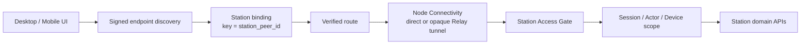

# Station 统一接入生命周期 - 架构设计

> **Status**: active
> **Version**: v2.2
> **Created**: 2026-09-26 | **Updated**: 2026-10-10
> **Owner**: Identity and Access
> **Module**: `apps/desktop/`, `apps/mobile/`, `apps/station/frame/touch/`

---

## 1. 核心原则

1. `station_peer_id` 是 Station identity；URL 和 Relay route 只是连接位置。
2. Access Gate 是普通客户端唯一准入 owner。
3. 同一 Station 的 direct/Relay route 共享一个 binding、Session scope 和业务 runtime。
4. Relay 不是账号、Session、Federation 或业务 authority。
5. Desktop/Mobile 共享 capability、协议、状态、错误和 scope 结果。
6. Federation governance 与普通客户端 context consumption 分离。
7. Session 并发槽由 canonical client class 决定，不由安装实例决定。
8. Relay wire、enrollment、role 和 resource limits 只由
   [Node Connectivity](../../runtime/node-connectivity/README.md) 定义。
9. Relay service host 只使用 Node Connectivity `NCP-D11` 定义的 Linux/POSIX
   runtime；Windows Desktop 仍可作为客户端连接 Linux Relay。

## 2. 系统架构



Node Connectivity returns a verified Station destination and transport. Station
Access does not parse Relay frames or own mount credentials. Both direct and
Relay paths enter the same Station identity, Access Gate and canonical router.

## 3. Sources Of Truth

| Concern | Source of truth | Client projection |
|---|---|---|
| Station identity and route proof | Node Connectivity + Station host key | station-keyed binding |
| Access decision | Station Access Gate | current attempt/gate/decision |
| Actor identity | Station Actor + `ActorRef` | current account/session |
| Device identity | canonical device registration | current device scope |
| Session class slot | Station Actor Session | `desktop`, `mobile`, or `web` |
| Federation topology | Federation app + Ledger | none |
| Federation context | Station Federation projection | selected context |
| Relay control/data plane | Node Connectivity | route kind and bounded diagnosis only |

## 4. Canonical Access Sequence

```text
one address or connection material
  -> verify signed endpoint role
  -> verify Station identity and route
  -> pin or explicitly replace station_peer_id
  -> establish direct or Relay transport
  -> access.gate.start
  -> access.gate.submit | access.gate.cancel
  -> access.gate.decision
  -> activate canonical Session scope
  -> start business runtimes
```

The client uses only registry-declared generated protobuf Access Gate
capabilities. Unknown gate, malformed response, identity mismatch, expired
attempt or scope mismatch fails closed.

## 5. Route-Aware Station Binding

```text
StationBinding
  station_peer_id
  pinned_host_public_key
  routes[]
  active_route_id
  route_revision
  lifecycle_generation
```

Rules:

- the registry key is `station_peer_id`, never URL;
- a route must verify to the same Station identity;
- route refresh/switch increments `route_revision` and rebuilds transport;
- Station identity replacement increments `lifecycle_generation`, quiesces the
  prior runtime and clears prior projections;
- Session, Actor, Device, Federation and business storage never use Relay
  origin or route ID as identity;
- direct/Relay switches preserve the complete Access scope.

Relay endpoint discovery, route attestation, connection grant, inner TLS/SPKI
and tunnel state are consumed from Node Connectivity and are not redefined here.

## 6. Federation Boundary

Ordinary clients may:

- list/select Federation context;
- search/resolve within an explicit Federation;
- display current Station/Federation and connection state.

Ordinary clients may not:

- create/join/leave/delete Federation or manage member Stations;
- manage Relay invite, mount, credential, certificate or quota;
- infer Federation membership from Relay reachability;
- use a Relay route to create or alter `ActorRef.acct`.

Federation governance belongs to Dashboard/CLI operator surfaces.

## 7. Scope Fence

Every committed access result resolves to:

```text
station_peer_id + actor_ptid + device_id + lifecycle_generation
```

Session, Messaging, Federation context, cache and projections use the same
tuple. Asynchronous results compare the tuple again before commit. A route
revision is transport state and does not change the tuple.

## 8. Client-Class Session Slot

Canonical classes:

```text
desktop
mobile
web
```

For one actor and class, Station permits one active Session. New same-class
activation atomically revokes the previous winner as `kicked`; other classes
remain active. `device_id` identifies an installation and binds downstream
runtime state but does not create a new concurrency class.

Password Access Gate, OAuth acknowledgement and session takeover share this
authority. Non-canonical runtime labels fail before credential activation.

## 9. Current Interface Contract

Station Access consumes:

- `station.identity.verify`;
- `access.gate.start`;
- `access.gate.submit`;
- `access.gate.decision`;
- `access.gate.cancel`.

Method/path/Proto/owner come from
`station-api-capabilities.yaml`. Client wrappers and runtime adapters must have
a positive capability owner and a real consumer. Unregistered fallbacks are
contract violations.

## 10. Failure Semantics

| Failure | Required behavior |
|---|---|
| endpoint/Station identity invalid | fail before credential submission |
| route attestation or inner SPKI invalid | close transport; preserve no partial Session |
| route unavailable | preserve Station binding and show typed offline/retry state |
| route switches for same Station | rebuild transport; preserve Access scope |
| Station identity changes | explicit replacement and full scope teardown |
| Access attempt expires | restart canonical attempt |
| unknown gate or malformed Proto | typed unsupported/invalid; no fallback API |
| Federation context absent | block scoped action; do not guess a default |
| stale lifecycle result | discard before projection commit |
| non-canonical client class | reject before Session activation |
| same-class new Session | atomically revoke old same-class Session |

## 11. Evidence Requirements

Completion requires both:

- current-interface inventory proving route, contract, owner and real
  Desktop/Mobile consumers; and
- exact-source native Journeys proving direct/Relay access, Session behavior,
  scope isolation, restart/recovery and receiver-visible business results.

Relay transport/security proof is supplied by Node Connectivity Gates. Station
Access may include those Gates in its aggregate completion set but cannot
replace or duplicate their implementation.
