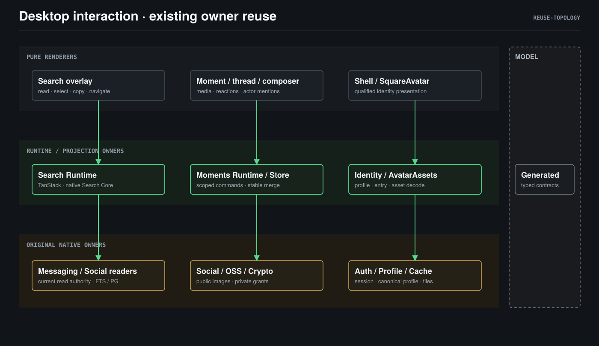

# 设计与证据

## 原则及既有合同

用户任务是找回并复制内容、稳定阅读和互动、完成有连续身份展示的登录。
检索、正文/媒体、安全授权、写入与导航各有原 Owner；展示准备不能成为新的身份或权限真源。
更新必须有资源身份、当前作用域、完成语义和失效条件。

依据：

- [Search 架构](../../../../docs/architecture/domains/search/design.md)、[产品合同](../../../../docs/architecture/domains/search/product.md)与
  [Desktop Search continuity](../../../../docs/client/desktop/search-experience-contract.md)。
- [Desktop runtime projections](../../../../docs/client/desktop/runtime-projections.md)与
  [Identity lifecycle](../../../../docs/client/desktop/identity-lifecycle.md)。
- [Social 私密体验](../../../../docs/architecture/domains/social/core/experience-contract.md)、
  [Social Desktop UI](../../../../docs/client/common/ui-identity/modules/social/desktop.md)。
- [Feed](../../../../docs/client/common/ui-identity/patterns/feed.md)、
  [Composer](../../../../docs/client/common/ui-identity/patterns/composer.md)、
  [Optimistic commit](../../../../docs/client/common/ui-identity/patterns/optimistic-commit.md)。

当前 Social Desktop 合同把 Back 放在线程上方，本次用户明确要求将它纳入所属卡片；
Search 合同规定 Suggest 为 Device-only 且不发网络，本次用户明确要求输入即出现完整结果。
二者都是待接受的合同变更；接受后更新原 Owner，不用旧合同否定这次诉求。

## 证据分类

`SOURCE` 表示当前基线源码事实；`REPORTED` 表示用户截图及描述；
`HYPOTHESIS` 表示需要现场验证的因果解释；`PROPOSAL` 表示目标行为。
corpdebug 尚未部署，没有新源码原生复现，不将推断写成已验证结果。

## S01：输入搜索与提交搜索不是同一语义

`SOURCE`：

- [searchRuntime.ts:61-68](../../../../apps/desktop/src/runtimes/searchRuntime.ts#L61-L68) 把非功能输入切到 suggest。
- [searchQueries.ts:292-294](../../../../apps/desktop/src/runtimes/searchQueries.ts#L292-L294) 按 mode 调用 `search_suggest` 或 `search_submit`。
- [search.proto:256-258](../../../../model/domain/search/search.proto#L256-L258) 规定 Suggest 是本机请求，绝不触发网络；[product.md:43-49](../../../../docs/architecture/domains/search/product.md#L43-L49) 也规定未提交前不产生外发请求。
- [private.rs:38-39](../../../../apps/desktop/src-tauri/src/application/search/private.rs#L38-L39) 声明私密 Social 不支持 suggestions；当前 Submit 才覆盖 Device 与当前 Station。
- [searchQueries.ts:378-385](../../../../apps/desktop/src/runtimes/searchQueries.ts#L378-L385) 对含 no-store 源的响应每 2 秒协调重读；实时 FIND 若直接复用，会放大 Station 请求。
- [session.rs:730-836](../../../../packages/search-core/src/session.rs#L730-L836) 收齐各来源后才做一次融合提交；“慢源不阻塞快源”的 progressive frame 当前并不存在。

`REPORTED`：必须按 Enter 才出现预期结果。

`PROPOSAL`：

- 空输入继续使用 Device-only Suggest：会话/快捷功能建议，不产生网络。
- 非空输入在 **200ms stable admission** 后自动发起一次 FIND。200ms 是完整检索而非函数匹配的输入预算；IME composition 未结束不发。
- 一次 FIND 保持 Device + 当前 Station scope，但现有 Search Core 是收齐来源后单帧返回；本次必须把它改为 progressive publication：某个来源完成 query + bounded hydrate 并提交当前授权后，立即发布该 source frame；所有来源完成、失败或到 5s deadline 后发布最终 RRF 融合 frame。
- Native binding 使用 request-scoped channel 发送带 `frame_kind/request_id` 的 progressive/final envelope。Progressive frame 只用于当前 draft 的首页阅读和打开，不进入 reusable Query cache，不产生 continuation cursor，也不表示完整 empty/error；未完成来源保持 pending coverage。
- 最终 frame 才确定 RRF 顺序、分页、缓存和 selection；若后到来源改变顺序，保留已选 ResourceKey 和 viewport anchor，不插入 loading 屏。
- 用户继续输入立即取消旧 request 和 AbortSignal；同一稳定 draft 每个来源最多一个在途 operation。`Messages`/`Attachment names` 的 narrowed intent 不读取 Social；`Posts and comments` 明确是当前 Station/已获得私密内容。
- Enter 不再承担“扩大来源”的职责：最终 frame 已完成时打开活动结果；progressive 阶段只等待当前 request 的 final frame，不另发 query 也不取消慢源；无活动结果时重发 refresh。分页继续只在最终 frame 上工作。
- 协调改为租约/事件驱动：read-state、来源 revision、撤权事件和窗口 focus 仍可失效结果，但未到期且 draft 不变时不每 2 秒重发 no-store FIND。无实时事件时公开源最长陈旧窗口为其 cursor TTL；Open 始终重新核权。
- 当前 UI 最大 512 字符而 search-core 最大 256；统一为 256，UI、proto 使用方、Station 校验共享该上限。协议和 Station 部署需按兼容顺序发布；旧端长查询在升级后会收到 InvalidQuery，不静默截断。

实时 FIND 会把非空 query 发往当前 Station 的公开 Social 查询；私密 Social 仍只传递对象引用和当前授权检查，不上传私密正文。不接入外部模型或公网。该变化必须写入 Search 产品合同和 `?` 中的范围说明。

## S02：大小写语义在来源间不一致

`SOURCE`：

- [tokenize.rs:81-82](../../../../packages/search-core/src/tokenize.rs#L81-L82) 为本机 FTS Latin run 生成小写 token，query/index 对称。
- [public_search.go:108-126](../../../../apps/station/app/subserver/social/infrastructure/public_search.go#L108-L126) 用转义后的参数化 `LIKE`，Post/Comment 两条 SQL 均大小写敏感；候选扫描仍限定在最近 100 个位置和 4.5s statement timeout。
- Overlay 函数筛选使用 NFKC/lowercase，正文 highlight 只做 lowercase。

`PROPOSAL`：当前支持来源默认大小写不敏感。Station 两条 SQL 改用参数化 `ILIKE`，保留 `%/_/!` escape、100 位置窗口、MVCC 快照、分页和授权条件。显示和 highlight 保留原文。不声称支持 accent-insensitive、NFKC-insensitive 或完整 Unicode case-fold；这些是独立分词/排序能力。

## S03：解释文案和结果导航抢占阅读

`SOURCE`：

- [SearchOverlay.tsx:112-128](../../../../apps/desktop/src/components/search/SearchOverlay.tsx#L112-L128) 以一个 `button[role=option]` 包住 title、snippet、meta，点击任意位置都 Open；CSS 对 title/snippet 做视觉截断，但 DOM 仍含完整可授权文本。
- 输入栏有 `Within Peers` scope，tabs 旁有 boundary，footer 固定 88px 展开 coverage；行尾 Lock/zone 是信任区声明。
- `SearchResultMeta` 的作者/时间是必要上下文，不属于帮助文案。

`PROPOSAL`：

- 结果容器使用 `role="list"`，行使用 `role="listitem"`；不再把整行标成 option 或 button。行内 open target 使用 `role="button"` 和 roving tabindex，title/snippet 在其中可选择。
- Copy 是同一 listitem 内 open target 的 sibling button，使用 `aria-labelledby` 关联本行 title 和“复制”动作；Tab 可到达，点击只复制。鼠标拖选后 mouseup 不触发 Open；无拖选且位移低于点击阈值才打开。
- 键盘路径采用真实焦点的 roving tabindex：input 中 ArrowDown 聚焦第一行 open target，↑↓ 在行间移动；第一行按 ArrowUp 或输入可打印字符时回到 input 并把该字符写入 draft；Enter 打开，Escape 回到 input 并清空行焦点。
- 无论焦点在 input 还是 open target，无文本选区时 ⌘/Ctrl+C 都复制 active row 的 title/snippet；右键菜单复制由原生 Journey 验证，不把 WebView 默认菜单当成已证事实。
- input 使用 `role="searchbox"` 和 `aria-controls` 指向 `role="list"` 结果容器；不使用 `aria-activedescendant`，避免虚拟焦点与真实 roving 焦点并存。
- 顶部 boundary、footer coverage 和键盘提示合并为一个紧凑 `?` Popover，支持 hover、click、focus、Esc 和滚动；footer 高度改为单行。Lock + Device/Station 区标保留，PARTIAL/timeout/denied 用紧凑状态点和文字常驻，详情在 Popover。
- 复制内容只包含当前读权下签发的 title/snippet，不新增 preview 全文缓存；撤权后旧选区不能再通过 UI action 复制。已经复制到系统剪贴板的副本无法远程收回。

## S04：公开上传与公开展示的媒体编码合同不闭合

`SOURCE`：

- [MomentComposer.tsx:399-414](../../../../apps/desktop/src/components/moments/MomentComposer.tsx#L399-L414) 的 `uploadOne` 调加密上传；[MomentComposer.tsx:578-607](../../../../apps/desktop/src/components/moments/MomentComposer.tsx#L578-L607) 的 PUBLIC 分支也调用它，并把 AES descriptor 放入公开 ImageAttachment。
- [oss.rs:767-962](../../../../apps/desktop/src-tauri/src/interface/tauri_commands/oss.rs#L767-L962) 把密文以 `public`、`application/octet-stream` 上传。
- [MomentCard.tsx:489-494](../../../../apps/desktop/src/components/moments/MomentCard.tsx#L489-L494) 与 [ImageThumbnail.tsx](../../../../apps/desktop/src/components/moments/ImageThumbnail.tsx) 按普通图片 URL 解码原始字节。
- 普通明文 Social 上传 [oss.rs:507-539](../../../../apps/desktop/src-tauri/src/interface/tauri_commands/oss.rs#L507-L539) 已存在，生产 Composer 却不调用。
- Social picker [oss.rs:455-504](../../../../apps/desktop/src-tauri/src/interface/tauri_commands/oss.rs#L455-L504) 直接返回路径；当前真实 helper 是 [messaging.rs:1072](../../../../apps/desktop/src-tauri/src/interface/tauri_commands/messaging.rs#L1072) 的私有 `allow_attachment_preview`，不是知识文档所写 `allow_file_preview`。
- acceptance harness 已使用明文上传且断言不用加密 wrapper，但它绕过真实 Composer，所以现有 Gate 不能发现用户路径错误。

`HYPOTHESIS`：截图的占位图高置信来自错编码；同一现场仍可能叠加 picker grant 403、OSS/Station 配置或私密 grant 问题，必须逐阶段取证。

`PROPOSAL`：

- 提取共享 `allow_selected_file_preview(window, path)` 到 interface 层公共模块，多选逐文件精确授权，只授权被选文件；Profile、generic OSS、Social picker 共用。错误不吞。
- PUBLIC intent 使用现有 `oss_upload_attachment_social`，服务端按真实图片 MIME 和 magic bytes 校验；PRIVATE intent 使用 `social_private_moment_publish`/Secure Content，不走 public object resolver。
- audience 冻结后不能把已上传明文对象改为私密发布，也不能把密文对象当公开图片。HEIC 只有在原生解码/转码能力存在时接受；否则 picker 阶段明确拒绝。
- 删除错误的 `oss_upload_encrypted_attachment_social` 生产路径、TS 类型/调用和 main 注册；同文件中零调用的 generic `upload_encrypted_attachment` dead helper 一并删除。私密消息/私密 Moment 的加密实现不在删除范围。
- Composer 本地预览走精确 grant；上传进度是真实字节进度，失败保留草稿和可重试 slot。ImageThumbnail 错误不是永久负缓存，恢复/重试可重新解析。

## S05：Reaction UI 丢掉领域允许的多选择

`SOURCE`：

- [SocialActionBar.tsx:50-52](../../../../apps/desktop/src/components/moments/surfaces/SocialActionBar.tsx#L50-L52) 只取第一个 `reactedByViewer`，有选择后 picker 消失，数字使用全帖总数而不是当前 kind count。
- [reaction.go:9-13](../../../../apps/station/app/subserver/social/domain/reaction.go#L9-L13) 定义同一 actor 可对同一 post 拥有多个不同 kind；public/private repository 都以 `(post, actor, kind)` 增删。
- 旧 [ReactionBar.tsx](../../../../apps/desktop/src/components/moments/ReactionBar.tsx) 已按多 kind 渲染但零消费者。
- ReactToPost proto 已有 `command_id`，但公开 Station handler 当前不读取、不回显 exact replay；公开 add/remove 已由 `(post, actor, kind)` 复合键天然幂等。

`PROPOSAL`：将旧 ReactionBar 的正确多 kind 语义并入唯一 SocialActionBar；每个已选 kind 一个 chip 和真实 count，picker 始终可打开，点击未选 kind 添加、点击已选 kind 删除。只禁用正在提交的具体 kind，不禁用整组。客户端生成本地 operation ID/command_id 做 intent fence 和日志关联；不新增公开 Station command ledger，不承诺 exact replay。网络重试依赖复合键 Add/Delete 幂等，失败回权威 summary，空集合可以归零。未使用的旧组件删除，避免两套互动 UI。

## S06：Comment 没有端到端 mention 接入

`SOURCE`：

- Public UI 只有 TextArea，submit 仅传 content/reply；[comment.proto](../../../../model/domain/social/comment.proto) 无 mention 字段。
- DB [social_comment.go:43](../../../../apps/station/frame/touch/model/db/social_comment.go#L43) 已有 `mentions_json`，converter 已有 DB round-trip，但 request→domain、domain→proto、事件发布未接通，无需 DDL。
- [post.proto:679-690](../../../../model/domain/social/post.proto#L679-L690) 已定义 UTF-16 offset/length 的 Mention；私密 comment intent 已有 mentions。
- domain `Commented.MentionedPTIDs` 已存在但未构造；公开 MomentEvent publisher 当前只给作者自己发 self echo，per-target 通知必须经 notification Bridge。
- [event.proto:274-291](../../../../model/domain/realtime/event.proto#L274-L291) 的 MomentEvent 不新增 mentioned 字段；notification 子系统有 `CategorySocial` Bridge，但 Social 还没有生产者。
- `UpdateCommentRequest` 目前没有 Station endpoint、Desktop API 或编辑 UI，不能投机添加无消费者字段。
- Chat MentionPopup 绑定 Agent store，不是 Social actor 候选。

`PROPOSAL`：

- Proto：`Comment.typed_mentions=22`，`CreateCommentRequest.typed_mentions=4`；不修改无消费者的 `UpdateCommentRequest`，不修改 MomentEvent。生成所有受影响客户端/Go 代码。
- Station 校验 mention range（UTF-16、越界/交叠、display 与正文一致）、actor 存在和父帖可读性；mention 不改变 audience。写入已有 `mentions_json`，Comment readback/search projection 返回 typed mentions，软删除评论不进入通知或搜索。
- Comment 创建后由 Social application 向既有 notification Bridge 生产 `CategorySocial` 通知；公开通知可包含最小标题/摘要，私密通知静态数据只存 post/comment/actor IDs，客户端经原授权回读。服务端在投递前再次按父 Post audience 裁决。
- Desktop notification store 消费该类型，通知中心显示可读文本并跳到原帖/评论；无权或已删除时不展示正文。
- Notification Bridge 未注册或投递失败不回滚已提交评论，但必须产生 typed warning/metric；UI 不伪造通知，后续不做无边界补投。
- Desktop 建立 Social actor mention controller/popover：候选来自现有好友/关系/帖内可见 actor projection，按 PTID 绑定；不使用 Agent MentionStore。打开候选时 Enter 选择候选，IME composition Enter 不提交，Shift+Enter 换行。
- 本次范围是评论 @；主 Moment composer 的 post-level @ 仍保持现状，不借题扩大。
- thread draft 移入 actor/session/post 作用域 store，包含 text、mentions、replyTarget、publication state；组件 key 不含 draftRevision。

## S07：刷新缺少资源级稳定提交合同

`SOURCE`：

- [momentsRuntime.ts:41](../../../../apps/desktop/src/runtimes/momentsRuntime.ts#L41) 定义 45s reconcile，事件也会触发全投影刷新。
- [moments.ts:599-668](../../../../apps/desktop/src/store/moments.ts#L599-L668) 用首批 20 条替换 home/explore 窗口，已分页 tail 会被截断。
- [moments.ts:502-534](../../../../apps/desktop/src/store/moments.ts#L502-L534) 无条件替换 Post，只在 reaction 数组非空时覆盖。
- 已有帖子时 `feed.loading` 仍插入页面级 loading；首屏 bootstrap 又可能短暂显示 empty。
- [MomentDetailPage.tsx:188-194](../../../../apps/desktop/src/pages/moments/MomentDetailPage.tsx#L188-L194) 用 draftRevision remount CommentList；详情 MomentCard 没传 `onOpen`/`onOpenComments` 但更多菜单和评论按钮仍渲染。

`PROPOSAL`：

- 资源身份与视图窗口分离：post/comment ID 是身份；content revision、interaction revision、read authority、scroll/焦点分别归并。
- 首批 reconcile 更新权威 first window 和排序，保留已加载 tail，直到删除/撤权/成员变化事件或一次有界 tail verification 判定其失效；不能因首批未返回就删除，也不能永久保留失效内容。
- 同 ID 同 content revision 保留实体引用和已解码媒体；reaction/comment 计数更新不替换媒体。空 reaction summary 是权威空集合。
- 首屏无数据才显示 skeleton；后台刷新使用安静状态和局部按钮 loading，不插入页面级 loading。
- 事件合并为 post-scoped wakeup；重复/无关事件不触发全列表 reload。详情 reaction/comment 只刷新对应 post/thread。
- CommentList key 只含 thread/session 身份；Back 移入 root card 头部；embedded detail 隐藏无 handler 的 Open 和评论死按钮。

## S08：头像身份准备与解码准备未分层闭合

`SOURCE`：

- [SquareAvatar.tsx:58-68](../../../../apps/desktop/src/components/common/SquareAvatar.tsx#L58-L68) 预热只创建 `Image` 并设置 src，不等待 decode；session store 还从组件模块导入该 helper。
- [identityRuntime.ts:665-698](../../../../apps/desktop/src/kernel/identityRuntime.ts#L665-L698) 在 dispatch authenticated edge 后才同步 profile；[identityRuntime.ts:226-236](../../../../apps/desktop/src/kernel/identityRuntime.ts#L226-L236) 丢弃 sync response 的 `avatar_local_path`。
- [profile/mod.rs:728-791](../../../../apps/desktop/src-tauri/src/application/profile/mod.rs#L728-L791) 会物化头像并返回 local path，但 `avatar_url` 是 ephemeral `station-resource://local/<token>`；后续 component resolve 还会按 token 再取字节。
- 密码登录的生产 LoginPage/store 路径绕过 `identityRuntime.loginWithPassword`，PIN 完成后走立即 ready 的 `completed_login`；runtime 方法主要供 harness/native bridge 使用。
- OAuth 初次只持久化 provider avatar，pending completion 与 profile sync 之间未闭合 decode；`profile.avatar_url || user.avatar` 会吞掉权威 ABSENT。
- 当前 reducer 的 avatar substate 只有 `unknown|remoteKnown`，不能表达 absent/failed/degraded presentation；现有 `data:image` 直出和 retired generated-avatar prefix 是必须保留的特例。

`PROPOSAL`：

- 建立无 React 的 `services/avatarAssets.ts`：以 canonical avatar identity、actorPtid、Station scope、profile revision 为 key，管理 native resolve、shared flight、有界 decoded Image cache、last-good、epoch fence 和清理。SquareAvatar 只消费状态。
- Native profile response 分离 `avatar_identity`、`avatar_local_path`、`avatar_state`；Station avatar 使用 cache identity 命中已物化文件，不把 per-process projector token 当持久 key，也不在 sync 后重复下载。空头像为 `ABSENT`，失败为 typed `FAILED`；sync 失败不清空同 actor last-good。
- Edge matrix：
  - fresh OAuth：保持 `authenticatedPendingCompletion`，在其中完成 canonical profile/account cache 和头像 decode，再发 `LOGIN_COMPLETED`。
  - fresh password：把生产 LoginPage/store 完成路径重接回 Identity Runtime 的 fresh edge；native 登录响应已带 local path，只需等本地 decode，不等待第二次网络。
  - completed_login（PIN set/skip/relink）：纳入 pending completion closure，2s 预算从用户完成动作起算，等待时展示非业务 Shell 的确定过渡。
  - restored_session、PIN unlock、account switch：有效 session 不等待网络，只等待本地 last-good decode（预算 250ms）；缺失时显示身份中性占位，后台 ready 后替换。
  - applet_launch：合成 actor 无头像，跳过资产准备。
- 替换会吞掉 ABSENT 的 URL 合并；同步 Tauri command、HTTP gateway 和 fallback `account_sync_avatar` 三个 profile/avatar 入口。确定性 readiness 落地后移除 OAuth 固定 650ms wait。
- 新 actor 绝不复用旧 actor 图片；迟到 profile/asset response 经 sessionEpoch/actorPtid fence 丢弃。
- same-URL 字节更新必须携带 profile revision；当前 API 若无 revision，不在本次宣称支持同 URL 实时换图，头像更新依赖新 identity，缺失能力列入原生诊断。

## 复用关系图

主视角：Reuse Topology。箭头只表示消费下层能力，不表示执行顺序或状态写权。
三个领域的 Owner 没有合并，右侧 Model 是合同底座。

## 交互与可靠性边界

Search 最多保留一个当前用户 intent；旧响应、分页、复制入口和打开操作均受当前
session/source/read validity 约束。结果撤权后不继续保留屏幕选区或复制旧正文。
用户已复制出的副本无法远程收回。

Moments runtime 拥有事件消费和低频 reconcile。重复事件合并成 post-scoped wakeup，
同 scope 一个 reconcile flight；不同资源状态按 Owner 完成，不以 loading 提前返回成功。
写入成功和读回成功分别表达；未知结果查询原命令，不重新生成写入 intent。
切账号、Station cutover、退出及销毁都释放订阅、在途工作、grant 和临时文件。

重试不改变 audience，不扩大权限。解密失败和授权失败无公开 URL fallback。
跨模块使用生成的 proto，不手写 JSON wire 平行模型。大媒体保留流式传输和既有数量/
大小上限；本方案不增加内存全量文件读取。

具体预算、可证伪指标、环境矩阵和日志见 [verification.md](./verification.md)。
