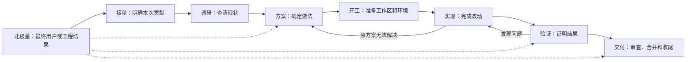

# Peers-Touch 规范研发流程

> **Status**: active
> **Created**: 2026-09-13 | **Updated**: 2026-10-13
> **Owner**: Platform Team

这份文档规定一个研发需求从提出到交付应该怎么做。开发者决定目标、范围和需要确认的事项，Agent 负责调研、实现、验证和整理交付材料。

## 北极星目标

北极星目标位于流程所有步骤的上游，不是第八个阶段，也不是任务状态。它说明最终
要改善的用户结果或工程结果，接单时把当前需求映射到它，方案、实现、验证和交付
始终用它判断有没有偏离。

本研发流程自身的北极星是：

> 在用户选择的既有 worktree 中，以尽量少的机械前置，把每个已授权需求持续转化为
> 当前源码上可验证的实际结果，同时不降低真实权限、数据和共享资源保护。

每项需求还要继承对应产品或工程领域的北极星。小改动直接引用已有产品、架构或用户
目标，不额外制造文档；非平凡产品工作如果无法说明目标用户、最终结果和本次贡献，
先回到 PRODUCT 阶段补齐，不能直接用功能清单或流程完成度代替。

整个过程按以下顺序推进：

每一步都要给下一步留下明确依据：北极星限定本次要改善的结果，任务目标决定调研
范围，调研结果支撑方案，方案限定实现范围，验证结果决定能否交付。小改动可以把
几步连续做完；复杂需求需要把方案和工作安排写下来。

本文是研发流程的唯一正文。编码细则见[编码规范](./coding-standards.md)和
[coding-guide](./coding-guide/)，流程工具的实现说明见[开发工作流目录](../architecture/engineering/development-workflow/README.md)。
规范、工具和 Gate 必须同步维护；文档生效或命令退出成功都不能单独证明流程合同。

## 1. 接单：先明确要解决什么

收到需求后，先确认它继承哪个产品或工程北极星、当前问题是什么、期望变成什么样、
这次贡献什么、做到哪里算完成。开发者已说明的内容直接沿用；只有缺失信息会影响
结果或导致改错地方时，才补问。流程不能把“创建了计划、跑完了步骤、测试数量增加”
当成北极星结果。

例如，“修复切换账号后看到上一账号消息”首先要明确账号切换后的消息隔离要求。“增加群管理”则要先明确哪些角色可以操作、支持哪些操作，以及被操作成员会看到什么结果。不能只凭功能名称开始写代码。

接着判断需要做到多深，依据是影响范围和是否需要新决策，不按文件数量判断：

- 小改动：沿用已确定的产品和架构规则，改动集中在局部。调研、简短修复说明、实现、自查和针对性验证可以连续完成，不另建正式计划，不要求任务登记和整套状态记录。
- 常规需求：改动涉及多个模块，或改变现有功能行为。先列清影响模块、实现顺序和验证场景；已有规则足够时，不重新设计整套架构。
- 复杂需求：新增用户操作流程，或改变模块职责、协议、存储、安全和发布方式。先确定产品和技术方案，再安排分步实施。

用户明确要求“不建 Plan”时，不创建计划文件、任务单或替代它们的记录。若现有规则无法决定关键行为，指出缺失的决定；不能为满足工具要求偷偷补一份计划。

这一步结束时，应能说清继承的北极星、本次贡献、完成标准、改动范围和工作区。
纯问答或只读排查可以在调研结果交付后结束，不进入编码流程。

## 2. 调研：让方案建立在实际情况上

目标明确后，先读相关产品和架构文档，再沿实际调用关系查代码。通过 [docs 入口](../README.md)和对应平台的 [Agent 入口](../.agent/)找到当前规则，并查阅管辖这些路径的[项目知识](../knowledge/README.md)。相关经验能帮助缩小排查范围，不能代替当前代码和运行结果。

修 Bug 时，先复现或找到足以定位问题的证据，确认问题出在哪一层、由哪个模块负责。桌面聊天、联系人和通知的状态问题，要先查负责维护状态的运行模块；不能用页面刷新掩盖更新链路断裂。

开发新功能时，先查已有接口、组件、SDK 和工具是否能复用，再检查依赖模块是否具备所需能力。外部案例只用于比较做法，不等于已经获准引入其实现，也不能据此改写本项目约束。本项目研发流程保持仓库内自包含。

调研结论要分清已确认的事实和仍待验证的判断。每个关键判断说明来源；拿不准的部分写明下一步如何验证，不把推测写成根因。

这一步结束时，应知道为什么要改、应该在哪一层改、会影响哪些调用方，以及还有哪些问题没有查清。调查发现的无关问题可以单独记录，不自动加入本次需求。

## 3. 方案：把做法和验收办法一起确定

根据调研结果确定改动方式，同时确定怎样验证它达到目标。方案必须说明具体行为、各模块负责什么、接口或数据如何变化，以及失败情况如何处理。不能只写“优化架构、完善测试、提升体验”。

小改动可以用一段说明交代问题原因、修复位置和验证方法。涉及产品或架构新决定的需求，要写入对应正式文档；复杂需求再按依赖顺序拆成可以分别验证的工作。

已有产品和架构文档只更新受本次改动影响的部分。界面变化需要原型确认时，复用项目已有原型库；原型用于确认外观和交互，不能作为功能已实现的证明。

Agent 先调用相关方法论和评审 Skill 检查方案。需要用户确认的产品、架构和实施方案，在确认后进入实现；例行自查、修正和重查由 Agent 完成，不反复把同一份方案交回用户。小改动按本次指令执行，不为了形式补出多轮审批。

已经授权的事项在原范围内继续执行。新发现的问题如果改变需求范围、产品行为或技术边界，应回到方案说明差异；只有需要新决定的事项才暂停等待。本地 commit 是流程内部检查点，已评审 Profile 覆盖其 capability 内的非 stable 开发环境操作；push、PR、合并、发布、历史改写、stable mutation、删除和 worktree 生命周期等独立操作，不能从“方案通过”中推导权限。

这一步结束时，做什么、为什么这样做、影响什么、怎样验证以及哪些操作已获授权都应明确。

## 4. 开工：准备正确的工作区和必要环境

方案确定后，核对当前 worktree、分支和已有改动，明确本次可以修改的路径。IDE 当前打开的文件、技能所在目录和终端默认目录都不能替代任务指定的工作区。

写报告或生成产物前，必须从本次选定 worktree 执行
`git rev-parse --show-toplevel` 确认归属。中间草稿、原始日志和一次性脚本写入
`/tmp/<repo>_<session>/`；面向用户且属于当前仓库任务的报告写入
`<selected-worktree>/.artifacts/reports/<report-name>/`；正式 Acceptance 证据只写入
外部 Evidence Store；长期有效的产品、架构和工程结论写入对应 `docs/`。
`.artifacts/` 是 gitignored 的本地交付区，不是正式证据。不得因 IDE 根目录顺序、
流程 Skill 来源或便利性，把产物写入另一个 worktree。

默认只读取和处理本次目标 worktree，不把目标外 worktree 的实现或报错作为当前事实。
只有用户明确要求跨分支比较、合并或冲突处理时，才读取指定的其他 worktree；
写文件、生成代码和提交始终留在本次指定工作区。已有的无关改动保留，不能清理、
覆盖或顺手提交。创建、切换或删除 worktree 必须有明确授权，不能用它绕过真实冲突。
其中创建 worktree 只能来自用户对“创建 worktree”这一动作的显式要求；
任务开始、计划存在、目标 worktree 有改动、并行冲突、验证需要或流程恢复都不能
被解释成创建授权。没有这句显式要求时，流程和 Agent 必须继续使用用户选定的
既有 worktree，或停下相关操作。

并行开发要分别检查源码和环境：不同 worktree、不同分支可以分别改代码；同一目录内改动相同文件需要协调。同一文件在不同分支都有改动，也要在合并时逐项判断，不能用一方覆盖另一方。

仅改代码时，不提前占用 Station、账号、设备或端口。需要运行验证时，选择已经评审的环境，核对目标主机、服务和数据范围；能复用的服务、客户端和登录状态优先复用。

Station 通过 `make profile <name>` 选择环境，并通过 `make station` 启动；Desktop 调试通过 `make desktop` 使用原生 Tauri 应用。不要直接运行 Station 二进制，也不要把桌面验证改成浏览器验证。

worktree 的源码隔离不等于环境隔离。两个工作区可以共享连接同一 Station，但部署、重启、重置数据或独占设备前必须检查实际占用和操作影响。真实资源冲突只影响依赖该资源的工作；其他可以独立完成的部分继续推进。旧任务记录异常本身不能证明当前有资源冲突。

已有已评审 Profile 本身就是开发环境操作依据。名称不以 `stable` 结尾的 Profile，
Agent 可以按任务需要自动选择、注册、创建运行实例、部署、重启和执行精确范围重置，
无需逐项再次询问。`make profile-init` 可以创建当前 worktree 的本地开发 Profile。
这些操作仍必须通过 Profile capability、目标或数据范围、当前源码身份和真实资源锁。
名称以 `stable` 结尾的 Profile 保留保护，Agent 不得自主重置，其他运行变更也必须有
用户明确指令。不得虚构主机、凭据或用脏的远端环境定义绕过 Profile。

Profile 授权的 source sync 可以更新内部部署传输仓库中的专用 ref，以便远端取得
当前 checkpoint；这不是向协作远端发布分支，也不是阶段性交付。向 origin/GitHub
等协作远端 push、改写协作历史或创建 PR 仍按各自授权处理。

发生真实资源竞争时，Agent 先依据当前锁、进程、目标和任务事实复用、串行等待或选择
不冲突资源。只有无法安全判断归属或无法自行消解竞争时，才请用户协调。

这一步结束时，工作区正确、已有改动已分清、需要的环境可用，运行验证所需的日志和观察位置已准备好。不需要运行环境的任务，只检查工作区和修改范围。

## 5. 实现：按约定完成改动

实现按依赖关系推进。涉及共享数据和跨应用通信时，先修改 `model/domain/` 中的 Proto，再按规定生成并接通服务和客户端；不手改生成代码、不另建同义模型。

编码前使用 `pt-read-before-edit` 查相关知识，小改动使用 `pt-small-fix-discipline`；涉及架构或模块职责时使用对应方法论 Skill。Skill 按问题选用，不以建立任务登记、OWNER 回执或正式计划为使用编码标准的条件。

代码遵守当前平台规范，包括模块边界、错误处理、日志和 i18n。不得用未经许可的假接口代替前后端联调，不硬编码凭据，不把调试语句和临时资料留在源码中。

修复应落在负责该问题的模块，同时更新受影响的调用方。结构调整要检查并处理被替换的旧路径、无用引用和重复实现，并同步修改对应文档。必要改动做完整，无关清理不夹带。

每完成一段可检查的改动，先做针对性检查，再接下一段。遇到原方案无法解释的问题，返回调研或方案补清依据；不能不断在症状旁边加补丁。

本地 commit 可以在任何有用的完整边界形成 checkpoint，用于追踪、回滚、合并或让
远端运行时取得 exact source；不要求先完成 Journey 或 Acceptance。checkpoint 只说明
这组源码可寻址，不表示验证通过、任务完成或已经交付。每次只暂存本任务文件，并在
提交前完成适合该 checkpoint 的源码检查与敏感信息检查。

开发中的例行检查、评审和修改继续自动推进。只有范围变更、新授权或关键决定缺失才需要用户介入。辅助提示、任务记录或 IDE Hook 出错，要报告工具故障，不能据此认定产品开发必须停止；实际权限不足或资源冲突仍需处理。

这一步结束时，约定范围的代码和文档已完成，相关调用方已接通，并经过源码检查。此时只能报告“实现完成，待运行验证”，不能据此说功能已经修好。纯文档等不涉及运行行为的任务，按对应内容和格式要求检查。

## 6. 验证：拿结果证明需求已经满足

验证从方案中的完成标准开始。先做与改动有关的类型、编译、单元和接口检查，再在对应运行环境执行真实操作。测试数量多、构建通过或命令退出码为零，都不能单独证明用户功能可用。

Agent 先自己验证，不把首次试用交给开发者。修 Bug 要重新执行原复现场景；涉及聊天或联邦投递时，要从接收方确认结果；涉及持久化、账号切换或恢复时，要验证重新进入后的状态。

验证使用本次修改的源码和实际运行产物。源码变化使已有结果失效时，重跑受影响的场景，不能借另一分支、旧构建或旧截图证明当前结果。

真实功能先跑通，再执行规定的正式验收。场景按改动涉及的行为、失败情况和风险选择；小改动也要证明正确，但不扩展成与本次需求无关的全平台测试。正式验收未执行时，不能把开发自测当作正式验收通过。

### Route Acceptance work by ownership

Acceptance 先按责任路由：业务 Domain 的 Feature、Capability、Journey、Fixture 与
Gate 注入由 `pt-acceptance-engineering` 负责；通用 runner、证据、schema、runtime
与 framework 工具由 `pt-acceptance-infra-engineering` 负责。Infra 发现缺少业务
注入时返回 `BUSINESS_INJECTION_REQUIRED`，不能替业务补造 PASS、mock 或降低断言。
Business Gate `FAILED`, `BLOCKED`, or `UNPROVEN` does not block
Acceptance Infra 自身的独立修复与自验证；同样，Infra 结构通过也不证明业务能力。

验证失败就定位失败步骤，返回实现修复并重验。环境、权限或设备缺失时，说清无法验证的范围，并继续不依赖它的工作；不能把“未运行”写成“通过”。

Agent 不得自发伪造、补写、重标或选择性隐藏测试结果、现场观察、评审 findings、
授权和 Acceptance evidence。缺失或过期证据保持未验证；内部协作流程不为此增加
签名、HMAC 或 reviewer receipt 链。

结果至少说明测试了哪个工作区和源码、在哪个环境执行、做了什么操作、期望与实际结果，以及日志或截图等证据位置。编码审查使用相应项目 Skill，发现问题后修正并重查。

Agent 验证后，再按本次约定交给开发者亲自验证。若约定了亲自验证前不提 PR，就必须等这一步完成；人工确认和 Agent 自验不能互相代替。未完成所需验证时，可以报告真实进度、失败或阻塞，但不能把 checkpoint 或运行中的候选结果包装成阶段性交付。

这一步结束时，已实现、已通过、未验证和仍失败的内容应分开列清。只有实际验证覆盖了本次完成标准，才能报告相应功能通过。

## 7. 交付：让结果可审查，并完成收尾

所需验证和 Acceptance 通过后，才整理阶段性交付：实际改动、原因、验证结果和剩余
限制。此前形成的 checkpoint commit 不需要重做，也不能被描述成已经验收。若最终
源码在验证后又变化，受影响证据失效，必须重验后再交付。

交付范围仅包含本次工作。禁止把无关脏改动一起提交，也不能把本地 checkpoint 权限
扩成 amend、rebase 或历史改写。push、创建 PR、合并、发布和历史改写仍分别按已有授权
执行，没有授权时不自动推进。PR 写明最终变化和证据，检查目标分支，并跟进 CI 与评审
问题直至处理完成。

审查结果和操作权限分别确认。评审通过说明改动具备交付条件；只有合并或发布获得授权后，才能执行对应操作。Git 冲突逐项理解和合并，不能直接覆盖一方。

收尾时处理本次启动的进程、临时文件和占用资源，不关闭其他任务的服务。需要保留供用户测试的环境，说明位置和使用方式；长期可复用的环境不因一个需求结束而自动删除。记录到期或关闭回执存在，都不能代替检查实际资源是否已释放。

最终交付说明保持简短：完成了什么、验证了什么、还有什么未完成，以及代码或文档位置。跨会话续作保存足以恢复的范围、进度、证据和待办，不用聊天摘要代替当前源码和实际运行状态。

这一步结束时，交付结果、验证证据、合并或发布状态以及资源去向均应明确。取消或暂时无法完成的需求也要交代已做部分和收尾结果，不能标成全部完成。

## 流程工具的边界与旧规则处理

上述步骤定义研发要求，工具负责帮助执行这些要求。本项目保留自己的流程、方法论 Skill 和编码标准，不依赖外部流程引擎。不新增快任务专用的 Make 入口，优先在现有能力上简化。

重构时必须解除以下通用前置依赖，替换相应工具和 Skill 中的旧要求：

- 把首次修改前的任务登记作为统一门槛；小改动按正文执行，不要求登记。
- 把 IDE Hook 的 OWNER 回执作为开工条件；缺少宿主身份或没有加载新 Hook，不能成为正常研发停工的理由。
- 把正式计划挂载及其任务、会话和快照记录作为通用执行框架；正式计划按需使用，编码标准和局部改动不依赖它。
- 因一条旧任务关闭记录异常，就阻止该 worktree 的全部新工作；应检查是否涉及当前修改路径或实际资源。
- 把多份状态记录相互一致当作工作进度和验证结果的必要证明；结论依据本次代码、实际操作和相应证据，辅助记录用于追踪。

这些规则撤下，不撤销工作区范围、实际权限、共享资源保护、当前源码验证和交付审查。任务记录用于恢复进度，不能替代授权；操作系统中的进程和监听端口能说明本机实际占用，也不能单独证明远端环境安全。

Hook 只补充规范、相关知识和状态提醒。Hook 不可用时，Agent 仍须直接读取项目文档和相关 Skill；不能要求开发者先修好 Hook 才继续正常研发。真正的权限拒绝、数据保护和资源独占检查仍应由对应操作入口执行，不能靠关闭 Hook 绕过。

普通工作、审查、状态和运行准入已不依赖 `dev-start`、`dev-check`、OWNER、
PlanMount、Session、active-work 或全工作区关闭回执。复杂任务按需使用
`.dev-workflow/tasks/<taskId>`；旧机器记录只保留历史，不参与新流程准入。
任何清理仍需精确路径与授权，不能手改机器记录或释放其他任务资源。

<!-- Already-authorized operations execute directly. -->
<!-- Existing doctor markers are diagnostic references, not universal admission gates. -->
<!-- workflow-doctor:dev.integration.installed -->
<!-- workflow-doctor:dev.plan.mount -->
<!-- workflow-doctor:dev.workflow.current -->
<!-- workflow-doctor:dev.review.current -->
<!-- workflow-doctor:dev.docs.executable -->
